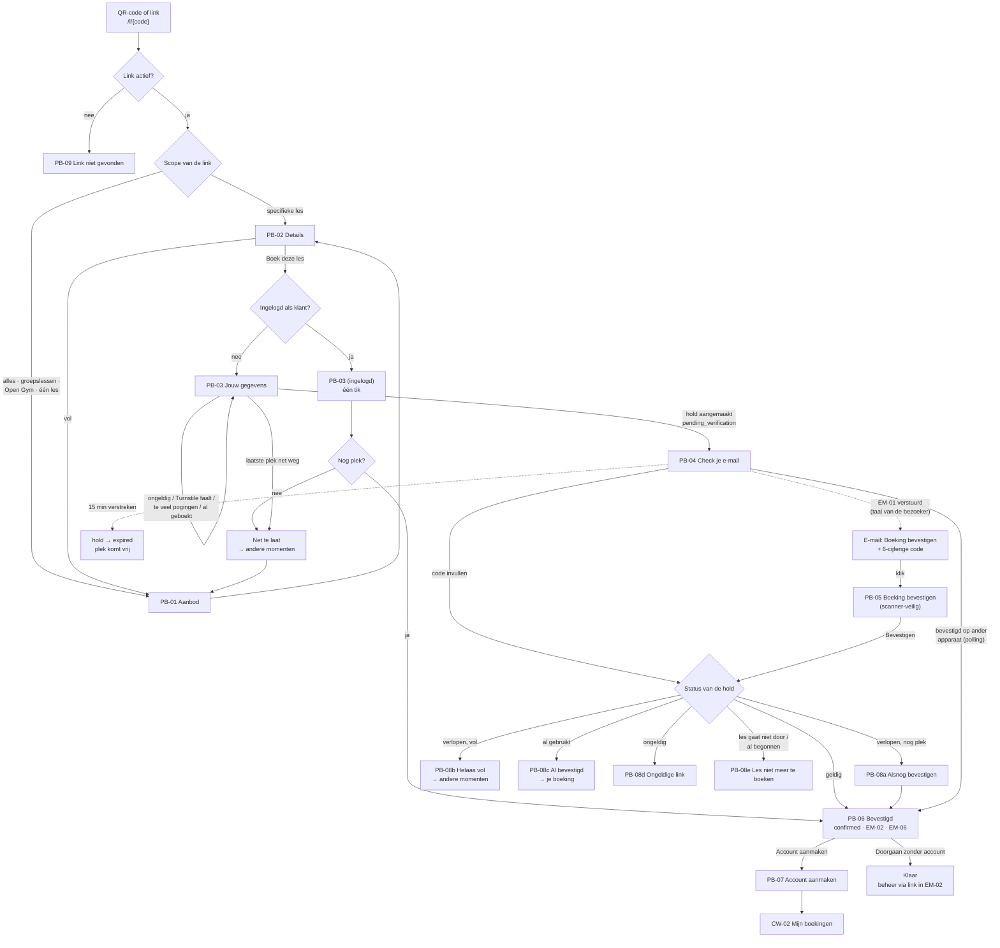

# Flow 01: Public booking on a phone

**QR → class → name/email → verify → confirmed → optional account**

| | |
|---|---|
| **Actors** | Guest (first booking), returning client (with or without account); assigned trainer (receives the notification) |
| **Surface** | Public booking web + client web, **phone first** (iOS Safari, Android Chrome); works on desktop |
| **Milestone** | M5 (group classes), M6 (Open Gym, link scopes, QR) |
| **Spec** | `PRODUCT.md §2.3, §2.4, §3, §21–§27, §30, §32, §33, §51`; `ROADMAP.md M5, M6, R1, R3, R5` |
| **Why critical** | It's the client's whole experience of the product, and the pilot's key metric: ≥ 70 % started → confirmed, median time to verify < 5 min (`ROADMAP §8`) |

## Features

| ID | Feature | Where in this flow |
|---|---|---|
| F027 | Public Booking Page | PB-01, PB-02 |
| F028 | Booking Capacity | Availability on PB-01/02; the "just missed it" error on PB-03 |
| F029 | Booking Hold | PB-03 → PB-04; expiry; PB-08 |
| F030 | Magic-Link Verification | EM-01, PB-04 (code), PB-05, PB-08 |
| F031 | Guest Booking | PB-03, PB-06, `/manage/{token}` |
| F032 | Optional Account Creation | PB-06, PB-07 |
| F033 | Client Booking Dashboard | CW-01 – CW-04 |
| F035 | Open Gym Public Booking | Open Gym items on PB-01/02 (same flow) |
| F037 | Booking Links | Entry scopes; PB-09 |
| F038 | QR Codes | Entry point |
| F010 | Locale Preference | `NL \| EN` on every screen; language stored on the hold |
| F049 | Localized Transactional Emails | EM-01, EM-02, EM-03 |
| F050 | Trainer Booking Notifications | EM-06, EM-07 |
| F026 | Cancellations | CW-03 |
| E013 | Public surface security | Turnstile, rate limits, hold cap on PB-03 |

## Flow diagram



## Screens

### PB-01 · Aanbod / Booking page

**Features:** F027, F028, F035, F037, F010 · **Reached from:** QR code, booking link, *Nog een les boeken*

```text
┌────────────────────────────────────────┐
│ John's Gym                     NL | EN │
├────────────────────────────────────────┤
│ Boek een les                           │
│                                        │
│ ● Alles   ○ Groepslessen   ○ Open Gym  │
│                                        │
│ VANDAAG · DINSDAG 22 SEPTEMBER         │
│────────────────────────────────────────│
│ 18:00–19:00   Strength              ›  │
│ Trainer: Sarah                         │
│ 3 plekken beschikbaar                  │
│────────────────────────────────────────│
│ 19:15–20:00   Boxing                ›  │
│ Trainer: Mike                          │
│ Vol                                    │
│                                        │
│ MORGEN · WOENSDAG 23 SEPTEMBER         │
│────────────────────────────────────────│
│ 10:00–11:00   Open Gym              ›  │
│ Nog 1 plek                             │
│────────────────────────────────────────│
│ 18:00–19:00   Strength              ›  │
│ Trainer: Sarah                         │
│ 8 plekken beschikbaar                  │
│                                        │
│ [ Meer dagen tonen ]                   │
│                                        │
│ Tijden in Nederlandse tijd.            │
│ Privacy · Voorwaarden                  │
└────────────────────────────────────────┘
```

- Grouped by day, in the workspace timezone. Shows the next **14 days** ⚑ [Q07](../open-questions.md#q07); *Meer dagen tonen* loads 14 more.
- **Date strip (added 23 September 2026 after prototype feedback):** above the list, a horizontally scrolling strip of the next **21 days** (weekday, date, month on the first chip and on the 1st). Each day shows one dot per class (at most three), today included, as in the app Agenda; today's chip reads *Vandaag* instead of the weekday. Days without bookable items are dimmed but tappable. Tapping a day shows only that day, with *Volgende: {day}* to jump to the next day that has something. On first open the strip selects today, or the first day with something to book. The prototype uses this pattern; validate with P-K whether clients prefer the strip or the long list.
- The segmented filter appears only for the *All bookings* scope, and only for types that have upcoming items. For the *class* scope the title becomes the class name ("Strength") and the filter is hidden.
- A class card shows the class description as one truncated line, as entered (PB-02). A group class without a trainer shows *Trainer volgt nog*, also on PB-02 and the confirmation; Open Gym has no trainer line.
- The location line appears only when the workspace has more than one location.
- **Availability** counts confirmed bookings **and** active holds against capacity (F028). When every remaining spot is held but not confirmed, the card says *Alle plekken zijn gereserveerd* instead of *Vol*, because a spot may free up within 15 minutes.
- Classes that have started are hidden. Cancelled occurrences are shown as *Gaat niet door* for the rest of that day, so a client who saw the poster isn't confused, and they can't be tapped.
- *Tijden in Nederlandse tijd* shows only when the browser timezone differs from the workspace's.

| Element | NL | EN |
|---|---|---|
| Page title (all / classes / Open Gym) | Boek een les · Groepslessen · Open Gym | Book a class · Group classes · Open Gym |
| Filter | Alles · Groepslessen · Open Gym | All · Group classes · Open Gym |
| Day header | Vandaag · dinsdag 22 september / Morgen · … / woensdag 23 september | Today · Tuesday 22 September / Tomorrow · … |
| Date strip | Kies een dag · Vandaag · Op deze dag is er niets te boeken. · Volgende: {day} | Choose a day · Today · Nothing to book on this day. · Next: {day} |
| Trainer line | Trainer: Sarah · Trainer volgt nog | Trainer: Sarah · Trainer to be confirmed |
| Availability | `{n, plural, one {Nog 1 plek} other {# plekken beschikbaar}}` | `{n, plural, one {1 spot left} other {# spots available}}` |
| Full | Vol | Full |
| All held | Alle plekken zijn gereserveerd | All spots are reserved |
| Cancelled | Gaat niet door | Cancelled |
| Load more | Meer dagen tonen | Show more days |
| Timezone hint | Tijden in Nederlandse tijd. | Times shown in Amsterdam time. |
| Footer | Privacy · Voorwaarden | Privacy · Terms |

**States**

| State | Behaviour | NL | EN |
|---|---|---|---|
| Loading | Server-rendered; no skeleton on first load. *Meer dagen tonen* shows 3 skeleton rows | — | — |
| Empty (nothing in 14 days) | Message + load-more stays available | Er staan de komende 14 dagen geen lessen gepland. Kijk later nog eens. | There are no classes in the next 14 days. Check back later. |
| Empty (Open Gym scope) | | Er is de komende 14 dagen geen Open Gym gepland. | There's no Open Gym in the next 14 days. |
| Error | Full-page message with retry | De pagina kon niet laden. [ Opnieuw proberen ] | The page couldn't load. [ Try again ] |

### PB-02 · Details van de les / Class details

**Features:** F027, F028, F035

```text
┌────────────────────────────────────────┐
│ ‹ Terug                        NL | EN │
├────────────────────────────────────────┤
│ Strength                               │
│                                        │
│ dinsdag 22 september 2026              │
│ 18:00–19:00                            │
│ Trainer: Sarah                         │
│ John's Gym                             │
│ Kerkstraat 12, Amsterdam  ↗ Route      │
│                                        │
│ Kracht en conditie in een kleine       │
│ groep. Voor alle niveaus.              │
│                                        │
│ 3 plekken beschikbaar                  │
│                                        │
│                                        │
│                                        │
├────────────────────────────────────────┤
│ [       Boek deze les                ] │
└────────────────────────────────────────┘
```

- The description is **user content** from the class template and is shown as entered, in whatever language the owner typed it (`§3`).
- The primary button is sticky at the bottom (safe-area aware).
- Open Gym uses the same screen with the title *Open Gym*, no trainer line ⚑ [Q14](../open-questions.md#q14) and the button *Boek Open Gym*.

| Element | NL | EN |
|---|---|---|
| Back | Terug | Back |
| Route link | Route | Directions |
| Button (class / Open Gym) | Boek deze les · Boek Open Gym | Book this class · Book Open Gym |
| Full (button disabled) | Deze les is vol | This class is full |
| Full, alternatives | Andere momenten van Strength: | Other times for Strength: |
| All held | Alle plekken zijn nu gereserveerd. Er kan binnen 15 minuten een plek vrijkomen. | All spots are reserved right now. A spot may free up within 15 minutes. |

**States:** loading = skeleton of the text blocks; not found or past → PB-08e.

### PB-03 · Jouw gegevens / Your details

**Features:** F031, F029, F028, E013

```text
┌────────────────────────────────────────┐
│ ‹ Terug                        NL | EN │
├────────────────────────────────────────┤
│ Strength                               │
│ di 22 sep · 18:00–19:00 · Sarah        │
│────────────────────────────────────────│
│                                        │
│ Naam                                   │
│ [ Anna de Vries                      ] │
│                                        │
│ E-mailadres                            │
│ [ anna@exmaple.com                     ] │
│ Bedoel je anna@example.com?  [ Ja ]      │
│                                        │
│ Je krijgt een e-mail om je boeking te  │
│ bevestigen. We houden je plek 15       │
│ minuten voor je vast.                  │
│                                        │
│ We gebruiken je naam en e-mailadres    │
│ alleen voor je boekingen bij John's    │
│ Gym. Privacyverklaring                 │
│                                        │
├────────────────────────────────────────┤
│ [          Boeken                    ] │
└────────────────────────────────────────┘
```

- Only **Naam** and **E-mailadres** (`§22`). No phone and no password (`§2.4`).
- Cloudflare Turnstile runs invisibly (E013). If it needs an interaction, its widget appears above the button, in the page language.
- The email typo hint ("Bedoel je …?") covers common domains (gmail.com, hotmail.com/.nl, outlook.com, live.nl, ziggo.nl, kpnmail.nl, icloud.com). It never blocks submitting.
- Submitting creates the hold (`pending_verification`), stores the **page language** on it, sends EM-01 and goes to PB-04.

**Signed-in variant** (a client with an account and a valid session):

```text
│ Boeken als                             │
│ Anna de Vries · anna@example.com         │
│ Niet jij? Uitloggen                    │
├────────────────────────────────────────┤
│ [          Boeken                    ] │
```

A signed-in client has already verified their email, so tapping *Boeken* confirms directly (→ PB-06 without the account prompt). There's no hold and no email round-trip ⚑ [QE06](../open-questions.md#qe06).

| Element | NL | EN |
|---|---|---|
| Labels | Naam · E-mailadres | Name · Email |
| Typo hint | Bedoel je {suggestion}? [ Ja ] | Did you mean {suggestion}? [ Yes ] |
| Explainer | Je krijgt een e-mail om je boeking te bevestigen. We houden je plek 15 minuten voor je vast. | We'll email you to confirm your booking. We'll hold your spot for 15 minutes. |
| Privacy line | We gebruiken je naam en e-mailadres alleen voor je boekingen bij {workspace}. Privacyverklaring | We only use your name and email for your bookings at {workspace}. Privacy statement |
| Button | Boeken | Book |
| Signed in | Boeken als · Niet jij? Uitloggen | Booking as · Not you? Sign out |

**Validation and errors** (inline, linked to the field, focus moves to the first error)

| Case | NL | EN |
|---|---|---|
| Name empty | Vul je naam in. | Enter your name. |
| Email empty / invalid | Vul een geldig e-mailadres in, bijvoorbeeld naam@example.com. | Enter a valid email address, like name@example.com. |
| Last spot just taken (race, F028) | Net te laat: de laatste plek is zojuist geboekt. [ Andere momenten bekijken ] | Just missed it: the last spot was just booked. [ See other times ] |
| This email already has a confirmed booking for this class | Je hebt deze les al geboekt. We hebben je de bevestiging opnieuw gestuurd. | You've already booked this class. We've sent you the confirmation again. |
| This email already has an active hold for this class | Je plek is al vastgehouden. Check je e-mail om te bevestigen. [ Naar bevestigen ] | Your spot is already on hold. Check your email to confirm. [ Go to confirm ] |
| Too many active holds for this email (E013 cap) | Je hebt al een paar boekingen die nog niet bevestigd zijn. Bevestig die eerst via je e-mail. | You already have a few bookings waiting for confirmation. Please confirm those first from your email. |
| Rate limit (IP/email) | Te veel pogingen. Probeer het over een paar minuten opnieuw. | Too many attempts. Try again in a few minutes. |
| Turnstile failed | We konden niet controleren of je een mens bent. Probeer het opnieuw. | We couldn't check that you're human. Please try again. |
| Class started meanwhile | Deze les is al begonnen en kan niet meer geboekt worden. | This class has already started and can't be booked any more. |
| Save error (network/server) | Boeken is niet gelukt. Je gegevens staan er nog. Probeer het opnieuw. | Booking didn't work. Your details are still here. Please try again. |

### PB-04 · Check je e-mail / Check your email

**Features:** F029, F030

```text
┌────────────────────────────────────────┐
│ John's Gym                     NL | EN │
├────────────────────────────────────────┤
│                                        │
│ Check je e-mail                        │
│                                        │
│ We hebben een e-mail gestuurd naar     │
│ anna@example.com. Tik op de knop in de   │
│ e-mail om je boeking te bevestigen.    │
│                                        │
│ Strength · di 22 sep · 18:00           │
│ Je plek is vastgehouden tot 14:20      │
│ (nog 15 min).                          │
│────────────────────────────────────────│
│ Of vul de code uit de e-mail in:       │
│ [ ______ ]            [ Bevestigen ]   │
│────────────────────────────────────────│
│                                        │
│ Geen e-mail gekregen?                  │
│ Kijk ook in je spam of ongewenste mail.│
│ [ Opnieuw sturen ]                     │
│ [ Ander e-mailadres gebruiken ]        │
│                                        │
└────────────────────────────────────────┘
```

- The page **polls** the hold status. If the booking is confirmed anywhere (the link opened in another browser, on a laptop …), this page moves on to PB-06 by itself.
- The **6-digit code** covers in-app browsers, emails read on another device, and link scanners (R1). It's one numeric field (`autocomplete="one-time-code"`, `inputmode="numeric"`), not six boxes, and it accepts pasted `482 913` with a space ⚑ [Q13](../open-questions.md#q13).
- The countdown uses server time. It updates every minute and is announced to screen readers only at 5 and 1 minutes left.
- Hold end = **the earlier of** *now + 15 min* and *class start* ⚑ [Q10](../open-questions.md#q10).
- *Opnieuw sturen* has a 60-second cooldown and sends the **same** hold's link with a fresh code. It doesn't extend the hold.
- *Ander e-mailadres gebruiken* opens an inline form on PB-04. It keeps the same hold, spot and countdown; there is no second spot.
- Submitting a valid address sends a new link to it. The earlier link stops working, and PB-04 says so.
- In the prototype, demo-only controls (open the email, let the hold expire) sit in their own *Alleen in de demo* group, apart from the real actions.

| Element | NL | EN |
|---|---|---|
| Title | Check je e-mail | Check your email |
| Body | We hebben een e-mail gestuurd naar {email}. Tik op de knop in de e-mail om je boeking te bevestigen. | We've sent an email to {email}. Tap the button in the email to confirm your booking. |
| Hold | Je plek is vastgehouden tot {time} (nog {minutes} min). | We're holding your spot until {time} ({minutes} min left). |
| Code | Of vul de code uit de e-mail in: · Bevestigen | Or enter the code from the email: · Confirm |
| Code wrong | Deze code klopt niet. Controleer de e-mail en probeer het opnieuw. | That code isn't right. Check the email and try again. |
| Too many code attempts | Te veel pogingen. Gebruik de knop in de e-mail. | Too many attempts. Use the button in the email. |
| No email | Geen e-mail gekregen? Kijk ook in je spam of ongewenste mail. | Didn't get the email? Check your spam or junk folder too. |
| Resend / cooldown / sent | Opnieuw sturen · Opnieuw sturen over {s} s · Verstuurd | Send again · Send again in {s}s · Sent |
| Change email | Ander e-mailadres gebruiken | Use a different email |
| Change form | Nieuw e-mailadres · Je plek blijft vastgehouden, de tijd loopt gewoon door. · Stuur nieuwe link | New email address · Your spot stays held; the timer keeps running. · Send new link |
| Email changed | We hebben een nieuwe link gestuurd naar {email}. De eerdere link werkt niet meer. | We sent a new link to {email}. The earlier link no longer works. |
| Expired while waiting | Je plek is niet meer vastgehouden. [ Opnieuw proberen ] | Your spot is no longer on hold. [ Try again ] |

### EM-01 · E-mail: Bevestig je boeking / Confirm your booking

**Features:** F030, F049 · **Language:** the one stored on the hold

```text
┌────────────────────────────────────────┐
│ Van: John's Gym via Trainer Hub        │
│ Onderwerp: Bevestig je boeking bij     │
│ John's Gym                             │
├────────────────────────────────────────┤
│ Hoi Anna,                              │
│                                        │
│ Bevestig je boeking voor:              │
│                                        │
│ Strength                               │
│ dinsdag 22 september 2026, 18:00–19:00 │
│ John's Gym · Trainer: Sarah            │
│                                        │
│ [      Boeking bevestigen          ]   │
│                                        │
│ Of vul deze code in: 482 913           │
│                                        │
│ We houden je plek vast tot 14:20.      │
│                                        │
│ Heb je niet geboekt? Dan kun je deze   │
│ e-mail negeren.                        │
└────────────────────────────────────────┘
```

| Element | NL | EN |
|---|---|---|
| Subject | Bevestig je boeking bij {workspace} | Confirm your booking at {workspace} |
| Greeting | Hoi {firstName}, | Hi {firstName}, |
| Intro | Bevestig je boeking voor: | Please confirm your booking for: |
| Button | Boeking bevestigen | Confirm booking |
| Code | Of vul deze code in: {code} | Or enter this code: {code} |
| Hold | We houden je plek vast tot {time}. | We're holding your spot until {time}. |
| Not you | Heb je niet geboekt? Dan kun je deze e-mail negeren. | Didn't book this? You can ignore this email. |

### PB-05 · Boeking bevestigen / Confirm booking

**Features:** F030 · **Reached from:** the button in EM-01

```text
┌────────────────────────────────────────┐
│ John's Gym                     NL | EN │
├────────────────────────────────────────┤
│                                        │
│ Bevestig je boeking                    │
│                                        │
│ Strength                               │
│ dinsdag 22 september 2026              │
│ 18:00–19:00 · Trainer: Sarah           │
│ Anna de Vries · anna@example.com         │
│                                        │
│ [       Boeking bevestigen           ] │
│                                        │
└────────────────────────────────────────┘
```

- One tap. The **GET** request never confirms; only the button (POST) does. That way mail scanners such as Outlook Safe Links can't consume the link or confirm for the client (`ROADMAP M2`, R1).
- The page opens in whatever language is stored on the hold, even if this browser's language differs. The `NL | EN` switch still works.

| Element | NL | EN |
|---|---|---|
| Title | Bevestig je boeking | Confirm your booking |
| Button | Boeking bevestigen | Confirm booking |

### PB-06 · Boeking bevestigd / Booking confirmed

**Features:** F031, F032, F050 (EM-06 is sent to the trainer), F049 (EM-02 to the client)

```text
┌────────────────────────────────────────┐
│ John's Gym                     NL | EN │
├────────────────────────────────────────┤
│ ✓                                      │
│ Je boeking is bevestigd.               │
│                                        │
│ Strength                               │
│ dinsdag 22 september 2026              │
│ 18:00–19:00 · Trainer: Sarah           │
│ John's Gym, Kerkstraat 12              │
│                                        │
│ [ Zet in je agenda ]                   │
│ Je krijgt ook een bevestiging per      │
│ e-mail.                                │
│                                        │
│ [ Beheer je boeking                › ] │
│ Deze link staat ook in je              │
│ bevestigingsmail.                      │
│────────────────────────────────────────│
│ Wil je een account aanmaken?           │
│ Dan zie je al je boekingen op één plek │
│ en boek je de volgende keer met één    │
│ tik.                                   │
│                                        │
│ [       Account aanmaken             ] │
│ [    Doorgaan zonder account         ] │
└────────────────────────────────────────┘
```

- The headline, question and button texts are taken literally from `§26`.
- The account prompt doesn't show if the client already has an account (they only see *Naar mijn boekingen*).
- *Zet in je agenda* downloads a single-event `.ics` ⚑ [Q15](../open-questions.md#q15).
- *Beheer je boeking* opens CW-03 for this booking. It replaces the earlier passive sentence about cancelling via the email. In production the same link is in the confirmation email (`/manage/{token}`).
- *Doorgaan zonder account* collapses the prompt into: *Klaar. Je kunt je boeking beheren via de link in de bevestigingsmail.* + *Beheer je boeking* + *Nog een les boeken*.

| Element | NL | EN |
|---|---|---|
| Headline | Je boeking is bevestigd. | Your booking is confirmed. |
| Add to calendar | Zet in je agenda | Add to calendar |
| Email note | Je krijgt ook een bevestiging per e-mail. | We've also sent you a confirmation email. |
| Manage | Beheer je boeking · Deze link staat ook in je bevestigingsmail. | Manage booking · This link is also in your confirmation email. |
| Account question | Wil je een account aanmaken? | Would you like to create an account? |
| Account benefit | Dan zie je al je boekingen op één plek en boek je de volgende keer met één tik. | You'll see all your bookings in one place and book with one tap next time. |
| Buttons | Account aanmaken · Doorgaan zonder account | Create account · Continue without account |
| After "without" | Klaar. Je kunt je boeking beheren via de link in de bevestigingsmail. | All set. You can manage your booking from the link in the confirmation email. |
| More | Nog een les boeken | Book another class |
| Has account | Naar mijn boekingen | Go to my bookings |

### PB-07 · Account aanmaken / Create account

**Features:** F032, F001

```text
┌────────────────────────────────────────┐
│ ‹ Terug                        NL | EN │
├────────────────────────────────────────┤
│ Account aanmaken                       │
│                                        │
│ Naam                                   │
│ [ Anna de Vries                      ] │
│                                        │
│ E-mailadres                            │
│ anna@example.com  ✓ bevestigd            │
│                                        │
│ Taal                                   │
│ ● Nederlands   ○ English               │
│                                        │
│ Geen wachtwoord nodig: je logt in met  │
│ een link of code per e-mail.           │
│                                        │
│ Door een account aan te maken ga je    │
│ akkoord met de voorwaarden en de       │
│ privacyverklaring.                     │
├────────────────────────────────────────┤
│ [       Account aanmaken             ] │
└────────────────────────────────────────┘
```

- The email was just verified, so there's no second verification. The client is signed in straight away and lands on CW-02.
- The language defaults to the one used for the booking.

| Element | NL | EN |
|---|---|---|
| Title / button | Account aanmaken | Create account |
| Verified | bevestigd | verified |
| Language | Taal · Nederlands · English | Language · Nederlands · English |
| No password | Geen wachtwoord nodig: je logt in met een link of code per e-mail. | No password needed: you sign in with a link or code sent by email. |
| Terms | Door een account aan te maken ga je akkoord met de voorwaarden en de privacyverklaring. | By creating an account you agree to the terms and the privacy statement. |
| Success (toast on CW-02) | Je account is aangemaakt. | Your account has been created. |

### PB-08 · Linkproblemen / Link problems

**Features:** F029, F030. The same layout for every variant: an icon, a title, one sentence and one clear action.

```text
┌────────────────────────────────────────┐
│ John's Gym                     NL | EN │
├────────────────────────────────────────┤
│                                        │
│ Je link is verlopen                    │
│                                        │
│ We hebben je plek niet langer          │
│ vastgehouden, maar er is nog plek.     │
│                                        │
│ Strength · di 22 sep · 18:00           │
│                                        │
│ [       Alsnog bevestigen            ] │
│                                        │
└────────────────────────────────────────┘
```

| Variant | When | NL | EN | Action |
|---|---|---|---|---|
| **08a** Expired, still space | Hold expired, capacity available now | **Je link is verlopen.** We hebben je plek niet langer vastgehouden, maar er is nog plek. | **Your link has expired.** We stopped holding your spot, but there's still space. | *Alsnog bevestigen* / *Confirm anyway* → PB-06 ⚑ [Q12](../open-questions.md#q12) |
| **08b** Expired, full | Hold expired and the class filled up | **Helaas, deze les is inmiddels vol.** | **Sorry, this class is now full.** | *Andere momenten bekijken* / *See other times* → PB-01 |
| **08c** Already used | Token already consumed; booking confirmed | **Je boeking is al bevestigd.** | **Your booking is already confirmed.** | *Bekijk je boeking* / *View your booking* → CW-03 |
| **08d** Invalid | Unknown or tampered token | **Deze link werkt niet.** Controleer of je de hele link hebt geopend, of boek opnieuw. | **This link doesn't work.** Check you opened the full link, or book again. | *Naar het aanbod* / *See classes* → PB-01 |
| **08e** Not bookable | Occurrence cancelled or already started | **Deze les gaat niet door.** / **Deze les is al begonnen.** | **This class is cancelled.** / **This class has already started.** | *Andere momenten bekijken* / *See other times* |

### PB-09 · Boekingslink niet gevonden / Booking link not found

**Features:** F037

| Case | NL | EN | Action |
|---|---|---|---|
| Unknown code | **Deze boekingslink bestaat niet.** Controleer de link of vraag de gym om een nieuwe. | **This booking link doesn't exist.** Check the link or ask the gym for a new one. | none |
| Link deactivated by the owner, workspace known | **Deze boekingslink is niet meer actief.** | **This booking link is no longer active.** | *Bekijk alle lessen van {workspace}* / *See all classes at {workspace}* |

### Client web: CW-01 – CW-04

**Features:** F033, F026, F010, F006. The same header with `NL | EN` as the public pages.

```text
CW-01 Inloggen                            CW-02 Mijn boekingen
┌────────────────────────────────────────┐┌────────────────────────────────────────┐
│ Trainer Hub                    NL | EN ││ Mijn boekingen           NL | EN  ○ ☰  │
├────────────────────────────────────────┤├────────────────────────────────────────┤
│ Inloggen                               ││ ● Aankomend   ○ Eerder                 │
│                                        ││                                        │
│ E-mailadres                            ││ DINSDAG 22 SEPTEMBER                   │
│ [ anna@example.com                     ] ││────────────────────────────────────────│
│                                        ││ 18:00  Strength                     ›  │
│ [    Stuur me een inlogcode          ] ││ John's Gym · Bevestigd                 │
│                                        ││                                        │
│ Je krijgt een e-mail met een link en   ││ VRIJDAG 25 SEPTEMBER                   │
│ een code. Geen wachtwoord nodig.       ││────────────────────────────────────────│
│                                        ││ 10:00  Open Gym                     ›  │
│                                        ││ John's Gym · Bevestigd                 │
│                                        ││                                        │
│                                        ││ [ Nog een les boeken ]                 │
└────────────────────────────────────────┘└────────────────────────────────────────┘

CW-03 Boeking                             CW-04 Profiel
┌────────────────────────────────────────┐┌────────────────────────────────────────┐
│ ‹ Mijn boekingen               NL | EN ││ ‹ Mijn boekingen               NL | EN │
├────────────────────────────────────────┤├────────────────────────────────────────┤
│ Strength                               ││ Profiel                                │
│ dinsdag 22 september 2026              ││                                        │
│ 18:00–19:00 · Trainer: Sarah           ││ Naam                                   │
│ John's Gym, Kerkstraat 12  ↗ Route     ││ [ Anna de Vries                      ] │
│ Status: Bevestigd                      ││ E-mailadres                            │
│                                        ││ anna@example.com         [ Wijzigen ]    │
│ [ Zet in je agenda ]                   ││ Taal                                   │
│                                        ││ ● Nederlands   ○ English               │
│ [    Boeking annuleren               ] ││                                        │
│ Ander moment nodig? Annuleer deze      ││ [ Opslaan ]                            │
│ boeking en boek daarna een nieuwe.     ││────────────────────────────────────────│
│                                        ││ Uitloggen                              │
│                                        ││ Account verwijderen                    │
└────────────────────────────────────────┘└────────────────────────────────────────┘
```

- **CW-01** reuses the PB-04 pattern: *Check je e-mail* + code field. It never reveals whether an email has an account (*Als dit e-mailadres bij ons bekend is, krijg je een e-mail.*).
- **CW-02** *Eerder* lists past bookings with their final status (*Aanwezig*, *Niet verschenen*, *Geannuleerd*).
- **CW-03** for a guest without an account is the same screen reached via `/manage/{token}`, with *Account aanmaken* at the bottom instead of the back link. PB-06 links to it with *Beheer je boeking*.
- The prototype's guest manage screen leaves out *Account aanmaken*, because the confirmation (PB-06) already offers it.
- There is no modify action. One line under the actions explains how to change the time: cancel and book again.
- **Cancel** asks for confirmation. After cancelling, EM-03 goes to the client and EM-07 to the trainer, and the spot is freed. In MVP a client can cancel until the class starts ⚑ [Q09](../open-questions.md#q09).
- **Change email** sends a code to the new address; the change only happens after verification.
- **Account verwijderen** asks for confirmation and explains what happens to past bookings (retention policy from the M0 legal task).

| Element | NL | EN |
|---|---|---|
| Sign in button | Stuur me een inlogcode | Send me a sign-in code |
| Sign in note | Je krijgt een e-mail met een link en een code. Geen wachtwoord nodig. | We'll email you a link and a code. No password needed. |
| No enumeration | Als dit e-mailadres bij ons bekend is, krijg je zo een e-mail. | If this email address is known to us, you'll get an email shortly. |
| Tabs | Aankomend · Eerder | Upcoming · Past |
| Empty upcoming | Je hebt geen aankomende boekingen. [ Les boeken ] | You don't have any upcoming bookings. [ Book a class ] |
| Empty past | Nog geen eerdere boekingen. | No past bookings yet. |
| Cancel button | Boeking annuleren | Cancel booking |
| Cancel confirm | Weet je zeker dat je Strength op dinsdag 22 september om 18:00 wilt annuleren? Je plek gaat naar iemand anders. [ Annuleren ] [ Terug ] | Are you sure you want to cancel Strength on Tuesday 22 September at 18:00? Your spot will go to someone else. [ Cancel booking ] [ Back ] |
| Cancelled | Je boeking is geannuleerd. | Your booking has been cancelled. |
| Too late | Deze les is al begonnen. Annuleren kan niet meer. | This class has already started. It can't be cancelled any more. |
| Change hint | Ander moment nodig? Annuleer deze boeking en boek daarna een nieuwe. | Need a different time? Cancel this booking, then book a new one. |
| Profile | Profiel · Naam · E-mailadres · Wijzigen · Taal · Opslaan · Uitloggen · Account verwijderen | Profile · Name · Email · Change · Language · Save · Sign out · Delete account |

## Edge cases

| Case | Expected behaviour | Screen |
|---|---|---|
| **Two people, one spot** | The capacity check and the hold insert run in one transaction (F028, R3). The second person gets *Net te laat* with other times, not an error page | PB-03 |
| **Holds fill the class** | Capacity counts holds. Show *Alle plekken zijn gereserveerd* (not *Vol*), and hide the button until a hold expires | PB-01, PB-02 |
| **Hold expires while on PB-04** | The countdown hits 0 → *Je plek is niet meer vastgehouden* + retry. Clicking the link later → PB-08a/b | PB-04, PB-08 |
| **Booking close to the start** | Hold end = min(now + 15 min, class start). At the start time booking closes ⚑ [Q08](../open-questions.md#q08) | PB-03, PB-04 |
| **Link opened on another device or browser** | Confirmation works anywhere. The original PB-04 moves on through polling | PB-04, PB-05 |
| **Email link pre-clicked by a scanner** | GET shows PB-05 only; nothing is confirmed without the button | PB-05 |
| **Email never arrives** | Resend (cooldown 60 s), spam hint, change address. Support runbook "client didn't get the email" (`ROADMAP M9`) | PB-04 |
| **Typo in email** | Typo hint on PB-03. On PB-04, *Ander e-mailadres gebruiken* keeps the same hold and countdown, sends a new link and invalidates the earlier one | PB-03, PB-04 |
| **Wrong code** | Error text; after 5 wrong attempts the code is locked and only the link works | PB-04 |
| **Double booking with the same email** | Refused; the confirmation is re-sent | PB-03 |
| **Hold spam** (R5) | Turnstile + rate limit + a cap on active holds per email | PB-03 |
| **Class cancelled while a hold is pending** | The hold is cancelled; the link → PB-08e *Gaat niet door*. No EM-02 is sent | PB-08e |
| **Trainer substituted after booking** | The booking stays (`§19`). CW-03 shows the new trainer. No email by default ⚑ [Q36](../open-questions.md#q36) | CW-03 |
| **Language switched mid-flow** | Step and input are kept. The language at the moment of submitting PB-03 is stored and used for EM-01, EM-02 and all later emails | all |
| **Visitor abroad / other timezone** | All times in the workspace timezone + *Tijden in Nederlandse tijd* hint. Emails always use workspace time | PB-01, EM |
| **DST weekend** (25 oktober 2026) | A weekly 18:00 class shows 18:00 on both sides of the change. The `.ics` file carries the timezone (`TZID=Europe/Amsterdam`), not a floating time | PB-01, PB-06 |
| **Hold countdown with a wrong device clock** | The countdown uses server-provided remaining seconds | PB-04 |
| **Browser back from PB-04** | PB-03 shows *Je plek is al vastgehouden* + *Naar bevestigen*. Back never creates a second hold | PB-03 |
| **Shared device** (e.g. a tablet at the gym desk) | Name and email are **not** remembered for guests. A signed-in session shows *Niet jij? Uitloggen* | PB-03 |
| **Occurrence link for a past date** | PB-08e + *Andere momenten bekijken* for the same class | PB-08e |
| **JavaScript unavailable** | PB-01 – PB-03 and PB-05 work as server-rendered forms; only polling and the live countdown need JS | all |

## Platform notes (mobile web)

This flow runs in the phone's browser, not in the native apps. It still has to feel native on both platforms.

| Topic | iOS (Safari, in-app browsers) | Android (Chrome, in-app browsers) |
|---|---|---|
| QR entry | The camera app opens Safari. Links from Instagram/WhatsApp open an in-app browser (SFSafariViewController-like) | Google Lens/camera opens Chrome. In-app browsers use Custom Tabs |
| Email link | Opens in the default browser, often not the in-app one → PB-04 polling + code cover this | Same |
| Code autofill | `autocomplete="one-time-code"` lets iOS suggest the code from Mail (iOS 17+) | No email OTP autofill; make paste easy (accept spaces and dashes) |
| Keyboards | `type="email"`, `autocapitalize="off"`, `autocorrect="off"`; `inputmode="numeric"` for the code | Same attributes; Gboard respects them |
| Autofill | `autocomplete="name"` / `"email"` → contact AutoFill | Same → Google autofill |
| Sticky button | Respect `env(safe-area-inset-bottom)` for the home indicator; keep it above the keyboard (`visualViewport`) | Respect the gesture-nav inset; same keyboard handling |
| Back | Edge swipe = browser back → every step is a real history entry | System back / predictive back = browser back |
| Add to calendar | `.ics` opens the Calendar sheet directly | `.ics` download → opens in Google Calendar or the default calendar app (varies by device) |
| Route link | Open an Apple Maps URL | Open a Google Maps URL |
| Performance | LCP < 2.5 s on a mid-range phone on 4G (`ROADMAP M5`); PB-01/02 are server-rendered with minimal JS | Same |
| Accessibility | WCAG 2.2 AA; 44 px targets; VoiceOver reads availability as text | Same; TalkBack |

## Open questions

[Q07](../open-questions.md#q07) booking horizon · [Q08](../open-questions.md#q08) booking cut-off · [Q09](../open-questions.md#q09) client cancellation · [Q10](../open-questions.md#q10) hold length · [Q11](../open-questions.md#q11) show spot count and trainer · [Q12](../open-questions.md#q12) re-confirm after expiry · [Q13](../open-questions.md#q13) code on PB-04 · [Q14](../open-questions.md#q14) address, description, Open Gym trainer · [Q15](../open-questions.md#q15) add to calendar · [Q16](../open-questions.md#q16) value of a client account · [QE04](../open-questions.md#qe04)–[QE07](../open-questions.md#qe07)
