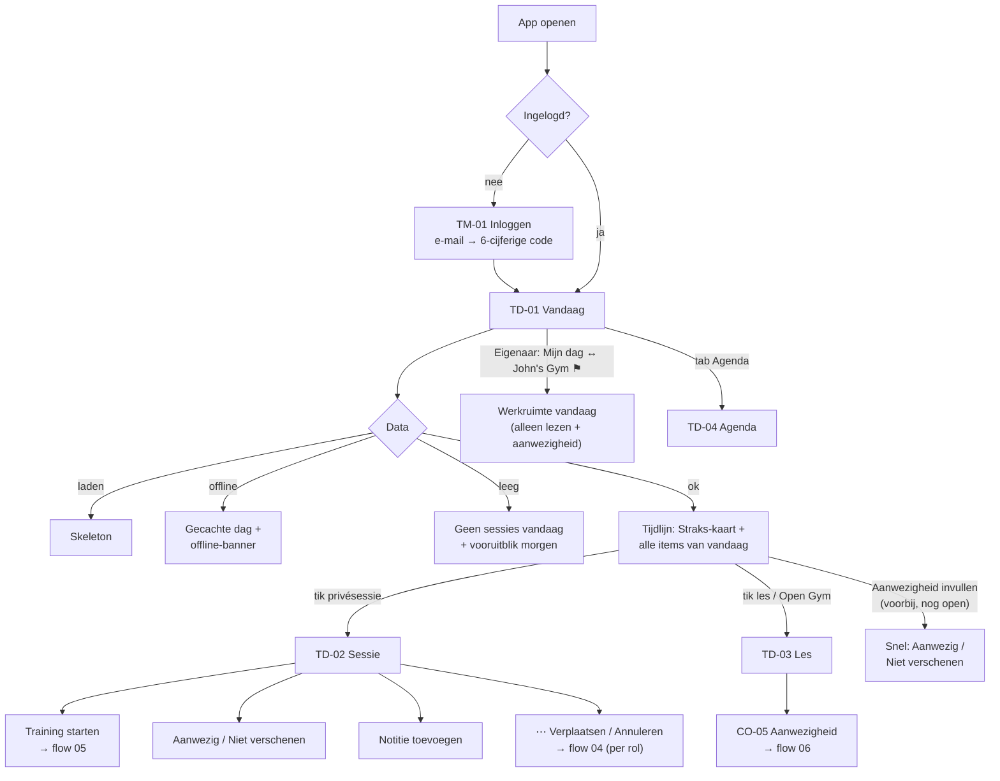

# Flow 02: Trainer "Vandaag" on mobile

**Open the app → see my day across all workspaces → open the next session → act (start workout, attendance, note)**

| | |
|---|---|
| **Actors** | Trainer (incl. an owner who also trains, like the pilot PT) |
| **Surface** | Trainer iOS app and trainer Android app (parity) |
| **Milestone** | M8 (API frozen at the end of M4 and M7) |
| **Spec** | `PRODUCT.md §4, §6, §15 (Trainer Mobile), §43, §46, §47, §78, §89`; `ROADMAP.md M8, R12, R15` |
| **Why critical** | It's the promise to trainers: "*Know where you need to be, who you're training, what they did last time and what you need to remember*" (`§89`). It's the screen trainers open most |

## Features

| ID | Feature | Where in this flow |
|---|---|---|
| F013 | Personal Trainer Calendar | TD-01 (today), TD-04 (Agenda tab) |
| F012 | Multi-Workspace Trainer | Workspace labels on every item |
| F020 | Private Sessions | TD-02 |
| F022 | Recurring Classes | TD-03 |
| F034 | Open Gym Slots | TD-03 (Open Gym variant) |
| F025 | Attendance | TD-02 quick attendance; TD-03 → CO-05 |
| F042 / F044 | Client Workouts / Previous Workout Display | TD-02 *Training* and *Vorige keer* |
| F043 | Live Workout Logging | *Training starten* → flow 05 |
| F046 / F047 / F048 | Client Notes / Session Notes / Note Visibility | TD-02 notes section |
| F024 | Trainer Substitution | *Je valt in* / *Overgenomen door* labels |
| F026 | Cancellations | Cancelled items on TD-01 |
| F010 | Locale Preference | All copy; *Profiel → Taal* |
| F006 | Client Profile | TM-02 *Klanten* tab, TM-03 profile, quick add in TD-05 |
| F021 / F022 / F034 | Group Class Templates / Recurring Classes / Open Gym Slots | TD-05 *Nieuw*: owner/admin create a class (optionally weekly) or Open Gym |

## Flow diagram



## Screens

### TD-01 · Vandaag / Today

**Features:** F013, F012, F025, F024, F026

```text
┌────────────────────────────────────────┐
│ Vandaag                              + │
│ dinsdag 22 september                   │
│ 5 sessies · 09:00–19:00                │
├────────────────────────────────────────┤
│ STRAKS · OVER 25 MIN                   │
│ 09:00–10:00  Anna                      │
│ Privésessie · TrainMore Zuid        ↗  │
│ Sarah Personal Training                │
│ Schema: Upper A                        │
│ [   Openen   ]   [ Training starten ]  │
├────────────────────────────────────────┤
│ 07:00–08:00  Mark                   ›  │
│ Privésessie · Basic-Fit Oost           │
│ Sarah Personal Training                │
│ ! Aanwezigheid nog invullen            │
│ [ Aanwezig ]  [ Niet verschenen ]      │
│────────────────────────────────────────│
│ 11:00–12:00  Lisa                   ›  │
│ Privésessie · John's Gym               │
│ John's Gym                             │
│────────────────────────────────────────│
│ 15:00–16:00  Strength               ›  │
│ Groepsles · 7/8 geboekt                │
│ John's Gym · Je valt in voor Mike      │
│────────────────────────────────────────│
│ 18:00–19:00  Strength               ›  │
│ Groepsles · Geannuleerd                │
│ John's Gym                             │
│────────────────────────────────────────│
│ Morgen: 3 sessies, eerste om 07:00     │
├────────────────────────────────────────┤
│  Vandaag    Agenda    Klanten  Profiel │
└────────────────────────────────────────┘
```

- **Order.** A *Straks* card on top (the next session that hasn't ended; *Nu bezig* while it runs), then **every** item of today in time order, including past ones. Past items are dimmed. The *Straks* item isn't repeated in the list.
- **Workspace label** (second line) appears only when the trainer is a member of more than one workspace (`§47`). Each workspace also gets a colour dot from the design tokens; colour is never the only signal.
- **Location** is always shown for private sessions (`§89`: "where you need to be"). `↗` opens Maps.
- **Past items without attendance** show *Aanwezigheid nog invullen* with two inline buttons for private sessions. Classes link to CO-05 ⚑ [Q18](../open-questions.md#q18).
- **Substitution** (F024): *Je valt in voor Mike* when I'm the substitute. When someone takes over *my* class, the item stays for today, dimmed, with *Overgenomen door Mike*, so I'm not surprised it's gone.
- **Cancelled** items stay visible and struck through, with the label *Geannuleerd*.
- **Overlapping sessions** are simply listed in order. Cross-workspace conflict warnings are Release 2.2 (`ROADMAP §9`), so there's no warning here.
- **+** opens *Nieuw* (TD-05): what the user's role may create.
- **Morgen** preview: one line with tomorrow's count and first start time; tapping it opens *Agenda* on tomorrow.

**Owner / Admin variant** ⚑ [Q01](../open-questions.md#q01): under the date there's a segmented control, *Mijn dag | John's Gym*. *John's Gym* shows the workspace's whole day (like WC-01), read-only except for attendance. Trainers without an Owner/Admin role never see the control.

| Element | NL | EN |
|---|---|---|
| Title | Vandaag | Today |
| Summary | `{count, plural, =0 {Geen sessies} one {# sessie} other {# sessies}}` · {first}–{last} | `{count, plural, =0 {No sessions} one {# session} other {# sessions}}` · {first}–{last} |
| Next up | Straks · over {minutes} min / Nu bezig | Up next · in {minutes} min / In progress |
| Types | Privésessie · Groepsles · Open Gym | Private session · Group class · Open Gym |
| Booked count | {booked}/{capacity} geboekt | {booked}/{capacity} booked |
| Buttons | Openen · Training starten | Open · Start workout |
| Attendance nudge | Aanwezigheid nog invullen | Attendance not recorded yet |
| Attendance | Aanwezig · Niet verschenen | Attended · No-show |
| Substitute (me) | Je valt in voor {name} | Covering for {name} |
| Taken over | Overgenomen door {name} | Taken over by {name} |
| Cancelled | Geannuleerd | Cancelled |
| Tomorrow | Morgen: `{count, plural, one {# sessie} other {# sessies}}`, eerste om {time} | Tomorrow: `{count, plural, one {# session} other {# sessions}}`, first at {time} |
| Owner toggle | Mijn dag · {workspace} | My day · {workspace} |
| Tabs | Vandaag · Agenda · Klanten · Profiel | Today · Calendar · Clients · Profile |

**States**

| State | Behaviour | NL | EN |
|---|---|---|---|
| Loading (first) | Header + 4 skeleton rows | — | — |
| Refresh | Pull to refresh; also refreshes when the app comes to the foreground | — | — |
| Empty | Friendly line + tomorrow preview + *+* | Geen sessies vandaag. | No sessions today. |
| Empty, nothing tomorrow either | | Geen sessies vandaag. Je volgende sessie is op {date}. | No sessions today. Your next session is on {date}. |
| Empty, nothing planned at all | | Je hebt nog geen sessies. Je ziet ze hier zodra je bent ingepland. | You don't have any sessions yet. They'll show up here once you're scheduled. |
| Offline | Banner + cached day; actions that need the server are disabled with a reason | Je bent offline. Laatst bijgewerkt om {time}. | You're offline. Last updated at {time}. |
| Error | Keep cached data; banner with retry | Vandaag kon niet worden bijgewerkt. [ Opnieuw ] | Couldn't update today. [ Retry ] |
| Removed from a workspace | That workspace's items disappear; one-time notice | Je hebt geen toegang meer tot {workspace}. | You no longer have access to {workspace}. |

### TD-02 · Sessie (privé) / Session (private)

**Features:** F020, F025, F042, F044, F046, F047, F048, F043

```text
┌────────────────────────────────────────┐
│ ‹ Vandaag                            ⋯ │
├────────────────────────────────────────┤
│ Anna de Vries                          │
│ dinsdag 22 september · 09:00–10:00     │
│ TrainMore Zuid                  ↗ Route│
│ Sarah Personal Training                │
│────────────────────────────────────────│
│ TRAINING                               │
│ Upper A · 5 oefeningen                 │
│ [        Training starten            ] │
│────────────────────────────────────────│
│ VORIGE KEER · DI 15 SEP                │
│ Bankdrukken   60 kg × 8, 8, 7          │
│ Cable row     45 kg × 10, 10, 10       │
│ Alles bekijken ›                       │
│────────────────────────────────────────│
│ NOTITIES · alleen voor trainers        │
│ "Linkerschouder gevoelig bij drukken." │
│ 8 sep · Sarah                          │
│ "Traint liever 's avonds."             │
│ 2 sep · Sarah                          │
│ [ + Notitie ]                          │
│────────────────────────────────────────│
│ AANWEZIGHEID                           │
│ ○ Geboekt  ○ Aanwezig  ○ Niet versch.  │
└────────────────────────────────────────┘
```

- **Order follows the trainer's questions** (`§89`): where and when → what we're doing → what they did last time → what to remember → attendance.
- **Training**: the assigned workout (F042). No workout → *Schema kiezen* / *Lege training* (flow 05, WL-01). A workout already in progress → *Doorgaan met training*. A finished one → *Training bekijken* + summary.
- **Vorige keer**: the client's last logged session in **this workspace** (tenant isolation). If there's none: *Nog geen eerdere training*.
- **Notes**: the latest 2–3 client notes (F046) and this session's note (F047). The visibility label is always visible. The default for new notes is *Alleen voor trainers* (`§37`). Notes are sensitive: they're never shown in notifications, widgets or the app switcher snapshot (see platform notes).
- **Attendance**: *Geboekt* until changed. The control is enabled from the session's start time. Before that it shows *Vanaf 09:00*.
- **⋯ menu**: *Verplaatsen*, *Annuleren* (flow 04; by role ⚑ [Q27](../open-questions.md#q27)), *Klantprofiel*.
- **Cancelled session**: a banner *Deze sessie is geannuleerd* on top; only notes stay editable.

| Element | NL | EN |
|---|---|---|
| Sections | Training · Vorige keer · Notities · Aanwezigheid | Workout · Last time · Notes · Attendance |
| Workout summary | {template} · `{n, plural, one {# oefening} other {# oefeningen}}` | {template} · `{n, plural, one {# exercise} other {# exercises}}` |
| Workout buttons | Training starten · Doorgaan met training · Training bekijken · Schema kiezen · Lege training | Start workout · Continue workout · View workout · Choose template · Empty workout |
| Last time header | Vorige keer · {date} | Last time · {date} |
| No history | Nog geen eerdere training | No previous workout yet |
| See all | Alles bekijken | See all |
| Notes visibility | alleen voor trainers · zichtbaar voor klant | trainer-only · visible to client |
| Add note | + Notitie | + Note |
| Attendance | Geboekt · Aanwezig · Niet verschenen | Booked · Attended · No-show |
| Not yet | Vanaf {time} | From {time} |
| Menu | Verplaatsen · Annuleren · Klantprofiel | Reschedule · Cancel · Client profile |
| Cancelled banner | Deze sessie is geannuleerd. | This session has been cancelled. |

**States:** loading = skeleton per section; each section can fail on its own (*Vorige keer kon niet laden. Opnieuw*) without blocking the others. Offline = cached session; *Training starten* stays available (logging works offline, flow 05). Attendance and note writes need a connection and show why they are unavailable.

### TD-03 · Les / Open Gym (class)

**Features:** F022, F025, F034, F028

```text
┌────────────────────────────────────────┐
│ ‹ Vandaag                            ⋯ │
├────────────────────────────────────────┤
│ Strength                               │
│ dinsdag 22 september · 15:00–16:00     │
│ John's Gym                             │
│ Je valt in voor Mike                   │
│────────────────────────────────────────│
│ 7/8 geboekt · 1 plek vrij              │
│ [       Aanwezigheid invullen        ] │
│────────────────────────────────────────│
│ DEELNEMERS                             │
│ Anna de Vries                 Geboekt  │
│ Bram Jansen                   Geboekt  │
│ Chris Bakker                  Geboekt  │
│ …                                      │
│ Toon alle 7                            │
│────────────────────────────────────────│
│ [ Boekingslink delen ]                 │
└────────────────────────────────────────┘
```

- A read-mostly summary. Attendance itself is CO-05 (flow 06).
- Participant names are visible to the assigned trainer. Participant emails are hidden on mobile (data minimisation).
- *Boekingslink delen* opens the share sheet with the occurrence link (F037) ⚑ [Q05](../open-questions.md#q05).
- The Open Gym variant has no trainer line and shows *Open Gym · 1/2 geboekt*.

| Element | NL | EN |
|---|---|---|
| Capacity | {booked}/{capacity} geboekt · `{free, plural, =0 {vol} one {# plek vrij} other {# plekken vrij}}` | {booked}/{capacity} booked · `{free, plural, =0 {full} one {# spot left} other {# spots left}}` |
| Button | Aanwezigheid invullen | Take attendance |
| Participants | Deelnemers · Toon alle {n} | Participants · Show all {n} |
| No participants | Nog geen boekingen. | No bookings yet. |
| Share | Boekingslink delen | Share booking link |

### TD-04 · Agenda (tab) / Calendar

**Features:** F013

```text
┌────────────────────────────────────────┐
│ Agenda                     Vandaag   + │
│ ‹  week 39 · 21–27 sep 2026         ›  │
│  ma  di  wo  do  vr  za  zo            │
│  21 [22] 23  24  25  26  27            │
│  ••  •••  •   ••  •                    │
├────────────────────────────────────────┤
│ DINSDAG 22 SEPTEMBER                   │
│ 07:00  Mark · Basic-Fit Oost           │
│ 09:00  Anna · TrainMore Zuid           │
│ 11:00  Lisa · John's Gym               │
│ 15:00  Strength · John's Gym           │
│ 18:00  Strength · Geannuleerd          │
├────────────────────────────────────────┤
│  Vandaag    Agenda    Klanten  Profiel │
└────────────────────────────────────────┘
```

- A week strip (Monday first) with dots for busy days, and the selected day's list underneath. It's the same row component as TD-01, so every item opens TD-02 or TD-03.
- Swipe the strip for the previous/next week. *Vandaag* jumps back.
- **DST weeks** show a one-line note under the strip, e.g. *zo 25 okt: wintertijd, de klok gaat 1 uur terug*.
- **Week | Maand** (updated 23 September 2026 after prototype feedback): besides the week strip, a **month grid** (Monday first, days outside the month dimmed) with up to three dots per day, so a trainer can look weeks ahead. Tapping a day shows its list below the grid. The time-grid calendar of the whole workspace stays on web (flow 03).

| Element | NL | EN |
|---|---|---|
| Week label | week {n} · {start}–{end} | week {n} · {start}–{end} |
| Today button | Vandaag | Today |
| View | Week · Maand | Week · Month |
| Month navigation | Vorige maand · Volgende maand | Previous month · Next month |
| DST (autumn) | zo 25 okt: wintertijd, de klok gaat 1 uur terug | Sun 25 Oct: clocks go back 1 hour |
| DST (spring) | zo 28 mrt: zomertijd, de klok gaat 1 uur vooruit | Sun 28 Mar: clocks go forward 1 hour |
| Empty day | Geen sessies op deze dag. | No sessions on this day. |

### TD-05 · Nieuw (+) / New

**Features:** F020, F006, F021, F022, F034 · Added 23 September 2026 after prototype feedback (`ROADMAP` v1.7). A bottom sheet from **+** on *Vandaag*, *Agenda* and *Klanten* (on *Klanten*, **+** goes straight to *Nieuwe klant*).

```text
┌────────────────────────────────────────┐
│ Annuleren          Nieuw               │
├────────────────────────────────────────┤
│ (👤) Privésessie                     › │
│      Een sessie met één klant.         │
│ (👥) Groepsles                       › │
│      Bij John's Gym                    │
│ (🚪) Open Gym                        › │
│      Bij John's Gym                    │
│ (+)  Klant                           › │
│      Een naam is genoeg. Het           │
│      e-mailadres kan later.            │
└────────────────────────────────────────┘
```

- **The role decides the items** (information architecture §3.1). Every trainer sees *Privésessie* (own sessions, flow 04) and *Klant*. *Groepsles* and *Open Gym* appear only for workspaces where the user is Owner or Admin. If the user is only a trainer somewhere, a footnote says who schedules there: *Groepslessen en Open Gym van John's Gym en Fit Studio plant de eigenaar of een beheerder.*
- **Groepsles (app)**: name, date, start, end, capacity, trainer (the workspace's trainers, or *Trainer nodig*), location (fixed for a gym; a choice for an independent workspace) and *Herhalen*: *Niet herhalen* or *Elke week op {weekday}*. A weekly class creates the series on the same weekday (F022, ADR-012). Editing a series, class templates and descriptions stay on web.
- **Open Gym (app)**: date, start, end, capacity; the location is the workspace's own. It's published on save, like WC-07.
- **Klant**: the PS-02 new-client form (flow 04). With more than one workspace, the client's workspace is chosen first; the default is the one the user owns ⚑ [Q03](../open-questions.md#q03).
- After saving, the new item opens (TD-03 for a class or Open Gym, TM-03 for a client) with a confirmation.

| Element | NL | EN |
|---|---|---|
| Title | Nieuw | New |
| Items | Privésessie · Groepsles · Open Gym · Klant | Private session · Group class · Open Gym · Client |
| Where | Bij {workspace} | At {workspace} |
| Trainer-only footnote | Groepslessen en Open Gym van {workspaces} plant de eigenaar of een beheerder. | The owner or an admin schedules group classes and Open Gym at {workspaces}. |
| Repeat (glossary) | Herhalen · Niet herhalen · Elke week op {weekday} | Repeat · Don't repeat · Every week on {weekday} |
| Series note | We zetten de komende {n} weken in de agenda. | We'll add the next {n} weeks to the calendar. |
| Created | Groepsles toegevoegd · {n} groepslessen toegevoegd · Open Gym gepubliceerd · {name} toegevoegd | Group class added · {n} group classes added · Open Gym published · {name} added |

### TM-02 / TM-03 · Klanten / Clients and Klantprofiel / Client profile

**Features:** F006, F045, F046

- **TM-02** lists the clients the user can see, **grouped per workspace** (the same person at two workspaces is two profiles, `§10–11`). Each row shows the email (or *geen e-mailadres*) and the last session date. Search matches name and email and ignores accents and case.
- **TM-03** shows workspace, email, language for emails, default training location and trainer-only client notes, then the workout history (name or *Training zonder schema*, date, exercise count, trainer).
- Two actions: **Nu training starten** creates a private session that starts now and opens WL-01 (flow 05). **Sessie plannen** opens PS-04 with the client filled in.

| Element | NL | EN |
|---|---|---|
| Row meta | {email} / geen e-mailadres · laatste sessie {date} / nog geen sessies | {email} / no email · last session {date} / no sessions yet |
| Actions | Nu training starten · Sessie plannen | Start workout now · Plan session |
| History | Trainingen · Nog geen trainingen bijgehouden. | Workouts · No workouts logged yet. |

## Edge cases

| Case | Expected behaviour | Screen |
|---|---|---|
| **Midnight while the app is open** | "Today" rolls over. Refresh on foreground and on the OS time-change signals | TD-01 |
| **Device timezone differs** (trainer abroad) | Times stay in the profile timezone (Amsterdam) + hint *Tijden in Nederlandse tijd* ⚑ [Q19](../open-questions.md#q19) | TD-01, TD-04 |
| **DST day** | A session at 18:00 is at 18:00 on screen. Durations are real elapsed time. The Agenda shows the DST note | TD-01, TD-04 |
| **Trainer in several workspaces** | Everything merged into one timeline with workspace labels; each item opens in its own workspace's context and permissions | TD-01 |
| **Trainer in one workspace** | No workspace labels, no colour dots | TD-01 |
| **Removed from a workspace or role changed** | The next refresh drops that workspace's items; a one-time notice | TD-01 |
| **Session moved or cancelled by the owner** | The next refresh shows the new time or *Geannuleerd*. No push in MVP (push is 1.2) | TD-01, TD-02 |
| **Substituted in / out** | *Je valt in voor …* / *Overgenomen door …* | TD-01, TD-03 |
| **Weak gym Wi-Fi** | Show cached data immediately; workout sets queue locally (R12). Attendance and note writes wait for a connection | TD-01, TD-02 |
| **Long names / Dynamic Type AX sizes** | Rows wrap to more lines; times never truncate; client names truncate last | all |
| **Owner who is also trainer** | Defaults to *Mijn dag*; toggle to the workspace view ⚑ [Q01](../open-questions.md#q01) | TD-01 |
| **Signed out on another device / token revoked** | Back to TM-01 with *Je bent uitgelogd. Log opnieuw in.*; keep queued workout writes securely until the same trainer signs in again. Explicit sign-out with queued writes follows WL-07's warning | all |

## Platform notes: iOS HIG vs Material 3

| Topic | iOS (SwiftUI) | Android (Compose, Material 3) |
|---|---|---|
| Structure | `TabView` with 4 tabs; `NavigationStack` per tab | `NavigationBar` with 4 destinations; one `NavHost` per destination with saved state |
| Title | Large title *Vandaag* that collapses on scroll; date as a subtitle line | `MediumTopAppBar` with title + date; collapses on scroll |
| Create (+) | `+` toolbar button, top right; opens TD-05 as a sheet | `+` FAB on *Vandaag*, *Agenda* and *Klanten* (M3 guidance: one FAB for the screen's primary action); opens TD-05 as a bottom sheet |
| List | `List` with inset-grouped style; the *Straks* card as the first section | `LazyColumn` with an `ElevatedCard` for *Straks* and `ListItem` rows |
| Row actions | Leading swipe on a past private session: *Aanwezig*; trailing: *Niet verschenen*; long press → context menu | No swipe actions; the inline buttons and a `⋮` overflow on the row |
| Attendance control | Two buttons (not a small segmented control): large targets, text labels | `SingleChoiceSegmentedButtonRow` (M3 segmented button) |
| Pull to refresh | `.refreshable` | `PullToRefreshBox` |
| Offline banner | Inline banner under the navigation bar | Inline banner under the top app bar (not a snackbar, so it stays) |
| Maps link | Opens Apple Maps (Google Maps if installed and the user chooses it) | Opens a `geo:` intent → the user's maps app |
| Sensitive notes | Hide note text in the app-switcher snapshot (privacy overlay on `scenePhase` inactive) | `setRecentsScreenshotEnabled(false)` on screens that show notes (Android 13+); on older versions hide the notes section when backgrounded. Avoid app-wide `FLAG_SECURE`, which also blocks the screenshots pilot users send as feedback |
| Time changes | Observe `significantTimeChangeNotification` | Listen for `ACTION_TIME_CHANGED`, `ACTION_TIMEZONE_CHANGED`, `ACTION_DATE_CHANGED` while in foreground |
| Text scaling | Dynamic Type up to AX5; rows grow | Font scale up to 200 %; rows grow |
| Screen reader | Each row is one VoiceOver element: "09:00 tot 10:00, Anna, privésessie, TrainMore Zuid, Sarah Personal Training" | Same, via `semantics(mergeDescendants = true)` for TalkBack |

## Open questions

[Q01](../open-questions.md#q01) owner default view on mobile · [Q17](../open-questions.md#q17) what matters on a Today row · [Q18](../open-questions.md#q18) attendance nudge · [Q19](../open-questions.md#q19) timezones · [Q27](../open-questions.md#q27) trainer rights for private sessions
