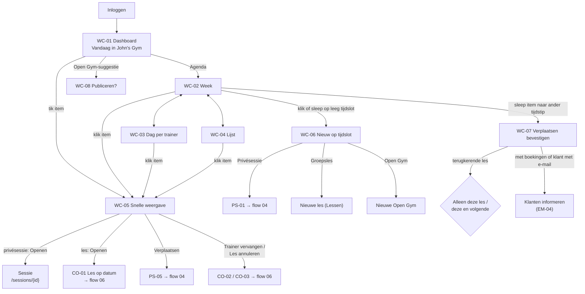

# Flow 03: Workspace calendar on web (owner view)

**Dashboard → Agenda (week / day by trainer / list) → open, create or move a session**

| | |
|---|---|
| **Actors** | Owner (primary); Trainer read-only ⚑ [Q02](../open-questions.md#q02) |
| **Surface** | Trainer web, laptop/desktop first; tablet landscape works |
| **Milestone** | M4 (Gate G2: an internal alpha; a full week shaped like the pilot's timetable runs from synthetic data, and the owner may click through a demo; no parallel run with the current apps) |
| **Spec** | `PRODUCT.md §7, §16–§20, §44, §45, §48, §78`; `ROADMAP.md M4, ADR-012, R2` |
| **Why critical** | It replaces the owner's current apps and calendar. Success = ≥ 95 % of the real weekly schedule lives here from pilot week 3 (`ROADMAP.md §8`) |

## Features

| ID | Feature | Where in this flow |
|---|---|---|
| F014 | Workspace Calendar | WC-02 – WC-04 |
| F013 | Personal Trainer Calendar | *Mijn dag* toggle on WC-01; the same grid under *Mijn agenda* |
| F020 | Private Sessions | Events, quick view, create (→ flow 04) |
| F021 / F022 | Group Class Templates / Recurring Classes | Class events, create (→ *Lessen*) |
| F023 / F024 | Trainer Assignment / Substitution | Trainer filter, day-by-trainer view, *Vervanger* labels (→ flow 06) |
| F025 | Attendance | Attendance status in quick view; *Aandacht nodig* on WC-01 |
| F026 | Cancellations | Cancelled events; cancel from the quick view |
| F034 | Open Gym Slots | Open Gym events, create |
| F036 | Open Gym Suggestions *(Should)* | WC-08 |
| F019 | Automatic Location Selection (after go-live) | Shown in quick view; applied on create |

## Flow diagram



## Screens

### WC-01 · Dashboard (Vandaag in de werkruimte)

**Features:** F014, F013, F025, F036 · `§45`

```text
┌──────────────────────────────────────────────────────────────────────────────────────────────────┐
│ Dashboard                                                      [ Zoek klant…  ]  [ + Nieuw ▾ ]   │
├──────────────────────────────────────────────────────────────────────────────────────────────────┤
│ VANDAAG · DINSDAG 22 SEPTEMBER                             ● John's Gym   ○ Mijn dag             │
│                                                                                                  │
│ 09:00–10:00   Privé — John           Anna de Vries      John's Gym       Aanwezig         ›      │
│ 10:00–11:00   Strength — Sarah       7/8                John's Gym                        ›      │
│ 11:00–12:00   Privé — Mike           Lisa Smit          John's Gym                        ›      │
│ 12:00–13:00   Open Gym               1/2                John's Gym                        ›      │
│ 18:00–19:00   Strength — Sarah       Geannuleerd                                          ›      │
│                                                                                                  │
│ AANDACHT NODIG                                                                                   │
│ ! 2 sessies van gisteren zonder aanwezigheid                                    Invullen ›       │
│ ! Boxing, do 24 sep 19:15: nog geen trainer                                     Toewijzen ›      │
│                                                                                                  │
│ ▌ Je bent morgen al in de gym van 10:00 tot 11:00. Open Gym aanbieden?   [ Publiceren ]  [ ✕ ]   │
│                                                                                                  │
│ [ Naar de agenda ]                                                                               │
└──────────────────────────────────────────────────────────────────────────────────────────────────┘
```

- The list format follows `§45`: time, type — trainer, then client or occupancy (`7/8`, `1/2`).
- *John's Gym / Mijn dag* toggle: the Owner defaults to the workspace ⚑ [Q01](../open-questions.md#q01). *Mijn dag* shows the same list as the app's TD-01, across all the user's workspaces.
- **Aandacht nodig** only shows when there's something to do: sessions without attendance (yesterday and today), and occurrences without a trainer. It never shows vanity numbers (analytics is Release 3.2).
- The Open Gym suggestion is WC-08.

| Element | NL | EN |
|---|---|---|
| Title / day header | Dashboard · Vandaag · dinsdag 22 september | Dashboard · Today · Tuesday 22 September |
| Toggle | {workspace} · Mijn dag | {workspace} · My day |
| Row, private | Privé — {trainer} | Private — {trainer} |
| Attention header | Aandacht nodig | Needs attention |
| No attendance | `{n, plural, one {# sessie} other {# sessies}}` van gisteren zonder aanwezigheid · Invullen | `{n, plural, one {# session} other {# sessions}}` from yesterday without attendance · Fill in |
| No trainer | {class}, {date} {time}: nog geen trainer · Toewijzen | {class}, {date} {time}: no trainer yet · Assign |
| To calendar | Naar de agenda | Go to calendar |

**States:** Empty day → *Vandaag staat er niets gepland in {workspace}.* / *Nothing is scheduled today at {workspace}.* + *[ + Nieuw ]*. Brand-new workspace → *Welkom bij Trainer Hub. Begin met je lesrooster of een privésessie.* / *Welcome to Trainer Hub. Start with your class timetable or a private session.* with *[ Groepsles toevoegen ]* *[ Privésessie toevoegen ]*. Loading = 5 skeleton rows. Error = inline retry.

### WC-02 · Agenda: week / Calendar: week

**Features:** F014, F020, F022, F024, F026, F034

```text
┌──────────────────────────────────────────────────────────────────────────────────────────────────┐
│ Agenda                                                         [ Zoek klant…  ]  [ + Nieuw ▾ ]   │
├──────────────────────────────────────────────────────────────────────────────────────────────────┤
│ [ Vandaag ]  ‹  ›   21 – 27 september 2026          ○ Dag  ● Week  ○ Lijst    Trainers ▾  Type ▾ │
├───────┬────────────┬────────────┬────────────┬────────────┬────────────┬────────────┬────────────┤
│       │ ma 21      │ di 22      │ wo 23      │ do 24      │ vr 25      │ za 26      │ zo 27      │
├───────┼────────────┼────────────┼────────────┼────────────┼────────────┼────────────┼────────────┤
│ 07:00 │            │▌Mark       │            │▌Mark       │            │            │            │
│       │            │▌Sarah · P  │            │▌Sarah · P  │            │            │            │
│ 08:00 │            │            │            │            │            │            │            │
│ 09:00 │▌Anna       │▌Anna       │            │▌Anna       │            │            │            │
│       │▌John · P   │▌John · P   │            │▌John · P   │            │            │            │
│ 10:00 │▌Strength   │▌Strength   │            │            │▌Open Gym   │▌Strength   │            │
│       │▌Sarah 6/8  │▌Sarah 7/8  │            │            │▌2/2 vol    │▌Mike 3/8   │            │
│ 11:00 │            │▌Lisa       │            │            │┆Open Gym? ┆│            │            │
│       │            │▌Mike · P   │            │            │┆suggestie ┆│            │            │
│ 12:00 │            │▌Open Gym   │            │            │            │            │            │
│       │            │▌1/2        │            │            │            │            │            │
│   ⋮   │            │            │            │            │            │            │            │
│ 18:00 │            │░Strength   │            │▌Strength   │            │            │            │
│       │            │░Geannul.   │            │▌Mike ⇄     │            │            │            │
│ 19:00 │            │            │            │▌Boxing     │            │            │            │
│       │            │            │            │▌! Trainer  │            │            │            │
└───────┴────────────┴────────────┴────────────┴────────────┴────────────┴────────────┴────────────┘
  ▌ gepland   ░ geannuleerd   ┆ ┆ suggestie   P = privésessie   ⇄ vervanger   ! actie nodig
```

- **Monday first**, 24 h. The visible hours fit the week's content (default 06:00–22:00 at compact density, 48 px per hour with a 15-minute grid, so a working day fits a laptop screen) and open scrolled to 07:00 or *now*. A red now-line runs across the grid; today's column is tinted.
- **Click an empty moment** (day or week view) to open *+ Nieuw* at that time, snapped to 15 minutes; in the day view the lane's trainer is pre-filled.
- **Event block** content by type. Blocks are cramped, and `PRODUCT.md §48` requires the type in words, so each block starts with a short text label, then the content: *Privé · Mark*, *Groep · Strength*, *Open Gym 1/2*. The labels are short on purpose (*Privé*, *Groep*, *Open Gym*, glossary), so they never truncate; a narrow block truncates the content, not the label. No emoji mark the type.
  - **Private**: *Privé*, client name, trainer.
  - **Group**: *Groep*, class name in the viewer's language (flows/01 PB-02), trainer, `booked/capacity`.
  - **Open Gym**: *Open Gym*, `booked/capacity`, *vol* when full.
- **Legend** above the grid is the key: colour and label for each type (*Privé · Groep · Open Gym*).
- **Accessible name**: each block's name starts with the type, so it reads *Privé · Mark*.
- **Colour** by session type (default) or by trainer ⚑ [Q22](../open-questions.md#q22). Colour is never the only signal: the text label names the type in the block and the legend.
- **Substituted**: `⇄` + the substitute's name; the tooltip and quick view say *Mike (vervangt Sarah)*.
- **Cancelled**: hatched + struck through. *Geannuleerde tonen* in the Type filter is on by default.
- **Overlaps** in one day column sit side by side, up to 3; then *+2 meer*.
- **Filters**: *Trainers* (multi-select with avatars), *Type* (Privé · Groepsles · Open Gym · Geannuleerde tonen), *Locatie* (only with more than one location). Filters are remembered per user.
- **DST**: the day header of **zo 25 okt 2026** carries `◐` with the tooltip *Wintertijd: de klok gaat 1 uur terug*. Events keep their wall-clock time.
- **Trainer (read-only) variant** ⚑ [Q02](../open-questions.md#q02): same grid, no drag, no empty-slot menu; *+ Nieuw* shows only *Privésessie* (for themselves).

| Element | NL | EN |
|---|---|---|
| Views | Dag · Week · Lijst | Day · Week · List |
| Today / range | Vandaag · 21 – 27 september 2026 | Today · 21 – 27 September 2026 |
| Filters | Trainers · Type · Locatie | Trainers · Type · Location |
| Type options | Privé · Groepsles · Open Gym · Geannuleerde tonen | Private · Group class · Open Gym · Show cancelled |
| Full | vol | full |
| Substitute | {substitute} (vervangt {original}) | {substitute} (covering for {original}) |
| No trainer | Nog geen trainer | No trainer yet |
| Cancelled | Geannuleerd | Cancelled |
| More | +{n} meer | +{n} more |
| DST autumn / spring | Wintertijd: de klok gaat 1 uur terug · Zomertijd: de klok gaat 1 uur vooruit | Clocks go back 1 hour · Clocks go forward 1 hour |
| Legend | Privé · Groep · Open Gym · gepland · geannuleerd · suggestie · vervanger · actie nodig | Private · Group · Open Gym · scheduled · cancelled · suggestion · substitute · action needed |
| Block (accessible name) | {type} · {client or class} | {type} · {client or class} |

### WC-03 · Agenda: dag per trainer / Calendar: day by trainer

**Features:** F014, F023, F024

```text
┌──────────────────────────────────────────────────────────────────────────────────────────────────┐
│ [ Vandaag ]  ‹  ›   dinsdag 22 september 2026         ● Dag  ○ Week  ○ Lijst    Trainers ▾  Type ▾ │
├───────┬──────────────────────┬──────────────────────┬──────────────────────┬──────────────────────┤
│       │ John                 │ Sarah                │ Mike                 │ Geen trainer         │
├───────┼──────────────────────┼──────────────────────┼──────────────────────┼──────────────────────┤
│ 07:00 │                      │▌Mark · P             │                      │                      │
│ 08:00 │                      │                      │                      │                      │
│ 09:00 │▌Anna · P             │                      │                      │                      │
│ 10:00 │                      │▌Strength 7/8         │                      │                      │
│ 11:00 │                      │                      │▌Lisa · P             │                      │
│ 12:00 │▌Open Gym 1/2         │                      │                      │                      │
│   ⋮   │                      │                      │                      │                      │
│ 18:00 │                      │░Strength (geannul.)  │                      │                      │
│ 19:00 │                      │                      │                      │                      │
└───────┴──────────────────────┴──────────────────────┴──────────────────────┴──────────────────────┘
```

- One column per trainer in the workspace (filtered by *Trainers*), plus *Geen trainer* only when something is unassigned. It answers "who's where today?" at a glance.
- Only **this workspace's** sessions appear. A trainer's sessions in other workspaces are **never** shown, not even as busy blocks (tenant isolation, `§77`).
- Dragging an event to another trainer's column = assign/substitute (→ CO-02 for class occurrences, with its scope question).
- More than 5 trainer columns scroll horizontally; the time column stays fixed.
- Open Gym without a trainer sits in the column of the person who created it ⚑ [Q14](../open-questions.md#q14).

| Element | NL | EN |
|---|---|---|
| Unassigned column | Geen trainer | No trainer |

### WC-04 · Agenda: lijst / Calendar: list

**Features:** F014 · The accessible, narrow-screen and keyboard-friendly alternative to the grid.

```text
┌──────────────────────────────────────────────────────────────────────────────────────────────────┐
│ [ Vandaag ]  ‹  ›   21 – 27 september 2026          ○ Dag  ○ Week  ● Lijst    Trainers ▾  Type ▾ │
├──────────────────────────────────────────────────────────────────────────────────────────────────┤
│ MAANDAG 21 SEPTEMBER                                                                             │
│ 09:00–10:00   Privésessie   Anna de Vries      John     John's Gym      Aanwezig                 │
│ 10:00–11:00   Groepsles     Strength           Sarah    John's Gym      6/8                      │
│ DINSDAG 22 SEPTEMBER · VANDAAG                                                                   │
│ 07:00–08:00   Privésessie   Mark Peters        Sarah    Basic-Fit Oost  Geboekt                  │
│ …                                                                                                │
└──────────────────────────────────────────────────────────────────────────────────────────────────┘
```

- The default view below 1024 px, and the recommended view for screen-reader users (a real table with headers).

### WC-05 · Snelle weergave / Quick view

**Features:** F020, F022, F024, F025, F026, F034 · Opens as a popover next to the event (a side panel on smaller screens).

```text
Privésessie                                    Groepsles (les op datum)
┌──────────────────────────────────────────┐   ┌──────────────────────────────────────────┐
│ Anna de Vries                          ✕ │   │ Strength                               ✕ │
│ di 22 sep · 09:00–10:00                  │   │ di 22 sep · 10:00–11:00                  │
│ Trainer: John                            │   │ Trainer: Sarah                           │
│ John's Gym (automatisch)                 │   │ John's Gym                               │
│ Schema: Upper A                          │   │ 7/8 geboekt · 1 plek vrij                │
│ Aanwezigheid: Geboekt                    │   │ Elke dinsdag 10:00                       │
│──────────────────────────────────────────│   │──────────────────────────────────────────│
│ [ Openen ]  [ Verplaatsen ]  ⋯           │   │ [ Openen ]  [ Trainer vervangen ]  ⋯     │
│             ⋯ Annuleren                  │   │             ⋯ Les annuleren              │
│               Klantprofiel               │   │               Boekingslink kopiëren      │
└──────────────────────────────────────────┘   └──────────────────────────────────────────┘
```

- Closes with Esc or ✕; focus returns to the event.
- **Notes are not shown in the quick view.** They're sensitive, and a calendar is often on a shared screen. They're one click away on the session page.

| Element | NL | EN |
|---|---|---|
| Auto location (after go-live; at go-live the workspace's one location is shown without a reason) | {location} (automatisch) | {location} (automatic) |
| Recurrence | Elke {weekday} {time} | Every {weekday} {time} |
| Actions (private) | Openen · Verplaatsen · Annuleren · Klantprofiel | Open · Reschedule · Cancel · Client profile |
| Actions (class) | Openen · Trainer vervangen · Les annuleren · Boekingslink kopiëren | Open · Substitute trainer · Cancel class · Copy booking link |
| Actions (Open Gym) | Openen · Verplaatsen · Annuleren · Boekingslink kopiëren | Open · Reschedule · Cancel · Copy booking link |
| Copied | Link gekopieerd | Link copied |

### WC-06 · Nieuw op tijdslot / New at time slot

**Features:** F020, F021, F034

```text
┌──────────────────────────────────┐
│ Nieuw op do 24 sep, 14:00        │
│──────────────────────────────────│
│ Privésessie                      │
│ Groepsles                        │
│ Open Gym                         │
└──────────────────────────────────┘
```

- A click on an empty slot uses the slot start and the default duration. Click-and-drag sets start and end.
- In the day-by-trainer view the column's trainer is pre-filled.
- *Privésessie* → PS-01 (flow 04). *Groepsles* → the class form on *Lessen* with date/time/weekday pre-filled. *Open Gym* → a short form: start, end, capacity, location (go-live: the workspace's one location; inferred after go-live).

| Element | NL | EN |
|---|---|---|
| Title | Nieuw op {date}, {time} | New on {date}, {time} |
| Options | Privésessie · Groepsles · Open Gym | Private session · Group class · Open Gym |

### WC-07 · Verplaatsen door slepen / Move by dragging

**Features:** F020, F022, F049 ⚑ [Q23](../open-questions.md#q23)

```text
┌──────────────────────────────────────────────────────────┐
│ Strength verplaatsen?                                    │
│                                                          │
│ di 22 sep 10:00  →  di 22 sep 11:00                      │
│                                                          │
│ ● Alleen deze les                                        │
│ ○ Deze en alle volgende lessen                           │
│                                                          │
│ [x] 7 deelnemers informeren per e-mail                   │
│     Iedereen krijgt de e-mail in de eigen gekozen taal.        │
│                                                          │
│                    [ Terug ]   [ Verplaatsen ]           │
└──────────────────────────────────────────────────────────┘
```

- Always asks for confirmation. Nothing moves on drop alone.
- The scope radio shows only for recurring classes. *Deze en alle volgende* changes the series from that date (ADR-012). Bookings on later dates move along, and those participants are informed too.
- The notify checkbox shows only when someone would be notified: participants with bookings (EM-04), or the private client if they have an email. It's on by default.
- Moving into the past is blocked for classes with bookings. For private sessions it's allowed with a warning (logging a session afterwards).
- The keyboard/form alternative is *Verplaatsen* in the quick view (→ PS-05 / CO-04).

| Element | NL | EN |
|---|---|---|
| Title | {name} verplaatsen? | Move {name}? |
| Scope | Alleen deze les · Deze en alle volgende lessen | Only this class · This and all following classes |
| Notify | `{n, plural, one {# deelnemer} other {# deelnemers}}` informeren per e-mail | Notify `{n, plural, one {# participant} other {# participants}}` by email |
| Language note | Iedereen krijgt de e-mail in de eigen gekozen taal. | Everyone gets the email in their own language. |
| Private client | {name} informeren per e-mail | Notify {name} by email |
| Buttons | Terug · Verplaatsen | Back · Move |
| Past warning | Dit tijdstip ligt in het verleden. | This time is in the past. |
| Blocked | Een les met boekingen kan niet naar het verleden worden verplaatst. | A class with bookings can't be moved into the past. |
| Done (snackbar) | Verplaatst naar {date} {time}. | Moved to {date} {time}. |

### WC-08 · Open Gym-suggestie / Open Gym suggestion

**Features:** F036 *(Should; first to slip to 1.1)* · `§29`

- **Rule (proposal):** a trainer (default: the owner) has two sessions at the same organization location with a gap of ≥ 60 minutes between them, within the next 7 days, and there's no Open Gym in that gap yet.
- Shown as a banner on WC-01 (the first upcoming suggestion) and as a dashed block in WC-02/WC-03.
- *Publiceren* opens a small confirm popover: start, end (pre-filled with the gap), capacity (the workspace default for Open Gym), location. *Publiceren* creates and publishes it. ✕ dismisses that suggestion for good.
- It's only a suggestion. Nothing is ever published automatically (automation is Release 3.1).

| Element | NL | EN |
|---|---|---|
| Banner (`§29`) | Je bent {day} al in de gym van {start} tot {end}. Open Gym aanbieden? | You're already at the gym {day} from {start} to {end}. Offer Open Gym? |
| Buttons | Publiceren · ✕ (Niet nu) | Publish · ✕ (Not now) |
| Popover | Open Gym publiceren · Begin · Einde · Capaciteit · Locatie · Publiceren | Publish Open Gym · Start · End · Capacity · Location · Publish |
| Done | Open Gym gepubliceerd. Klanten kunnen nu boeken. [ Link kopiëren ] | Open Gym published. Clients can book now. [ Copy link ] |

## States (calendar)

| State | Behaviour | NL | EN |
|---|---|---|---|
| Loading | Grid with headers + shimmering blocks; navigation stays usable | — | — |
| Slow (> 3 s) | Keep the old week visible, dimmed, until the new week arrives | — | — |
| Empty week | A centred line in the grid + quick actions | Nog niets gepland deze week. [ + Privésessie ] [ + Groepsles ] [ + Open Gym ] | Nothing planned this week. [ + Private session ] [ + Group class ] [ + Open Gym ] |
| Filters hide everything | Say it's the filters | Geen resultaten met deze filters. [ Filters wissen ] | No results with these filters. [ Clear filters ] |
| Error | Banner + retry; keep the last loaded week | De agenda kon niet laden. [ Opnieuw proberen ] | The calendar couldn't load. [ Try again ] |
| Save conflict | Someone else changed the event meanwhile | Dit item is net gewijzigd door {name}. We hebben de agenda bijgewerkt. | {name} just changed this item. We've updated the calendar. |

## Edge cases

| Case | Expected behaviour |
|---|---|
| **DST week** (25 oktober 2026; 28 maart 2027) | Recurring classes stay at their wall-clock time. The day header shows `◐` + tooltip. If the visible hours include 02:00–03:00: on 25 Oct that hour is shown twice (*02:00 zomertijd*, *02:00 wintertijd*); on 28 Mar it's skipped. Event heights reflect real duration |
| **Browser in another timezone** | All times are in the workspace timezone, with a toolbar hint *Tijden in Nederlandse tijd* |
| **Beyond the materialisation horizon** (ADR-012, ~12 weeks) | Navigating further ahead shows recurring classes exactly the same way (materialised on demand). The owner never sees a gap |
| **Class without a trainer** | `! Nog geen trainer` block + WC-01 *Aandacht nodig* |
| **Trainer removed from the workspace** | Their future sessions stay, now under *Geen trainer*, and show up in *Aandacht nodig* |
| **Double-booked trainer (same workspace)** | Both events shown side by side with a small `!`. Creating one shows a soft warning (PS-07) ⚑ [Q24](../open-questions.md#q24) |
| **Trainer busy in another workspace** | **Not visible** here (tenant isolation). Detecting that is Release 2.2 |
| **Very busy week** (pilot: ~15 classes + ~30 private sessions) | One request per week; renders < 1 s (`ROADMAP M9` performance) |
| **Two people edit at once** | Last write wins per field; the other screen refreshes with the *Dit item is net gewijzigd* notice |
| **Occurrence edited individually** | Marked in the quick view: *Aangepast t.o.v. de reeks* / *Changed from the series* |
| **Open Gym full** | The block shows *vol*; bookings are unaffected by the calendar |

## Platform notes

Web only. The native apps have the **personal** calendar (TD-04), not the workspace grid. That's intentional: workspace administration stays on web (IA §5.1).

| Topic | Note |
|---|---|
| Grid library | Needs a resource (per-trainer) day view, drag with a confirm step, IANA timezone support, a Monday-first week, 24 h and nl/en locales. Evaluate open-source options (license!) in M4 |
| Keyboard | `T` today, `←/→` previous/next period, `D/W/L` switch view, `N` new, `Enter` opens the focused event, `Esc` closes. Shortcuts are listed under `?` |
| Screen readers | Every event is a button with its full label ("Strength, dinsdag 22 september 10:00 tot 11:00, Sarah, 7 van 8 geboekt"). The list view is a real table |
| Responsive | ≥ 1280 px: week with sidebar. 1024–1279 px: week with a collapsed sidebar. < 1024 px: day or list only; drag is disabled below 1024 px |
| Print | *Afdrukken* of the week view (A4 landscape) for the gym wall ⚑ [Q21](../open-questions.md#q21) |

## Open questions

[Q01](../open-questions.md#q01) default view · [Q02](../open-questions.md#q02) trainers and the workspace calendar · [Q20](../open-questions.md#q20) default view and hours · [Q21](../open-questions.md#q21) month view / print · [Q22](../open-questions.md#q22) colour by type or trainer · [Q23](../open-questions.md#q23) drag and drop · [Q24](../open-questions.md#q24) double-booking warning
