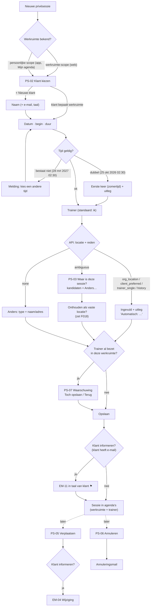

# Flow 04: Create / reschedule a private session (with location inference)

**Choose client → pick date and time → location is filled in (asked only when ambiguous) → save → client informed**

| | |
|---|---|
| **Actors** | Owner/Admin (any trainer's sessions), Trainer (own sessions ⚑ [Q27](../open-questions.md#q27)) |
| **Surfaces** | Trainer web (PS-01) and trainer iOS/Android (PS-04); reschedule and cancel on all three |
| **Milestone** | M4 (web), M8 (mobile). Location inference (F019) comes after go-live, with M7 (`ROADMAP.md` v1.19); until then the default location is preselected (M3) |
| **Spec** | `PRODUCT.md §2.6, §7, §12–§14, §17, §51`; `ROADMAP.md M3 (inference is a pure domain function), M4, ADR-012` |
| **Note** | The location inference described below is F019 and is **not** in the go-live build: until it lands, PS-01 and PS-04 preselect the default location (client's preferred, else the trainer's, else the workspace's; order to confirm in the F016–F018 specs) and the trainer can change it. The "ambiguous, ask" state of PS-03 arrives with F019 |
| **Why critical** | Private sessions are the pilot PT's core business, and today they live in Google Calendar and Word (`PRODUCT.md §8`). "*Infer obvious information automatically*" (`§2.1`) is proven or broken here |

## Features

| ID | Feature | Where in this flow |
|---|---|---|
| F020 | Private Sessions | PS-01, PS-04, PS-05, PS-06 |
| F019 | Automatic Location Selection (after go-live) | PS-03 (all states) |
| F015 / F016 / F017 / F018 | Locations / Org default / Trainer locations / Client preferred location | Inputs to inference; *Onthouden als vaste locatie* sets F018 |
| F023 | Trainer Assignment | Trainer field |
| F006 | Client Profile | PS-02, including a new client inline |
| F042 | Client Workouts | Optional *Training* field |
| F026 | Cancellations | PS-06 |
| F049 | Localized Transactional Emails | EM-04 (change), EM-11 ⚑ (new), cancellation email |
| F012 / F013 | Multi-workspace / Personal calendar | Workspace chosen from the client when creating from the personal scope |

## Location inference: what the UI shows

The inference runs **on the server** (`packages/domain`, `ROADMAP M3`). The API returns a location **and a reason code**. The UI only turns the reason into a sentence and never re-implements the rules. Inputs are the workspace, trainer, client and history.

| Reason code (proposed) | When | UI | NL explanation | EN explanation |
|---|---|---|---|---|
| `org_location` | The session belongs to a gym/studio workspace with one location (`§13` "Organization session") | Filled in, *Wijzigen* link | Automatisch: de locatie van {workspace}. | Automatic: {workspace}'s location. |
| `client_preferred` | The client has a default training location (`§14`) | Filled in | Automatisch: {client} traint meestal bij {location}. | Automatic: {client} usually trains at {location}. |
| `trainer_single` | The trainer has exactly one location in this workspace (`§2.6`) | Filled in | Automatisch: je enige locatie. | Automatic: your only location. |
| `history` | Recent sessions with this client were all at one place | Filled in | Automatisch: dezelfde locatie als de vorige sessie ({date}). | Automatic: same location as the last session ({date}). |
| `ambiguous` | Several candidates, none decisive (`§13` "Ambiguous location") | **Question** with candidates + *Anders…* | Waar is deze sessie? | Where is this session? |
| `none` | No locations known at all (new independent trainer) | *Anders…* form opens directly | Waar is deze sessie? | Where is this session? |



## Screens

### PS-01 · Nieuwe privésessie (web) / New private session

**Features:** F020, F019, F023, F006, F042 · Opens as a right-hand side panel over the calendar, pre-filled from the clicked slot (WC-06) or empty from *+ Nieuw*.

```text
┌──────────────────────────────────────────────────────────┐
│ Nieuwe privésessie                                     ✕ │
├──────────────────────────────────────────────────────────┤
│ Klant                                                    │
│ [ Anna de Vries                                      ▾ ] │
│                                                          │
│ Datum                 Begin        Duur                  │
│ [ do 24 sep 2026  ▾ ] [ 09:00 ]    ○ 45  ● 60  ○ 90  ▾   │
│                       Eindigt om 10:00                   │
│                                                          │
│ Trainer                                                  │
│ [ Sarah (ik)                                         ▾ ] │
│                                                          │
│ Locatie                                                  │
│ TrainMore Zuid                                 Wijzigen  │
│ Automatisch: Anna traint meestal bij TrainMore Zuid.     │
│                                                          │
│ Training (optioneel)                                     │
│ [ Upper A                                            ▾ ] │
│                                                          │
│ [x] Anna een bevestiging sturen                          │
│     anna@example.com · in het Nederlands                   │
│                                                          │
├──────────────────────────────────────────────────────────┤
│                             [ Annuleren ]  [ Opslaan ]   │
└──────────────────────────────────────────────────────────┘
```

- **Field order** follows how trainers think: *who* → *when* → *who trains* → *where* (inferred) → *what* (optional).
- **Workspace** is the current one on web. From *Mijn agenda* (personal scope) a *Werkruimte* field appears first, and only if the user can create sessions in more than one workspace. It's pre-filled from the chosen client.
- **Duration** chips come from the pilot's common durations ⚑ [Q25](../open-questions.md#q25); `▾` offers another value in 5-minute steps. The end time is shown, not asked.
- **Trainer** defaults to *me* if I have a trainer profile here; the owner can pick any trainer in the workspace. Changing the trainer re-runs inference.
- **Location** always shows the *reason* (table above). *Wijzigen* opens PS-03.
- **Training**: choose a template (F041) to assign as this session's workout (F042). Leave it empty to decide at the session.
- **Confirmation email** ⚑ [Q26](../open-questions.md#q26), [QE02](../open-questions.md#qe02): shown only if the client has an email; the note tells which language it'll be in.
- **Unsaved changes**: closing asks *Wijzigingen weggooien?*

| Element | NL | EN |
|---|---|---|
| Title | Nieuwe privésessie | New private session |
| Labels | Klant · Datum · Begin · Duur · Trainer · Locatie · Training (optioneel) · Werkruimte | Client · Date · Start · Duration · Trainer · Location · Workout (optional) · Workspace |
| Duration chips | 45 · 60 · 90 min | 45 · 60 · 90 min |
| End | Eindigt om {time} · Eindigt om {time} (volgende dag) | Ends at {time} · Ends at {time} (next day) |
| Me | {name} (ik) | {name} (me) |
| Change | Wijzigen | Change |
| Email toggle | {client} een bevestiging sturen | Send {client} a confirmation |
| Email note | {email} · in het Nederlands / in het Engels | {email} · in Dutch / in English |
| Buttons | Annuleren · Opslaan | Cancel · Save |
| Discard | Wijzigingen weggooien? [ Weggooien ] [ Verder bewerken ] | Discard changes? [ Discard ] [ Keep editing ] |
| Saved (snackbar) | Sessie met {client} gepland op {date} om {time}. [ Openen ] | Session with {client} scheduled for {date} at {time}. [ Open ] |

**Validation**

| Case | NL | EN |
|---|---|---|
| No client | Kies een klant. | Choose a client. |
| No location (ambiguous, not chosen) | Kies waar deze sessie is. | Choose where this session is. |
| Time doesn't exist (DST spring) | 02:30 bestaat niet op 28 maart 2027: de klok gaat dan van 02:00 naar 03:00. Kies een andere tijd. | 02:30 doesn't exist on 28 March 2027: clocks go from 02:00 to 03:00. Choose another time. |
| Time happens twice (DST autumn) | Op 25 oktober 2026 komt 02:30 twee keer voor. We gebruiken de eerste keer (zomertijd). | On 25 October 2026, 02:30 happens twice. We'll use the first one (summer time). |
| Time in the past | Deze tijd ligt in het verleden. De klant krijgt geen e-mail. | This time is in the past. The client won't get an email. |
| Save failed | Niet opgeslagen. Controleer je verbinding en probeer het opnieuw. | Not saved. Check your connection and try again. |

### PS-02 · Klant kiezen / Choose client

**Features:** F006, F018

```text
┌──────────────────────────────────────────────────────────┐
│ [ ann                                                  ] │
│──────────────────────────────────────────────────────────│
│ Anna de Vries                                            │
│ anna@example.com · laatste sessie di 15 sep                │
│──────────────────────────────────────────────────────────│
│ Annemiek Bos                                             │
│ geen e-mailadres · nog geen sessies                      │
│──────────────────────────────────────────────────────────│
│ + Nieuwe klant "ann"                                     │
└──────────────────────────────────────────────────────────┘

+ Nieuwe klant
┌──────────────────────────────────────────────────────────┐
│ Naam                                                     │
│ [ Anne Jansen                                          ] │
│ E-mailadres (optioneel)                                  │
│ [                                                      ] │
│ Taal voor e-mails                                        │
│ ● Nederlands   ○ English                                 │
│ Standaard trainingslocatie (optioneel)                                │
│ [ Kies een locatie                                   ▾ ] │
│                                   [ Klant toevoegen ]    │
└──────────────────────────────────────────────────────────┘
```

- Search matches name and email, and ignores accents and case ("anne" finds "Anné").
- **Recent clients first** when the field is empty: the trainer's last 5 clients.
- **Personal scope (app)**: results come from every workspace the trainer can create in, each with a workspace label. The same person at two workspaces appears twice, because they're separate client profiles (`§10, §11`).
- **New client inline**: only a name is required; email is optional (a private client may not have given one). *Taal voor e-mails* defaults to the workspace default.
- Duplicate check on email: *Er is al een klant met dit e-mailadres: Anna de Vries.* [ *Die gebruiken* ].

| Element | NL | EN |
|---|---|---|
| Search placeholder | Zoek op naam of e-mail | Search by name or email |
| Result meta | laatste sessie {date} · nog geen sessies · geen e-mailadres | last session {date} · no sessions yet · no email |
| New | + Nieuwe klant "{query}" | + New client "{query}" |
| New client labels | Naam · E-mailadres (optioneel) · Taal voor e-mails · Standaard trainingslocatie (optioneel) | Name · Email (optional) · Language for emails · Default location (optional) |
| Add | Klant toevoegen | Add client |
| Duplicate | Er is al een klant met dit e-mailadres: {name}. [ Die gebruiken ] | There's already a client with this email: {name}. [ Use them ] |
| No results | Geen klanten gevonden. | No clients found. |

### PS-03 · Locatie / Location

**Features:** F019, F015, F016, F017, F018 · Three states of the same field.

```text
A · Automatisch                                          B · Onduidelijk: de vraag uit §13
┌──────────────────────────────────────────┐             ┌──────────────────────────────────────────┐
│ Locatie                                  │             │ Waar is deze sessie?                     │
│ TrainMore Zuid                 Wijzigen  │             │ ○ TrainMore Zuid                         │
│ Automatisch: Anna traint meestal bij     │             │ ○ Basic-Fit Oost                         │
│ TrainMore Zuid.                          │             │ ○ Anders…                                │
└──────────────────────────────────────────┘             │                                          │
                                                         │ [ ] Onthouden als vaste locatie voor Anna│
C · Anders…                                              └──────────────────────────────────────────┘
┌──────────────────────────────────────────┐
│ Soort locatie                            │
│ [ Externe sportschool               ▾ ] │
│ Naam                                     │
│ [ SportCity Utrecht                    ] │
│ Adres (optioneel)                        │
│ [                                      ] │
│ [x] Bewaren voor volgende keer           │
└──────────────────────────────────────────┘
```

- **B** lists the candidates (the trainer's locations in this workspace, the client's past locations) in the order the API returns, most likely first. There's no pre-selection: the whole point is that it's ambiguous.
- *Onthouden als vaste locatie voor Anna* sets the client's preferred location (F018), so next time it's state A. It's off by default.
- **C** types (`§12`, glossary §4.3): *Eigen locatie · Externe sportschool · Bij de klant thuis · Buiten · Online · Anders*. *Bij de klant thuis* needs no address field (sensitive; the client profile holds it if needed). *Online* shows *Link (optioneel)*.
- **Re-inference**: if client, trainer or workspace changes while the location is still automatic, the location updates and briefly highlights *Locatie bijgewerkt*. If the user chose it by hand, it stays, and a hint offers the new inference: *Anna traint meestal bij TrainMore Zuid. [ Gebruiken ]*.

| Element | NL | EN |
|---|---|---|
| Question (`§13`) | Waar is deze sessie? | Where is this session? |
| Other | Anders… | Other… |
| Remember | Onthouden als vaste locatie voor {client} | Remember as {client}'s default location |
| Types | Eigen locatie · Externe sportschool · Bij de klant thuis · Buiten · Online · Anders | Own location · External gym · Client's home · Outdoors · Online · Other |
| Fields | Soort locatie · Naam · Adres (optioneel) · Link (optioneel) · Bewaren voor volgende keer | Location type · Name · Address (optional) · Link (optional) · Save for next time |
| Updated | Locatie bijgewerkt | Location updated |
| Suggest | {client} traint meestal bij {location}. [ Gebruiken ] | {client} usually trains at {location}. [ Use ] |

### PS-04 · Nieuwe privésessie (app) / New private session (app)

**Features:** F020, F019 · Same fields, same order, same inference as PS-01; native form conventions.

```text
iOS: sheet                                  Android: full-screen dialog
┌────────────────────────────────────────┐  ┌────────────────────────────────────────┐
│ Annuleren  Nieuwe privésessie  Opslaan │  │ ✕  Nieuwe privésessie          Opslaan │
├────────────────────────────────────────┤  ├────────────────────────────────────────┤
│ KLANT                                  │  │ Klant                                  │
│ Anna de Vries                       ›  │  │ [ Anna de Vries                     ▾ ]│
│ Sarah Personal Training                │  │ Sarah Personal Training                │
│                                        │  │                                        │
│ WANNEER                                │  │ Datum                                  │
│ Datum                do 24 sep 2026    │  │ [ do 24 sep 2026                   ▾ ]│
│ Begin                        09:00     │  │ Begin              Duur                │
│ Duur                        60 min  ›  │  │ [ 09:00          ▾ ] [ 60 min        ▾ ]│
│ Eindigt om 10:00                       │  │ Eindigt om 10:00                       │
│                                        │  │                                        │
│ WIE EN WAAR                            │  │ Trainer                                │
│ Trainer                 Sarah (ik)  ›  │  │ [ Sarah (ik)                        ▾ ]│
│ Locatie             TrainMore Zuid  ›  │  │ Locatie                                │
│ Automatisch: Anna traint meestal bij   │  │ [ TrainMore Zuid                    ▾ ]│
│ TrainMore Zuid.                        │  │ Automatisch: Anna traint meestal bij   │
│                                        │  │ TrainMore Zuid.                        │
│ TRAINING                               │  │                                        │
│ Schema                     Upper A  ›  │  │ Schema (optioneel)                     │
│                                        │  │ [ Upper A                           ▾ ]│
│ Bevestiging naar Anna          [ ●]    │  │ Bevestiging naar Anna          [ ●]    │
└────────────────────────────────────────┘  └────────────────────────────────────────┘
```

- The **workspace** line under the client appears only for multi-workspace trainers (it comes from the chosen client).
- **Offline**: creating needs a connection (only logging is offline-ready, `ROADMAP M7`). *Opslaan* is disabled with *Je bent offline. Plannen kan pas als je weer verbinding hebt.*

| Element | NL | EN |
|---|---|---|
| iOS bar | Annuleren · Nieuwe privésessie · Opslaan | Cancel · New private session · Save |
| Android bar | ✕ · Nieuwe privésessie · Opslaan | ✕ · New private session · Save |
| Sections (iOS) | Klant · Wanneer · Wie en waar · Training | Client · When · Who and where · Workout |
| Toggle | Bevestiging naar {client} | Confirmation to {client} |
| Offline | Je bent offline. Plannen kan pas als je weer verbinding hebt. | You're offline. You can schedule once you're back online. |

### PS-05 · Sessie verplaatsen / Reschedule session

**Features:** F020, F049 (EM-04) · From the quick view (WC-05), session page, TD-02 `⋯`, or by dragging (WC-07).

```text
┌──────────────────────────────────────────────────────────┐
│ Sessie verplaatsen                                     ✕ │
├──────────────────────────────────────────────────────────┤
│ Anna de Vries · Privésessie                              │
│ Nu: di 22 sep 2026, 09:00–10:00 · TrainMore Zuid         │
│                                                          │
│ Nieuwe datum          Begin        Duur                  │
│ [ do 24 sep 2026  ▾ ] [ 09:00 ]    [ 60 min          ▾ ] │
│                                                          │
│ Locatie                                                  │
│ TrainMore Zuid (ongewijzigd)                   Wijzigen  │
│                                                          │
│ [x] Anna informeren per e-mail                           │
│     Anna krijgt de e-mail in het Nederlands.             │
│                                                          │
├──────────────────────────────────────────────────────────┤
│              [ Annuleren ]  [ Verplaatsen en informeren ]│
└──────────────────────────────────────────────────────────┘
```

- Only *when* is edited by default. The location stays unless changed; it's **not** re-inferred on a reschedule, because the client expects the same place.
- The **primary button says what will happen**: *Verplaatsen* or *Verplaatsen en informeren*. There's no undo after an email has gone out, so the label is the confirmation.
- A session that already has a **logged workout or attendance** can still be moved, e.g. to correct a mistake. A note says the workout moves along, and attendance resets to *Geboekt* if the new time is in the future.

| Element | NL | EN |
|---|---|---|
| Title | Sessie verplaatsen | Reschedule session |
| Current | Nu: {date}, {start}–{end} · {location} | Currently: {date}, {start}–{end} · {location} |
| Unchanged | {location} (ongewijzigd) | {location} (unchanged) |
| Notify | {client} informeren per e-mail · {client} krijgt de e-mail in het Nederlands. | Notify {client} by email · {client} will get the email in English. |
| Buttons | Annuleren · Verplaatsen · Verplaatsen en informeren | Cancel · Reschedule · Reschedule and notify |
| Workout note | Er is al een training gelogd. Die verhuist mee. | A workout has already been logged. It moves along. |
| Done | Verplaatst naar {date} om {time}. | Moved to {date} at {time}. |
| EM-04 subject | Wijziging: je sessie op {oldDate} is verplaatst naar {newDate} | Change: your session on {oldDate} has moved to {newDate} |

### PS-06 · Sessie annuleren / Cancel session

**Features:** F026, F049

```text
┌──────────────────────────────────────────────────────────┐
│ Sessie annuleren?                                        │
│                                                          │
│ Anna de Vries · di 22 sep 2026, 09:00–10:00              │
│                                                          │
│ Wie annuleert?                                           │
│ ● De klant   ○ Wij                                       │
│                                                          │
│ [x] Anna informeren per e-mail                           │
│                                                          │
│ Liever een ander moment? Verplaatsen                     │
│                                                          │
│                     [ Terug ]  [ Sessie annuleren ]      │
└──────────────────────────────────────────────────────────┘
```

- **Wie annuleert?** records who cancelled (useful for no-show and cancellation insight later, Release 3.2) ⚑ [Q29](../open-questions.md#q29). If *De klant* is chosen, the email defaults to off (the client already knows).
- The session stays in the calendars as *Geannuleerd* (attendance status `cancelled`, `§43`); it isn't deleted.

| Element | NL | EN |
|---|---|---|
| Title | Sessie annuleren? | Cancel session? |
| Who | Wie annuleert? · De klant · Wij | Who's cancelling? · The client · Us |
| Notify | {client} informeren per e-mail | Notify {client} by email |
| Alternative | Liever een ander moment? Verplaatsen | Rather pick another time? Reschedule |
| Buttons | Terug · Sessie annuleren | Back · Cancel session |
| Done | Sessie geannuleerd. | Session cancelled. |

### PS-07 · Dubbele boeking / Double booking

**Features:** F020, F023 ⚑ [Q24](../open-questions.md#q24) · A soft warning, never a block.

```text
┌──────────────────────────────────────────────────────────┐
│ Sarah heeft dan al iets                                  │
│                                                          │
│ do 24 sep, 09:00–10:00: Mark Peters (privésessie)        │
│                                                          │
│                       [ Terug ]   [ Toch opslaan ]       │
└──────────────────────────────────────────────────────────┘
```

- Checks **only this workspace**. The owner of John's Gym must not learn anything about Sarah's sessions in Sarah Personal Training (tenant isolation). Cross-workspace conflict detection is Release 2.2.
- **Exception (personal scope):** when trainers plan **their own** session from *Mijn agenda*, they may see their own sessions from all their workspaces. The warning then names the other workspace: *Je hebt dan al: 09:00 Strength (John's Gym)* ⚑ [QE11](../open-questions.md#qe11).

| Element | NL | EN |
|---|---|---|
| Title | {trainer} heeft dan al iets | {trainer} already has something then |
| Own | Je hebt dan al: {time} {title} ({workspace}) | You already have: {time} {title} ({workspace}) |
| Buttons | Terug · Toch opslaan | Back · Save anyway |

## Edge cases

| Case | Expected behaviour | Screen |
|---|---|---|
| **DST: non-existent time** (28 maart 2027, 02:00–02:59) | Validation error; can't save | PS-01, PS-04, PS-05 |
| **DST: repeated time** (25 oktober 2026, 02:00–02:59) | Use the first occurrence (CEST) + an explanatory note | PS-01 |
| **Duration across a DST change** | Duration is elapsed time; the end is shown in wall-clock time (01:30 + 90 min on 25 Oct → *Eindigt om 02:00*) | PS-01 |
| **Past midnight** | Allowed; *Eindigt om 00:30 (volgende dag)* | PS-01 |
| **Planning in the past** (logging afterwards) | Allowed with a warning; no email | PS-01 |
| **Client without email** | The email option is hidden; the save message says the client wasn't informed | PS-01, PS-05, PS-06 |
| **Client prefers English** | EM-11/EM-04 in English. The note under the checkbox says so, so the trainer isn't surprised | PS-01, PS-05 |
| **Same person in two workspaces** | Two separate client profiles; picking one fixes the workspace; nothing crosses over | PS-02 |
| **Location inference changes while editing** | Automatic → updates with a highlight; manual → kept, with a hint | PS-03 |
| **Ambiguous every time for the same client** | After two identical manual choices, suggest *Onthouden als vaste locatie* (pre-checked the third time) | PS-03 |
| **Trainer double-booked** | PS-07 soft warning, same workspace only | PS-07 |
| **Someone else moved or cancelled the session meanwhile** | Save → *Deze sessie is net gewijzigd door {name}.* + the reloaded values | PS-05, PS-06 |
| **Trainer removed as assignee while the form is open** | Save → *Je hebt geen rechten meer voor deze sessie.* | PS-05 |
| **Offline on mobile** | Create/reschedule/cancel disabled with a reason; nothing is queued (to avoid double-booking surprises) | PS-04 |
| **Moving a session with a logged workout** | Allowed; the workout moves along | PS-05 |

## Platform notes: iOS HIG vs Material 3

| Topic | iOS (SwiftUI) | Android (Compose, Material 3) |
|---|---|---|
| Container | `.sheet` with `.large` detent; *Annuleren* (leading) and *Opslaan* (trailing, bold) in the navigation bar; swipe-down dismissal asks to discard when dirty (`interactiveDismissDisabled` + confirmation) | Full-screen dialog: `TopAppBar` with ✕ (navigation icon) and *Opslaan* (text button); back/✕ asks to discard when dirty |
| Form style | `Form` with section headers (*KLANT*, *WANNEER*, *WIE EN WAAR*, *TRAINING*) | A single column of `OutlinedTextField`s / `ExposedDropdownMenuBox`es with supporting text for the location reason |
| Client picker | Pushed searchable list (`.searchable`) | `ModalBottomSheet` with a search field, or a full-screen search on small screens |
| Date | Compact `DatePicker`, expands inline | `DatePickerDialog` (M3), Monday-first from locale |
| Time | `DatePicker(.hourAndMinute)`, 24 h from the nl/en app locale | `TimePickerDialog` (M3) in 24 h mode; the keyboard input mode is allowed |
| Duration | `Picker` pushed list (45/60/90/other) | `ExposedDropdownMenu` |
| Location question (ambiguous) | Inline section with checkmark rows | Radio button group |
| Destructive (PS-06) | `.confirmationDialog` with a red *Sessie annuleren* button | `AlertDialog` with the confirm button in the error colour |
| Soft warning (PS-07) | `.alert` with two buttons | `AlertDialog` |
| Saved feedback | Dismiss the sheet; the new item briefly highlights in *Agenda* | Dismiss; `Snackbar` *Sessie gepland* with *Openen* |
| Accessibility | The location reason is part of the field's accessibility value | The location reason is the field's supporting text (TalkBack reads it) |

## Open questions

[Q06](../open-questions.md#q06) naming a private session · [Q24](../open-questions.md#q24) double-booking warning · [Q25](../open-questions.md#q25) durations · [Q26](../open-questions.md#q26) emails for private sessions · [Q27](../open-questions.md#q27) trainer rights · [Q28](../open-questions.md#q28) where sessions happen · [Q29](../open-questions.md#q29) who cancelled · [QE02](../open-questions.md#qe02) · [QE11](../open-questions.md#qe11)
