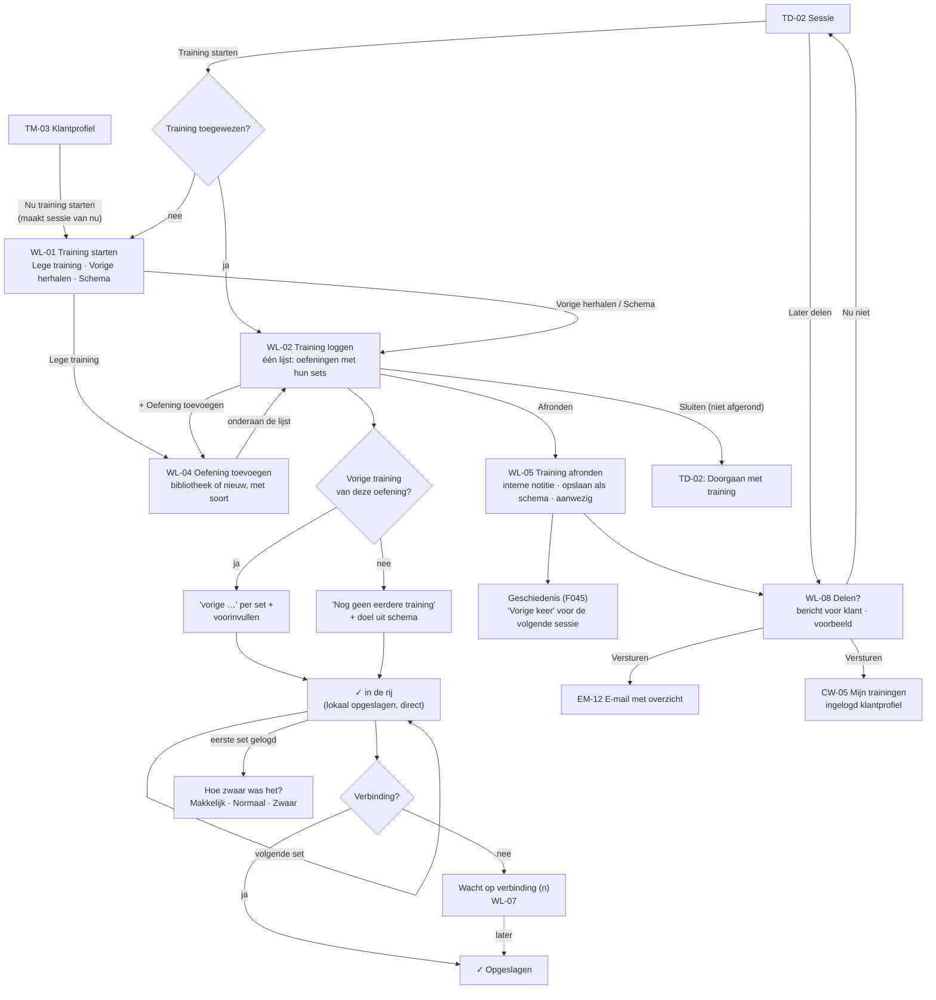

# Flow 05: Live workout logging with previous values

**Session → start workout (empty, repeat previous, or template) → log sets → finish with an internal note → optionally save as template and share a recap**

> **Updated 23 September 2026 (prototype feedback, `ROADMAP` v1.11).** A workout never needs a prior plan. WL-01 puts *Lege training* first and adds *Vorige training herhalen* (F051, moved from Release 1.1). Sets are prefilled and logged with one tap on their check. WL-05 can save the workout as a template. A workout can also start from a client profile without a planned session.
>
> **Updated 14 October 2026 (owner, `ROADMAP` v1.14).** WL-02 is now the logger: one scrolling list with every exercise and its sets, editable in the row. WL-03 is merged into it; the per-exercise screen and its stepper dock are gone. Every exercise has a type that decides its set fields (`§38`); WL-04 asks for it.

| | |
|---|---|
| **Actors** | Trainer (during or right after a private session); Owner/Admin as trainers |
| **Surfaces** | Trainer iOS/Android (primary, one hand, between sets); trainer web (WL-06, e.g. afterwards at a desk) |
| **Milestone** | M7 (web + logging API, offline-ready), M8 (native) |
| **Spec** | `PRODUCT.md §38–§42, §36, §37, §89`; `ROADMAP.md M7 (offline-ready API: client IDs, idempotent writes, batch sync), M8, R12` |
| **Why critical** | It replaces Excel for workouts (target: ≥ 80 % of private sessions logged) and answers "what did they do last time?" (target: ≥ 4/5 rating) (`ROADMAP §8`) |

## Features

| ID | Feature | Where in this flow |
|---|---|---|
| F043 | Live Workout Logging | WL-02 (WL-03 merged into it), WL-06, WL-07 |
| F044 | Previous Workout Display | *vorige* line under each set on WL-02; *Vorige* column on WL-06 |
| F045 | Workout History | The result; *Alles bekijken* on TD-02; shared recap in the client profile |
| F042 | Client Workouts | The assigned workout on WL-01 |
| F041 | Workout Templates | *Schema kiezen* on WL-01; *Opslaan als schema* on WL-05 |
| F051 | Repeat Previous Workout | *Vorige training herhalen* on WL-01 |
| F006 / F020 | Client Profile / Private Sessions | *Nu training starten* on TM-03 creates a private session that starts now |
| F039 / F040 | Exercise Library / Custom Exercises | WL-04, including the exercise type |
| F047 / F048 | Session Notes / Note Visibility | WL-05 internal note; WL-08 separate client message and explicit share |
| F049 | Localized Transactional Emails | EM-12 shared workout email |
| F025 | Attendance | Set to *Aanwezig* on finishing ⚑ [Q34](../open-questions.md#q34) |

## Flow diagram



## Screens

### WL-01 · Training starten / Start workout

**Features:** F051, F042, F041 · Shown when the session has no workout assigned. An assigned workout opens WL-02 directly.

```text
┌────────────────────────────────────────┐
│ Annuleren     Training starten         │
├────────────────────────────────────────┤
│ Koen Meijer · di 22 15:00              │
│                                        │
│ (+) Lege training                   ›  │
│     Begin zonder schema en voeg        │
│     oefeningen toe terwijl je traint.  │
│ (⟲) Vorige training herhalen        ›  │
│     Training zonder schema · 17 sep ·  │
│     3 oefeningen                       │
│                                        │
│ SCHEMA'S VAN KOEN                      │
│ Full body                           ›  │
│                                        │
│ ANDERE SCHEMA'S                        │
│ Upper A                             ›  │
│ Lower A                             ›  │
└────────────────────────────────────────┘
```

- **Lege training comes first**: training on the fly is a normal way to work, not an exception. It opens WL-02 with WL-04 on top, so the first exercise is one search away.
- **Vorige training herhalen** (F051) copies the client's last logged workout: same exercises, same number of sets, prefilled with last time's values. Hidden when the client has no history.
- **Schema's van Koen** = templates used with this client before (F042), most recent first; then the other workspace templates. With many templates, a search field appears above *Andere schema's*.
- **Without a planned session**: *Nu training starten* on the client profile (TM-03) creates a private session for the trainer that starts now, with the inferred location (F019), then opens WL-01. ⚑ [QE15](../open-questions.md#qe15)

| Element | NL | EN |
|---|---|---|
| Title | Training starten | Start workout |
| Empty | Lege training · Begin zonder schema en voeg oefeningen toe terwijl je traint. | Empty workout · Start without a template and add exercises as you train. |
| Repeat | Vorige training herhalen · {name} · {date} · {count} | Repeat previous workout · {name} · {date} · {count} |
| Unnamed workout | Training zonder schema | Workout without template |
| Sections | Schema's van {client} · Andere schema's (· Alle schema's when none are assigned) | {client}'s templates · Other templates (· All templates) |
| Count | `{n, plural, one {# oefening} other {# oefeningen}}` | `{n, plural, one {# exercise} other {# exercises}}` |
| Search | Zoek schema… | Search templates… |
| From profile | Nu training starten · Sessie aangemaakt voor nu, {time} | Start workout now · Session created for now, {time} |

### WL-02 · Training loggen / Log workout

**Features:** F043, F044 · The core screen, built for **one hand, big targets, a glance between sets** (`ROADMAP M8`). One scrolling list: every exercise in order, its sets underneath (owner, 14 October 2026).

```text
┌────────────────────────────────────────┐
│ Sluiten   Anna · Upper A    Afronden   │
│             ◷ 12:05                    │
│ 3 oefeningen               ✓ Opgeslagen│
├────────────────────────────────────────┤
│ (1) Bankdrukken                   1/3  │
│     Doel: 3 × 8 · Vorige: 15 sep       │
│  1  [ 62,5 ] kg × [ 8 ]           (✓)  │
│     vorige 60 × 8                      │
│  2  [ 62,5 ] kg × [ 8 ]           ( )  │
│     vorige 60 × 8                      │
│  3  [ 62,5 ] kg × [ 8 ]           ( )  │
│     vorige 60 × 7                      │
│  + Set   Makkelijk [Normaal] Zwaar     │
├────────────────────────────────────────┤
│ (2) Plank                         0/3  │
│  1  [ 0 ] : [ 45 ]                ( )  │
│     vorige 0:45                        │
│  …                                     │
├────────────────────────────────────────┤
│ (3) Roeien                        0/1  │
│  1  [ 500 ] m [ 1 ] : [ 45 ]      ( )  │
│     vorige 500 m · 1:45                │
│  + Set                                 │
├────────────────────────────────────────┤
│ [ + Oefening toevoegen ]               │
└────────────────────────────────────────┘
```

- A **full-screen modal** with its own exit: *Sluiten* (keep going later) or *Afronden* (WL-05).
- The header shows the **elapsed workout time** under the title. It runs from the moment the workout starts (`§41`).
- Exercise names show in the **UI language** when the library has both (F039: *Bankdrukken* / *Bench press*). Custom exercises show as entered (F040).
- **Each exercise** shows its number, name, progress (*1/3*), the target and the date of the previous workout. Its sets follow underneath.
- **Each set row** has the set number, the previous value (F044, small and muted, e.g. *vorige 60 × 8*), editable fields for today and a tick. Fields follow the exercise type (`§38`):

  | Type | Fields | Previous / summary |
  |---|---|---|
  | Gewicht × herhalingen / Weight × reps | kg (`inputmode="decimal"`) × reps (`numeric`) | *60 × 8* / *60 kg × 8* |
  | Alleen herhalingen / Reps only | reps (`numeric`) | *12 herh.* / *12 reps* |
  | Tijd / Time | minutes : seconds (both `numeric`), stored in seconds | *0:45*; repeats group as *0:45 × 3* |
  | Afstand + tijd / Distance + time | metres (`decimal`) and minutes : seconds | *500 m · 1:45* |

- **Prefill**, per row: the same values as the set just logged today; otherwise the previous workout's same set; otherwise the template target. Every row shows its prefilled value, so the trainer sees the whole plan. Most sets are **one tap** on the tick (≥ 48 pt/dp). Tapping a ticked set reopens it.
- **Editing in the row**: tap a field; the numeric keypad opens. A changed value carries over to later sets the trainer hasn't changed or logged. Inputs are at least 44 pt/dp, with generous spacing between rows for one-handed use.
- **+ Set** under each exercise adds a row prefilled from its last set. An unlogged extra set can be removed with its ×.
- **Difficulty** (`§41`: *Makkelijk / Normaal / Zwaar*) is asked **once per exercise**, compact under its sets, after the first logged set ⚑ [Q30](../open-questions.md#q30). It's pre-selected *Normaal*, so it costs no tap unless it differs.
- Each set is saved **locally first**, then synced (WL-07).
- **+ Oefening toevoegen** ends the list (WL-04). A new exercise joins the end; focus moves to it.
- **No fixed dock**: nothing covers the rows, also in short landscape. iOS uses inset grouped sections; Android uses cards.
- **Empty state** (Lege training): *Nog geen oefeningen. Voeg de eerste oefening toe. Wat {client} eerder deed, staat bovenaan.* with *Oefening toevoegen*.
- Reordering exercises is a Release 1.1 item. The screen **stays awake** while the logger is open.

| Element | NL | EN |
|---|---|---|
| Bar | Sluiten · Afronden | Close · Finish |
| Timer (accessible name) | {m:ss} (Trainingstijd) | {m:ss} (Workout time) |
| Progress | {done}/{total} | {done}/{total} |
| Target | Doel: {sets} × {reps · m:ss · metres} | Target: {sets} × {reps · m:ss · metres} |
| Previous header (`§41`) | Vorige training · {date} · {trainer} | Previous · {date} · {trainer} |
| No previous | Nog geen eerdere training | No previous workout |
| Previous per set | vorige {value} | last {value} |
| Field labels (screen readers) | Set {n}, Gewicht (kg) · Herhalingen · Minuten · Seconden · Afstand (m) | Set {n}, Weight (kg) · Reps · Minutes · Seconds · Distance (m) |
| Tick | Set {n} klaar · Set {n} weer openzetten | Set {n} done · Reopen set {n} |
| Add set | + Set (Set toevoegen aan {exercise}) | + Set (Add a set to {exercise}) |
| Remove extra set | Set {n} verwijderen | Remove set {n} |
| Difficulty (`§41`) | Hoe zwaar was het? · Makkelijk · Normaal · Zwaar | How hard was it? · Easy · Normal · Hard |
| Add exercise | + Oefening toevoegen | + Add exercise |
| Sanity check | Klopt {value} kg? Dat is veel meer dan vorige keer ({prev} kg). [ Ja ] [ Aanpassen ] | Is {value} kg right? That's a lot more than last time ({prev} kg). [ Yes ] [ Edit ] |

### WL-03 · Oefening loggen / Log exercise (merged into WL-02)

Merged into WL-02 on 14 October 2026 (owner). The ID stays because other documents refer to it. Its behaviour now lives in the WL-02 list: previous values per set, prefill, one-tap ticks, extra sets and difficulty. The separate screen, its position header (*2 van 5*), the steppers and the bottom dock are gone.

### WL-04 · Oefening toevoegen / Add exercise

**Features:** F039, F040

```text
┌────────────────────────────────────────┐
│ Annuleren    Oefening toevoegen        │
├────────────────────────────────────────┤
│ [ bench                              ] │
│────────────────────────────────────────│
│ +  Nieuwe oefening                  ›  │
│────────────────────────────────────────│
│ Bankdrukken                            │
│ ook: Bench press · borst, triceps      │
│────────────────────────────────────────│
│ Schuine bankdrukken                    │
│ ook: Incline bench press               │
│────────────────────────────────────────│
│ + Nieuwe oefening "bench" aanmaken     │
└────────────────────────────────────────┘
```

- Search matches **Dutch and English names and aliases**, whatever the UI language, so a trainer can type "bench" in a Dutch UI. The name is shown in the UI language; *ook:* shows the matching alias.
- Empty field: **the client's recent exercises first** (*Recent bij {client}*, with last time's values), then the library. An exercise already in the workout is shown but disabled.
- **+ Nieuwe oefening** is always the first row, so a trainer-specific exercise can be created without searching first. It opens a name field, prefilled with what was typed, and the **exercise type**: *Gewicht × herhalingen* (default), *Alleen herhalingen*, *Tijd* or *Afstand + tijd* (`§38`).
- The custom-exercise button also appears below the results as soon as something is typed. It opens the same form with the search text as the name. The new exercise joins the end of WL-02 with one set row.
- Library and own exercises that aren't weight × reps show their type in the row (e.g. *Plank · Tijd*). Library examples: *Plank* is time, *Opdrukken / Push-up* and *Pull-up* are reps only, *Roeien / Rowing* is distance + time, the rest weight × reps.
- Created custom exercises are listed under *Jouw oefeningen*, between *Recent bij {client}* and the library.
- **Custom exercise**: a name, stored exactly as typed (F040, no translation), and a type. Equipment and muscles are optional and can be filled in later on the web.

| Element | NL | EN |
|---|---|---|
| Title | Oefening toevoegen | Add exercise |
| Placeholder | Zoek oefening (NL of EN) | Search exercise (Dutch or English) |
| Alias | ook: {alias} | also: {alias} |
| Recent | Recent bij {client} | Recent for {client} |
| New (first row) | + Nieuwe oefening · Naam van de oefening · Toevoegen | + New exercise · Exercise name · Add |
| Type | Soort oefening · Gewicht × herhalingen · Alleen herhalingen · Tijd · Afstand + tijd | Exercise type · Weight × reps · Reps only · Time · Distance + time |
| New (from search) | + Nieuwe oefening "{query}" aanmaken | + Create new exercise "{query}" |
| Own exercises | Jouw oefeningen | Your exercises |
| Created | Oefening aangemaakt. Je vindt hem voortaan onder Jouw oefeningen. | Exercise created. You'll find it under Your exercises from now on. |
| No results | Geen oefening gevonden. | No exercise found. |

### WL-05 · Training afronden / Finish workout

**Features:** F045, F047, F048, F025

```text
┌────────────────────────────────────────┐
│ ‹ Terug      Training afronden         │
├────────────────────────────────────────┤
│ Anna · Upper A · 52 min                │
│ 4 van 5 oefeningen · 13 sets           │
│ Niet gedaan: Face pull                 │
│────────────────────────────────────────│
│ Notitie voor trainers                  │
│ [ Bankdrukken laatste set zwaar.     ] │
│ [ Volgende keer zelfde gewicht.      ] │
│ Alleen trainers lezen dit.             │
│────────────────────────────────────────│
│ Opslaan als schema               [ ◯ ] │
│ Naam van het schema                    │
│ [ Koen · 22 september                ] │
│────────────────────────────────────────│
│ Aanwezigheid: Aanwezig        Wijzigen │
├────────────────────────────────────────┤
│ [         Training afronden          ] │
└────────────────────────────────────────┘
```

- The **internal session note** (F047) is free text, stored as typed (`§35–36`). It is *Alleen voor trainers* (`§37`, F048): authorized workspace staff can read it; the client cannot. A separate message for the client is composed in WL-08. The distinction is explicit, without a visibility toggle that could accidentally expose the internal note.
- The results show exercises done, sets and a **Duur** tile: the elapsed time from start to *Afronden*, recorded with the workout (`§41`).
- **Attendance** is set to *Aanwezig* when a workout is finished ⚑ [Q34](../open-questions.md#q34).
- The set breakdown, the shared email (EM-12) and the client profile format sets per exercise type: *60 kg × 8 · 60 kg × 8*, *Plank 0:45 × 3*, *Roeien 500 m · 1:45*, *12 herh.*
- Exercises with no sets are listed as *Niet gedaan*. They're kept in the planned workout, but no empty set logs are created.
- Finishing with **zero sets** asks: *Je hebt nog niets bijgehouden. Toch afronden?* Confirming closes the workout without history or a share step.
- **Opslaan als schema** (F041) is offered when the workout didn't come from a template unchanged (empty, repeated, or exercises/sets added). It saves the logged exercises, set count and reps as a template, adds it to *Schema's van {client}*, and names the workout after it. The name defaults to the template's name or *{client} · {date}*.
- After finishing, the workout becomes history (F045) and is next session's *Vorige training*. Saving alone does not share it. WL-08 can be opened now or later from the finished session.

| Element | NL | EN |
|---|---|---|
| Title / button | Training afronden | Finish workout |
| Summary | {done} van {total} oefeningen · `{sets, plural, one {# set} other {# sets}}` | {done} of {total} exercises · `{sets, plural, one {# set} other {# sets}}` |
| Duration | Duur · {n} min · {h} uur {m} min | Duration · {n} min · {h} hour(s) {m} min |
| Skipped | Niet gedaan: {list} | Not done: {list} |
| Note | Notitie voor trainers · Alleen trainers van deze workspace zien dit. | Note for trainers · Only trainers in this workspace see this. |
| Attendance | Aanwezigheid: Aanwezig · Wijzigen | Attendance: Attended · Change |
| Zero sets | Je hebt nog niets bijgehouden. Toch afronden? [ Afronden ] [ Terug ] | You haven't logged anything yet. Finish anyway? [ Finish ] [ Back ] |
| Save as template | Opslaan als schema · Dan kun je deze training later opnieuw kiezen, ook bij {client}. · Naam van het schema | Save as template · Then you can choose this workout again later, also for {client}. · Template name |
| Saved with template | Training opgeslagen. Schema {name} staat klaar. | Workout saved. Template {name} is ready. |
| Done | Training opgeslagen. | Workout saved. |

### WL-08 · Training delen / Share workout

**Features:** F045, F048, F049 · Available immediately after WL-05 and later from the finished session.

```text
┌────────────────────────────────────────┐
│ Training opgeslagen                    │
│ Training delen met Anna?               │
│ Anna ziet het overzicht in haar        │
│ profiel en krijgt een e-mail.          │
│                                        │
│ Bericht voor de klant (optioneel)      │
│ [ Goed gewerkt vandaag!              ] │
│                                        │
│ [ Voorbeeld bekijken ]                 │
│ [ Nu niet delen ]                      │
└────────────────────────────────────────┘
```

- *Voorbeeld bekijken* shows the exact workout summary, recipient, and optional message that the client will see. The internal note must be absent. The trainer confirms with *Training en bericht versturen* (or *Training versturen* when the message is empty).
- Confirmation makes the recap available in the authenticated client's *Mijn trainingen* (CW-05) and sends EM-12. Both use the same shared content. The email template is in the recipient's language; the trainer's free text stays as entered.
- *Nu niet delen* leaves the workout and internal note saved, with no client view or email. The trainer can share it from the session later. Re-sending an already shared workout requires a separate explicit action; never send another email merely by opening or editing it.
- The email link opens the client's authenticated workout view. No internal note or health-sensitive content is placed in the link itself.

| Element | NL | EN |
|---|---|---|
| Title | Training delen met {client}? | Share the workout with {client}? |
| Message | Bericht voor de klant (optioneel) | Message for the client (optional) |
| Review | Voorbeeld bekijken | Preview |
| Confirm | Training en bericht versturen | Send workout and message |
| Later | Nu niet delen | Don't share now |
| Client view | Mijn trainingen | My workouts |
| Email subject | Je training staat klaar, {client} | Your workout is ready, {client} |

### WL-06 · Training bijhouden (web) / Log workout (web)

**Features:** F043, F044 · The same model, keyboard-first, for logging at a desk (M7 exit criterion is on web).

```text
┌──────────────────────────────────────────────────────────────────────────────────────────────────┐
│ ‹ Sessie   Anna de Vries · di 22 sep 09:00 · Upper A                  ✓ Opgeslagen  [ Afronden ] │
├──────────────────────────────┬───────────────────────────────────────────────────────────────────┤
│ 1 Bankdrukken        3/3  ✓  │ CABLE ROW                        Doel: 3 × 10                     │
│ 2 Cable row          1/3   ▶ │ Vorige training · di 15 sep                                       │
│ 3 Schouderdrukken    0/3     │                                                                   │
│ 4 Lat pulldown       0/3     │ Set   Vorige          Gewicht (kg)   Herhalingen                  │
│ 5 Face pull          0/3     │ 1     45 kg × 10      [ 47,5  ]      [ 10 ]        ✓              │
│                              │ 2     45 kg × 10      [ 47,5  ]      [ 10 ]        [ Klaar ↵ ]    │
│ + Oefening toevoegen         │ 3     45 kg × 9       [       ]      [    ]                       │
│                              │ + Set                                                             │
│                              │                                                                   │
│                              │ Hoe zwaar was het?   ○ Makkelijk  ● Normaal  ○ Zwaar              │
│                              │ Notitie bij deze oefening  [                                    ]  │
└──────────────────────────────┴───────────────────────────────────────────────────────────────────┘
```

- `Tab` moves weight → reps → *Klaar*; `Enter` logs the set and focuses the next one; `Alt+↓` goes to the next exercise.
- The web version saves each set immediately (online only). If saving fails, the row keeps its values and shows *Niet opgeslagen · Opnieuw*.

### WL-07 · Synchronisatie / Sync status

**Features:** F043 · `ROADMAP M7` (client IDs, idempotent writes, batch sync), R12

| State | Indicator (in the bar) | Detail sheet (tap) | NL | EN |
|---|---|---|---|---|
| Synced | `✓` | — | Opgeslagen | Saved |
| Syncing | `⟳` | — | Synchroniseren… | Syncing… |
| Queued (offline) | `○ 3` | List of pending changes; *Opnieuw proberen* | Wacht op verbinding (3) | Waiting for connection (3) |
| Failed (server rejected) | `!` | Which change failed, and why; *Opnieuw* / *Verwijderen* | Niet gesynchroniseerd. Tik voor details. | Not synced. Tap for details. |
| Edited elsewhere | Banner until reviewed | Review conflicting set values | Deze training is ook op een ander apparaat bewerkt. Controleer de verschillen. | This workout was also edited on another device. Review the differences. |

- Logging **never waits for the network**. Every set gets a client-generated ID (UUIDv7) and is written to the local store (SwiftData / Room) before the UI confirms.
- Sets from two devices may be distinct records. The result of concurrent edits to the **same** set is unresolved ([QE14](../open-questions.md#qe14)); the implementation must preserve both changes for recovery until a conflict rule is agreed.
- **Signing out with pending changes**: *Er zijn nog 3 wijzigingen niet gesynchroniseerd. Als je nu uitlogt, gaan ze verloren.* [ *Toch uitloggen* ] [ *Terug* ].

## Edge cases

| Case | Expected behaviour | Screen |
|---|---|---|
| **No previous workout for this exercise** | *Nog geen eerdere training*; prefill from the template target | WL-02 |
| **Previous had fewer or more sets** | Missing cells show `–`; extra previous sets are listed so nothing is hidden | WL-02 |
| **Two sessions with the client on the same day** | *Vorige* = the latest logged before **this** session's start, never the workout in progress | WL-02 |
| **Previous by another trainer** | Shown with the trainer's name (same workspace only) | WL-02 |
| **Client also trains in another workspace** | Never used as *Vorige* (separate client profiles, tenant isolation) | WL-02 |
| **Decimal comma** | NL shows and accepts `62,5` (also for distance); `62.5` is also accepted on keyboards that only offer a dot. Stored as a number | WL-02, WL-06 |
| **Typo like 625 instead of 62,5** | A soft sanity check when the value is > 2× the previous value (or > 300 kg) | WL-02 |
| **Weak gym Wi-Fi / offline** | Logging continues; indicator `○ n`; syncs automatically on reconnect | WL-07 |
| **App killed or phone locked mid-workout** | Everything logged is already stored locally; reopening resumes on WL-02 with the logged sets ticked | WL-02 |
| **Logger closed without finishing** | Sets stay saved; TD-02 shows *Doorgaan met training*; *Mijn dag* on web flags it as unfinished | TD-02 |
| **Logging late at night / DST night** | The workout belongs to the session's date in the workspace timezone; the *Vorige* date uses that date | WL-02 |
| **Same session logged on phone and web** | Sync distinct sets; surface a same-set conflict without silently discarding either edit, pending QE14 | WL-07 |
| **Seconds above 59** | `0:75` is stored as 75 seconds and shown as `1:15` | WL-02 |
| **Exercise renamed later** | History follows the exercise ID, so *Vorige* still works | WL-02 |
| **Session cancelled while logging** | Logging continues (the session happened after all?); on finishing: *Deze sessie is geannuleerd. Toch opslaan en de sessie herstellen?* | WL-05 |

## Platform notes: iOS HIG vs Material 3

| Topic | iOS (SwiftUI) | Android (Compose, Material 3) |
|---|---|---|
| Container | `fullScreenCover` from TD-02; *Sluiten* leading, *Afronden* trailing | Full-screen destination with `TopAppBar`; system back = *Sluiten* (auto-saved, no confirmation) |
| Keep awake | `UIApplication.shared.isIdleTimerDisabled = true` while open | `Modifier.keepScreenOn()` / `FLAG_KEEP_SCREEN_ON` while open |
| Numeric input | `.keyboardType(.decimalPad)` shows the locale's separator (`,` for nl) | `KeyboardType.Decimal`; some keyboards show only `.`, so accept both |
| Set fields | Inline text fields in the row, ≥ 44 pt; `.decimalPad` for kg and metres, `.numberPad` for reps, minutes and seconds | Inline `OutlinedTextField`s, ≥ 48 dp; `KeyboardType.Decimal` / `KeyboardType.Number` |
| Set done feedback | `sensoryFeedback(.success)` haptic | `HapticFeedbackConstants.CONFIRM` |
| Delete set | Swipe to delete on the row | Long-press → menu *Set verwijderen* (M3 has no standard swipe-to-delete in lists) |
| Difficulty | Compact segmented control under the exercise's sets, ≥ 44 pt | `SingleChoiceSegmentedButtonRow` under the sets, ≥ 48 dp |
| Exercise grouping | Inset grouped section per exercise | Card per exercise |
| Local queue | SwiftData | Room |
| Background sync | Sync on foreground and when connectivity returns (`NWPathMonitor`); `BGTaskScheduler` best effort | `WorkManager` with a network constraint |
| Dynamic Type / font scale | Numbers use tabular figures; at AX sizes the *Vorige* and *Vandaag* columns stack vertically | Same at font scale ≥ 150 % |
| Screen readers | The exercise name labels its set list; fields read "Set 2, Gewicht (kg)", then "vorige 45 × 10" and the tick "Set 2 klaar" | Same via semantics for TalkBack |
| Web (WL-06) | Keyboard-first; the same fields per exercise type | — |

## Open questions

[Q30](../open-questions.md#q30) difficulty per exercise or per set · [Q31](../open-questions.md#q31) exercises that aren't weight × reps (answered: exercise types) · [Q32](../open-questions.md#q32) when and where trainers log · [Q33](../open-questions.md#q33) weight steps · [Q34](../open-questions.md#q34) attendance on finish · [Q35](../open-questions.md#q35) previous values from other trainers · [QE04](../open-questions.md#qe04) client-visible notes · [QE10](../open-questions.md#qe10) data model · [QE14](../open-questions.md#qe14) concurrent logging
