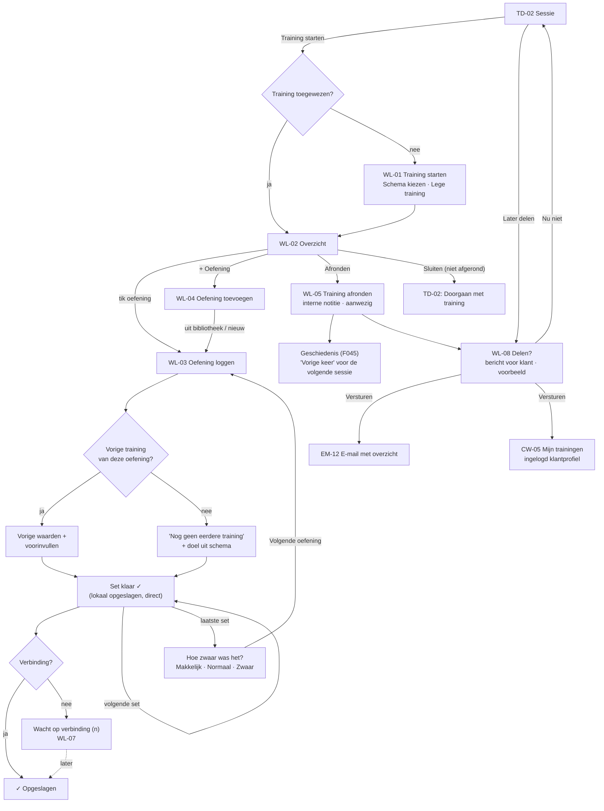

# Flow 05: Live workout logging with previous values

**Session → start workout → log sets → finish with an internal note → optionally share a recap and client message**

| | |
|---|---|
| **Actors** | Trainer (during or right after a private session); Owner/Admin as trainers |
| **Surfaces** | Trainer iOS/Android (primary, one hand, between sets); trainer web (WL-06, e.g. afterwards at a desk) |
| **Milestone** | M7 (web + logging API, offline-ready), M8 (native) |
| **Spec** | `PRODUCT.md §38–§42, §36, §37, §89`; `ROADMAP.md M7 (offline-ready API: client IDs, idempotent writes, batch sync), M8, R12` |
| **Why critical** | It replaces Excel for workouts (target: ≥ 80 % of private sessions logged) and answers "what did they do last time?" (target: ≥ 4/5 rating) (`ROADMAP §8`) |

## Features

| ID | Feature | Where in this flow |
|---|---|---|
| F043 | Live Workout Logging | WL-02, WL-03, WL-06, WL-07 |
| F044 | Previous Workout Display | *Vorige training* column on WL-03 / WL-06 |
| F045 | Workout History | The result; *Alles bekijken* on TD-02; shared recap in the client profile |
| F042 | Client Workouts | The assigned workout on WL-01 |
| F041 | Workout Templates | *Schema kiezen* on WL-01 |
| F039 / F040 | Exercise Library / Custom Exercises | WL-04 |
| F047 / F048 | Session Notes / Note Visibility | WL-05 internal note; WL-08 separate client message and explicit share |
| F049 | Localized Transactional Emails | EM-12 shared workout email |
| F025 | Attendance | Set to *Aanwezig* on finishing ⚑ [Q34](../open-questions.md#q34) |

## Flow diagram



## Screens

### WL-01 · Training starten / Start workout

**Features:** F042, F041 · Only shown when the session has no workout assigned.

```text
┌────────────────────────────────────────┐
│ Annuleren     Training starten         │
├────────────────────────────────────────┤
│ Anna de Vries · di 22 sep 09:00        │
│                                        │
│ SCHEMA'S VAN ANNA                      │
│ Upper A · 5 oefeningen              ›  │
│ Lower A · 6 oefeningen              ›  │
│                                        │
│ ALLE SCHEMA'S                          │
│ [ Zoek schema…                       ] │
│ Full body beginner                  ›  │
│ Push                                ›  │
│ …                                      │
│────────────────────────────────────────│
│ [ Lege training ]                      │
└────────────────────────────────────────┘
```

- **Schema's van Anna** = templates assigned to this client before (F042), most recent first.
- *Lege training* starts with no exercises (→ WL-04).
- Repeating the previous session as a copy is *previous-session duplication*, a Release 1.1 item, so it's not here.

| Element | NL | EN |
|---|---|---|
| Title | Training starten | Start workout |
| Sections | Schema's van {client} · Alle schema's | {client}'s templates · All templates |
| Count | `{n, plural, one {# oefening} other {# oefeningen}}` | `{n, plural, one {# exercise} other {# exercises}}` |
| Search | Zoek schema… | Search templates… |
| Empty | Lege training | Empty workout |
| No templates | Nog geen schema's. Begin met een lege training of maak een schema op het web. | No templates yet. Start an empty workout or create a template on the web. |

### WL-02 · Trainingsoverzicht / Workout overview

**Features:** F043

```text
┌────────────────────────────────────────┐
│ Sluiten   Anna · Upper A    Afronden   │
│ ✓ Opgeslagen                           │
├────────────────────────────────────────┤
│ 1  Bankdrukken                 3/3  ✓  │
│    vorige: 60 kg × 8, 8, 7             │
│────────────────────────────────────────│
│ 2  Cable row                   1/3  ›  │
│    vorige: 45 kg × 10, 10, 9           │
│────────────────────────────────────────│
│ 3  Schouderdrukken             0/3  ›  │
│    nog geen eerdere training           │
│────────────────────────────────────────│
│ 4  Lat pulldown                0/3  ›  │
│────────────────────────────────────────│
│ 5  Face pull                   0/3  ›  │
│────────────────────────────────────────│
│ [ + Oefening toevoegen ]               │
│                                        │
│ ▌ Doorgaan: Cable row, set 2         › │
└────────────────────────────────────────┘
```

- A **full-screen modal** with its own exit: *Sluiten* (keep going later) or *Afronden* (WL-05).
- Exercise names show in the **UI language** when the library has both (F039: *Bankdrukken* / *Bench press*). Custom exercises show as entered (F040).
- The bottom bar *Doorgaan* jumps to the next set to log.
- Reordering exercises is a Release 1.1 item. Exercises run in template order, but the trainer can open any of them.

| Element | NL | EN |
|---|---|---|
| Bar | Sluiten · Afronden | Close · Finish |
| Progress | {done}/{total} | {done}/{total} |
| Previous line | vorige: {weight} × {reps}, … | last: {weight} × {reps}, … |
| No previous | nog geen eerdere training | no previous workout |
| Add | + Oefening toevoegen | + Add exercise |
| Continue | Doorgaan: {exercise}, set {n} | Continue: {exercise}, set {n} |

### WL-03 · Oefening loggen / Log exercise

**Features:** F043, F044 · The core screen. Built for **one hand, big targets, a glance between sets** (`ROADMAP M8`).

```text
┌────────────────────────────────────────┐
│ ‹ Overzicht      2 van 5      ✓ Opgesl.│
├────────────────────────────────────────┤
│ CABLE ROW                              │
│ Doel: 3 × 10                           │
│ Vorige training · di 15 sep            │
├────────────────────────────────────────┤
│ SET   VORIGE         VANDAAG           │
│ 1     45 kg × 10     47,5 kg × 10   ✓  │
│ 2     45 kg × 10   ▶ 47,5 kg × 10      │
│ 3     45 kg × 9        –               │
│ [ + Set ]                              │
├────────────────────────────────────────┤
│ Gewicht (kg)                           │
│ [  −  ]         47,5         [  +  ]   │
│ Herhalingen                            │
│ [  −  ]          10          [  +  ]   │
│                                        │
│ [          Set 2 klaar   ✓           ] │
└────────────────────────────────────────┘

After the last set:
├────────────────────────────────────────┤
│ Hoe zwaar was het?                     │
│ [ Makkelijk ] [● Normaal ] [ Zwaar ]   │
│ + Notitie bij deze oefening            │
│                                        │
│ [   Volgende: Schouderdrukken   ›    ] │
└────────────────────────────────────────┘
```

**Behaviour**

- **Previous and today side by side** (`§41`): the *Vorige* column is the client's **last logged performance of this exercise in this workspace**, set by set, with its date. If it was logged by another trainer, their name is added (*di 15 sep · Mike*) ⚑ [Q35](../open-questions.md#q35).
- **The active set (▶)** is pre-filled, in this order:
  1. the same values as the set just logged today;
  2. otherwise the previous workout's same set;
  3. otherwise the template target reps, with weight empty.

  Most sets are therefore one tap: *Set klaar*. Changing the weight on set 1 carries over to sets 2 and 3.
- **Steppers**: weight ± 2,5 kg ⚑ [Q33](../open-questions.md#q33), reps ± 1. Long-press repeats. Tapping the number opens the decimal keyboard.
- **Set klaar** saves the set **locally first**, then syncs (WL-07). The button is at the bottom (thumb zone), full width, at least 56 pt/dp tall, with a haptic tick.
- **Editing a logged set**: tap its row; the steppers load its values and the button becomes *Set 1 bijwerken*. Delete via swipe (iOS) or long-press menu (Android).
- **Difficulty** (`§41`: *Makkelijk / Normaal / Zwaar*) is asked **once per exercise**, after the last set ⚑ [Q30](../open-questions.md#q30). It's pre-selected *Normaal* and changing it is one tap.
- **Extra sets** beyond the template: *+ Set*. Their *Vorige* cell shows `–` when last time had fewer sets.
- **Bodyweight / time / distance** exercises: open question ⚑ [Q31](../open-questions.md#q31). Proposal: weight may be empty (shown as *lichaamsgewicht*); time/distance need a data-model change ([QE10](../open-questions.md#qe10)).
- The screen **stays awake** while the logger is open.

| Element | NL | EN |
|---|---|---|
| Position | {n} van {total} | {n} of {total} |
| Target | Doel: {sets} × {reps} | Target: {sets} × {reps} |
| Previous header (`§41`) | Vorige training · {date} · {trainer} | Previous · {date} · {trainer} |
| No previous | Nog geen eerdere training | No previous workout |
| Columns (`§41`) | Set · Vorige · Vandaag | Set · Previous · Today |
| Set value | 47,5 kg × 10 | 47.5 kg × 10 |
| Bodyweight | lichaamsgewicht × {reps} | bodyweight × {reps} |
| Labels | Gewicht (kg) · Herhalingen | Weight (kg) · Reps |
| Add set | + Set | + Set |
| Done / update | Set {n} klaar · Set {n} bijwerken | Set {n} done · Update set {n} |
| Difficulty (`§41`) | Hoe zwaar was het? · Makkelijk · Normaal · Zwaar | How hard was it? · Easy · Normal · Hard |
| Exercise note | + Notitie bij deze oefening | + Note for this exercise |
| Next | Volgende: {exercise} · Terug naar overzicht | Next: {exercise} · Back to overview |
| Delete set | Set verwijderen | Delete set |
| Sanity check | Klopt {value} kg? Dat is veel meer dan vorige keer ({prev} kg). [ Ja ] [ Aanpassen ] | Is {value} kg right? That's a lot more than last time ({prev} kg). [ Yes ] [ Edit ] |

### WL-04 · Oefening toevoegen / Add exercise

**Features:** F039, F040

```text
┌────────────────────────────────────────┐
│ Annuleren    Oefening toevoegen        │
├────────────────────────────────────────┤
│ [ bench                              ] │
│────────────────────────────────────────│
│ Bankdrukken                            │
│ ook: Bench press · borst, triceps      │
│────────────────────────────────────────│
│ Schuine bankdrukken                    │
│ ook: Incline bench press               │
│────────────────────────────────────────│
│ + Nieuwe oefening "bench" aanmaken     │
└────────────────────────────────────────┘
```

- Search matches **Dutch and English names and aliases**, whatever the UI language, so a trainer can type "bench" in a Dutch UI. The name is shown in the UI language; *ook:* shows the matching alias.
- Empty field: *Recent gebruikt* (this trainer's last 10) first.
- **Custom exercise**: just a name, stored exactly as typed (F040, no translation). Equipment and muscles are optional and can be filled in later on the web.

| Element | NL | EN |
|---|---|---|
| Title | Oefening toevoegen | Add exercise |
| Placeholder | Zoek oefening (NL of EN) | Search exercise (Dutch or English) |
| Alias | ook: {alias} | also: {alias} |
| Recent | Recent gebruikt | Recently used |
| New | + Nieuwe oefening "{query}" aanmaken | + Create new exercise "{query}" |
| Created | Oefening aangemaakt. Je vindt hem terug onder Trainingen. | Exercise created. You'll find it under Workouts. |
| No results | Geen oefening gevonden. | No exercise found. |

### WL-05 · Training afronden / Finish workout

**Features:** F045, F047, F048, F025

```text
┌────────────────────────────────────────┐
│ ‹ Terug      Training afronden         │
├────────────────────────────────────────┤
│ Anna · Upper A · 52 min                │
│ 4 van 5 oefeningen · 13 sets           │
│ Niet gedaan: Face pull                 │
│────────────────────────────────────────│
│ Notitie voor trainers                  │
│ [ Bankdrukken laatste set zwaar.     ] │
│ [ Volgende keer zelfde gewicht.      ] │
│ Alleen trainers lezen dit.             │
│────────────────────────────────────────│
│ Aanwezigheid: Aanwezig        Wijzigen │
├────────────────────────────────────────┤
│ [         Training afronden          ] │
└────────────────────────────────────────┘
```

- The **internal session note** (F047) is free text, stored as typed (`§35–36`). It is *Alleen voor trainers* (`§37`, F048): authorized workspace staff can read it; the client cannot. A separate message for the client is composed in WL-08. The distinction is explicit, without a visibility toggle that could accidentally expose the internal note.
- **Attendance** is set to *Aanwezig* when a workout is finished ⚑ [Q34](../open-questions.md#q34).
- Exercises with no sets are listed as *Niet gedaan*. They're kept in the planned workout, but no empty set logs are created.
- Finishing with **zero sets** asks: *Je hebt nog niets gelogd. Toch afronden?*
- After finishing, the workout becomes history (F045) and is next session's *Vorige training*. Saving alone does not share it. WL-08 can be opened now or later from the finished session.

| Element | NL | EN |
|---|---|---|
| Title / button | Training afronden | Finish workout |
| Summary | {done} van {total} oefeningen · `{sets, plural, one {# set} other {# sets}}` | {done} of {total} exercises · `{sets, plural, one {# set} other {# sets}}` |
| Skipped | Niet gedaan: {list} | Not done: {list} |
| Note | Notitie voor trainers · Alleen trainers van deze workspace zien dit. | Note for trainers · Only trainers in this workspace see this. |
| Attendance | Aanwezigheid: Aanwezig · Wijzigen | Attendance: Attended · Change |
| Zero sets | Je hebt nog niets gelogd. Toch afronden? [ Afronden ] [ Terug ] | You haven't logged anything yet. Finish anyway? [ Finish ] [ Back ] |
| Done | Training opgeslagen. | Workout saved. |

### WL-08 · Training delen / Share workout

**Features:** F045, F048, F049 · Available immediately after WL-05 and later from the finished session.

```text
┌────────────────────────────────────────┐
│ Training opgeslagen                    │
│ Training delen met Anna?               │
│ Anna ziet het overzicht in haar        │
│ profiel en krijgt een e-mail.          │
│                                        │
│ Bericht voor de klant (optioneel)      │
│ [ Goed gewerkt vandaag!              ] │
│                                        │
│ [ Voorbeeld bekijken ]                 │
│ [ Nu niet delen ]                      │
└────────────────────────────────────────┘
```

- *Voorbeeld bekijken* shows the exact workout summary, recipient, and optional message that the client will see. The internal note must be absent. The trainer confirms with *Training en bericht versturen* (or *Training versturen* when the message is empty).
- Confirmation makes the recap available in the authenticated client's *Mijn trainingen* (CW-05) and sends EM-12. Both use the same shared content. The email template is in the recipient's language; the trainer's free text stays as entered.
- *Nu niet delen* leaves the workout and internal note saved, with no client view or email. The trainer can share it from the session later. Re-sending an already shared workout requires a separate explicit action; never send another email merely by opening or editing it.
- The email link opens the client's authenticated workout view. No internal note or health-sensitive content is placed in the link itself.

| Element | NL | EN |
|---|---|---|
| Title | Training delen met {client}? | Share the workout with {client}? |
| Message | Bericht voor de klant (optioneel) | Message for the client (optional) |
| Review | Voorbeeld bekijken | Preview |
| Confirm | Training en bericht versturen | Send workout and message |
| Later | Nu niet delen | Don't share now |
| Client view | Mijn trainingen | My workouts |
| Email subject | Je training staat klaar, {client} | Your workout is ready, {client} |

### WL-06 · Training bijhouden (web) / Log workout (web)

**Features:** F043, F044 · The same model, keyboard-first, for logging at a desk (M7 exit criterion is on web).

```text
┌──────────────────────────────────────────────────────────────────────────────────────────────────┐
│ ‹ Sessie   Anna de Vries · di 22 sep 09:00 · Upper A                  ✓ Opgeslagen  [ Afronden ] │
├──────────────────────────────┬───────────────────────────────────────────────────────────────────┤
│ 1 Bankdrukken        3/3  ✓  │ CABLE ROW                        Doel: 3 × 10                     │
│ 2 Cable row          1/3   ▶ │ Vorige training · di 15 sep                                       │
│ 3 Schouderdrukken    0/3     │                                                                   │
│ 4 Lat pulldown       0/3     │ Set   Vorige          Gewicht (kg)   Herhalingen                  │
│ 5 Face pull          0/3     │ 1     45 kg × 10      [ 47,5  ]      [ 10 ]        ✓              │
│                              │ 2     45 kg × 10      [ 47,5  ]      [ 10 ]        [ Klaar ↵ ]    │
│ + Oefening toevoegen         │ 3     45 kg × 9       [       ]      [    ]                       │
│                              │ + Set                                                             │
│                              │                                                                   │
│                              │ Hoe zwaar was het?   ○ Makkelijk  ● Normaal  ○ Zwaar              │
│                              │ Notitie bij deze oefening  [                                    ]  │
└──────────────────────────────┴───────────────────────────────────────────────────────────────────┘
```

- `Tab` moves weight → reps → *Klaar*; `Enter` logs the set and focuses the next one; `Alt+↓` goes to the next exercise.
- The web version saves each set immediately (online only). If saving fails, the row keeps its values and shows *Niet opgeslagen · Opnieuw*.

### WL-07 · Synchronisatie / Sync status

**Features:** F043 · `ROADMAP M7` (client IDs, idempotent writes, batch sync), R12

| State | Indicator (in the bar) | Detail sheet (tap) | NL | EN |
|---|---|---|---|---|
| Synced | `✓` | — | Opgeslagen | Saved |
| Syncing | `⟳` | — | Synchroniseren… | Syncing… |
| Queued (offline) | `○ 3` | List of pending changes; *Opnieuw proberen* | Wacht op verbinding (3) | Waiting for connection (3) |
| Failed (server rejected) | `!` | Which change failed, and why; *Opnieuw* / *Verwijderen* | Niet gesynchroniseerd. Tik voor details. | Not synced. Tap for details. |
| Edited elsewhere | Banner until reviewed | Review conflicting set values | Deze training is ook op een ander apparaat bewerkt. Controleer de verschillen. | This workout was also edited on another device. Review the differences. |

- Logging **never waits for the network**. Every set gets a client-generated ID (UUIDv7) and is written to the local store (SwiftData / Room) before the UI confirms.
- Sets from two devices may be distinct records. The result of concurrent edits to the **same** set is unresolved ([QE14](../open-questions.md#qe14)); the implementation must preserve both changes for recovery until a conflict rule is agreed.
- **Signing out with pending changes**: *Er zijn nog 3 wijzigingen niet gesynchroniseerd. Als je nu uitlogt, gaan ze verloren.* [ *Toch uitloggen* ] [ *Terug* ].

## Edge cases

| Case | Expected behaviour | Screen |
|---|---|---|
| **No previous workout for this exercise** | *Nog geen eerdere training*; prefill from the template target | WL-03 |
| **Previous had fewer or more sets** | Missing cells show `–`; extra previous sets are listed so nothing is hidden | WL-03 |
| **Two sessions with the client on the same day** | *Vorige* = the latest logged before **this** session's start, never the workout in progress | WL-03 |
| **Previous by another trainer** | Shown with the trainer's name (same workspace only) | WL-03 |
| **Client also trains in another workspace** | Never used as *Vorige* (separate client profiles, tenant isolation) | WL-03 |
| **Decimal comma** | NL shows and accepts `62,5`; `62.5` is also accepted on keyboards that only offer a dot. Stored as a number | WL-03, WL-06 |
| **Typo like 625 instead of 62,5** | A soft sanity check when the value is > 2× the previous value (or > 300 kg) | WL-03 |
| **Weak gym Wi-Fi / offline** | Logging continues; indicator `○ n`; syncs automatically on reconnect | WL-07 |
| **App killed or phone locked mid-workout** | Everything logged is already stored locally; reopening resumes on WL-02 at *Doorgaan* | WL-02 |
| **Logger closed without finishing** | Sets stay saved; TD-02 shows *Doorgaan met training*; *Mijn dag* on web flags it as unfinished | TD-02 |
| **Logging late at night / DST night** | The workout belongs to the session's date in the workspace timezone; the *Vorige* date uses that date | WL-03 |
| **Same session logged on phone and web** | Sync distinct sets; surface a same-set conflict without silently discarding either edit, pending QE14 | WL-07 |
| **Exercise renamed later** | History follows the exercise ID, so *Vorige* still works | WL-03 |
| **Session cancelled while logging** | Logging continues (the session happened after all?); on finishing: *Deze sessie is geannuleerd. Toch opslaan en de sessie herstellen?* | WL-05 |

## Platform notes: iOS HIG vs Material 3

| Topic | iOS (SwiftUI) | Android (Compose, Material 3) |
|---|---|---|
| Container | `fullScreenCover` from TD-02; *Sluiten* leading, *Afronden* trailing | Full-screen destination with `TopAppBar`; system back = *Sluiten* (auto-saved, no confirmation) |
| Keep awake | `UIApplication.shared.isIdleTimerDisabled = true` while open | `Modifier.keepScreenOn()` / `FLAG_KEEP_SCREEN_ON` while open |
| Numeric input | `.keyboardType(.decimalPad)` shows the locale's separator (`,` for nl) | `KeyboardType.Decimal`; some keyboards show only `.`, so accept both |
| Steppers | Custom large buttons (not the small `Stepper`); ≥ 56 pt | `FilledTonalIconButton`s ≥ 56 dp; long-press repeat |
| Set done feedback | `sensoryFeedback(.success)` haptic | `HapticFeedbackConstants.CONFIRM` |
| Delete set | Swipe to delete on the row | Long-press → menu *Set verwijderen* (M3 has no standard swipe-to-delete in lists) |
| Difficulty | Three large buttons (a segmented `Picker` is too small for sweaty hands) | `SingleChoiceSegmentedButtonRow` at 56 dp height |
| Local queue | SwiftData | Room |
| Background sync | Sync on foreground and when connectivity returns (`NWPathMonitor`); `BGTaskScheduler` best effort | `WorkManager` with a network constraint |
| Dynamic Type / font scale | Numbers use tabular figures; at AX sizes the *Vorige* and *Vandaag* columns stack vertically | Same at font scale ≥ 150 % |
| Screen readers | Each set row reads "Set 2, vorige 45 kilo maal 10, vandaag 47,5 kilo maal 10, klaar" | Same via merged semantics for TalkBack |
| Web (WL-06) | Keyboard-first; no stepper buttons needed | — |

## Open questions

[Q30](../open-questions.md#q30) difficulty per exercise or per set · [Q31](../open-questions.md#q31) exercises that aren't weight × reps · [Q32](../open-questions.md#q32) when and where trainers log · [Q33](../open-questions.md#q33) weight steps · [Q34](../open-questions.md#q34) attendance on finish · [Q35](../open-questions.md#q35) previous values from other trainers · [QE04](../open-questions.md#qe04) client-visible notes · [QE10](../open-questions.md#qe10) data model · [QE14](../open-questions.md#qe14) concurrent logging
