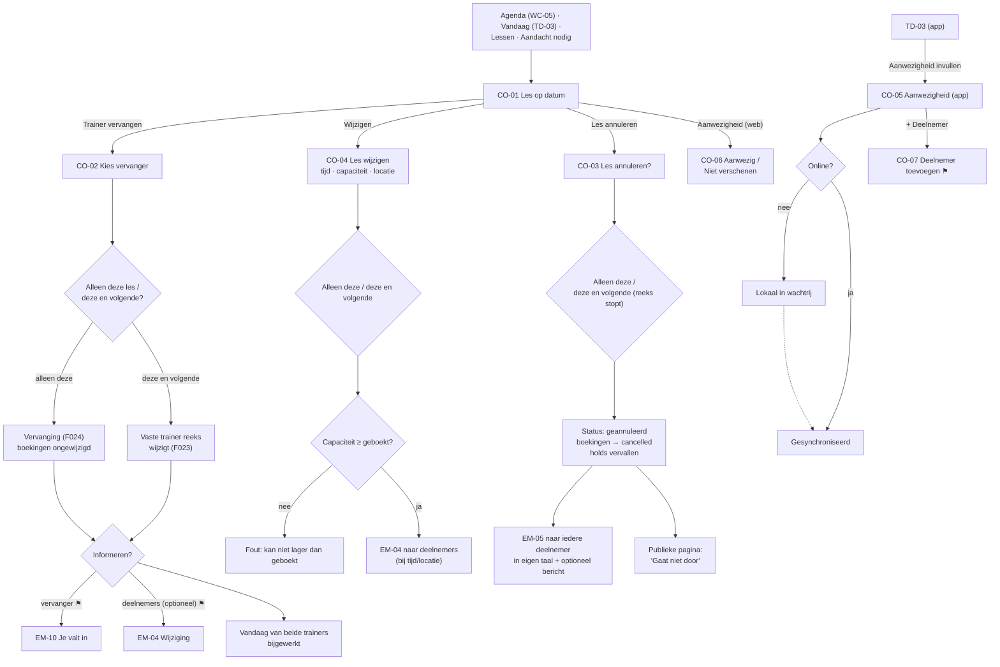

# Flow 06: Manage a class occurrence (substitution, cancellation, attendance)

**Open one class on one date → swap the trainer, change or cancel it, or take attendance**

| | |
|---|---|
| **Actors** | Owner/Admin (substitute, edit, cancel), assigned Trainer (attendance; substitute/cancel ⚑ [Q40](../open-questions.md#q40)) |
| **Surfaces** | Trainer web (CO-01 – CO-04, CO-06); trainer iOS/Android (CO-05 attendance; CO-02/CO-03 on mobile ⚑ [QE12](../open-questions.md#qe12)) |
| **Milestone** | M4 (web), M8 (mobile attendance) |
| **Spec** | `PRODUCT.md §18–§20, §43, §51`; `ROADMAP.md M4 (substitution changes the trainer only; cancellations notify in the recipient's language), ADR-012` |
| **Why critical** | Sick trainers and cancelled classes are the moments where Excel + WhatsApp hurt most. Every participant must hear about it in their own language, and bookings must survive a trainer swap (`§19`) |

## Features

| ID | Feature | Where in this flow |
|---|---|---|
| F022 | Recurring Classes | *Alleen deze les / Deze en volgende*; series info on CO-01 |
| F023 | Trainer Assignment | *Deze en alle volgende lessen* in CO-02 (changes the series' trainer) |
| F024 | Trainer Substitution | CO-02 *Alleen deze les* |
| F025 | Attendance | CO-05 (app), CO-06 (web), CO-07 |
| F026 | Cancellations | CO-03; client cancellations listed on CO-01 |
| F028 | Booking Capacity | Occupancy, holds, capacity edits (CO-04), walk-ins (CO-07) |
| F049 | Localized Transactional Emails | EM-04 (change), EM-05 (class cancelled) |
| F050 | Trainer Booking Notifications | EM-06/EM-07 go to the **current** (substitute) trainer |
| F037 / F038 | Booking Links / QR Codes | *Boekingslink* menu on CO-01 (this occurrence) |

## Flow diagram



## Screens

### CO-01 · Les op datum / Class on date (web)

**Features:** F022, F023, F028, F037, F025

```text
┌──────────────────────────────────────────────────────────────────────────────────────────────────┐
│ ‹ Agenda                                                                                         │
│ Strength                                                                                         │
│ dinsdag 22 september 2026 · 18:00–19:00 · John's Gym                                             │
│ Trainer: Sarah · Onderdeel van: Strength, elke dinsdag 18:00  ›                                  │
│                                                                                                  │
│ [ Trainer vervangen ]  [ Wijzigen ]  [ Les annuleren ]                    [ Boekingslink ▾ ]     │
├──────────────────────────────────────────────────────────────────────────────────────────────────┤
│ 6/8 geboekt · 1 plek vrij · 1 wacht op bevestiging (tot 14:20)                                   │
│                                                                                                  │
│ DEELNEMERS                                   AANWEZIGHEID                                        │
│ Anna de Vries    via boekingslink, 20 sep    ● Geboekt   ○ Aanwezig   ○ Niet verschenen          │
│ Bram Jansen      via boekingslink, 21 sep    ● Geboekt   ○ Aanwezig   ○ Niet verschenen          │
│ Chris Bakker     toegevoegd door John        ● Geboekt   ○ Aanwezig   ○ Niet verschenen          │
│ …                                                                                                │
│                                                                                                  │
│ GEANNULEERD                                                                                      │
│ Kees Smit        door klant op 21 sep, 09:12                                                     │
│                                                                                                  │
│ [ + Deelnemer toevoegen ]                                                                        │
└──────────────────────────────────────────────────────────────────────────────────────────────────┘
```

- The header answers what, when, where, who, and which series (`§20`: each occurrence has its own trainer, date, capacity, bookings, attendance and status).
- **Wacht op bevestiging** shows active holds (F029), so the owner understands why the public page says *gereserveerd*. Names of unverified guests are **not** shown.
- **Participant source**: *via boekingslink* (public, F031) or *toegevoegd door {name}* (CO-07).
- **Attendance** (CO-06) is inline and enabled from 30 minutes before the start ⚑ [Q38](../open-questions.md#q38).
- **Boekingslink ▾**: *Link kopiëren · QR-code tonen · Delen*, all scoped to this occurrence (F037/F038).
- If the occurrence differs from its series: *Aangepast t.o.v. de reeks: tijd* / *Changed from the series: time*.
- **Trainer (assigned) view**: the same page without *Trainer vervangen / Wijzigen / Les annuleren* ⚑ [Q40](../open-questions.md#q40). Participant emails are hidden from trainers; owners and admins can reveal them with a button available by keyboard and touch as well as pointer.

| Element | NL | EN |
|---|---|---|
| Series | Onderdeel van: {class}, elke {weekday} {time} | Part of: {class}, every {weekday} {time} |
| Actions | Trainer vervangen · Wijzigen · Les annuleren · Boekingslink | Substitute trainer · Edit · Cancel class · Booking link |
| Link menu | Link kopiëren · QR-code tonen · Delen | Copy link · Show QR code · Share |
| Occupancy | {booked}/{capacity} geboekt · `{free, plural, =0 {vol} one {# plek vrij} other {# plekken vrij}}` | {booked}/{capacity} booked · `{free, plural, =0 {full} one {# spot left} other {# spots left}}` |
| Holds | `{n, plural, one {# wacht} other {# wachten}}` op bevestiging (tot {time}) | {n} awaiting confirmation (until {time}) |
| Columns | Deelnemers · Aanwezigheid | Participants · Attendance |
| Source | via boekingslink, {date} · toegevoegd door {name} | via booking link, {date} · added by {name} |
| Cancelled section | Geannuleerd · door klant op {date}, {time} | Cancelled · by client on {date}, {time} |
| Add | + Deelnemer toevoegen | + Add participant |
| Changed | Aangepast t.o.v. de reeks: {fields} | Changed from the series: {fields} |
| Empty | Nog geen boekingen. Deel de boekingslink om deelnemers te krijgen. | No bookings yet. Share the booking link to get participants. |

### CO-02 · Trainer vervangen / Substitute trainer

**Features:** F024, F023

```text
┌──────────────────────────────────────────────────────────┐
│ Trainer vervangen                                      ✕ │
├──────────────────────────────────────────────────────────┤
│ Strength · di 22 sep 2026, 18:00–19:00                   │
│ Nu: Sarah                                                │
│                                                          │
│ Wie neemt het over?                                      │
│ ○ John                                                   │
│ ○ Mike           ! geeft dan al Boxing (18:00)           │
│ ○ Lisa                                                   │
│                                                          │
│ Voor                                                     │
│ ● Alleen deze les                                        │
│ ○ Deze en alle volgende lessen                           │
│                                                          │
│ [x] Mike een e-mail sturen                               │
│ [ ] 7 deelnemers informeren                              │
│                                                          │
│ De boekingen blijven gewoon staan.                       │
├──────────────────────────────────────────────────────────┤
│                           [ Annuleren ]  [ Vervangen ]   │
└──────────────────────────────────────────────────────────┘
```

- **Candidates**: every trainer in this workspace except the current one. The `!` conflict hint only considers **this workspace** (tenant isolation, `§77`).
- **Alleen deze les** = substitution (F024): only this occurrence's trainer changes; bookings are untouched (`§19`).
- **Deze en alle volgende lessen** = the series' regular trainer changes from this date (F023). The confirm text says so: *Mike wordt vanaf 22 september de vaste trainer van Strength.*
- **Emails**:
  - *Mike een e-mail sturen*: EM-10, which `§51` doesn't list yet ⚑ [Q37](../open-questions.md#q37), [QE01](../open-questions.md#qe01). On by default.
  - *Deelnemers informeren*: EM-04, off by default ⚑ [Q36](../open-questions.md#q36).
- **After saving**: the calendar shows *Mike (vervangt Sarah)*; Mike's *Vandaag* shows *Je valt in voor Sarah*; Sarah's shows *Overgenomen door Mike*. New-booking emails (EM-06) now go to Mike.

| Element | NL | EN |
|---|---|---|
| Title / button | Trainer vervangen · Vervangen | Substitute trainer · Substitute |
| Current | Nu: {trainer} | Currently: {trainer} |
| Question | Wie neemt het over? | Who's taking over? |
| Conflict | geeft dan al {class} ({time}) · heeft dan al een privésessie ({time}) | already teaching {class} then ({time}) · already has a private session then ({time}) |
| Scope | Voor · Alleen deze les · Deze en alle volgende lessen | For · Only this class · This and all following classes |
| Series note | {trainer} wordt vanaf {date} de vaste trainer van {class}. | {trainer} becomes the regular trainer of {class} from {date}. |
| Emails | {trainer} een e-mail sturen · `{n, plural, one {# deelnemer} other {# deelnemers}}` informeren | Email {trainer} · Notify `{n, plural, one {# participant} other {# participants}}` |
| Reassurance | De boekingen blijven gewoon staan. | Bookings stay exactly as they are. |
| Done | {substitute} vervangt {original} op {date}. | {substitute} is covering for {original} on {date}. |
| No other trainers | Er zijn geen andere trainers in {workspace}. [ Trainer uitnodigen ] | There are no other trainers at {workspace}. [ Invite a trainer ] |

### CO-03 · Les annuleren / Cancel class

**Features:** F026, F049 (EM-05), F028

```text
┌──────────────────────────────────────────────────────────┐
│ Les annuleren?                                           │
├──────────────────────────────────────────────────────────┤
│ Strength · dinsdag 22 september 2026, 18:00–19:00        │
│                                                          │
│ ● Alleen deze les                                        │
│ ○ Deze en alle volgende lessen (de reeks stopt)          │
│                                                          │
│ 7 deelnemers krijgen een e-mail, ieder in de eigen       │
│ gekozen taal. 1 reservering die nog niet bevestigd is,   │
│ vervalt.                                                 │
│                                                          │
│ Bericht aan deelnemers (optioneel)                       │
│ [ Sarah is ziek, sorry! Volgende week gewoon weer.     ] │
│ Je bericht wordt niet vertaald.                          │
│                                                          │
├──────────────────────────────────────────────────────────┤
│                        [ Terug ]  [ Les annuleren ]      │
└──────────────────────────────────────────────────────────┘
```

- **Participants are always informed** (EM-05 is a required email, `§51`). Only the optional message is up to the owner ⚑ [Q42](../open-questions.md#q42).
- The count line adapts: no participants → *Er zijn nog geen deelnemers, dus niemand krijgt een e-mail.*; *Deze en volgende* → *12 deelnemers in 4 lessen krijgen een e-mail.*
- **The message is user content**: it's sent as typed, inside the localized template, marked *Bericht van John's Gym:* / *Message from John's Gym:* (`§3`). The hint *Je bericht wordt niet vertaald.* prevents surprises for English-language participants.
- **Results**:
  - The occurrence becomes *Geannuleerd* (not deleted).
  - All bookings become `cancelled`.
  - Active holds expire, and their confirmation links show PB-08e.
  - The public page shows *Gaat niet door* for the rest of that day.
  - The assigned trainer gets EM-07-style notice ⚑ [Q37](../open-questions.md#q37).
- **Undo**: not in MVP. Emails have gone out, so the owner creates a new occurrence instead ⚑ [Q41](../open-questions.md#q41).
- Cancelling an occurrence **in the past** is allowed only for the record (*ging niet door*) and sends no emails.

| Element | NL | EN |
|---|---|---|
| Title | Les annuleren? | Cancel class? |
| Scope | Alleen deze les · Deze en alle volgende lessen (de reeks stopt) | Only this class · This and all following classes (the series ends) |
| Count | `{n, plural, =0 {Er zijn nog geen deelnemers, dus niemand krijgt een e-mail.} one {# deelnemer krijgt een e-mail in de eigen gekozen taal.} other {# deelnemers krijgen een e-mail, ieder in de eigen gekozen taal.}}` | `{n, plural, =0 {There are no participants yet, so nobody gets an email.} one {# participant gets an email in their own language.} other {# participants get an email, each in their own language.}}` |
| Series count | {n} deelnemers in {classes} lessen krijgen een e-mail. | {n} participants in {classes} classes get an email. |
| Holds | `{h, plural, one {# reservering die nog niet bevestigd is, vervalt.} other {# reserveringen die nog niet bevestigd zijn, vervallen.}}` | `{h, plural, one {# unconfirmed reservation will expire.} other {# unconfirmed reservations will expire.}}` |
| Message | Bericht aan deelnemers (optioneel) · Je bericht wordt niet vertaald. | Message to participants (optional) · Your message won't be translated. |
| Buttons | Terug · Les annuleren | Back · Cancel class |
| Done | Strength op {date} is geannuleerd. {n} deelnemers zijn geïnformeerd. | Strength on {date} has been cancelled. {n} participants have been notified. |
| EM-05 subject | {class} op {date} gaat niet door | {class} on {date} is cancelled |
| EM-05 body | Helaas gaat {class} op {date} om {time} niet door. Je boeking is geannuleerd. · Bericht van {workspace}: "{message}" · [ Andere lessen bekijken ] | Unfortunately {class} on {date} at {time} is cancelled. Your booking has been cancelled. · Message from {workspace}: "{message}" · [ See other classes ] |

### CO-04 · Les wijzigen / Edit class (this occurrence)

**Features:** F022, F028, F049

```text
┌──────────────────────────────────────────────────────────┐
│ Les wijzigen                                           ✕ │
├──────────────────────────────────────────────────────────┤
│ Strength · di 22 sep 2026                                │
│                                                          │
│ Begin          Einde           Capaciteit                │
│ [ 18:00 ]      [ 19:00 ]       [ 8 ]                     │
│ Locatie                                                  │
│ [ John's Gym                                         ▾ ] │
│                                                          │
│ Wijzigen voor                                            │
│ ● Alleen deze les                                        │
│ ○ Deze en alle volgende lessen                           │
│                                                          │
│ [x] 7 deelnemers informeren over de nieuwe tijd          │
├──────────────────────────────────────────────────────────┤
│                           [ Annuleren ]  [ Opslaan ]     │
└──────────────────────────────────────────────────────────┘
```

- The notify checkbox appears only when **time, date or location** changes and there are participants (EM-04). A capacity change never emails anyone.
- **Capacity below the number booked** is blocked: *Er zijn al 7 boekingen. De capaciteit kan niet lager dan 7.* Lowering it to exactly the number booked makes the class *Vol*.
- The name and description are edited on the series (*Lessen*), not per occurrence, because they're user content shown on the public page.

| Element | NL | EN |
|---|---|---|
| Title | Les wijzigen | Edit class |
| Labels | Begin · Einde · Capaciteit · Locatie · Wijzigen voor | Start · End · Capacity · Location · Apply to |
| Notify | `{n, plural, one {# deelnemer} other {# deelnemers}}` informeren over de nieuwe tijd | Notify `{n, plural, one {# participant} other {# participants}}` about the new time |
| Capacity error | Er zijn al {n} boekingen. De capaciteit kan niet lager dan {n}. | There are already {n} bookings. Capacity can't be lower than {n}. |
| End before start | De eindtijd moet na de begintijd liggen. | The end time must be after the start time. |

### CO-05 · Aanwezigheid (app) / Attendance (app)

**Features:** F025 · From TD-03 *Aanwezigheid invullen*, or from the Today nudge.

```text
┌────────────────────────────────────────┐
│ ‹ Strength             Aanwezigheid    │
│ di 22 sep · 18:00–19:00                │
│ 5 aanwezig · 1 niet verschenen · 1 open│
├────────────────────────────────────────┤
│ Anna de Vries                          │
│ [✓ Aanwezig      ] [ Niet verschenen ] │
│────────────────────────────────────────│
│ Bram Jansen                            │
│ [  Aanwezig      ] [✓ Niet verschenen] │
│────────────────────────────────────────│
│ Chris Bakker                           │
│ [  Aanwezig      ] [ Niet verschenen ] │
│────────────────────────────────────────│
│ …                                      │
│────────────────────────────────────────│
│ GEANNULEERD                            │
│ Kees Smit · door klant, 21 sep         │
├────────────────────────────────────────┤
│ [ + Deelnemer toevoegen ]              │
└────────────────────────────────────────┘
```

- **Two big buttons per person** with text labels (`§43`: *Aanwezig*, *Niet verschenen*). Tapping the selected one again returns to *Geboekt*.
- Enabled from 30 minutes before the start ⚑ [Q38](../open-questions.md#q38); before that: *Aanwezigheid kun je invullen vanaf {time}.*
- Each tap **saves immediately** (queued when offline, synced later, as in WL-07). There's no *Opslaan* button to forget.
- *Iedereen aanwezig* (bulk attendance) is a Release 1.1 item, so it's deliberately missing.
- The summary line updates live and is announced politely to screen readers.

| Element | NL | EN |
|---|---|---|
| Title | Aanwezigheid | Attendance |
| Summary | {a} aanwezig · {n} niet verschenen · {o} open | {a} attended · {n} no-show · {o} open |
| Buttons (`§43`) | Aanwezig · Niet verschenen | Attended · No-show |
| Too early | Aanwezigheid kun je invullen vanaf {time}. | You can take attendance from {time}. |
| Cancelled class | Deze les is geannuleerd. Aanwezigheid is niet nodig. | This class is cancelled. No attendance needed. |
| Queued | Wacht op verbinding | Waiting for connection |

### CO-06 · Aanwezigheid (web) / Attendance (web)

**Features:** F025 · Inline in CO-01: a three-state radio group per participant (*Geboekt · Aanwezig · Niet verschenen*). It's keyboard-operable with the arrow keys and saves on change, with a *Opgeslagen* tick per row.

### CO-07 · Deelnemer toevoegen / Add participant

**Features:** F025, F028, F006 ⚑ [Q39](../open-questions.md#q39) · For walk-ins, or someone who booked by WhatsApp.

```text
┌────────────────────────────────────────┐
│ Deelnemer toevoegen                    │
├────────────────────────────────────────┤
│ [ Zoek klant…                        ] │
│ Recent: Anna de Vries · Lisa Smit      │
│ + Nieuwe klant                         │
│                                        │
│ ! De les is vol (8/8). Toch toevoegen? │
│   De bezetting wordt 9/8.              │
│                                        │
│ [x] Meteen op aanwezig zetten          │
│ [ ] Bevestiging per e-mail sturen      │
│                                        │
│ [          Toevoegen                 ] │
└────────────────────────────────────────┘
```

- Uses the client picker from PS-02.
- The **capacity override** is explicit and shown as *9/8* everywhere. It only applies to trainer-added participants; public booking never overbooks (F028).
- *Meteen op aanwezig zetten* is on by default when the class has already started (the walk-in case).

| Element | NL | EN |
|---|---|---|
| Title / button | Deelnemer toevoegen · Toevoegen | Add participant · Add |
| Full | De les is vol ({b}/{c}). Toch toevoegen? De bezetting wordt {b1}/{c}. | The class is full ({b}/{c}). Add anyway? Occupancy will be {b1}/{c}. |
| Options | Meteen op aanwezig zetten · Bevestiging per e-mail sturen | Mark as attended now · Send a confirmation email |
| Already in | {name} staat al op de lijst. | {name} is already on the list. |

## Edge cases

| Case | Expected behaviour | Screen |
|---|---|---|
| **DST: series across 25 oktober 2026** | *Elke dinsdag 18:00* is 18:00 on 20 and 27 October; tested with fixtures (R2). *Deze en volgende* edits keep wall-clock time across the change | CO-01, CO-04 |
| **Edit crosses the materialisation horizon** | *Deze en volgende* also applies to occurrences materialised later (the rule changes, not just the rows) | CO-04 |
| **Substitution for a past occurrence** | Allowed, to record who actually taught; no emails | CO-02 |
| **Substitute has a conflict in another workspace** | Invisible here (tenant isolation). Mike may see it in his own *Mijn agenda* | CO-02 |
| **Substituted trainer is looking at the app** | On the next refresh: *Overgenomen door Mike* (dimmed) | TD-01 |
| **New booking after the substitution** | EM-06 goes to the substitute, not the original trainer | — |
| **Cancel while holds are pending** | Holds expire; the confirmation link → PB-08e *Deze les gaat niet door* | CO-03 |
| **Cancel after the class started** | Allowed for the record; no emails; attendance disabled | CO-03 |
| **Participant language mix** | Each EM-05 in the participant's language; the owner's message as typed | CO-03 |
| **Participant without a known language** (added by a trainer) | Workspace default language | CO-03, CO-07 |
| **Client cancels at the last minute** | Moves to *Geannuleerd* on CO-01 with a timestamp; the trainer gets EM-07; the spot frees for public booking | CO-01 |
| **Attendance on a cancelled occurrence** | Disabled with an explanation | CO-05 |
| **Two people take attendance at once** (owner on web, trainer on phone) | Last write wins per participant; both screens update on refresh | CO-05, CO-06 |
| **Offline attendance** | Queued; the summary line counts local state; the sync indicator as in WL-07 | CO-05 |
| **Capacity lowered below bookings** | Blocked | CO-04 |
| **Occurrence without a trainer** | CO-01 shows *Nog geen trainer* + *Trainer toewijzen* (CO-02 without "Nu:") | CO-01 |
| **The only trainer is the one who's ill** | CO-02 has no candidates → *Trainer uitnodigen*, or cancel via CO-03 | CO-02 |

## Platform notes: iOS HIG vs Material 3

Attendance (CO-05) is in the M8 apps. Substitution and cancellation on mobile are an open question ([QE12](../open-questions.md#qe12)); if they're added, they follow the same patterns as flow 04.

| Topic | iOS (SwiftUI) | Android (Compose, Material 3) |
|---|---|---|
| Attendance buttons | Two large bordered buttons per row (`.borderedProminent` for the selected one), not a tiny segmented control | `SingleChoiceSegmentedButtonRow` with two segments at ≥ 48 dp; the selected segment shows a check icon |
| Row layout at large text | Name above the buttons; buttons wrap to a vertical stack at AX sizes | Same at font scale ≥ 150 % |
| Saving feedback | Subtle haptic on change; no toast | No snackbar per tap (too noisy); a small check icon in the row |
| Add participant | `+` in the bottom toolbar → sheet with the PS-02 picker | Extended FAB *Deelnemer* → `ModalBottomSheet` with the picker |
| Destructive (if CO-03 on mobile) | `.confirmationDialog` with a red *Les annuleren* | `AlertDialog`, confirm button in the error colour |
| Screen readers | Row reads "Anna de Vries, aanwezig" and exposes the two actions as a custom rotor | Row reads the name + state; the segmented buttons announce "geselecteerd" |
| Web (CO-01/06) | — | Radio groups, keyboard arrows, visible focus; dialogs trap focus and return it to the trigger |

## Open questions

[Q36](../open-questions.md#q36) inform participants on substitution · [Q37](../open-questions.md#q37) how the substitute hears about it · [Q38](../open-questions.md#q38) who takes attendance, and when · [Q39](../open-questions.md#q39) walk-ins over capacity · [Q40](../open-questions.md#q40) trainer rights · [Q41](../open-questions.md#q41) undo a cancellation · [Q42](../open-questions.md#q42) message on cancellation · [QE01](../open-questions.md#qe01) · [QE12](../open-questions.md#qe12)
