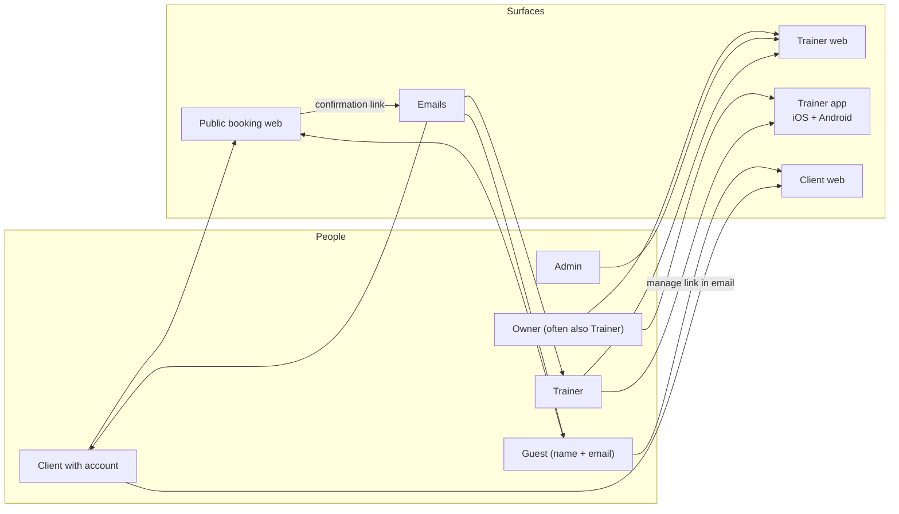
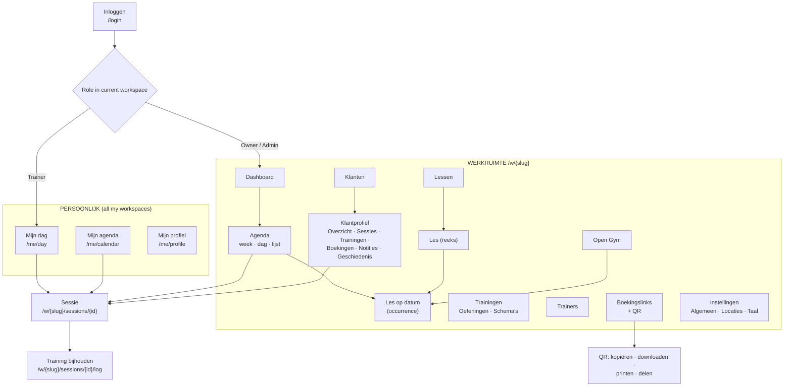
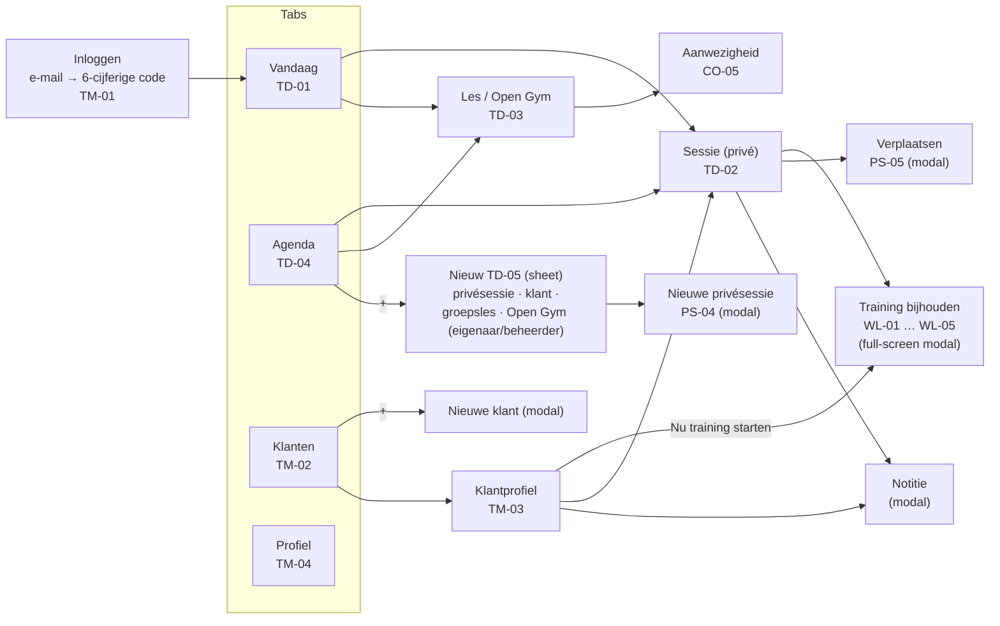
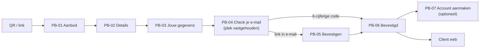
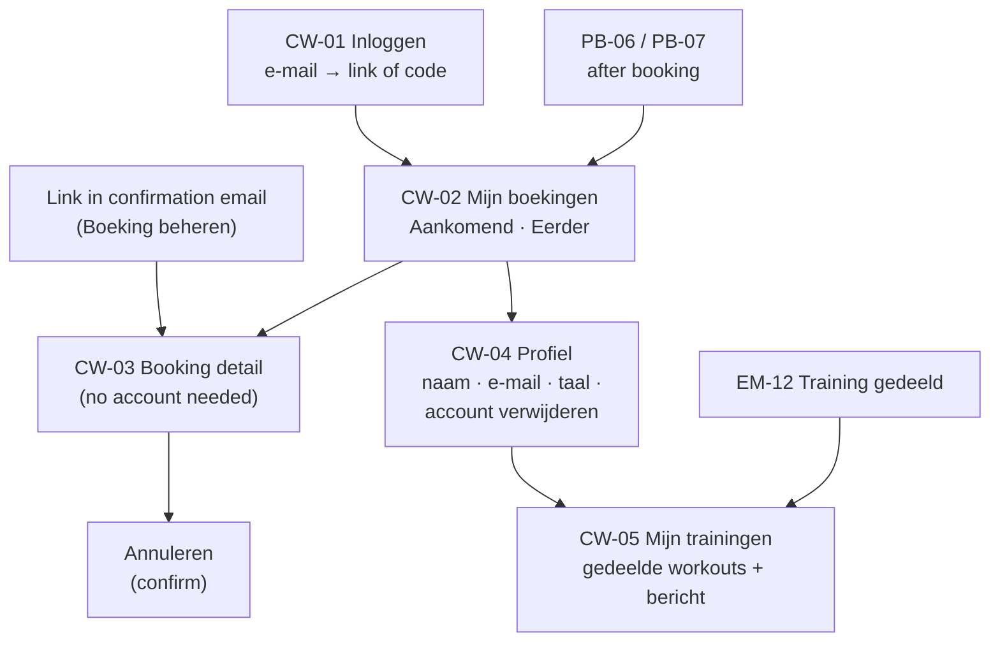

# Information architecture

| | |
|---|---|
| **Status** | Draft for validation with the pilot owner |
| **Covers** | Trainer web, trainer iOS/Android apps, public booking web, client web, transactional emails |
| **Sources** | `PRODUCT.md §2–§15, §43–§51, §78–§79`; `ROADMAP.md §4.2, M2–M8` |

Assumptions that `PRODUCT.md` doesn't settle are marked **⚑** and linked to [open-questions.md](open-questions.md).

---

## 1. Principles

1. **Two scopes, never mixed up.** A trainer works in a **personal scope** (*Mijn dag*, *Mijn agenda*: everything assigned to me across all my workspaces, `§4, §46–47, §78`) and in a **workspace scope** (*Agenda*, *Klanten*, *Lessen* … of one workspace, `§48`). The UI always shows which scope you're in. A workspace screen **never** shows data from another workspace, not even as "busy" blocks (tenant isolation, `§77`).
2. **Web administers, mobile operates.** Trainer web is the admin surface (`§15`). The phone is for the trainer's day: Vandaag, sessions, logging, notes, attendance (`§15`, `ROADMAP M8`).
3. **Clients never need an app or a password.** Public booking and client web are responsive web pages, reached through a QR code, a link or an email (`§2.3, §2.4`).
4. **One scheduling engine, one session screen.** Private sessions, group classes and Open Gym share one detail pattern. The type changes the sections, not the navigation (`§16`).
5. **Language is always one tap away** on public surfaces (`NL | EN` in the header, `§15`), and one menu away on trainer surfaces.
6. **Infer, then offer to change.** Location, workspace, trainer and duration are pre-filled and explained. The UI asks only when the answer is ambiguous (`§2.6, §13`).

---

## 2. Surfaces

| Surface | Who | Device | Tech | Milestone | Main features |
|---|---|---|---|---|---|
| **Trainer web** | Owner, Admin, Trainer | Laptop/desktop (responsive down to tablet) | Next.js | M2–M7 | F001–F026, F034, F036–F048 |
| **Trainer iOS app** | Trainer (incl. owner-trainers) | iPhone | Swift + SwiftUI | M8 | Mobile slices of F013, F020, F025, F043–F048, F010 |
| **Trainer Android app** | Trainer (incl. owner-trainers) | Android phone | Kotlin + Compose (Material 3) | M8 | Same as iOS (parity) |
| **Public booking web** | Guest, client | Phone first (from QR), also desktop | Next.js (SSR) | M5–M6 | F027–F032, F035, F037, F038 |
| **Client web** | Guest (via email link), client with account | Phone first | Next.js | M5 | F033, F026, F010 |
| **Emails** | Clients, guests, trainers | Any mail client | React Email | M1 → M5 | F049, F050, F011, F001 |



---

## 3. Roles and what each role sees

Roles come from `PRODUCT.md §9, §50`: **Owner, Admin, Trainer** inside a workspace, plus **Client/Guest** on public surfaces. There are no custom permissions in MVP. A person has one role **per workspace**, so Sarah can be *Trainer* at John's Gym and *Owner* of Sarah Personal Training at the same time (`§6`).

### 3.1 Permission matrix

✓ = can · 👁 = view only · — = can't · ⚑ = assumption, see the linked question

| Capability | Owner | Admin | Trainer | Client (account) | Guest |
|---|---|---|---|---|---|
| Workspace settings: name, default language, timezone, locations | ✓ | — ⚑ [Q05](open-questions.md#q05) | — | — | — |
| Invite trainers | ✓ | ✓ | — | — | — |
| Change roles, remove members, transfer ownership | ✓ | — ⚑ [Q05](open-questions.md#q05) | — | — | — |
| Dashboard: whole workspace today (`§45`) | ✓ | ✓ | — (sees *Mijn dag*, `§46`) | — | — |
| Workspace calendar (`§48`) | ✓ | ✓ | 👁 ⚑ [Q02](open-questions.md#q02) | — | — |
| Personal calendar across workspaces (`§47`) | ✓ own | ✓ own | ✓ own | — | — |
| Create / reschedule / cancel private sessions | ✓ any | ✓ any | ✓ own ⚑ [Q27](open-questions.md#q27) | — | — |
| Class templates and recurring series | ✓ | ✓ | — | — | — |
| Substitute trainer / cancel a class occurrence | ✓ | ✓ | — ⚑ [Q40](open-questions.md#q40) | — | — |
| Mark attendance | ✓ | ✓ | ✓ own sessions and classes | — | — |
| Open Gym: create, publish | ✓ | ✓ ⚑ [Q05](open-questions.md#q05) | — | — | — |
| Booking links and QR codes: manage | ✓ | ✓ ⚑ [Q05](open-questions.md#q05) | 👁 copy/share | — | — |
| Clients: list and profile | ✓ all | ✓ all | ✓ ⚑ [Q03](open-questions.md#q03) | — | — |
| Notes: write client and session notes | ✓ | ✓ | ✓ | — | — |
| Notes: read *trainer-only* notes | ✓ | ✓ | ✓ ⚑ [Q04](open-questions.md#q04) | — | — |
| Exercises, custom exercises, templates | ✓ | ✓ | ✓ | — | — |
| Log workouts | ✓ | ✓ | ✓ own sessions | — | — |
| Book group classes and Open Gym | — | — | — | ✓ | ✓ |
| View and cancel own bookings | — | — | — | ✓ client web | ✓ via manage link in email |
| Personal profile and language | ✓ | ✓ | ✓ | ✓ | language only (per booking) |

### 3.2 Role → navigation

Trainer web shows or hides whole sections by role. Hidden means absent from the navigation **and** blocked by the API; it's not just greyed out.

| Nav item (NL / EN) | Owner | Admin | Trainer |
|---|---|---|---|
| Dashboard / Dashboard | Whole workspace, toggle to *Mijn dag* | Whole workspace | *Mijn dag* |
| Agenda / Calendar | Edit | Edit | View ⚑ [Q02](open-questions.md#q02) |
| Klanten / Clients | ✓ | ✓ | ✓ ⚑ [Q03](open-questions.md#q03) |
| Lessen / Classes | ✓ | ✓ | — |
| Open Gym / Open Gym | ✓ | ✓ ⚑ | — |
| Trainingen / Workouts | ✓ | ✓ | ✓ |
| Trainers / Trainers | ✓ | ✓ (invite only) | — |
| Boekingslinks / Booking links | ✓ | ✓ ⚑ | 👁 |
| Instellingen / Settings | ✓ | — ⚑ | — |

---

## 4. Trainer web

### 4.1 Frame

The left sidebar holds the scope switcher and the workspace navigation (`§44`, same order). The top bar holds the page title, the global **+ Nieuw** menu and client search. Language and profile sit in the user menu.

```text
┌──────────────────────┬──────────────────────────────────────────────────────────────────────────┐
│ ▾ John's Gym         │  Agenda                                    [ Zoek klant…  ]  [ + Nieuw ▾ ] │
│   Eigenaar · Trainer │                                                                          │
│──────────────────────│                                                                          │
│ PERSOONLIJK          │                                                                          │
│   Mijn dag           │                                                                          │
│   Mijn agenda        │                         (page content)                                   │
│──────────────────────│                                                                          │
│ JOHN'S GYM           │                                                                          │
│   Dashboard          │                                                                          │
│ ▸ Agenda             │                                                                          │
│   Klanten            │                                                                          │
│   Lessen             │                                                                          │
│   Open Gym           │                                                                          │
│   Trainingen         │                                                                          │
│   Trainers           │                                                                          │
│   Boekingslinks      │                                                                          │
│   Instellingen       │                                                                          │
│──────────────────────│                                                                          │
│ ○ Keyvan M.       ⋯  │                                                                          │
│   Feedback geven     │                                                                          │
└──────────────────────┴──────────────────────────────────────────────────────────────────────────┘
```

- **Scope switcher** (`▾ John's Gym`): lists every workspace with the user's role in it (`Eigenaar`, `Beheerder`, `Trainer`). With a single workspace it's a plain label, and the *Persoonlijk* group still shows (the pilot owner is also a trainer).
- **+ Nieuw ▾**: *Privésessie*, *Groepsles*, *Open Gym*, *Klant*. It shows only the items the role may create.
- **User menu (⋯)**: *Mijn profiel*, *Taal: Nederlands / English*, *Uitloggen*.
- **Feedback geven**: the pilot feedback link (`ROADMAP §7`) on every page.
- Below 1024 px the sidebar collapses to a menu button. Trainer web is not optimised for phones; the apps cover that.

### 4.2 Sitemap



### 4.3 Pages

Paths are proposals for the web routes. They're English and language-neutral; the UI language comes from the user's preference, not the URL.

| Page (NL / EN) | Path | Roles | Features | Screens |
|---|---|---|---|---|
| Inloggen / Sign in | `/login` | all | F001 | TW-10 |
| Mijn dag / My day | `/me/day` | anyone with a trainer profile | F013, F012, F025 | WC-01 (personal variant) |
| Mijn agenda / My calendar | `/me/calendar` | anyone with a trainer profile | F013 | WC-02 (personal variant) |
| Mijn profiel / My profile | `/me/profile` | all | F005, F010, F012 | TW-09 |
| Dashboard | `/w/{slug}` | Owner, Admin | F014, F025, F036 | WC-01 |
| Agenda / Calendar | `/w/{slug}/calendar?view=week\|day\|list` | Owner, Admin, (Trainer 👁) | F014 | WC-02 – WC-07 |
| Sessie / Session | `/w/{slug}/sessions/{id}` | per role | F020, F025, F046, F047 | PS-05, PS-06 |
| Training bijhouden / Log workout | `/w/{slug}/sessions/{id}/log` | Owner, Admin, assigned Trainer | F043, F044 | WL-06 |
| Klanten / Clients | `/w/{slug}/clients` | Owner, Admin, Trainer ⚑ | F006 | TW-01 |
| Klantprofiel / Client profile | `/w/{slug}/clients/{id}/{tab}` | Owner, Admin, Trainer ⚑ | F006, F018, F045, F046 | TW-02 |
| Lessen / Classes | `/w/{slug}/classes` | Owner, Admin | F021, F022 | TW-03 |
| Les op datum / Class on date | `/w/{slug}/classes/{id}/{yyyy-mm-dd}` | Owner, Admin, assigned Trainer | F022–F026, F028 | CO-01 – CO-06 |
| Open Gym | `/w/{slug}/open-gym` | Owner, Admin | F034, F036 | TW-04 |
| Trainingen / Workouts | `/w/{slug}/workouts/{exercises\|templates}` | Owner, Admin, Trainer | F039–F041 | TW-05 |
| Trainers | `/w/{slug}/trainers` | Owner, Admin | F011, F017, F023 | TW-06 |
| Boekingslinks / Booking links | `/w/{slug}/booking-links` | Owner, Admin, (Trainer 👁) | F037, F038 | TW-07 |
| Instellingen / Settings | `/w/{slug}/settings/{general\|locations\|language}` | Owner | F002, F015, F016, F010 | TW-08 |

**Client profile tabs** follow `§34` exactly: *Overzicht, Sessies, Trainingen, Boekingen, Notities, Geschiedenis* / *Overview, Sessions, Workouts, Bookings, Notes, History*.

---

## 5. Trainer app (iOS and Android)

### 5.1 Structure

Four top-level destinations, identical on both platforms. They're a **tab bar** on iOS and a **navigation bar** on Android (Material 3).

| Tab (NL / EN) | Scope | Content | Features |
|---|---|---|---|
| **Vandaag** / Today | Personal (all workspaces) | Today's sessions and classes, next up, attendance to fill in | F013, F025 |
| **Agenda** / Calendar | Personal (all workspaces) | Day and week list; *+* opens *Nieuw* (TD-05) | F013, F020 |
| **Klanten** / Clients | Per workspace, grouped | Search, client profile, notes, workout history, *+ Nieuwe klant*, *Nu training starten* | F006, F045, F046 |
| **Profiel** / Profile | Me | Language, my workspaces, sign out, delete account, feedback | F005, F010, F012, E017 |

The rest is pushed or presented from these tabs:



- **Navigation depth stays at most 2 pushes** from a tab. The workout logger is a **full-screen modal** because it's a focused task with its own exit (*Afronden*).
- **Owner/Admin on mobile.** M8 scopes the app to the trainer's day. Owners get two extras: a *Mijn dag | John's Gym* toggle on *Vandaag* to see the whole workspace today, read-mostly ⚑ [Q01](open-questions.md#q01), and **creating a group class (one-off or weekly) or Open Gym from *+*** (TD-05, `PRODUCT.md §15`, added 23 September 2026) ⚑ [QE16](open-questions.md#qe16). Other workspace administration (class templates, series edits, trainers, links, settings) stays on web. The app links out to it (*Beheer op het web* / *Manage on the web*).
- **Sign-in** uses email + **6-digit code** (ADR-007); deep links come in 1.1. The code field uses the platform's one-time-code autofill.
- **Language** is set in *Profiel → Taal* and follows the in-app choice, not only the OS language (`ROADMAP M2`). Changing it re-renders immediately without a restart.

### 5.2 Platform conventions (both apps)

Same flow, same content and same order on both platforms, with a native look on each (`ROADMAP §4.2`).

| Element | iOS (HIG) | Android (Material 3) |
|---|---|---|
| Top-level navigation | Tab bar, 4 items, SF Symbols | Navigation bar, 4 destinations, Material Symbols |
| Screen title | Large title that collapses on scroll | Top app bar (medium or small) |
| Primary create action | `+` in the navigation bar | FAB (Floating Action Button) on *Agenda* |
| Create/edit forms | Sheet (`.large` detent) with *Annuleren* / *Opslaan* in the bar | Full-screen dialog with ✕ and *Opslaan* |
| Row actions | Swipe actions + context menu (long press) | Overflow menu `⋮`; no swipe actions by default |
| Destructive confirmation | Action sheet / alert with a red destructive button | Dialog with the text button in the error colour |
| Pickers | Inline/compact `DatePicker`; 24 h from locale | M3 date picker dialog and time picker dialog (24 h input) |
| Refresh | Pull to refresh | Pull to refresh (`PullToRefreshBox`) |
| Back | Edge swipe + back button with the previous title | System back / predictive back gesture |
| Feedback after saving | Brief inline confirmation; no blocking alert | Snackbar |
| Text size | Dynamic Type up to AX sizes | Font scale up to 200 % |
| Screen readers | VoiceOver labels | TalkBack content descriptions |

---

## 6. Public booking web

A client scans a QR code or opens a link. There's no app, no password and no phone number (`§2.3, §2.4, §22`).

### 6.1 Entry points and link scopes

Every booking link (F037) is a short URL that is also used for the QR code (F038). It resolves to one of the five scopes from `§32`:

| Scope (`§32`) | Resolves to | Lands on |
|---|---|---|
| All bookings | `/book/{workspace}` | PB-01, tabs *Alles · Groepslessen · Open Gym* |
| Group classes | `/book/{workspace}/classes` | PB-01, group classes only |
| Open Gym | `/book/{workspace}/open-gym` | PB-01, Open Gym only |
| A specific class | `/book/{workspace}/classes/{classId}` | PB-01, filtered to that class's upcoming dates |
| A specific occurrence | `/book/{workspace}/s/{sessionId}` | PB-02 directly |

Short link: `/l/{code}` → redirect to the scope above. The short form keeps QR codes small and lets the owner change the target without reprinting a poster ⚑ [QE07](open-questions.md#qe07).

### 6.2 Steps



The full flow with every unhappy path is in [flows/01-public-booking.md](flows/01-public-booking.md).

### 6.3 Language behaviour

- The header always shows **`NL | EN`** (`§15`). Switching keeps the current step and whatever the visitor has typed.
- Initial language (`§32`, ADR-017): the link either *detects the browser language* or sets a *fixed language*. Detection takes the first supported browser language and falls back to English. `?lang=nl|en` on any URL and the visitor's own switch override both.
- The language in use when the visitor submits PB-03 is **stored on the hold**. It drives the confirmation email, the confirmation page, all later emails and the client dashboard (`§3 "Client language"`).

---

## 7. Client web

Initially: upcoming bookings, past bookings, cancellation, profile (`§15`).



| Page (NL / EN) | Path | Who | Features |
|---|---|---|---|
| Inloggen / Sign in | `/my/login` | Client | F001, F033 |
| Mijn boekingen / My bookings | `/my` | Client with account | F033 |
| Boeking / Booking | `/my/bookings/{id}`, or `/manage/{token}` for guests | Client, guest | F033, F026 |
| Profiel / Profile | `/my/profile` | Client with account | F033, F010, F006 |
| Mijn trainingen / My workouts | `/my/workouts` and `/my/workouts/{id}` | Signed-in client | F045, F048 |

- **Guests without an account** manage one booking through the tokenised link in their confirmation email (`/manage/{token}`). From there they can cancel it or *Account aanmaken* to see all their bookings.
- A client can have bookings at more than one workspace (same email). *Mijn boekingen* lists them together with the workspace name on each booking. Each booking still belongs to its own workspace ⚑ [QE05](open-questions.md#qe05).
- A trainer-created private session is not automatically a booking in CW-02/03. After the trainer explicitly shares its workout, the recap and optional client message appear in CW-05. Only the owning client can read it; the internal note stays in trainer surfaces ([QE04](open-questions.md#qe04)).

---

## 8. Emails

Every email exists in `nl-NL` and `en` with one template structure (`§51, §74`). Booking emails carry the workspace name, the date/time in the workspace timezone, and a link to manage the booking. The workout recap email (EM-12) carries the workout date and a link to the authenticated client workout view.

**Recipient language** (communication language, [ADR-017](../decisions/ADR-017-language-policy.md)): stored user preference → language chosen at booking (guests) → workspace default. For trainer invitations it's the language picked for the invitee → workspace default (`§49`).

| ID | NL subject (proposed) | EN subject (proposed) | To | Trigger | Features |
|---|---|---|---|---|---|
| EM-01 | Bevestig je boeking bij {workspace} | Confirm your booking at {workspace} | Guest/client | PB-03 submitted (hold created) | F030, F049 |
| EM-02 | Je boeking is bevestigd: {class}, {date} | Your booking is confirmed: {class}, {date} | Guest/client | Booking confirmed | F031, F049 |
| EM-03 | Je boeking is geannuleerd | Your booking has been cancelled | Guest/client | Client cancels (CW-03) | F026, F049 |
| EM-04 | Wijziging: {class} op {date} | Change: {class} on {date} | Booked clients; private-session client | Time or location changed (PS-05, CO-04) | F026, F049 |
| EM-05 | {class} op {date} gaat niet door | {class} on {date} is cancelled | Booked clients | Occurrence cancelled (CO-03) | F026, F049 |
| EM-06 | Nieuwe boeking: {name} voor {class} | New booking: {name} for {class} | Assigned trainer | Booking confirmed | F050 |
| EM-07 | Afmelding: {name} voor {class} | Cancellation: {name} for {class} | Assigned trainer | Client cancels | F050 |
| EM-08 | Je inlogcode voor Trainer Hub | Your sign-in code for Trainer Hub | Anyone signing in | Sign-in requested | F001 |
| EM-09 | {inviter} nodigt je uit voor {workspace} | {inviter} invited you to {workspace} | Invited trainer | Invitation sent | F011 |
| EM-10 ⚑ | Je valt in: {class} op {date} | You're covering: {class} on {date} | Substitute trainer | Substitution (CO-02) | F024 — **not in `§51`**, see [QE01](open-questions.md#qe01) |
| EM-11 ⚑ | Nieuwe afspraak: {date} om {time} | New appointment: {date} at {time} | Private-session client | Private session created (PS-01) | F020 — **not in `§51`**, see [QE02](open-questions.md#qe02) |
| EM-12 | Je training staat klaar, {client} | Your workout is ready, {client} | Client | Trainer confirms WL-08 share | F045, F048, F049; `§51` |

- Emails **never** say "magic link". The button is *Boeking bevestigen* / *Confirm booking*, and the code is shown underneath.
- Free text from the owner (e.g. the optional message on a class cancellation, CO-03) is inserted **as typed** and not translated (`§3`). The template marks it as a quote from the workspace.

---

## 9. Cross-cutting patterns

### 9.1 Language switching

| Surface | Where | Behaviour |
|---|---|---|
| Public booking | Header, always visible: `NL \| EN` | Instant, keeps step and input; stored on the hold at PB-03 |
| Client web | Header `NL \| EN` + *Profiel → Taal* | Saved as the client's `preferredLocale` |
| Trainer web | User menu → *Taal* | Saved on the user; applies on every device |
| Trainer apps | *Profiel → Taal* | Saved on the user; overrides the OS language in-app |
| Emails | n/a | Recipient language, see §8 |

Resolution order everywhere ([ADR-017](../decisions/ADR-017-language-policy.md)): the **interface language** is **explicit choice → stored preference → a booking link's fixed language → device/browser → English**; the **communication language** of emails is **recipient's preference → workspace default**.

### 9.2 Timezones

- Everything is stored in UTC. **Every time on screen is shown in the timezone of the workspace that owns the session** (default `Europe/Amsterdam`).
- In the personal scope (*Mijn dag*, *Mijn agenda*) sessions from several workspaces are shown in the **user's profile timezone** (default `Europe/Amsterdam`). In MVP all workspaces are Dutch, so the two are the same ⚑ [Q19](open-questions.md#q19).
- If the device or browser timezone differs from the timezone being displayed, a quiet hint appears once per screen: *Tijden in Nederlandse tijd* / *Times shown in Amsterdam time*. Times are never silently converted to the device timezone.
- **DST days** (next ones: **25 oktober 2026**, clocks go back; **28 maart 2027**, clocks go forward): recurring classes keep their wall-clock time (ADR-012). Calendar day headers show a small marker on those days (WC-02). Times that don't exist (02:00–03:00 on 28 March) or happen twice (02:00–03:00 on 25 October) are handled in PS-01.
- Countdowns (the booking hold) use the **server's remaining seconds**, not the device clock.

### 9.3 Dates, times and numbers

| What | nl-NL | en (en-GB formatting; [QE03](open-questions.md#qe03)) |
|---|---|---|
| Long date | dinsdag 22 september 2026 | Tuesday 22 September 2026 |
| Medium date | di 22 sep | Tue 22 Sep |
| Day header in lists | Vandaag · dinsdag 22 september | Today · Tuesday 22 September |
| Time | 18:00 | 18:00 |
| Time range | 18:00–19:00 | 18:00–19:00 |
| Relative | over 25 min · morgen · gisteren | in 25 min · tomorrow · yesterday |
| Week starts on | maandag | Monday |
| Weight | 62,5 kg | 62.5 kg |
| Capacity | 7/8 · 3 plekken beschikbaar · Nog 1 plek · Vol | 7/8 · 3 spots available · 1 spot left · Full |

All formatting goes through the platform's locale APIs (`Intl`, `Date.FormatStyle`, `java.time` + `DateTimeFormatter`). Never concatenate date parts by hand.

### 9.4 Status vocabulary

| Concept | Internal | NL | EN | Source |
|---|---|---|---|---|
| Attendance | `booked` | Geboekt | Booked | `§43` |
| | `attended` | Aanwezig | Attended | `§43` |
| | `cancelled` | Geannuleerd | Cancelled | `§43` |
| | `no_show` | Niet verschenen | No-show | `§43` |
| Booking | `pending_verification` | Wacht op bevestiging | Awaiting confirmation | `§24` |
| | `confirmed` | Bevestigd | Confirmed | `§24` |
| | `expired` | Verlopen | Expired | `§24` |
| Occurrence | scheduled | Gepland | Scheduled | proposed |
| | cancelled | Gaat niet door (public) · Geannuleerd (trainer) | Cancelled | proposed |
| | substituted | Vervanger: {name} | Substitute: {name} | proposed |
| Sync (mobile logging) | synced / queued / syncing | Opgeslagen · Wacht op verbinding · Synchroniseren… | Saved · Waiting for connection · Syncing… | proposed |

Status is never shown by colour alone; there's always a text label or an icon with an accessible name (WCAG 1.4.1).

### 9.5 Standard states

Every screen in the flow documents specifies these four states. The defaults:

| State | Pattern | NL copy (default) | EN copy (default) |
|---|---|---|---|
| Loading | Skeleton rows in the layout's shape; no spinner-only screens. After 10 s, a line of text | *Dit duurt langer dan normaal…* | *This is taking longer than usual…* |
| Empty | What's missing + one action | per screen | per screen |
| Error (load) | Inline message + retry; keep whatever was already shown | *Er ging iets mis bij het laden. [ Opnieuw proberen ]* | *Something went wrong while loading. [ Try again ]* |
| Error (save) | Keep the user's input; say what didn't happen | *Niet opgeslagen. Controleer je verbinding en probeer het opnieuw.* | *Not saved. Check your connection and try again.* |
| Offline (apps) | Banner at the top; show cached data with its age | *Je bent offline. Laatst bijgewerkt om 08:42.* | *You're offline. Last updated at 08:42.* |
| No permission | Plain explanation, no dead ends | *Je hebt geen toegang tot deze pagina. Vraag de eigenaar van {workspace}.* | *You don't have access to this page. Ask the owner of {workspace}.* |

### 9.6 Accessibility baseline

- Public booking and client web: WCAG 2.2 AA (`ROADMAP M9`). Targets are at least 44 × 44 CSS px on touch, focus is always visible, errors are linked to their fields, and nothing depends on colour alone.
- Apps: Dynamic Type / font scaling, VoiceOver / TalkBack labels on every control, and contrast from the design tokens.
- Every drag interaction on web (calendar) has a keyboard and form alternative.

---

## 10. Terminology used in these documents

**Terminology follows the [approved glossary](../../packages/i18n/GLOSSARY.md).** "`§`" = fixed by `PRODUCT.md`; glossary terms marked ⚠️ still need pilot validation ([Q06](open-questions.md#q06)).

| Concept | NL | EN | Source |
|---|---|---|---|
| Workspace | Werkruimte | Workspace | proposed ⚑ |
| Owner / Admin / Trainer (roles) | Eigenaar / Beheerder / Trainer | Owner / Admin / Trainer | proposed |
| Dashboard | Dashboard | Dashboard | §44 |
| Calendar | Agenda | Calendar | §44 |
| Clients / client | Klanten / klant | Clients / client | §44 |
| Classes / group class | Lessen / groepsles | Classes / group class | §44, §21 |
| Open Gym | Open Gym | Open Gym | §44 |
| Workouts / workout | Trainingen / training | Workouts / workout | §44, §41 |
| Trainers | Trainers | Trainers | §44 |
| Booking links | Boekingslinks | Booking links | §44; glossary sentence case |
| Settings | Instellingen | Settings | §44 |
| Session (generic) | Sessie | Session | proposed ⚑ |
| Private session | Privésessie | Private session | proposed ⚑ (alternatives: *PT-sessie*, *afspraak*) |
| Class on a date (occurrence) | Les (op {date}); *deze les* | Class (on {date}); *this class* | proposed; "occurrence" is never shown |
| Recurring series | Terugkerende les; *deze en volgende lessen* | Recurring class; *this and following classes* | proposed |
| Workout template | Trainingsschema (short: schema) | Workout template (short: template) | glossary §4.6 ⚠️ |
| Exercise | Oefening | Exercise | proposed |
| Set / reps / weight | Set / herhalingen (herh.) / gewicht | Set / reps / weight | proposed |
| Previous / today (logging) | Vorige training / Vandaag | Previous / Today | §41 |
| Difficulty: easy / normal / hard | Zwaarte: Makkelijk / Normaal / Zwaar | Difficulty: Easy / Normal / Hard | §41 (labels); "Zwaarte" proposed |
| Booking / to book | Boeking / boeken | Booking / to book | §21–23 |
| Spot | Plek | Spot | §21 |
| Hold a spot | Plek vasthouden | Hold a spot | proposed |
| Confirmation link / code | Bevestigingslink / code | Confirmation link / code | proposed; never "magic link" |
| Attendance statuses | Geboekt / Aanwezig / Geannuleerd / Niet verschenen | Booked / Attended / Cancelled / No-show | §43 |
| Substitute (person) / substitute (verb) | Vervanger / trainer vervangen | Substitute / substitute trainer | proposed ⚑ (alternative: *invaller*, *invallen*) |
| Reschedule | Verplaatsen | Reschedule | proposed |
| Cancel | Annuleren | Cancel | §43 |
| Location | Locatie | Location | §13 |
| Client note / session note | Klantnotitie / sessienotitie | Client note / session note | proposed |
| Internal note / client message | Notitie voor trainers / Bericht voor de klant | Note for trainers / Message for the client | §37; share via WL-08 |
| My day / my calendar | Mijn dag / Mijn agenda | My day / My calendar | §46; proposed |
| Account (create / continue without) | Account aanmaken / Doorgaan zonder account | Create account / Continue without account | §26 |
| Location types | Eigen locatie · Externe sportschool · Bij de klant thuis · Buiten · Online · Anders | Own location · External gym · Client's home · Outdoors · Online · Other | glossary §4.3 |

---

## 11. Screen inventory

All screens with an ID. **Critical-flow** screens are wireframed in `flows/`. The others are listed so spec issues can reference them; they get wireframes when their feature moves to `DESIGNED`.

### 11.1 Critical-flow screens

| ID | Screen (NL) | Screen (EN) | Surface | Features | Milestone |
|---|---|---|---|---|---|
| PB-01 | Aanbod | Booking page | Public web | F027, F028, F035, F037, F010 | M5/M6 |
| PB-02 | Details van de les | Class details | Public web | F027, F028, F035 | M5 |
| PB-03 | Jouw gegevens | Your details | Public web | F031, F029, F028, E013 | M5 |
| PB-04 | Check je e-mail | Check your email | Public web | F029, F030 | M5 |
| PB-05 | Boeking bevestigen | Confirm booking | Public web | F030 | M5 |
| PB-06 | Boeking bevestigd | Booking confirmed | Public web | F031, F032 | M5 |
| PB-07 | Account aanmaken | Create account | Public web | F032, F001 | M5 |
| PB-08 | Link verlopen / gebruikt / ongeldig | Link expired / used / invalid | Public web | F029, F030 | M5 |
| PB-09 | Boekingslink niet gevonden | Booking link not found | Public web | F037 | M6 |
| CW-01 | Inloggen | Sign in | Client web | F001, F033 | M5 |
| CW-02 | Mijn boekingen | My bookings | Client web | F033 | M5 |
| CW-03 | Boeking | Booking | Client web | F033, F026, F050 | M5 |
| CW-04 | Profiel | Profile | Client web | F033, F010, F006 | M5 |
| CW-05 | Mijn trainingen | My workouts | Client web | F045, F048 | M7 |
| TD-01 | Vandaag | Today | iOS, Android | F013, F012, F025 | M8 |
| TD-02 | Sessie (privé) | Session (private) | iOS, Android | F020, F025, F042, F044, F046, F047 | M8 |
| TD-03 | Les / Open Gym | Class / Open Gym | iOS, Android | F022, F025, F034 | M8 |
| TD-04 | Agenda | Calendar | iOS, Android | F013 | M8 |
| WC-01 | Dashboard | Dashboard | Web | F014, F013, F025, F036 | M4 |
| WC-02 | Agenda: week | Calendar: week | Web | F014, F013 | M4 |
| WC-03 | Agenda: dag per trainer | Calendar: day by trainer | Web | F014 | M4 |
| WC-04 | Agenda: lijst | Calendar: list | Web | F014 | M4 |
| WC-05 | Snelle weergave | Quick view | Web | F020, F022, F024, F026, F034 | M4 |
| WC-06 | Nieuw op tijdslot | New at time slot | Web | F020, F021, F034 | M4 |
| WC-07 | Verplaatsen door slepen | Move by dragging | Web | F020, F022, F049 | M4 |
| WC-08 | Open Gym-suggestie | Open Gym suggestion | Web | F036 | M6 |
| PS-01 | Nieuwe privésessie (web) | New private session (web) | Web | F020, F019, F023, F006 | M4 |
| PS-02 | Klant kiezen | Choose client | Web, iOS, Android | F006 | M4/M8 |
| PS-03 | Locatie | Location | Web, iOS, Android | F019, F015–F018 | M4/M8 |
| PS-04 | Nieuwe privésessie (app) | New private session (app) | iOS, Android | F020, F019 | M8 |
| PS-05 | Sessie verplaatsen | Reschedule session | Web, iOS, Android | F020, F049 | M4/M8 |
| PS-06 | Sessie annuleren | Cancel session | Web, iOS, Android | F026, F049 | M4/M8 |
| PS-07 | Dubbele boeking | Double booking | Web, iOS, Android | F020, F023 | M4/M8 |
| WL-01 | Training starten | Start workout | iOS, Android, Web | F042, F041 | M7/M8 |
| WL-02 | Training loggen | Log workout | iOS, Android, Web | F043, F044 | M7/M8 |
| WL-03 | Oefening loggen (merged into WL-02, 14 October 2026) | Log exercise (merged into WL-02) | iOS, Android | F043, F044 | M8 |
| WL-04 | Oefening toevoegen | Add exercise | iOS, Android, Web | F039, F040 | M7/M8 |
| WL-05 | Training afronden | Finish workout | iOS, Android, Web | F045, F047, F048, F025 | M7/M8 |
| WL-06 | Training bijhouden (web) | Log workout (web) | Web | F043, F044 | M7 |
| WL-07 | Synchronisatie | Sync status | iOS, Android | F043 | M8 |
| WL-08 | Training delen | Share workout | iOS, Android, Web | F045, F048, F049 | M7/M8 |
| CO-01 | Les op datum | Class on date | Web | F022, F023, F028, F037 | M4 |
| CO-02 | Trainer vervangen | Substitute trainer | Web (app ⚑) | F024, F023 | M4 |
| CO-03 | Les annuleren | Cancel class | Web (app ⚑) | F026, F049 | M4 |
| CO-04 | Les wijzigen | Edit class | Web | F022, F049 | M4 |
| CO-05 | Aanwezigheid (app) | Attendance (app) | iOS, Android | F025 | M8 |
| CO-06 | Aanwezigheid (web) | Attendance (web) | Web | F025 | M4 |
| CO-07 | Deelnemer toevoegen | Add participant | Web, iOS, Android | F025, F028 ⚑ | M4/M8 |

### 11.2 Other screens (IA only, no wireframe yet)

| ID | Screen (NL / EN) | Surface | Features |
|---|---|---|---|
| TW-01 | Klanten / Clients | Web | F006 |
| TW-02 | Klantprofiel / Client profile | Web | F006, F018, F045, F046, F048 |
| TW-03 | Lessen / Classes (templates and series) | Web | F021, F022, F023 |
| TW-04 | Open Gym | Web | F034, F036 |
| TW-05 | Trainingen: Oefeningen, Schema's / Workouts: Exercises, Templates | Web | F039, F040, F041, F042 |
| TW-06 | Trainers (list, invite, locations) | Web | F011, F017 |
| TW-07 | Boekingslinks + QR / Booking links + QR | Web | F037, F038 |
| TW-08 | Instellingen / Settings | Web | F002, F015, F016, F010 |
| TW-09 | Mijn profiel / My profile | Web | F005, F010, F012 |
| TW-10 | Inloggen / Sign in | Web | F001 |
| TM-01 | Inloggen / Sign in | iOS, Android | F001 |
| TM-02 | Klanten / Clients | iOS, Android | F006 |
| TM-03 | Klantprofiel / Client profile | iOS, Android | F006, F045, F046, F048 |
| TM-04 | Profiel / Profile | iOS, Android | F005, F010, F012, E017 |
