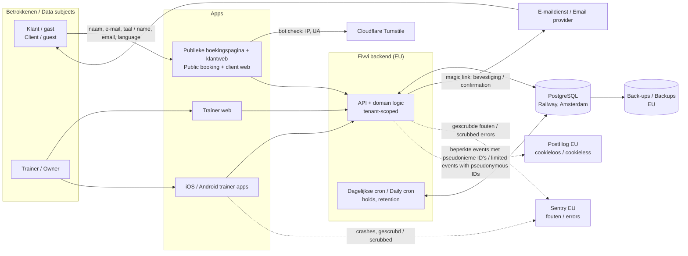

# Rolverdeling en gegevensstromen / Role mapping and data flows

> **⚠️ CONCEPT — GEEN JURIDISCH ADVIES.** Opgesteld door een AI-agent, niet gecontroleerd door een jurist. De Nederlandse tekst is leidend.
> **⚠️ DRAFT — NOT LEGAL ADVICE.** Written by an AI agent, not reviewed by a lawyer. The Dutch text prevails.

| | |
|---|---|
| **Versie / Version** | 0.2 · 20 oktober 2026 |
| **Bronnen / Sources** | `PRODUCT.md` §4–11, §25, §34–37, §76–79 · `ROADMAP.md` §4.3, §10, §11 |

Elke sectie staat eerst in het Nederlands en daarna in het Engels. Tabellen zijn tweetalig.
Each section is in Dutch first, then English. Tables are bilingual.

---

## 1. Samenvatting / Summary

**NL.** Fivvi heeft twee rollen tegelijk:

1. **Verwerker** (AVG art. 4(8), art. 28) voor alle bedrijfsgegevens van een workspace: klanten, boekingen, sessies, aanwezigheid, trainingen en notities. De **workspace** (gym, studio of zelfstandige trainer) is daarvoor de **verwerkingsverantwoordelijke**. Zij bepaalt waarom en welke klantgegevens ze vastlegt; wij verwerken alleen in opdracht. Daarvoor sluiten we met elke workspace een verwerkersovereenkomst.
2. **Verwerkingsverantwoordelijke** voor een klein aantal eigen doelen: gebruikersaccounts en inloggen, de klantrelatie met workspaces, beveiliging en misbruikpreventie van het platform als geheel, en productanalyse met pseudonieme ID's maar zonder boekings-, trainings- of notitie-inhoud.

De rol volgt het doel van de verwerking. Bedrijfsgegevens met een `organization_id` verwerken we in opdracht van de workspace. Account-, beveiligings- en beperkte gebruiksgegevens voor onze eigen platformdoelen verwerken we als verwerkingsverantwoordelijke; een pseudoniem workspace-ID in een productevent verandert dat niet.

**EN.** Fivvi has two roles at once:

1. **Processor** (GDPR art. 4(8), art. 28) for all of a workspace's business data: clients, bookings, sessions, attendance, workouts and notes. The **workspace** (gym, studio or independent trainer) is the **controller** for that data. It decides why and which client data it records; we only process it on its behalf. We sign a processor agreement with every workspace for this.
2. **Controller** for a small set of our own purposes: user accounts and sign-in, the customer relationship with workspaces, security and abuse prevention for the platform as a whole, and product analytics using pseudonymous identifiers but no booking, workout or note content.

The role follows the purpose of processing. We process business records carrying an `organization_id` on the workspace's behalf. We process account, security and limited usage data for our own platform purposes as controller; a pseudonymous workspace ID in a product event does not change that.

---

## 2. Partijen / Parties

| Partij / Party | Voorbeeld / Example | AVG-rol / GDPR role |
|---|---|---|
| **Aanbieder / Provider** (Fivvi, `{{Naam aanbieder}}`) | Operator of the platform | Verwerker voor workspace-gegevens; verwerkingsverantwoordelijke voor eigen doelen (§3.1) / Processor for workspace data; controller for its own purposes (§3.1) |
| **Workspace** (organisatie / organization) | John's Gym; Sarah Personal Training | Verwerkingsverantwoordelijke voor haar klant- en bedrijfsgegevens / Controller for its client and business data |
| **Owner** | Pilot gym owner | Handelt namens de workspace; geen eigen AVG-rol / Acts on behalf of the workspace; no separate GDPR role |
| **Trainer** (member of 1+ workspaces) | Sarah | Handelt namens elke workspace waarvan de trainer lid is. Een zelfstandige met een eigen workspace is zelf verwerkingsverantwoordelijke / Acts on behalf of each workspace the trainer belongs to. An independent with their own workspace is a controller themselves |
| **Klant / gast** (client / guest) | Anna, who books a class | Betrokkene / Data subject |
| **Subverwerkers / Sub-processors** | Hosting, database, email, error tracking, payments (the payment provider, M11) | Subverwerker (art. 28(4)), see [`sub-processors.md`](sub-processors.md) |

---

## 3. Verwerkingen / Processing activities

### 3.1 Aanbieder is verwerkingsverantwoordelijke / Provider is controller

| # | Verwerking / Processing | Betrokkenen / Data subjects | Gegevens / Data | Grondslag / Legal basis |
|---|---|---|---|---|
| P1 | Gebruikersaccount en inloggen (magic link, 6-cijferige code, sessies, taalvoorkeur) / User account and sign-in (magic link, 6-digit code, sessions, language preference) | Owners, trainers, klanten met account / clients with an account | Naam, e-mail, `preferredLocale`, gehashte tokens, sessie-ID's, apparaat-/app-versie / Name, email, `preferredLocale`, hashed tokens, session IDs, device/app version | Art. 6(1)(b), uitvoering overeenkomst / contract |
| P2 | Klantrelatie met workspaces (contract, support, service-mededelingen) / Customer relationship with workspaces (contract, support, service notices) | Owners, contactpersonen / contacts | Naam, e-mail, organisatie, correspondentie / Name, email, organization, correspondence | Art. 6(1)(b); art. 6(1)(f) voor service-mededelingen / for service notices |
| P3 | Beveiliging en misbruikpreventie van het platform (rate limits, hold-caps, Turnstile, beveiligingslogs) / Platform security and abuse prevention (rate limits, hold caps, Turnstile, security logs) | Alle bezoekers en gebruikers / All visitors and users | IP-adres (kort), gehasht e-mailadres, user-agent, tijdstip / IP address (short-lived), hashed email, user agent, timestamp | Art. 6(1)(f), gerechtvaardigd belang: veilige dienst / legitimate interest: a secure service |
| P4 | Productanalyse (PostHog EU, cookieloos) / Product analytics (PostHog EU, cookieless) | Gebruikers, ook klanten met account; elke bezoeker van de webapp, ook van boekingspagina's / Users, including clients with accounts; every visitor of the web app, including booking pages | Gebeurtenistype en pseudonieme gebruikers-/workspace-ID's; bij een paginaweergave van de webapp het URL-pad zonder querystring of fragment, browser, besturingssysteem, apparaattype, user-agent en tijdzone, en het IP-adres van de browser voor de dagelijkse bezoekershash; **persoonsgegevens**, maar geen klantnamen, e-mail, boekings-, trainings- of notitie-inhoud / Event type and pseudonymous user/workspace IDs; for a page view of the web app, the URL path without query string or fragment, browser, operating system, device type, user agent and time zone, and the browser's IP address for the daily visitor hash; **personal data**, but no client names, email, booking, workout or note content | Art. 6(1)(f), productverbetering / product improvement |
| P5 | Wettelijke verplichtingen en geschillen (o.a. administratie zodra er facturen zijn) / Legal obligations and disputes (e.g. bookkeeping once there are invoices) | Workspace-contacten / Workspace contacts | Contract- en factuurgegevens / Contract and invoice data | Art. 6(1)(c); art. 6(1)(f) |

### 3.2 Workspace is verwerkingsverantwoordelijke, aanbieder is verwerker / Workspace is controller, provider is processor

| # | Verwerking / Processing | Betrokkenen / Data subjects | Gegevens / Data | Waarschijnlijke grondslag van de workspace / Likely basis for the workspace |
|---|---|---|---|---|
| W1 | Klantbeheer (profiel, voorkeurslocatie) / Client management (profile, preferred location) | Klanten / Clients | Naam, e-mail, taal, standaardlocatie (kan een **thuisadres** zijn: `client_home`) / Name, email, language, default location (may be a **home address**: `client_home`) | Art. 6(1)(b) |
| W2 | Publieke boeking, hold, bevestiging, klantdashboard / Public booking, hold, confirmation, client dashboard | Klanten, gasten / Clients, guests | Naam, e-mail, taal, boekingsstatus, tijdstippen / Name, email, language, booking status, timestamps | Art. 6(1)(b) |
| W3 | Planning: privésessies, lessen, Open Gym, vervanging, annulering / Scheduling: private sessions, classes, Open Gym, substitution, cancellation | Klanten, trainers | Sessies, deelnemers, trainer, locatie / Sessions, participants, trainer, location | Art. 6(1)(b); art. 6(1)(f) for trainer scheduling |
| W4 | Aanwezigheid en no-shows / Attendance and no-shows | Klanten | Status: geboekt / aanwezig / geannuleerd / niet verschenen / Status: booked / attended / cancelled / no-show | Art. 6(1)(b) or (f) |
| W5 | Trainingen en live logging / Workouts and live logging | Klanten | Oefeningen, sets, herhalingen, gewicht, zwaarte, datum, trainer / Exercises, sets, reps, weight, difficulty, date, trainer | Art. 6(1)(b) |
| W6 | **Notities** (klant- en sessienotities, vrije tekst) / **Notes** (client and session notes, free text) | Klanten | Vrije tekst; **kan gezondheidsgegevens bevatten** (blessures, klachten, medicatie, zwangerschap) / Free text; **may contain health data** (injuries, complaints, medication, pregnancy) | Art. 6(1)(b) **plus** an art. 9(2) exception for health data, in practice **explicit consent**, art. 9(2)(a). See [`dpia-assessment.md`](dpia-assessment.md) §4 |
| W7 | Transactionele e-mails (magic link, bevestiging, annulering, wijziging) / Transactional emails (magic link, confirmation, cancellation, change) | Klanten, trainers | E-mail, naam, sessiegegevens, taal / Email, name, session details, language | Art. 6(1)(b) |
| W8 | Trainers en rollen in de workspace, uitnodigingen / Trainers and roles in the workspace, invitations | Trainers, genodigden / invitees | Naam, e-mail, rol, toegewezen sessies / Name, email, role, assigned sessions | Art. 6(1)(b) or (f) |
| W9 | Import van bestaande gegevens (Excel/CSV) bij go-live / Import of existing data (Excel/CSV) at go-live | Klanten, trainers | Wat de workspace aanlevert, ook lopende afspraken, tegoeden (credits en inhaallessen), volgende vervaldata en factuurgegevens (`import-checklist.md` §3.4a) / Whatever the workspace supplies, including active agreements, credit balances and makeups, next due dates and billing details (`import-checklist.md` §3.4a) | As W1–W6 |
| W10 | Toegangslog op notities (audit log) / Note access audit log | Trainers, owners | Wie welke notitie wanneer heeft bekeken of gewijzigd / Who viewed or changed which note, and when | Art. 32 (security), on the workspace's behalf |
| W11 | Beheer, hosting, back-ups, foutmonitoring, support op verzoek van de workspace / Operations, hosting, backups, error monitoring, support at the workspace's request | Alle bovenstaande / All of the above | Alle bovenstaande, zo min mogelijk / All of the above, minimized | Part of the service under the processor agreement |

**NL.** De grondslagen in §3.2 zijn een **voorstel**: de workspace kiest en draagt ze zelf. Wij leveren wel de middelen, zoals een toestemmingsregistratie voor gezondheidsgegevens als de pilotgym die wil (zie open vragen).

**EN.** The legal bases in §3.2 are a **suggestion**. The workspace chooses them and is responsible for them. We do provide the tools, such as a consent record for health data if the pilot gym wants one (see open questions).

---

## 4. Betrokkenen en gegevenscategorieën / Data subjects and data categories

| Betrokkene / Data subject | Gewone persoonsgegevens / Ordinary personal data | Bijzondere / gevoelige gegevens / Special or sensitive data | Bron / Source |
|---|---|---|---|
| Klant of gast / Client or guest | Naam, e-mail, taal, boekingen, aanwezigheid, trainingen, locatie / Name, email, language, bookings, attendance, workouts, location | **Gezondheidsgegevens in vrije notities** (art. 9); mogelijk thuisadres; mogelijk **minderjarigen** / **Health data in free-text notes** (art. 9); possibly home address; possibly **minors** | Klant zelf (boeking), trainer (notities, logging), import / The client (booking), the trainer (notes, logging), import |
| Trainer | Naam, e-mail, taal, rollen, planning over workspaces heen / Name, email, language, roles, schedule across workspaces | Nee / No | Trainer zelf, owner (uitnodiging) / The trainer, the owner (invitation) |
| Owner | Naam, e-mail, taal, workspace-instellingen / Name, email, language, workspace settings | Nee / No | Owner zelf / The owner |
| Bezoeker van een boekingspagina / Booking-page visitor | IP-adres, user-agent (kortstondig, beveiliging); cookieloze gebeurtenissen / IP address, user agent (short-lived, security); cookieless events | Nee / No | Browser |

**Niet verzameld (bewust) / Deliberately not collected:** telefoonnummer, wachtwoord, geboortedatum, BSN, kaart- en bankgegevens (`PRODUCT.md §2.4, §27, §94`) / phone number, password, date of birth, citizen service number (BSN), card and bank details.

**Betalingen (vanaf de MVP, M11) / Payments (from the MVP, M11).** **NL.** Betalingen komen in de MVP (`ROADMAP.md` v1.19). De betaalprovider verwerkt de betaalgegevens; Fivvi bewaart alleen verwijzingen, bedragen en statussen, naast de facturen die het uitgeeft (factuurgegevens, `PRODUCT.md §96`). Of de provider subverwerker is of voor eigen betaalgegevens een aparte verwerkingsverantwoordelijke, en wie de handelaar is, is vastgelegd in ADR-020 (geaccepteerd op 21 oktober 2026): Mollie Connect for Platforms, de sportschool als handelaar op een eigen Mollie-account. Mollie ziet zichzelf als zelfstandig verwerkingsverantwoordelijke voor de betaalgegevens; ADR-020 laat de bevestiging van die rolverdeling open (open vraag 7). Dit document wordt vóór G4 bijgewerkt, nu de provider is gekozen. **EN.** Payments come into the MVP (`ROADMAP.md` v1.19). The payment provider processes the payment data; Fivvi stores only references, amounts and statuses, besides the invoices it issues (billing details, `PRODUCT.md §96`). Whether the provider is a sub-processor or a separate controller for its own payment data, and who the merchant is, is recorded in ADR-020 (accepted 21 October 2026): Mollie Connect for Platforms, the gym as merchant on its own Mollie account. Mollie sees itself as an independent controller for the payment data; ADR-020 leaves the confirmation of that role split open (open question 7). This document is updated before G4, now that the provider is chosen.

---

## 5. Gegevensstromen / Data flows

| # | Stroom / Flow | Gegevens / Data | Rol aanbieder / Provider role |
|---|---|---|---|
| F1 | Klant boekt via QR/link → hold → magic link → bevestigd / Client books via QR/link → hold → magic link → confirmed | Naam, e-mail, taal, sessie / Name, email, language, session | Verwerker / Processor (W2, W7) |
| F2 | Bot check op het boekingsformulier / Bot check on the booking form | IP, TLS fingerprint, user agent → Cloudflare | Verwerker (Cloudflare = subverwerker); aanbieder ook verantwoordelijke voor P3 / Processor (Cloudflare = sub-processor); provider is also controller for P3 |
| F3 | Trainer logt training / schrijft notitie (web of app) / Trainer logs a workout or writes a note (web or app) | Trainingsdata, notities / Workout data, notes | Verwerker / Processor (W5, W6) |
| F4 | Trainer bekijkt "Mijn dag" over meerdere workspaces / Trainer views "My day" across several workspaces | Sessies uit workspace A én B / Sessions from workspace A and B | Verwerker voor A én B, elk op eigen instructie (de trainer is door beide toegewezen) / Processor for A and B, each on its own instruction (both assigned the trainer) |
| F5 | E-mail via de e-maildienst / Email through the email provider | Adres, naam, inhoud / Address, name, content | Verwerker; e-maildienst = subverwerker / Processor; email provider = sub-processor |
| F6 | Foutrapport naar Sentry / Error report to Sentry | Stacktrace, route, app- en apparaatgegevens, pseudonieme user-ID (in de apps zonder ingelogde gebruiker: het willekeurige ID per installatie, zie D5); **geen** request bodies of notities / Stack trace, route, app and device details, pseudonymous user ID (in the apps without a signed-in user: the random per-installation ID, see D5); **no** request bodies or notes | Verwerker (onderdeel van de dienst) / Processor (part of operating the service) |
| F7 | Productgebeurtenis of paginaweergave naar PostHog / Product event or page view to PostHog | Type gebeurtenis, pseudonieme ID's; bij een paginaweergave de gegevens uit P4 / Event type, pseudonymous IDs; for a page view the data listed in P4 | Verwerkingsverantwoordelijke (P4) / Controller (P4) |
| F8 | Import van pilotgegevens (Excel/CSV) / Import of pilot data (Excel/CSV) | Klantenlijst, rooster, lopende afspraken, tegoeden (credits en inhaallessen), volgende vervaldata, factuurgegevens, eventueel historie / Client list, timetable, active agreements, credit balances and makeups, next due dates, billing details, optionally history | Verwerker, **pas na ondertekening van de verwerkersovereenkomst** / Processor, **only after the processor agreement is signed** |
| F9 | Export of verwijdering op verzoek / Export or deletion on request | Alles van een klant of workspace / Everything for one client or workspace | Verwerker (assistentie art. 28(3)(e)) / Processor (assistance, art. 28(3)(e)) |

---

## 6. Randgevallen / Edge cases

**6.1 Trainer in meerdere workspaces / Trainer in several workspaces**

- **NL.** Het account van de trainer (naam, e-mail, inloggen, taal) is van ons (P1). Het lidmaatschap en de planning van de trainer in workspace A zijn van A, en die in B zijn van B. Workspace A ziet nooit gegevens van B (tenant-isolatie, ADR-006). De gecombineerde agenda toont de trainer alleen de sessies waarvoor elke workspace de trainer zelf heeft ingeroosterd.
- **EN.** The trainer's account (name, email, sign-in, language) is ours (P1). The trainer's membership and schedule in workspace A belong to A, and those in B belong to B. Workspace A never sees B's data (tenant isolation, ADR-006). The combined calendar only shows the trainer the sessions each workspace itself scheduled them for.

**6.2 Zelfstandige trainer / Independent trainer**

- **NL.** Een zelfstandige trainer met een eigen workspace (bijv. "Sarah Personal Training") is voor de eigen klanten zelf verwerkingsverantwoordelijke en sluit een eigen verwerkersovereenkomst. Werkt Sarah ook bij John's Gym, dan is John's Gym verantwoordelijk voor de klanten van John's Gym, ook als Sarah hen traint.
- **EN.** An independent trainer with their own workspace (e.g. "Sarah Personal Training") is the controller for their own clients and signs their own processor agreement. If Sarah also works at John's Gym, John's Gym is responsible for John's Gym's clients, even when Sarah trains them.

**6.3 Klant die bij meerdere workspaces boekt / Client who books at several workspaces**

- **NL.** Het optionele klantaccount (inloggen, e-mail, taal) is van ons (P1). Het klantprofiel, de boekingen en notities per workspace zijn van die workspace. Het klantdashboard toont de klant de eigen boekingen, per workspace. Dat is inzage voor de betrokkene, geen delen tussen workspaces. **Ontwerpregel:** er is geen gedeeld klantprofiel over workspaces heen. Een workspace ziet nooit dat dezelfde persoon ook bij een andere workspace klant is. Anders ontstaat het risico van gezamenlijke verwerkingsverantwoordelijkheid (art. 26).
- **EN.** The optional client account (sign-in, email, language) is ours (P1). The client profile, bookings and notes in each workspace belong to that workspace. The client dashboard shows the client their own bookings, per workspace. That is access for the data subject, not sharing between workspaces. **Design rule:** there is no client profile shared across workspaces. A workspace never learns that the same person is also a client of another workspace. Otherwise we risk joint controllership (art. 26).

**6.4 Pilotgym-eigenaar is owner én trainer / Pilot gym owner is both owner and trainer**

- **NL.** Dat verandert niets aan de rollen. De pilotgym (de onderneming) is verwerkingsverantwoordelijke. De persoon handelt namens de gym.
- **EN.** This changes nothing about the roles. The pilot gym (the business) is the controller. The person acts on behalf of the gym.

**6.5 Support met toegang tot gegevens / Support with access to data**

- **NL.** De aanbieder kijkt alleen in gegevens van een workspace als dat nodig is voor een supportvraag of storing. Dat gebeurt op verzoek of met medeweten van de workspace, en wordt gelogd. Notitie-inhoud wordt alleen bekeken als het echt niet anders kan.
- **EN.** The provider only looks at a workspace's data when a support request or an incident needs it. This happens at the workspace's request or with its knowledge, and it is logged. Note content is only viewed if there is truly no other way.

**6.6 AI-codeeragents / AI coding agents**

- **NL.** Het platform wordt gebouwd door AI-codeeragents (GitHub Copilot, Claude Code, Codex). Zolang die **nooit** productiegegevens of echte pilotgegevens te zien krijgen, zijn hun aanbieders geen subverwerker. Dat geldt ook voor importbestanden, logs, screenshots en databasedumps. Zie §7.
- **EN.** The platform is built by AI coding agents (GitHub Copilot, Claude Code, Codex). As long as they **never** see production data or real pilot data, their providers are not sub-processors. That includes import files, logs, screenshots and database dumps. See §7.

**6.7 Toekomstige releases / Future releases**

- **NL.** AI-notities (1.3) en AI-briefing (1.4) voegen een AI-aanbieder toe als subverwerker. Ze verwerken notities, dus mogelijk gezondheidsgegevens, met nieuwe technologie. Dat vraagt een DPIA vóór de start (zie `dpia-assessment.md` §6). Betalingen (MVP, M11) veranderen deze rolverdeling ook: de betaalprovider komt op de subverwerkerslijst of is voor eigen betaalgegevens een aparte verwerkingsverantwoordelijke. Werk dit document bij vóór G4, nu ADR-020 (Mollie, geaccepteerd op 21 oktober 2026) de provider heeft gekozen. HealthKit/Health Connect (6.0) verandert de rolverdeling ook; werk het document dan opnieuw bij.
- **EN.** AI notes (1.3) and AI briefing (1.4) add an AI provider as a sub-processor. They process notes, so possibly health data, with new technology. That needs a DPIA before they start (see `dpia-assessment.md` §6). Payments (MVP, M11) also change this role mapping: the payment provider joins the sub-processor list or is a separate controller for its own payment data. Update this document before G4, now that ADR-020 (Mollie, accepted 21 October 2026) has chosen the provider. HealthKit/Health Connect (6.0) also changes the role mapping; update this document again then.

---

## 7. Ontwerpregels die de rolverdeling overeind houden / Design rules that keep the roles valid

| # | Regel (NL) | Rule (EN) | Waar / Where |
|---|---|---|---|
| D1 | Elke bedrijfsrecord heeft een `organization_id`; geen query zonder tenant-scope | Every business record has an `organization_id`; no query without tenant scope | ADR-006, E011 |
| D2 | Geen klantprofiel dat over workspaces heen gedeeld wordt | No client profile shared across workspaces | M2/M5 data model |
| D3 | Notities zijn standaard alleen voor trainers; toegang wordt gelogd | Notes are trainer-only by default; access is logged | F046–F048, E014 |
| D4 | Alleen toegestane PostHog-events met gebeurtenistype en pseudonieme ID's, en paginaweergaven met alleen de gegevens uit P4 (het URL-pad zonder querystring of fragment); autocapture en sessie-opnames uit; geen namen, e-mail, boekings-, trainings- of notitie-inhoud, vrije tekst of URL-parameters | Only allowlisted PostHog events with event type and pseudonymous IDs, and page views with only the data listed in P4 (the URL path without query string or fragment); autocapture and session replay off; no names, email, booking, workout or note content, free text or URL parameters | E009 |
| D5 | Sentry: standaard-PII uit (`dataCollection` in web/API/cron en Android, `sendDefaultPii: false` in iOS; `sendDefaultPii` is verouderd in de Android-SDK 8), geen request bodies, scrubbing van e-mail en tokens in `beforeSend`/`beforeBreadcrumb`. Zonder ingelogde gebruiker sturen de apps Sentry's willekeurige ID per installatie als gebruikers-ID; Sentry telt er crashvrije gebruikers mee. Het is pseudoniem en niet aan een persoon gekoppeld | Sentry: default PII off (`dataCollection` in web/API/cron and Android, `sendDefaultPii: false` in iOS; `sendDefaultPii` is deprecated in the Android SDK 8), no request bodies, scrubbing of email and tokens in `beforeSend`/`beforeBreadcrumb`. Without a signed-in user, the apps send Sentry's random per-installation ID as the user ID; Sentry counts crash-free users with it. It is pseudonymous and not linked to a person | E009 |
| D6 | Logs bevatten geen notitie-inhoud of tokens; e-mailadressen worden gemaskeerd | Logs contain no note content or tokens; email addresses are masked | E009, E013 |
| D7 | Railway preview-omgevingen en -databases bevatten **nooit** productiegegevens; ze worden met seed-data gevuld, niet uit productie gekopieerd | Railway preview environments and databases **never** contain production data; they are seeded, not copied from production | E003 |
| D8 | AI-agents krijgen geen toegang tot productie, echte exports of pilotbestanden | AI agents get no access to production, real exports or pilot files | `AGENTS.md` |
| D9 | Geen echte persoonsgegevens in het platform vóór een getekende verwerkersovereenkomst **en** een host met DPA | No real personal data in the platform before a signed processor agreement **and** a host with a DPA | Gate G2 (see `sub-processors.md` §3) |
| D10 | Gegevens die de workspace verwijdert zijn na 30 dagen definitief weg, en uit back-ups binnen de back-uptermijn | Data the workspace deletes is permanently gone after 30 days, and from backups within the backup window | `retention-policy.md` |
