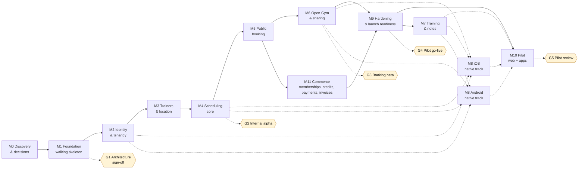
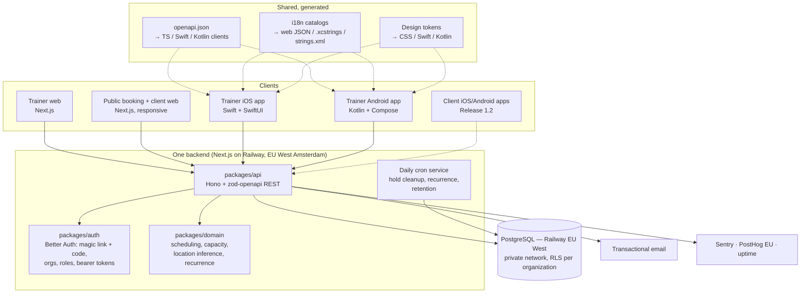

# Fivvi — Product & Delivery Roadmap

| | |
|---|---|
| **Version** | 1.24 |
| **Date** | 27 October 2026 |
| **Owner** | Keyvan Mahmoudi (product owner, reviewer, final decision-maker) |
| **Builders** | AI coding agents: GitHub Copilot (VS Code + CLI), Claude Code and Codex, working in parallel worktrees |
| **Status** | Approved (22 September 2026); ADR-011 (hosting) revised to Railway in v1.3; ADR-009 email provider selected in v1.5; account inventory updated in v1.6; E006 email infrastructure and the G1 email check in v1.7; GitHub Copilot added as a builder in v1.8; Matt Pocock's skills and GitHub issue specs in v1.9; E006 owner to-dos placed at M2, G2 and G4 in v1.10; prototype feedback on workouts, clients and app creation applied in v1.11; agents merge low-risk PRs in v1.12 (ADR-016, proposed); workout duration added to §41 and packages confirmed outside the MVP in v1.13; bilingual class name and description, exercise types and a one-list logger in v1.14; web-first pilot, native trainer apps after go-live in v1.15; personal language policy in v1.17 (ADR-017, accepted); F001 shaped in v1.18: closed sign-up, a client account at first verified booking and the sign-in communication language (ADR-019, proposed); commerce before go-live in v1.19: memberships, session packs, recurring payments and invoices (M11; single classes and payouts are proposed), workouts, notes and location inference after go-live; owner review of 20 October 2026 in v1.20: no parallel run (the four pain points define go-live), session packs decided, one location at go-live, no Admin role in the MVP, ADR-020 (payment provider and merchant model: Mollie Connect for Platforms, the gym as merchant; accepted by the owner on 21 October 2026 in v1.22), the simple user experience as the first product principle (`PRODUCT.md §2.0`), payments connected in one guided step, and native trainer apps built in parallel with the web from M2; credits in v1.21: group and private credit packs and credit plans in the MVP (the two kinds never mix; combined credits are not planned), replacing the session pack; the product is named Fivvi, with the domain fivvi.app, and the business app Fivvi Pro and the client app Fivvi are separate apps, and ADR-020 (payment provider and merchant model) accepted by the owner (21 October 2026) in v1.22; agents queue high-risk PRs before G2, except owner-only changes, and there is no fixed parallel limit in v1.23 (ADR-021, proposed); the Google Play Console organisation account verified and the Fivvi Pro app with internal testing created in v1.24 |
| **Requirements source** | [`PRODUCT.md`](PRODUCT.md) (what we build and why) |
| **Feature registry** | [`FEATURES.md`](FEATURES.md) (status of every feature) |
| **Engineering workflow** | [`../engineering/WORKFLOW.md`](../engineering/WORKFLOW.md) (branches, worktrees, reviews, cleanup, Definition of Done) |

> **Precedence:** `PRODUCT.md` owns requirements. This roadmap owns sequencing, milestones, gates and technical decisions. `FEATURES.md` owns per-feature status. If they disagree, fix the doc that is wrong in the same PR that finds the mismatch. Where this roadmap deliberately deviates from `PRODUCT.md` (e.g. native apps instead of React Native), the ADR in §4.3 records why.

---

## Table of contents

1. [Executive summary](#1-executive-summary)
2. [Delivery principles](#2-delivery-principles)
3. [Roadmap at a glance](#3-roadmap-at-a-glance)
4. [Phase 0: Discovery and decisions](#4-phase-0-discovery-and-decisions-m0)
5. [MVP delivery plan (M1–M11)](#5-mvp-delivery-plan-m1m11)
6. [Parallel tracks and dependencies](#6-parallel-tracks-and-dependencies)
7. [Pilot plan (M10)](#7-pilot-plan-m10)
8. [MVP success metrics](#8-mvp-success-metrics)
9. [Post-MVP roadmap (1.1 → 7.0)](#9-post-mvp-roadmap-11--70)
10. [Cross-cutting tracks](#10-cross-cutting-tracks)
11. [Target architecture](#11-target-architecture)
12. [Cost plan: free-tier first](#12-cost-plan-free-tier-first)
13. [Risk register](#13-risk-register)
14. [Decisions](#14-decisions)
15. [Roadmap governance](#15-roadmap-governance)
16. [Changelog](#16-changelog)

---

## 1. Executive summary

**What:** A Dutch-first, fully bilingual (nl-NL + en) operating platform for personal trainers and small fitness businesses. It covers scheduling, public booking, Open Gym, client management, memberships, payments and invoices, workouts and notes, on **web, native iOS and native Android**.

**First customer:** A pilot gym owner who is also a PT and works with other trainers. Today they run on two apps (one books group classes, tracks memberships and collects payments), Google Calendar and Word documents, and invoice private training by hand (`docs/discovery/results/interview-01.md`). They won't use Fivvi in parallel with the old apps: they start when it solves at least the four pain points they named in interview 01 (billing, one clear calendar, proper roles, prepaid session tracking), so memberships, credit packs and credit plans (group and private credits), recurring payments and invoices are part of the MVP (v1.19, v1.21).

**How it is built:** AI coding agents (GitHub Copilot, Claude Code and Codex) implement the work in parallel, one branch and worktree per change. They review their changes locally before pushing; another agent may help locally when useful. The product owner approves each milestone gate. The plan is therefore **sequence- and gate-based, not date-based**: a milestone is done when its exit criteria pass, not when a calendar date arrives.

**Strategy in horizons:**

| Horizon | Goal | Releases | When |
|---|---|---|---|
| **H1: Prove it** | Replace the pilot gym's booking and payment app, Google Calendar, Word documents and hand-made invoices | MVP, 1.1 | Now |
| **H2: Deepen it** | Native client apps and AI assistance for trainers | 1.2, 1.3, 1.4 | After the pilot proves value |
| **H3: Open it** | Self-serve SaaS for independent trainers, freelancers and multi-location gyms | 2.0 – 2.3 | After the pilot says "would not go back" |
| **H4+: Scale it** | Smart scheduling, analytics, advanced commerce, integrations, enterprise | 3.0 – 7.0 | Themes only; scoped when their gate opens |

**MVP at a glance:** 61 user-facing features (F001–F061) plus 19 engineering enablers (E001–E019), delivered in **11 milestones**, followed by a **6-week real-world pilot**. Go-live (G4) needs scheduling, booking, Open Gym and **commerce** (M11: memberships, credit packs and credit plans, recurring payments and invoices; single classes and payouts are proposed scope, [decision 9](#14-decisions)), with one location per workspace. The web works for everyone at go-live, with a cutover, not a parallel run. The native trainer apps are built **in parallel with the web** from M2 (M8 is the label of that track): trainers use them from day one through TestFlight and Play internal testing if they pass their checks, and go-live doesn't wait for public App Store / Play listings. Training and notes (M7, on web, iOS and Android together), more locations and automatic location inference (F017–F019) follow after go-live and join the running pilot. Everything runs on **free tiers** until real clients are on the platform (§12).

---

## 2. Delivery principles

These principles govern *how* we deliver. The product principles in `PRODUCT.md §2` govern *what* we deliver.

1. **Bilingual is part of done, not a phase.** Every milestone ships in Dutch and English on every platform. CI fails on a missing translation key or a hard-coded user-facing string. There is no "translate later".
2. **Build the architecture once; build features only when needed.** The multi-workspace model, tenant isolation, timezone-correct time handling and localization go in on day one (`PRODUCT.md §4, §77, §3`). Features that are explicitly excluded (`PRODUCT.md §53`) stay out.
3. **One contract, many clients.** The API is defined once as an OpenAPI contract. Web, iOS and Android all consume generated clients from it, so the three apps can't drift apart.
4. **Vertical slices.** Each milestone ends with something a real user can do end-to-end (DB → API → UI → email, in NL and EN), not with a finished layer.
5. **Walking skeleton first.** Web, iOS, Android, API, database, email and CI are all connected in M1, before any feature work.
6. **Pilot evidence beats opinion.** After MVP, a release is scoped only from observed pilot usage, and each post-MVP release has an entry gate.
7. **Security and privacy by default.** Notes can contain health information. Least-privilege access, trainer-only by default, EU data residency and a processor agreement with every workspace.
8. **Agents build, the owner decides.** Agents work in small, reviewable PRs, one per worktree. Agent review is local and is not a GitHub PR or CI gate. The owner approves specs and merges owner-only PRs (the agents' own rules, legal, money); agents merge low-risk PRs, and until G2 high-risk PRs that are not owner-only, through a scripted merge gate (ADR-016, ADR-021). Every milestone gate needs the owner's approval. Rules for agents live in `AGENTS.md`, which every agent reads (Copilot and Codex directly, Claude Code through `CLAUDE.md`).
9. **Free-tier first.** Every service starts on a free plan. Moving to a paid plan is triggered by real clients (Gate G4) or a hard limit, never by convenience (§12).
10. **Documentation is part of the change.** The spec issue, the `FEATURES.md` status and the domain glossary are updated with the code; the PR closes the spec and its tickets.
11. **One change, one branch, one worktree. Clean up afterwards.** See `WORKFLOW.md`.
12. **Simple is the product.** Every milestone is judged by the simple user experience first: few steps, nothing asked that we can know, one place for everything, plain words ([`PRODUCT.md §2.0`](PRODUCT.md#20-simple-is-the-product)).

---

## 3. Roadmap at a glance

### 3.1 Milestone sequence and parallel tracks



**Native trainer apps in parallel with the web (owner, 20 October 2026; replaces the web-first order of v1.15).** The iOS and Android trainer apps are built from M2, next to the web, not after go-live. Every feature with a trainer mobile surface gets iOS and Android tickets beside its web ticket, with the same acceptance criteria (platform parity, `AGENTS.md`), and counts as done when web, iOS and Android all work; client apps stay Release 1.2. M8 is no longer a milestone after G4: it stays as the label of the native track, and its parts sit in the milestones whose features they belong to (M2, M4, M6, M7; see M8 below). At go-live (G4) the web works for everyone and trainers use the apps from day one through TestFlight and Play internal testing if the apps pass their checks (M9); G4 doesn't wait for public App Store / Play listings. The trainer web on a phone (v1.15) stays the fallback for a trainer whose app isn't ready or who prefers the browser. M1 already built the native shells, so the contract and the string catalogs are proven on every platform early.

**Commerce before go-live (v1.19).** The pilot owner won't run a second system next to the app that collects their money (`PRODUCT.md §2.8`). So M11 (commerce) is part of go-live, and M7 (training and notes) and automatic location inference (F019) move after it. Milestone numbers are labels, not order: M11 runs before M9 and M7 after it, and M8 is the native track that runs next to all of them.

**No parallel run; the four pain points define go-live (owner, 20 October 2026).** The pilot owner won't use Fivvi next to the old apps. He starts when it solves at least the four pain points he named in interview 01: (1) billing, with invoices for private training and recurring payments; (2) one clear calendar for private sessions and group classes, for owner, trainers and clients; (3) proper roles, where trainers use their own team access and never client access; (4) tracking prepaid private sessions, used and left. Until then everything runs on synthetic data (G2 is an internal alpha); real data first enters at pilot setup, before G4, and all scheduling, booking and payments move at one cutover (§7).

**One location at go-live (owner, 20 October 2026).** Each workspace has one location, the gym's own, and every session takes it. More locations and the other location types follow after go-live with M7 (F017–F019).

| Track | Milestones | Typical agent split |
|---|---|---|
| **Backend + web** | From M2; M5 → M6 and M11 in parallel; M7 after G4 | One agent on Open Gym/sharing, one or two on commerce; training/notes after go-live |
| **iOS** | M8 (iOS), from M2, beside the web | One agent: Swift + SwiftUI |
| **Android** | M8 (Android), from M2, beside the web | One agent: Kotlin + Jetpack Compose |

The native tracks start with M2's sign-in and token routes and then follow each web milestone: a feature's iOS and Android tickets sit next to its web ticket, with the same acceptance criteria, and build on its routes in the contract as soon as they are there. The contract is frozen at the end of M2 (sign-in and tokens), at the end of M4 (Today, calendars, sessions, attendance) and early in M7 (logging, notes). If a gate is at risk, the native tracks may trail the web by one milestone, never the other way round (§6).

### 3.2 Milestones summary

Size is relative complexity (S / M / L / XL), not a duration.

| # | Milestone | Outcome (what someone can do at the end) | Features | Size |
|---|---|---|---|---|
| **M0** | Discovery & decisions | Validated flows, accepted ADRs, pilot baseline measured | — | S |
| **M1** | Engineering foundation | A "hello" runs web + iOS + Android → API → DB → email, in NL and EN, with CI | E001–E010, E018 | L |
| **M2** | Identity & tenancy | Owner signs in, creates a workspace, sees Dutch-default UI, switches to English; signs in on iOS and Android with the 6-digit code | F001–F010, E011, E017 | L |
| **M3** | Trainers & location | Owner invites trainers; a trainer belongs to several workspaces; the workspace has one location (the gym's own) and every session takes it | F011, F012, F015 (one location), F016 | M |
| **M4** | Scheduling core | A full week shaped like the pilot's timetable (synthetic data) runs: private sessions, recurring classes, substitution, attendance, cancellations (time and actor recorded for the M11 cutoff); every calendar labels and filters by type; the trainer's day (Today, calendar, session, attendance, **+**) also runs on iOS and Android | F013, F014, F020–F026, E012 | XL |
| **M5** | Public booking | A client scans a link, books a class with name + email, verifies, gets a localized confirmation | F027–F033, F049, F050, E013 | L |
| **M6** | Open Gym & sharing | Owner publishes Open Gym; clients book it; booking links and QR posters are printable; the owner creates Open Gym from the apps' **+** menu | F034–F038 | M |
| **M11** | Commerce | A client confirms a membership, a credit pack or a credit plan and pays online; recurring payments are collected; every payment gets an invoice; credit balances and makeups are explainable (single classes and payouts are proposed scope, [decision 9](#14-decisions)) | F052–F061, E019 | XL |
| **M7** | Training & notes, after G4 | Trainer logs live sets with or without a template, repeats the previous workout, keeps notes, on web, iOS and Android. Joins the running pilot; more locations and F019 location inference come with it | F039–F048, F051, F017–F019 | L |
| **M8** | Native track (iOS + Android), runs in parallel from M2 | A trainer's day runs from the phone on both platforms, built beside the web: sign-in with the 6-digit code (M2), Today, calendar, clients, session, attendance and **+** by role (M4), Open Gym (M6), logging and notes (M7). Builds reach testers through TestFlight and Play internal testing from M2 | Mobile surfaces of F001, F006, F010, F013, F020–F022, F025, F034, F043–F048, F051; E017 | XL (×2 platforms), spread over M2–M7 |
| **M9** | Hardening & launch readiness | Security, privacy, accessibility, NL/EN QA, import tooling (incl. agreements and balances), backups, runbooks and the payments review are all done | E014–E016 | M |
| **M10** | Pilot | After the cutover the pilot gym runs on the platform for 6 weeks (the web for everyone, the native trainer apps from day one), payments included, joined by M7 when it is done; the old app (read-only fallback) is cancelled once the first full payment cycle reconciles; Release 1.1 defined | — | 6 weeks |

### 3.3 Release roadmap

| Release | Objective | Horizon | Entry gate (must be true to start) |
|---|---|---|---|
| **MVP** | Dutch-first pilot gym platform | H1 | Roadmap approved |
| **1.1** | Pilot-driven refinement | H1 | ≥ 4 weeks of pilot usage data; findings triaged |
| **1.2** | Native client iOS + Android apps | H2 | Public booking web is healthy (funnel ≥ target); clients ask for an app |
| **1.3** | NL/EN AI note capture | H2 | AI processor DPA signed; per-workspace opt-in designed |
| **1.4** | AI client briefing | H2 | 1.3 in use; enough history per client to summarize |
| **2.0** | Public SaaS onboarding | H3 | Pilot says "would not go back"; pricing model decided (see §9, 2.0) |
| **2.1** | Freelance trainer improvements | H3 | ≥ 3 independent trainers onboarded via 2.0 |
| **2.2** | Multi-workspace improvements | H3 | Trainers actually active in ≥ 2 workspaces |
| **2.3** | Multi-location organizations | H3 | A committed multi-location customer |
| **3.0** | Smart scheduling | H4 | Enough scheduling data to justify it |
| **3.1** | Open Gym automation | H4 | Manual Open Gym publishing is a proven, repeated chore |
| **3.2** | Business analytics | H4 | Customers ask for reports they currently build by hand |
| **4.0** | Advanced commerce (basic payments and invoices are MVP since v1.19) | H4 | Customers ask for pricing models, reminders or accounting links beyond the MVP |
| **5.0** | Advanced AI | H4+ | 1.3/1.4 adoption proves AI value |
| **6.0** | Integrations | H4+ | Integration demand ranked from customer requests |
| **7.0** | Larger-business features | H4+ | Pipeline of larger gyms |

---

## 4. Phase 0: Discovery and decisions (M0)

**Goal:** Remove the expensive unknowns before writing product code.

### 4.1 Pilot discovery

Run it with the printable kit in [`docs/discovery/`](../discovery/README.md) (shadow day, baseline, phone inventory, import checklist, metric targets, prototype validation).

- [ ] **Shadow day** with the pilot owner: observe a real day of scheduling, booking, logging and notes.
- [ ] Understand the **real artefacts**: current tools (the old booking and payment app, Google Calendar, Word documents, notes by hand), calendar, note formats, the weekly class timetable. The gym owner describes them; files are only shared if they choose to.
- [ ] Inventory: number of trainers, clients, recurring classes, Open Gym demand, and private sessions per week.
- [ ] Inventory **which phones the trainers use** (iOS vs Android split, OS versions). This sets the minimum OS versions (ADR-003).
- [ ] **Measure the baseline:** hours per week spent on admin, number of tools used, booking method, no-show rate. This is what M10 success is compared against.
- [ ] Agree on the **data to import** at go-live (clients, class schedule, future sessions, active agreements, credit balances and due dates, optionally workout history; `import-checklist.md §3.4a`).
- [ ] Agree on MVP metric targets with the owner (see §8).
- [x] **Interview 01** with the gym owner: current tools, money flows and switching conditions (19 October 2026, [`results/interview-01.md`](../discovery/results/interview-01.md)). It moved commerce into the MVP (v1.19).
- [ ] **Commerce walkthrough** with the gym owner before the M11 specs: one private invoice and one fixed-weekday membership (booking, no-show, makeup, renewal), on their screen only; the app names, the real cost of the current app and the open questions QC01–QC19 ([`open-questions.md`](../design/open-questions.md)).
- [ ] **Interview a second gym owner** without suggesting payments as the answer (R6). It checks the pilot's priorities; it doesn't block M11.
- [ ] **Competitors:** ask the pilot owner and the second gym owner whether they know Huppa and what they think of it; the owner books a Huppa demo ([`competitors.md`](../discovery/competitors.md), R22).

### 4.2 UX design

- [x] Draft [information architecture](../design/information-architecture.md) for trainer web, iOS/Android trainer apps, public booking and client web; pending pilot validation.
- [x] Draft [wireframes for the 6 critical flows](../design/README.md), **written in Dutch first**; pending pilot validation:
  1. Public booking on a phone (QR → class → name/email → verify → confirmed → client account created)
  2. Trainer "Today" on mobile
  3. Workspace calendar on web (owner view)
  4. Create / reschedule a private session (the workspace's location; inference after go-live)
  5. Live workout logging with previous values
  6. Manage a class occurrence (substitution, cancellation, attendance)
- [x] The [mobile flow drafts](../design/README.md) specify **platform conventions**: iOS Human Interface Guidelines and Android Material 3, with the same flow and content; pending prototype validation on both platforms.
- [ ] Clickable prototype validated with the pilot owner and at least 1 other trainer.
- [ ] Visual direction and **design tokens** (colour, type, spacing) as a single source that exports to web CSS, Swift and Kotlin (ADR-015).
- [x] Start the **Dutch terminology glossary** (`packages/i18n/GLOSSARY.md`), e.g. Klanten, Lessen, Boekingslinks, Aanwezig, Niet verschenen. It keeps LLM translations consistent.

### 4.3 Architecture Decision Records (ADRs)

Each decision has a short ADR in [`docs/decisions/`](../decisions/README.md) with its context, consequences and alternatives. All ADRs were accepted by the owner on 22 September 2026. **ADR-011 (hosting) was re-evaluated** during the write-up, because the owner already pays for Railway Hobby and Vercel Hobby is non-commercial only; the owner accepted the Railway option the same day.

**The product name in ADRs.** ADRs written before 21 October 2026 say Trainer Hub; the product is now Fivvi (decision 1). Accepted ADRs are not edited for a name; ADR-020, written after the rename, uses Fivvi.

| ADR | Decision | Choice | Status | Why |
|---|---|---|---|---|
| [001](../decisions/ADR-001-monorepo-tooling.md) | Monorepo tooling | **pnpm workspaces + Turborepo** for TS; native projects live in the same repo (`apps/ios`, `apps/android`) with their own build tools (Xcode, Gradle) | Accepted | One repo, one PR per change across all platforms |
| [002](../decisions/ADR-002-web-framework.md) | Web framework | **Next.js (App Router) + TypeScript strict** | Accepted | Per spec §71; server rendering is good for public booking speed |
| [003](../decisions/ADR-003-native-mobile-apps.md) | Mobile | **Native: iOS in Swift + SwiftUI; Android in Kotlin + Jetpack Compose** (min OS versions set in M0 from the trainers' phones) | **Accepted, deviates from spec §72** | Owner decision: best platform fit, performance and native feel. The cost is two UI codebases, offset by the shared API contract, i18n and design tokens |
| [004](../decisions/ADR-004-api-layer.md) | API layer | **REST + OpenAPI 3.1**, built with Hono + `@hono/zod-openapi` in `packages/api` and served from Next.js route handlers. The OpenAPI spec is generated and committed; **typed clients are generated** for TS (web), Swift (swift-openapi-generator) and Kotlin (openapi-generator) | Accepted (replaces tRPC) | Native clients need a language-neutral contract. One backend still serves all clients (§75) |
| [005](../decisions/ADR-005-database-and-orm.md) | Database & ORM | **PostgreSQL (EU region) + Drizzle ORM + versioned SQL migrations** | Accepted | Per spec §76; SQL-first, works cleanly with Row-Level Security |
| [006](../decisions/ADR-006-tenant-isolation.md) | Tenant isolation | **Org-scoped data-access layer + Postgres RLS as defence in depth + automated cross-tenant tests** | Accepted | Per spec §77; two independent barriers against data leaks |
| [007](../decisions/ADR-007-authentication.md) | Authentication | **Better Auth** (organization/member/invitation plugins + email magic link **and** 6-digit email code; bearer tokens for native apps) | Accepted | Our own tables and our own localized emails. The 6-digit code lets native apps sign in without needing Universal/App Links on day one, and it survives email link scanners. *Spike in M2, as the first step of the native track: native bearer-token flow* |
| [008](../decisions/ADR-008-localization.md) | Localization | **One source of truth:** ICU MessageFormat catalogs in `packages/i18n` (`nl-NL.json`, `en.json`). Web uses next-intl. A generator **exports the catalogs to iOS String Catalogs (`.xcstrings`) and Android `strings.xml`/plurals**. Emails use the same catalogs | Accepted | One set of keys and translations for three platforms; CI checks parity on the source and on the generated files |
| [009](../decisions/ADR-009-transactional-email.md) | Transactional email | **React Email templates + Brevo** (free tier initially) | Accepted; implemented in E006 | One template structure with localized strings (§74); E006 checked the DPA, send limits, EU storage, tracking and log retention (`docs/legal/sub-processors.md §4`). Own domain before M5 |
| [010](../decisions/ADR-010-background-jobs.md) | Background jobs | **Avoid needing a job runner:** holds expire *lazily* (`expires_at` is checked when capacity is read) and a daily cron cleans up; emails are sent inline with retry; recurrence is materialized by a daily cron plus on-demand at edit time | Accepted | Works within free-tier cron limits; add a queue (e.g. Inngest free tier) only if needed |
| [011](../decisions/ADR-011-hosting-and-environments.md) | Hosting & environments | All on **Railway, EU West (Amsterdam)**: Next.js web + API, Postgres and a cron service in one project; a PR environment per PR. Hobby (already paid) during the build → **Pro ($20/month) at G4**. *Replaces v1.2: Vercel Hobby + Neon free* | Accepted (revised in v1.3) | Vercel Hobby is non-commercial only, so G4 needs a paid plan anyway. Railway keeps app and DB in one EU location with one DPA, no DB cold starts, and costs a flat $20/month at pilot volume vs ≈ $20–40 for Vercel Pro + Neon |
| [012](../decisions/ADR-012-time-and-recurrence.md) | Time & recurrence model | **UTC `timestamptz` + IANA timezone on workspace/location; recurrence as RRULE in local wall-clock time; occurrences materialized as rows for a rolling horizon (e.g. 12 weeks)** | Accepted | "Every Tuesday 18:00" must stay 18:00 across daylight-saving changes; each occurrence needs its own trainer, capacity and bookings (§20) |
| [013](../decisions/ADR-013-observability.md) | Observability | **Free tiers:** Sentry (EU region; web, iOS, Android, API), UptimeRobot / Better Stack uptime checks, PostHog EU (cookieless mode) for product events | Accepted | Pilot observation (§85 J) needs data; cookieless means no consent banner |
| [014](../decisions/ADR-014-testing.md) | Testing | **Vitest** (unit + integration against real Postgres), **Playwright** (web e2e in NL and EN), **XCTest/XCUITest** (iOS), **JUnit + Compose UI tests** (Android), **Maestro** for shared cross-platform mobile flows | Accepted | Booking and tenancy bugs are the most expensive; Maestro runs the same flow on both native apps |
| [015](../decisions/ADR-015-ui-foundation.md) | UI foundation | **Shared design tokens** (Style Dictionary) → web (Tailwind + shadcn/ui), iOS (SwiftUI), Android (Compose + Material 3) | Accepted | Share tokens, contract and strings, not components |
| [016](../decisions/ADR-016-agent-merges.md) | Agent merges | **Agents merge low-risk PRs** through a scripted merge gate (`scripts/pr.sh merge`); risk comes from changed paths and the `owner-merge` label (`scripts/risk.sh`); a GitHub ruleset enforces the CI checks on `main`; specs need `spec-approved`. Amended by ADR-021 | Proposed | The owner's merge was the bottleneck for changes without real risk; high-risk work, including the factory's own guardrails, still goes to the owner |
| [017](../decisions/ADR-017-language-policy.md) | Language policy | **Interface language:** explicit choice (switch or OS per-app language) → stored preference → a booking link's fixed language → first supported device/browser language → **English**. **Communication language:** recipient's preference → workspace default. Replaces ADR-008's single order | Accepted | The workspace default is for messages, not for a person's screen; English helps people we don't support more than Dutch |
| [018](../decisions/ADR-018-merge-queue.md) | Merge queue | **Merges go through the GitHub merge queue** (squash). Agents add low-risk PRs with `scripts/pr.sh merge`; the owner adds high-risk ones (until G2 agents also add high-risk PRs that are not owner-only, ADR-021). CI also runs on `merge_group`. The ruleset requires the queue, not an up-to-date branch. Amends ADR-016; amended by ADR-021 | Proposed | Updating branches by hand before every merge was the biggest time sink of the retro; the queue tests each PR on the latest `main` |
| [019](../decisions/ADR-019-sign-in-communication-language.md) | Sign-in communication language | A sign-in email uses the recipient's stored preference, otherwise the **interface language of the screen that asked**; the first sign-in stores it as the preference. Amends ADR-017 | Proposed | A sign-in has no workspace, so ADR-017's workspace fallback doesn't apply; the person gets the language they were just reading |
| [020](../decisions/ADR-020-payment-provider.md) | Payment provider and merchant model | **Mollie Connect for Platforms**: each gym connects its own Mollie account by OAuth and is the merchant; iDEAL first payment creates the SEPA mandate, our daily cron collects recurring payments (no provider subscriptions); weekly payouts to the gym; no application fee on client payments in the MVP (platform billing stays decision 16). Stripe Connect is the fallback | Accepted | Fivvi never holds client money (R19); a webhook URL per payment lets every PR preview run test payments; Dutch onboarding and weekly payouts fit the pilot gym. Fees per payment are within cents of Stripe's |
| [021](../decisions/ADR-021-agents-queue-high-risk.md) | Agents queue high-risk PRs | **Until G2, agents add high-risk PRs to the merge queue** when the whole merge gate holds; **owner-only** stays with the owner: guardrails, legal, billing and payments, product and decision docs, and issues labelled `owner-only`. `risk.sh` reports `low`, `high` or `owner`; agent merges of high-risk PRs are recorded and listed for the owner. Amends ADR-016 and ADR-018 | Proposed | Every approved spec was `owner-merge`, so the factory stopped after each ticket; before G2 production holds no real personal data, and high-risk PRs already pass the same gate |

> **Three notes on the table (owner review, 20 October 2026).** (1) The MVP configures only the Owner and Trainer roles (decision 13); Better Auth's role setup in ADR-007, which also lists Admin, is unchanged, and Admin is a later role. (2) the safeguards ADR-011 and ADR-016 tie to G2 (the Railway DPA, PITR, the release step) stay due no later than G2, while real data first enters at pilot setup, before G4 (decision 6). (3) ADR-003 (native apps) and ADR-007 (bearer tokens for native apps, with its native spike) are unchanged; only their timing moves: the native track (M8) runs in parallel with the web from M2, and the bearer-token spike opens it there. ADR-007's dated note names M8 as the spike's place, which still reads true, because M8 is now the label of the native track. The same holds for ADR-003's follow-up "E017 handles distribution at M8": E017 App distribution is now part of M2 (§6, M8 table).

### 4.4 Legal and privacy preparation

*This is not legal advice. Before go-live, have the result checked (at least an LLM-assisted review against AVG/GDPR guidance; ideally a privacy professional once there is revenue).*

**Drafts (v0.1):** [`docs/legal/`](../legal/README.md). Drafting is complete; the agreements and public texts remain subject to the [open questions](../legal/open-questions.md) and the checks below.

- [x] **Role mapping drafted:** each workspace (gym/trainer) is the *controller* of its client data; the platform is the *processor* for that data.
- [x] **Processor agreement (verwerkersovereenkomst) template drafted** in Dutch with an English translation.
- [x] **Sub-processor list drafted** for Railway, Brevo, error tracking, bot protection and analytics, with regions and DPA links.
- [x] **Initial DPIA screening drafted** for the MVP and pilot, because free-form notes may contain health data (special-category data).
- [x] **Privacy policy and terms drafted** in **NL and EN**.
- [x] **Data retention policy drafted** for guest bookings, expired holds, deleted clients and backups.
- [ ] Complete the remaining legal-entity details and review the agreement and public texts before signing or publishing them.
- [ ] Confirm Railway's signed DPA before real data enters (pilot setup), no later than G2; resolve its special-category-data scope before health notes at M7. *(Since v1.20 there is no parallel run: real data first enters at pilot setup, before G4. The G2 items stay where they are; doing them early is harmless.)*
- [ ] Sign the processor agreement with the pilot gym before real personal data enters (pilot setup), no later than G2; complete the pilot gym's DPIA assessment before G4.
- [ ] **Commerce (M11, before G4):** add the payment provider to the sub-processor list and the role mapping (the gym is the merchant, as ADR-020, Accepted on 21 October 2026, and `PRODUCT.md §94` decide; ADR-020 also describes Mollie as an independent controller for its own payment data, which the project owner still confirms, open question 7); reassess the DPIA (`docs/legal/dpia-assessment.md`) and role mapping (`docs/legal/role-mapping.md`) before G4, now that ADR-020 is accepted and the provider chosen, and the retention policy for invoices (statutory retention period); the membership terms (term, renewal, cancellation) checked against Dutch consumer law (ACM) and shown to the client before the first payment; the gym's terms and invoice details complete.

### 4.5 Accounts and setup (free-first)

- [x] **Name:** Fivvi (owner, 21 October 2026; the working name was Trainer Hub, [decision 1](#14-decisions)). The business app for owners and trainers is **Fivvi Pro**; the client app (Release 1.2) is **Fivvi**.
- [x] **Domain:** **fivvi.app** bought by the owner (21 October 2026): the web app, the public booking pages and the API (under `/api`) all live on it; a marketing site can take `www` or a path later.
- [ ] **Domain setup, before M5:** add `fivvi.app` as a custom domain in Railway (web service, `production`), and set up the email sender `Fivvi` (noreply at fivvi.app) in Brevo with SPF, DKIM and DMARC on `fivvi.app` (R1; ADR-009). Real clients need emails from an authenticated domain and deep links need the domain.
- [x] GitHub repository is public since 2026-10-16 (owner decision, §14 #7): Actions minutes are free, macOS included.
- [ ] Ruleset on `main` (GitHub Pro): apply `.github/rulesets/main.json`, the squash-only merge settings and the `spec-approved`, `owner-merge`, `owner-only` and `run-native` labels with `scripts/github-settings.sh apply` (ADR-016), which also requires the merge queue (ADR-018): merge the PR of ADR-018 first, so `ci.yml` has `merge_group` on `main`, then apply. Then the orchestrator lists the open specs without `spec-approved` for the owner to approve.
- [x] Accounts: Railway Hobby (already paid; EU West Amsterdam, ADR-011) and Brevo (owner account created).
- [x] Sentry account created by the owner on a personal account. Confirm that the Sentry organization uses the EU data region and complete the DPA and privacy configuration in E009 before sending data.
- [x] PostHog account created by the owner on a personal account. Confirm EU Cloud and configure cookieless, allowlisted events and privacy settings in E009 before sending data.
- [x] Create the free-tier uptime-monitor account and configure checks in E009.
- [x] Apple Developer Program: the owner reports an existing company membership. Verify active membership, team access and distribution setup in E017 at M2.
- [x] Google Play Console: an organisation account, verified and active (owner, 27 October 2026); the app *Fivvi Pro* (`app.fivvi.pro`) and the internal testing testers list are created ([#149](https://github.com/fivvi-app/fivvi/issues/149)). The upload key, Play App Signing and the service account follow in E017.

The Sentry, Brevo and PostHog accounts currently belong to the owner's personal account; moving them to company ownership is planned later and does not block M0. Account creation does not complete E006, E009 or E017.

### 4.6 M0 exit criteria (Gate G0)

- Critical flows validated by the pilot owner.
- ADRs 001–015 written up in `docs/decisions/` (the decisions themselves are accepted).
- Baseline metrics recorded; trainer phone inventory known.
- Free-tier accounts created.

---

## 5. MVP delivery plan (M1–M11)

Each milestone lists its **goal**, **scope** (features from `FEATURES.md`), **key technical notes**, **pilot touchpoint** and **exit criteria**. Every milestone must also meet the Definition of Done (`WORKFLOW.md §6`), including Dutch and English on every platform it touches.

### M1: Engineering foundation (walking skeleton)

**Goal:** Every layer on every platform is connected before feature work starts.

**Scope:** E001 Monorepo, E002 CI, E003 Environments, E004 Database, E005 i18n + native export, E006 Email infra, E007 Design tokens + UI foundation, E008 Native app shells, E009 Observability, E010 Test infra, E018 API contract + client generation.

**Key notes**
- Repo layout (this deviates from `PRODUCT.md §70` for native, per ADR-003/004):

  ```text
  /apps
    /web          Next.js: trainer web, public booking, client web, hosts the API
    /ios          Xcode project, Swift + SwiftUI
    /android      Gradle project, Kotlin + Jetpack Compose
  /packages
    /api          Hono + zod-openapi routes → generates openapi.json
    /contract     Committed openapi.json + generated TS / Swift / Kotlin clients
    /domain       Pure business logic (location inference, capacity, recurrence)
    /database     Drizzle schema, migrations, seed
    /auth         Better Auth configuration
    /i18n         nl-NL.json, en.json, GLOSSARY.md, exporters → .xcstrings / strings.xml
    /validation   zod schemas (shared by API and web)
    /design-tokens  Style Dictionary source → CSS / Swift / Kotlin
    /ui           Web component kit
  ```
- CI on every PR: lint, typecheck, tests, build, **i18n key parity**, **ICU syntax**, **no hard-coded strings** (web lint; SwiftLint/ktlint custom rules for native), and an **OpenAPI drift check** (the committed spec must match the code; generated clients must be up to date).
- **CI speed:** the repo is public, so Actions minutes are free, macOS included (§12). The web jobs run on every PR; the iOS and Android jobs run only when their app, generated inputs or scripts change, or on demand, never on a push to `main` (`WORKFLOW.md §7`). Agents also build locally with Xcode.
- Environments (ADR-011): `local` (Docker Postgres), `preview` (a Railway PR environment per PR with its own migrated and seeded Postgres, removed on merge/close), `production` (Railway, EU West Amsterdam). A separate `staging` is only added if it's needed. The M1 spike checks the ADR-011 conditions (per-PR databases, backup/restore, cron, cost).
- Native shells: an iOS app and an Android app that call a generated API client and show a translated screen, running on a simulator/emulator and on a real device.

**Exit criteria (Gate G1: architecture sign-off)**
- A translated "hello" screen on web, iOS and Android reads from the DB through the generated API client. ✅ iOS and Android on the owner's phones against production, NL and EN (2026-10-17, #59); web, NL and EN (#94).
- A localized test email is delivered and lands in the inbox, not spam. ✅ Gmail, NL and EN (2026-10-03, E006); other mailbox providers in M5.
- A PR opens a preview deploy; merging to `main` deploys production (not yet public).
- Adding a string to only one locale fails CI, and so does changing an API route without regenerating the contract.

---

### M2: Identity and tenancy

**Goal:** Users, workspaces and roles, with strict tenant isolation and locale handling.

**Scope:** F001 Authentication, F002 Workspaces, F003 Workspace Membership, F004 Roles, F005 Trainer Profile, F006 Client Profile, F007 Localization Infrastructure, F008 Dutch UI, F009 English UI, F010 Locale Preference, E011 Tenant isolation suite, E017 App distribution (moved here from M8, so TestFlight and Play internal testing work for the internal alpha).

**Native slice (the M8 track starts here):** F001 on iOS and Android, next to the web ticket with the same acceptance criteria: sign-in with the 6-digit code, exchanged for a **bearer token** kept in Keychain / encrypted storage (ADR-007; this milestone's request-code and verify-code routes answer the web sign-in flow, and the native slice adds the contract routes native needs to exchange a verified code for a bearer token and to sign out with one, #128), and the in-app NL/EN switch (F010). The **native bearer-token spike** (ADR-007, moved from M1) opens the native track: code sign-in → token → authenticated generated-client call, proven end to end on iOS and Android before the rest of the track builds on it.

**Key notes**
- `preferredLocale: "nl-NL" | "en"` on the user; a `defaultLocale` (default communication language) on the workspace; people without a stored preference are detected from browser/device locale (§3).
- Language resolution, implemented once in `packages/i18n` and used by every platform ([ADR-017](../decisions/ADR-017-language-policy.md)): **interface language** = explicit choice → stored preference → a booking link's fixed language → first supported device/browser language → English; **communication language** = recipient's stored preference → workspace default, except for a sign-in email, which falls back to the interface language of the screen that asked ([ADR-019](../decisions/ADR-019-sign-in-communication-language.md)). The workspace default never decides the interface language. The native apps follow the in-app choice, not only the OS language.
- **Sign-up is closed in MVP** (`PRODUCT.md §27`): an account is created only by the first sign-in of an email address we've allowed, an accepted trainer invitation, or a client's first verified booking (M5). Every other address gets the same neutral answer and no email.
- Roles: Owner and Trainer (§50, §9). The Owner can do everything, including the money; the Trainer runs their own sessions and classes, calendar and attendance. **No Admin role in the MVP** (owner, 20 October 2026): it is a later role 🔜, added when a gym asks for a manager who isn't the owner (Release 7.0 "advanced permissions", or earlier on request). The role model must allow it without migration pain. No custom permissions. Owner + Trainer on the same person is a normal case.
- **One account, separate relationships** (`PRODUCT.md §2.9, §9`): a team role (F003/F004) and being a client (F006) are separate records for the same account and workspace, and can exist together. Accepting an invitation adds a team role to an existing account; removing it keeps the person's client history. The F003, F004 and F006 specs include these cases, and E011 tests one person who is a trainer in workspace A, owner of B and client of A.
- Every business table carries `organization_id`; RLS policies are active; the cross-tenant test suite runs in CI.
- **Sign-in email contains a magic link and a 6-digit code.** Web uses either one; native apps use the code, and deep links come later. Tokens are hashed, single-use, short-lived and rate-limited, with no account enumeration. The link opens a **confirm-click page**, so email scanners (e.g. Outlook Safe Links) can't consume it.
- **Owner setup before F001 sends real email (E006):**
  - [x] Apply `.railway/railway.ts` to `development`, then `production` (`docs/engineering/ENVIRONMENTS.md §3`). It declares `BREVO_API_KEY`, `EMAIL_FROM_ADDRESS` and `EMAIL_FROM_NAME` on `web`. ✅ Applied to both (22 October 2026, #144).
  - [x] Set the values (ENVIRONMENTS.md §7): `development` gets its own Brevo key; `production` gets a **new, separate** Brevo key; `EMAIL_FROM_ADDRESS` = the verified sender in both. ✅ Keys `fivvi-dev` and `fivvi-prod` (the old key deleted after Railway's 21 October 2026 incident), `EMAIL_FROM_ADDRESS` = `noreply@fivvi.app` in both; live in production since the redeploy of 24 October 2026 (#144).
  - [ ] Set `BETTER_AUTH_SECRET` per environment (a distinct, generated secret for `development` and `production`).
  - [ ] Set `SIGN_UP_ALLOWED_EMAILS` per environment: `development` and PR previews use `@example.com` test addresses (seeded `owner@example.com`); only `production` holds the pilot owner's real address, set directly in Railway and never committed to the repo (§27).

**Exit criteria**
- Owner signs in on web (laptop and phone browser), creates "John's Gym", sees the UI in Dutch by default, switches to English, and the choice persists across devices. On iOS and Android the owner signs in with the 6-digit code, stays signed in on a bearer token, makes an authenticated call through the generated client, switches language and signs out, and the same builds install through TestFlight and Play internal testing.
- If the "native may trail the web by one milestone" lever is used (§6, scope levers), the native items of this milestone move to the next milestone's exit criteria.
- Automated tests prove workspace A cannot read or write workspace B's data through any API route.

---

### M3: Trainers and location

**Goal:** A multi-trainer gym, and trainers who work across workspaces.

**Scope:** F011 Trainer Invitations, F012 Multi-Workspace Trainer, F015 Locations (**one location per workspace**, the gym's own), F016 Organization Default Location (that one location). **Start with one location** (owner, 20 October 2026): every session takes the workspace's location. After go-live, still in the MVP, M7 adds more locations and the other location types (F015 extended), trainer locations (F017), a client's preferred location (F018) and automatic location selection (F019).

**Key notes**
- Invitation emails are localized: **recipient language if known → workspace default** (§49).
- At go-live there is one location type in use, `organization_location` (the gym's own). The other types (`external_gym`, `client_home`, `outdoor`, `online`, `other`, §12) come after go-live with M7, so the data model keeps the type. No floors, rooms or resources.
- Location inference (F019, after go-live) is a **pure domain function** in `packages/domain`: (workspace, trainer, client, history) → a location or "ambiguous, ask". The server computes it and returns it through the API, so native apps never re-implement it.

**Exit criteria**
- Owner invites 2 trainers (one NL, one EN); each receives the invite in their language and joins.
- Sarah is a trainer at John's Gym and owner of "Sarah Personal Training" at the same time.
- A new session shows the workspace's one location; nobody has to choose. (More locations, the preferred-location order and inference across the §13 scenarios are checked when F017–F019 land after go-live.)

---

### M4: Scheduling core

**Goal:** The platform can run a gym's weekly schedule: a full week shaped like the pilot's timetable, built from synthetic data.

**Scope:** F013 Personal Trainer Calendar, F014 Workspace Calendar, F020 Private Sessions, F021 Group Class Templates, F022 Recurring Classes, F023 Trainer Assignment, F024 Trainer Substitution, F025 Attendance, F026 Cancellations, E012 Scheduled jobs.

**Native slice (the M8 track):** iOS and Android tickets next to the web ones, with the same acceptance criteria: Today (*Vandaag*), the personal calendar, clients (list, profile, quick add), the session screen for private sessions and classes, attendance, and the **+** menu by role (private session and client for every trainer; group class, one-off or weekly, for the owner; `PRODUCT.md §15`). Class templates, series edits, trainers, booking links and settings stay on web.

**Key notes**
- **One scheduling engine** for Private, Group and Open Gym (§16). A `session` has a type, workspace, trainer(s), location, start/end and capacity.
- Recurrence follows ADR-012. Editing one occurrence vs. "this and following" is explicit in the UI. DST transitions (last Sunday of March/October) are covered by tests.
- **Two calendars, one data model:** the workspace calendar filters by `organization_id`; the trainer calendar filters by `trainer_id` across all the trainer's workspaces (§78). Both are permission-checked.
- Substitution changes the occurrence's trainer only; bookings stay untouched (§19).
- Cancelling a session or class notifies participants in *their* language.
- Attendance statuses: Booked / Attended / Cancelled / No-show (§43). A cancellation after the offer's cutoff is a late cancellation (§93); M4 records the time and the actor of every status change, so M11 can apply the cancellation policy to balances.
- **Calendars label and filter by type** (Private / Group / Open Gym) and by trainer, in words, never by colour alone (`PRODUCT.md §48`). Trainers see their schedule with their team access; a client account is never the way in.
- Leave room for M11: a private session can refer to the private credit agreement (pack or plan) it uses, a group class booking to the membership or group credit agreement it falls under. M4 doesn't build either.
- **Trainer web works on a phone too.** Today, the personal calendar, the session screen and attendance work in a phone browser with touch-sized targets, and the trainer web can be added to the home screen (web app manifest). The phone browser stays a fallback beside the native apps built in this milestone.
- **Freeze the mobile-facing API** (Today, calendars, sessions, attendance) at the end of M4. The iOS and Android tickets of this milestone build on its routes as they land; after the freeze a change is additive and versioned.

**Pilot touchpoint (Gate G2: internal alpha):** we run a full week built from synthetic data shaped like the pilot's timetable (no real names), and the owner may click through a demo on the web and, through TestFlight and Play internal testing, in the iOS and Android apps. No real data is entered and nothing runs next to the old apps; real data first enters at pilot setup, before G4 (§7). The email, legal and release items below stay at G2; doing them early is harmless. First feedback loop.

**Exit criteria**
- A full week shaped like the pilot gym's timetable, built from synthetic data, is represented correctly, including a substitution and a cancellation.
- Owner sees the workspace-wide "Today" (§45); a trainer sees "My day" across workspaces (§46–47).
- The same synthetic week runs in the iOS and Android apps: Today, the personal calendar, a session, attendance and the **+** menu, in Dutch and English, with the platform parity checklist and the shared Maestro flows green on both platforms.
- If the "native may trail the web by one milestone" lever is used (§6, scope levers), the native items of this milestone move to the next milestone's exit criteria.
- Email is ready for real names (`docs/legal/sub-processors.md §4`):
  - [ ] Brevo support has switched off open/click tracking (link rewriting) and the unsubscribe header for transactional email, or the owner has accepted the risk with a reason (R1).
  - [ ] A PDF of the Brevo terms and DPA (Annex 2) in force on that day is saved.
  - [ ] R18 in `docs/legal/retention-policy.md` records that Brevo deletes delivery logs after 1 month, the minimum it allows and a few days over the 30-day maximum (owner approves the wording).
- Production releases need the owner's approval: once real names are in production, an agent merge to `main` no longer releases by itself. The release step is built before G2, so it is in place long before real names enter at pilot setup (ADR-016).
- Agents no longer queue high-risk PRs (ADR-021): the `@agent-queue` lines are removed from `scripts/high-risk-paths.txt` (or a new ADR decides otherwise), so from G2 every high-risk PR goes to the owner again. The wording of measure T12 in `docs/legal/verwerkersovereenkomst.md` (version 0.3) says the same, and the owner approves production releases separately (the item above).

---

### M5: Public booking

**Goal:** A client books without an app, without a password and without a phone number.

**Scope:** F027 Public Booking Page, F028 Booking Capacity, F029 Booking Hold, F030 Magic-Link Verification, F031 Booking with Email Verification, F032 Client Account on First Booking, F033 Client Booking Dashboard, F049 Localized Transactional Emails, F050 Trainer Booking Notifications, E013 Public surface security.

**Key notes**
- Flow per §23: choose → name + email → **hold (`pending_verification`, 10–15 min)** → magic link → verified → `confirmed` → client account created. Expired holds become `expired` and free the spot. Expiry is checked lazily, per ADR-010.
- **Capacity is enforced transactionally**: row lock or constraint on the occurrence, with holds counted against capacity, and concurrent booking tests (two people, one spot).
- **Abuse protection:** holds could be spammed to block a class. Mitigate with rate limits per IP/email, a cap on active holds per email, and Cloudflare Turnstile (free, privacy-friendly) on the form.
- A prominent **NL | EN** switch; the chosen language is carried through the hold, the email, the confirmation and all future emails (§3, "Client language").
- Email set (NL + EN each): magic link, booking confirmation, cancellation, schedule change, class cancellation; trainer: new booking, cancellation (§51).
- **There are no guests.** A client's account is created automatically at their first verified booking (§26); the booking form still only asks for name + email, never a password, and its initial stored language preference is whatever language the booking was made in. Whether a signed-in client booking again should skip the confirmation email is open ([`open-questions.md`](../design/open-questions.md)).
- Client web (F033): **my schedule** with group bookings and private sessions together, labelled by type and filterable; past bookings, cancellation, profile; reachable after signing in, or by the email link of a booking. M11 adds agreements, balances, payments and invoices to it.
- The public booking page never lists private sessions. M11 makes booking membership-aware and adds paid single classes (proposed, [decision 9](#14-decisions)).
- **The domain is bought (fivvi.app, 21 October 2026); set up its DNS before this milestone:** the Railway custom domain, and SPF, DKIM and DMARC for the sender `Fivvi` (noreply at fivvi.app) in Brevo (§4.5). Real clients need emails from an authenticated domain.
- Performance budget for the public page: fast on a mid-range phone over 4G (LCP < 2.5 s).

**Exit criteria**
- Playwright e2e passes the whole flow **in Dutch and in English** on a mobile viewport.
- A concurrency test proves no overbooking.
- Deliverability tested against Gmail, Outlook/Hotmail and a Dutch ISP mailbox.

---

### M6: Open Gym and sharing

**Goal:** Open Gym is bookable, and every booking surface is shareable by link and QR.

**Scope:** F034 Open Gym Slots, F035 Open Gym Public Booking, F036 Open Gym Suggestions *(Should-have; the first candidate to slip to 1.1)*, F037 Booking Links, F038 QR Codes.

**Native slice (the M8 track):** Open Gym in the owner's **+** menu (F034) on iOS and Android, next to its web ticket.

**Key notes**
- Open Gym is just a session type with start, end, location and capacity (§2.7, §28). It reuses the M4 engine and the M5 booking flow.
- Booking-link scopes: all bookings, group classes, Open Gym, a specific class, a specific occurrence (§32). Links carry a language behaviour: detect the visitor's language, or a fixed page language; the visitor can always switch (ADR-017).
- QR codes: copy link, download (PNG + SVG), a print-ready poster (A4, bilingual), share (§33). Generated server-side, so native apps just show and share them.
- Suggestions (F036): "You're already at the gym 10:00–11:00. Offer Open Gym?", derived from the trainer's calendar.

**Pilot touchpoint (Gate G3: booking beta):** a QR poster is printed and scanned on a preview environment by testers with synthetic data (no real clients, no real data). Real clients first book at the cutover (§7).

**Exit criteria**
- Testers have completed bookings through a printed QR code, in both languages.
- The owner creates an Open Gym from the **+** menu on iOS and Android.
- If the "native may trail the web by one milestone" lever is used (§6, scope levers), the native items of this milestone move to the next milestone's exit criteria.

---

### M11: Commerce

**Goal:** The pilot gym runs its memberships, recurring payments and invoices in the platform, so it can cancel its old booking and payment app (`PRODUCT.md §2.8, §90–§97`). Memberships, credit packs and credit plans (group and private credits, owner 21 October 2026), recurring payments and invoices are decided; single classes and payouts are proposed ([decision 9](#14-decisions)).

**Scope:** F052 Offers and Prices (including the three default plans and owner-made offers, `PRODUCT.md §90`), F053 Memberships, F054 Credit Packs and Plans (group and private), F055 Credit Balance, F056 Cancellation Policy and Makeups, F057 Recurring Payments, F058 Single Class Purchase, F059 Invoices and Billing Details, F060 Failed Payments and Refunds, F061 Payouts and Reconciliation, E019 Payment provider integration.

**When:** after M5 (it needs bookings and client accounts), in parallel with M6, before M9. The subscription model and invoices ship together: no recurring payment without its invoice.

**Key notes**
- **Opening spike (E019, done as ADR-020):** Mollie Connect vs Stripe Connect for a Dutch gym, researched against primary sources (`docs/decisions/research/`). ADR-020 decides **Mollie Connect for Platforms** with the gym as merchant on its own Mollie account (Fivvi never holds client money) and Stripe Connect as the fallback; the owner accepted ADR-020 on 21 October 2026 (decision 14). Before any money code is written, E019 asks Mollie the questions ADR-020 lists (iDEAL on Wero rails and mandates, partner terms and cost, test connection for previews, failed-debit fees, retries) and compares the fees with the per-payment fee the pilot pays today (figures in the owner's private notes).
- **Default plans and owner-made plans (owner, 21 October 2026):** F052 includes three ready-made offers every new workspace starts with, pre-filled and switched off (the values are in `PRODUCT.md §90`). The owner adds the price (Fivvi never suggests one), can change every field of an offer, switch a default off or delete it, and can create their own offers; every offer is one of the four kinds, so there is no new kind and group and private credits never mix. Everything else is a proposal: whether a changed offer reaches running agreements (QC15), and the rules around the defaults, including the private credit plan's term (QC19); the defaults' cutoff and carry-over start from the proposals of QC02 and QC17, not decisions.
- **Money is a ledger, not a field.** Credit balances, payments, refunds and invoices are append-only histories; a balance or an amount is always the sum of its lines (`PRODUCT.md §92`). Amounts in euro cents, VAT per offer.
- **Credits come in two kinds that never mix** (owner, 21 October 2026): group credits book group classes, private credits book private sessions, one credit one session of its kind, no exchange rates and no combined balance. The kind is part of the credit balance, never inferred from the session. A credit plan is a recurring payment like a membership (F057); when its monthly credits are granted is open (QC17), and the carry-over limit and expiry are rules of the offer (QC17), not code constants. A client with both kinds sees two balances ("6 group credits, 3 private credits").
- **Exactly once:** every call to the provider carries an idempotency key, webhook events are stored and processed once, and the daily cron (ADR-010) creates due payments idempotently. Tests replay duplicate and out-of-order events.
- **Separate clocks:** a class's recurrence (ADR-012), an agreement's term and its payment schedule are separate; no code derives one from another.
- **Capacity stays correct** with memberships: their spots count against capacity in the same transaction as bookings (R3); whether a membership holds a standing spot is open (QC01).
- **Invoices** follow the Dutch requirements (`PRODUCT.md §96`): a gapless number series per workspace (proposal, QC10), immutable once issued, credit notes for corrections, a PDF in the client's communication language. Invoice numbering is concurrency-tested.
- **Permissions:** the owner manages offers, prices and the provider connection (ADR-020); the owner does all commerce, and what a trainer sees of a client's credit balance follows QC12 (proposal: the balance, not amounts). Clients see only their own agreements, balances, payments and invoices. All of it is tenant-scoped and in the E011 suite.
- **Native:** commerce is web: the owner's screens in the trainer web, the client's in the client web. Clients never pay inside the apps (`PRODUCT.md §53`). If the trainer apps show a client's credit balances (what a trainer sees follows QC12), that screen gets iOS and Android tickets next to its web ticket.
- **No real money before G4.** Previews and the synthetic end-to-end run use the provider's test mode.

**Pilot touchpoint (synthetic end-to-end run):** we run offers, memberships, credit packs, credit plans, payments and invoices end to end on a preview in the provider's test mode, with synthetic data, and the owner may click through it. No real agreements are entered next to the old app; real agreements, balances and due dates arrive with the M9 import dry run and the cutover (§7).

**Exit criteria**
- A client confirms a membership on a phone, pays the first amount with iDEAL (test mode; the methods follow QC06), books the included classes without paying again, and gets an invoice; the next amount is collected by direct debit (test mode) with its invoice. In Dutch and in English.
- A client with a group credit plan books group classes with their credits and is charged every month by direct debit (test mode) with an invoice for each payment; the month's credits are granted as the offer says ([QC17](../design/open-questions.md#qc17)).
- A client with a private credit pack books private sessions with their credits; a timely cancellation returns the credit ([QC02](../design/open-questions.md#qc02)), a no-show uses it ([QC16](../design/open-questions.md#qc16)); the history explains every step.
- Group and private credits never mix: a group credit cannot book a private session and a private credit cannot book a group class, and a client with both sees two balances.
- A client with a membership buys an extra class; it doesn't change the membership or any credit agreement (single classes: proposed, [decision 9](#14-decisions)).
- A new workspace shows the three default plans, switched off. The owner adds prices, turns one on, edits another (for example the number of classes or credits) and creates their own credit plan; clients see only what is switched on, and the offers keep the four kinds.
- An owner connects payments from Fivvi in one guided flow (test mode) without leaving the product for anything else than Mollie's own checks.
- A duplicate webhook and a retried job leave one payment, one invoice and one balance change.
- A failed debit and a refund show up for the owner, the client gets an email (proposal, [QC05](../design/open-questions.md#qc05)), and a credit note is issued for the refund.
- A client invoice in a company's name is correct, and stays unchanged after the client edits their details.
- The M9 import dry run reconciles agreements, credit balances and due dates with the old app's export.

---

### M7: Training and notes (after G4)

**Goal:** Workouts and notes replace Word and scattered notes.

**When:** after Gate G4 (v1.19). It joins the running pilot. Its web, iOS and Android tickets are built together (the native slice of the M8 track), and a feature counts as done when all three work. More locations and the other location types, trainer locations, a client's preferred location and automatic location selection (F015 extended, F017, F018, F019) are built in the same period: go-live has one location per workspace (M3).

**Scope:** F039 Exercise Library, F040 Custom Exercises, F041 Workout Templates, F042 Client Workouts, F043 Live Workout Logging, F044 Previous Workout Display, F045 Workout History, F046 Client Notes, F047 Session Notes, F048 Note Visibility, F051 Repeat Previous Workout; F017 Trainer Locations, F018 Client Preferred Location, F019 Automatic Location Selection (and more locations and location types per workspace, extending F015).

**Native slice (the M8 track):** the workout logger, history, repeat previous workout, notes and note visibility on iOS and Android (F043–F048, F051), next to their web tickets, with the same acceptance criteria.

**Key notes**
- **Exercise library baseline:** curate about 150 core exercises with Dutch and English names and aliases. Check the license of any open dataset before using it. Custom exercises are stored as entered (§38).
- Data model per §42: exercise, sets, reps, weight, difficulty (Easy/Normal/Hard), date, session, trainer, notes.
- "Previous" values come from the client's last logged performance of that exercise (§41). Indexed for instant display.
- **Logging never requires a template** (§41): start empty, repeat the previous workout (F051) or pick a template; add library or custom exercises mid-session; prefilled sets are logged with one tap; a finished workout can be saved as a template (F041). A workout can start from a client profile without a planned session (it creates a private session that starts now).
- **Design the logging API for offline from day one:** client-generated IDs (UUIDv7), idempotent writes and a batch sync endpoint. The native apps queue writes locally (SwiftData / Room). Full offline resilience is scoped for 1.1, but it must not need a rewrite.
- Notes are free-form, stored as entered, **trainer-only by default**, with an optional client-visible flag (§35–37). Access to notes is permission-checked and audit-logged.
- **The web logger works on a phone** between sets: one hand, big targets. It keeps sets that weren't sent yet on the device and sends them through the batch sync endpoint when the connection returns, so weak gym Wi-Fi never loses a set.

**Exit criteria**
- A trainer completes a real private session on web: assigns a template, logs sets against previous values, adds a session note and a trainer-only client note.
- A trainer completes a session without a template: adds exercises during the session, then saves it as a template; the next session can repeat it.
- The same session works in a phone browser, including a moment without connection: no set is lost.
- The logging API contract is frozen early in the milestone, once the web logger has proved it; the iOS and Android logger and notes screens build on it.
- A trainer runs a full day on the phone (check Today, take attendance, log 3 sessions, add notes) in NL and in EN, on iOS and on Android; the shared Maestro flows pass on both.

---

### M8: Native track (iOS + Android, in parallel with the web)

**Goal:** A trainer's day runs from the phone, on either platform, built beside the web, not after it.

**What M8 is (owner, 20 October 2026; replaces the web-first order of v1.15).** M8 is no longer a milestone after G4. It is the label of the native track, and its parts sit in the milestones whose features they belong to. Each part has iOS and Android tickets next to the web ticket of the same feature, with the same acceptance criteria (platform parity, `AGENTS.md`); a feature with a trainer mobile surface is done when web, iOS and Android all work. Client apps stay Release 1.2.

| Milestone | Native slice (iOS and Android) | Features |
|---|---|---|
| M1 | App shells with the generated clients and string catalogs (done) | E008 |
| M2 | Sign-in with the 6-digit code and bearer token, sign-out, the in-app NL/EN switch; the bearer-token spike opens the track; E017 App distribution (TestFlight, Play internal testing) | F001, F010, E017 |
| M4 | Today, personal calendar, clients (list, profile, quick add), session screen, attendance, the **+** menu by role | F006, F013, F020–F022, F025 |
| M6 | Open Gym from the owner's **+** menu | F034 |
| M7 | Workout logger, history, repeat previous workout, notes and their visibility | F043–F048, F051 |

**Key notes**
- Both apps consume the **generated API clients** and **generated string catalogs**. No hand-written API models and no hand-written strings.
- **The platform parity checklist and the Maestro flows run per milestone**, not once at the end: every screen and state (loading, empty, error, offline) exists on both platforms in both languages before the milestone that carries it closes, and the shared Maestro flows run on iOS and Android as that milestone's acceptance test and grow with each one.
- The workout logger is designed for one hand, big targets and use between sets, and keeps working on weak gym Wi-Fi (local queue from M7).
- **Distribution (E017, from M2):** TestFlight (iOS) and Play internal testing (Android) carry every build to the owner, the testers and, at go-live, the pilot's trainers. The trainer app is **Fivvi Pro**, app ID `app.fivvi.pro` (iOS bundle ID and Android application ID); the client app of Release 1.2 will be **Fivvi**, `app.fivvi` ([decision 18](#14-decisions)). E017 checks that the store names *Fivvi Pro* and *Fivvi* are available in App Store Connect and Play Console. Reuse the owner's existing Apple company membership after verifying access; the Google Play Console organisation account is verified and the app *Fivvi Pro* with internal testing exists ([#149](https://github.com/fivvi-app/fivvi/issues/149), §4.5); costs in §12. E017 also settles who can install: internal TestFlight testing is for App Store Connect team members, and testers outside the team use external testing, which needs a beta review of the first build. Native apps have no over-the-air updates, so fixes ship as new builds; the trainer web on the phone is the fallback meanwhile.
- **Public App Store / Play listings are not needed for go-live.** Their requirements (in-app account deletion, a privacy nutrition label, a demo account for review) are met before the first public listing; Release 1.2 plans the listings.
- **Sequencing lever:** if a gate is at risk, the native tracks may trail the web by one milestone, never the other way round (§6).

**Exit criteria** (checked per slice, in the milestone that carries it)
- The slice's acceptance criteria pass on iOS and on Android, in NL and in EN, with the parity checklist and the Maestro flows green on both.
- The track closes when a trainer runs a full day on the phone (check Today, take attendance, log 3 sessions, add notes) in NL and in EN, on iOS and on Android (M7).
- The native items of the M9 launch checklist pass for each build before it reaches pilot users.

---

### M9: Hardening and launch readiness

**Goal:** Nothing about going live is left to chance.

**Scope:** E014 Privacy tooling (export, deletion, retention), E015 Data import tooling (now including active agreements, credit balances, next due dates and billing details), E016 Backups, restore drill and runbooks, plus the checklist below.

**Launch checklist** (the web goes live for everyone; the native-app items are checked for each app build before it reaches pilot users, and an app that fails them stays off the pilot, its trainers on the trainer web, without delaying G4)
- [ ] Local security review + owner sign-off: authn/authz on every route, tenant isolation suite green, rate limits, security headers, secrets rotation, dependency audit, native secure storage for tokens (Keychain / EncryptedSharedPreferences or DataStore).
- [ ] Privacy: data export and deletion work per client and per workspace (§79); retention jobs run; processor agreement signed.
- [ ] **Full bilingual QA pass:** review every string locally against the glossary and tone guide, on web, iOS, Android and email. Dates/times checked (`22 september 2026`, 24h, Europe/Amsterdam). The pilot owner flags anything that reads oddly.
- [ ] Accessibility: public booking and client web meet WCAG 2.2 AA. Native apps support Dynamic Type / font scaling, VoiceOver / TalkBack labels, and have sufficient contrast.
- [ ] Performance: public page budget met; calendar loads a busy week quickly.
- [ ] Backups verified by an **actual restore** to a scratch Postgres service on Railway.
- [ ] Runbooks: incident response, rollback, "a client says they didn't get the email", "wrong booking".
- [ ] Import scripts dry-run against a copy of the pilot's real data, including agreements, balances and due dates, with a reconciliation report against the old app.
- [ ] **Payments ready for real money:** the pilot owner has connected Mollie from Fivvi (*Betalingen koppelen*) at least a week before the cutover, because Mollie reviews SEPA Direct Debit separately, and the account is verified and live; ADR-020's model, fees and the DPA are reviewed; the membership terms passed the consumer-law check (§4.4); invoices checked by the gym's accountant; runbooks for "a client was charged twice", "a debit failed", "a refund" and "the provider is down".
- [ ] **Mandates:** how each active client gives a new mandate (or how existing mandates move) is agreed, and the client email with the first-payment link for the new mandate is ready for every client at cutover ([QC09](../design/open-questions.md#qc09)).
- [ ] The old app stays available **read-only** as a fallback until the first full payment cycle reconciles, then it is cancelled.
- [ ] **Free-tier limits reviewed** and the paid upgrades triggered by G4 are ready to switch on (§12).
- [ ] **Email capacity:** a usage alert for Brevo's 300 emails/day free limit is set up, and the paid Brevo plan is ready to switch on, so sign-in and booking emails never stop at the cap (R14).
- [ ] Support channel with the pilot agreed (response times, how to report issues).

**Exit criteria (Gate G4: pilot go-live)**
- Every checklist item is done or explicitly waived by the owner, with a reason.
- The web works for everyone. Trainers can use the iOS and Android apps from day one through TestFlight and Play internal testing if the apps pass their checks; G4 doesn't wait for public App Store / Play listings.

---

## 6. Parallel tracks and dependencies

- **Hard sequence:** M1 → M2 → M3 → M4. Everything depends on the foundation, identity/tenancy, and the scheduling engine.
- **After M4, the web track runs** M5, then M6 and M11 in parallel; M11 is the critical path to G4. **From M2, the native tracks run beside it**: iOS (M8) and Android (M8), one agent each, building the trainer mobile surface of each web milestone (M2 sign-in, M4 Today to attendance, M6 Open Gym, M7 logging and notes). **After G4,** M7 (training and notes, plus more locations and F017–F019) runs on all three tracks. Each agent works in its own worktree and branch.
- **Contract freezes are the sync points:** the mobile-facing contract freezes at the end of M2 (sign-in and tokens), at the end of M4 (scheduling) and early in M7 (logging/notes). Any later contract change comes as a versioned, additive change with regenerated clients, never a silent break.
- **The real bottleneck is review and integration, not typing.** To keep it moving:
  - Keep PRs small (one feature or sub-feature each).
  - The author completes the local review checklist before pushing. A second agent can review locally when useful; no agent review is required on GitHub.
  - At most **3–4 open worktrees at once**, to limit merge conflicts and review load.
- **Scope levers, in order, if a gate is at risk:** the native tracks trail the web by one milestone (a feature's web ticket lands first and its iOS and Android tickets follow within the next milestone; never the other way round; the native exit items of the milestone then move to the next milestone's exit criteria) → F036 (Open Gym suggestions) → F038 QR posters (keep plain booking links) → a minimal F061 (payout list without per-line matching) → a minimal version of F033 client web. **Never cut:** bilingual, tenant isolation, booking capacity correctness, payments exactly once, correct invoices, explainable balances, iOS/Android parity (the two native tracks trail together, never one without the other), privacy basics.

---

## 7. Pilot plan (M10)

| Week | Activity |
|---|---|
| **0: Setup** | The pilot owner has connected Mollie (*Betalingen koppelen*) at least a week before cutover day, so Mollie's separate SEPA Direct Debit review is done in time; import data (clients, timetable, future sessions, active agreements, balances, due dates); the owner checks the reconciliation report against the old app; 1:1 onboarding with the owner; short onboarding per trainer (Dutch quick guide); install the iOS or Android app for each trainer through TestFlight / Play internal testing, and add the trainer web to the phone's home screen as the fallback; create classes, offers and Open Gym; print QR posters. Real data first enters here, not earlier |
| **Cutover day** | Scheduling, booking and payments all move to Fivvi at once; every client gets the first-payment link for the new mandate ([QC09](../design/open-questions.md#qc09)). There is no soft launch with a subset next to the old app. The old app stays only as a **read-only fallback** until the first full payment cycle reconciles, then it is cancelled |
| **1–3: Stabilise** | Every payout reconciled (if F061 is in scope, decision 9); the first full payment cycle matches the expected amounts; the old app is cancelled after it |
| **4–6: Observe** | Weekly 30-min check-in with the owner; trainers asked every two weeks; workaround log maintained |
| **End of 6** | **Pilot review (Gate G5):** metrics vs. baseline and targets; ranked findings; Release 1.1 scope defined from evidence |
| **From day one** | Trainers use the iOS and Android apps through TestFlight / Play internal testing if the apps pass their checks (§5 M9); the web works for everyone, so a trainer whose app isn't ready, or who prefers the browser, loses nothing. Public App Store / Play listings are not part of go-live |
| **When M7 is done** | Workouts are logged in-app and notes move in; Word retired for training |

**What we observe (§85 J 75–77):**
- Where people still use the old app, Google Calendar, Word or notes, and why.
- Workarounds (things people do *around* the product).
- Support requests and developer interventions (goal: zero for normal use).
- Funnel drop-offs in public booking.
- Laptop vs phone-browser vs native-app issue split; iOS vs Android.

**Feedback channels:** in-app "feedback" link (NL/EN) on web and in both apps, the weekly check-in, and the workaround log in `docs/pilot/`.

---

## 8. MVP success metrics

These turn `PRODUCT.md §87` into measurable targets. **Targets marked ⚑ are confirmed with the pilot owner in M0.**

| Success criterion (§87) | Metric | Target |
|---|---|---|
| Owner runs gym scheduling through the platform | Share of the real weekly schedule that exists in the platform | ≥ 95 % from pilot week 3 |
| Trainers use their assigned sessions | Active trainers per week ÷ trainers with sessions | 100 % |
| Customers book through public pages | Share of group + Open Gym bookings made via public pages | ≥ 80 % ⚑ |
| Booking is easy | Started → confirmed conversion; median time to verify | ≥ 70 %; < 5 min |
| Dutch-only and English-only users complete everything | Missing keys; e2e suites per locale on web, iOS, Android | 0 missing; all suites green |
| Open Gym receives bookings | Open Gym bookings per week | ⚑ agreed in M0 |
| Workout logging replaces Word and by-hand notes | Private sessions with a logged workout, measured from 2 weeks after M7 joins | ≥ 80 % |
| Notes replace scattered tools | Owner/trainers confirm no other notes tool is in use | Yes, at pilot review |
| Previous performance is easy to access | Trainer rating "easy to see what they did last time" | ≥ 4/5 |
| Normal usage needs no developer | Developer interventions for routine operations | 0 in the final 2 weeks |
| Reliability and safety | Uptime; cross-tenant incidents; app crash-free sessions | ≥ 99.5 %; 0; ≥ 99 % |
| Admin time reduced | Hours per week on admin vs. M0 baseline | ⚑ e.g. −50 % |
| Memberships, credit packs and credit plans run in the platform | Share of active agreements in the platform; unexplained balance differences | 100 % from pilot week 3 ⚑; 0 |
| Payments are collected without the old app | Share of due payments collected through Fivvi; duplicate charges | 100 % by pilot week 6 ⚑; 0 |
| Private invoices need no manual work | Invoices made or edited by hand per month | 0 ⚑ baseline from the M0 walkthrough |
| Trainers use team access | Trainers using a client account to see their schedule | 0 |
| **Strongest signal** | "Would you go back to your old app, Google Calendar and Word?" and the old app cancelled | **No**, and cancelled |

---

## 9. Post-MVP roadmap (1.1 → 7.0)

Near-term releases have concrete scope. Later releases are **themes**, and their scope is re-planned when their entry gate opens (§3.3). Every release keeps the rule: **both languages, on every platform, or it isn't done.**

### Horizon 1: Prove it

#### Release 1.1: Pilot refinement
- **Goal:** Close the gaps the pilot exposes.
- **Candidate scope (from `PRODUCT.md §54`, re-ranked by evidence):** waitlists, recurring private appointments, schedule exceptions, holidays, blocked time, workout duplication, warm-up sets, supersets, workout reordering, pinned notes, note search, offline resilience, bulk attendance.
- **Suggested additions (not in spec, validate in pilot):**
  - **Session reminder emails** (e.g. 24 h before): a cheap way to reduce no-shows.
  - **Read-only calendar feed (ICS)** per trainer: covers much of the Google/Apple/Outlook need well before 6.0.
  - **Deep links** (Universal Links / App Links) so email links open the trainer apps directly.
- **Exit:** the top 5 pilot pain points are resolved; still zero dev interventions.

### Horizon 2: Deepen it

#### Release 1.2: Native client apps (iOS + Android)
- **Scope:** Home / Book / Training / Profile (Dutch: Home / Boeken / Training / Profiel); upcoming bookings, group and Open Gym booking, cancellations, workout history, notifications, language switch.
- **Build:** Swift/SwiftUI and Kotlin/Compose, same as Fivvi Pro. A **separate client app**, **Fivvi** (app ID `app.fivvi`), next to Fivvi Pro (`app.fivvi.pro`), on both platforms ([decision 18](#14-decisions), resolved 21 October 2026); check the store names for availability before the first listing.
- **Enablers:** push notifications via APNs + FCM directly (both free) with localized payloads; deep links from emails; public App Store / Play listings (NL + EN); in-app account deletion.
- **Reuse:** the same API contract, booking engine, string catalogs and design tokens.

#### Release 1.3: AI note capture (NL/EN)
- **Scope:** the trainer speaks or types; AI proposes structured notes; **the trainer confirms before saving** (§56).
- **Prerequisites:** a DPA with the AI/speech processor (EU processing, no training on customer data); per-workspace opt-in; Dutch-capable speech-to-text (on-device speech APIs on iOS/Android are a free first option); an evaluation set of real Dutch and English trainer notes to measure quality before release.

#### Release 1.4: AI client briefing
- **Scope:** a short pre-session summary from history (last sessions, trends, notes), in the trainer's language (§57).
- **Guardrails:** trainer-only; always cites which notes/sessions it used; never shows client-invisible notes to clients.

### Horizon 3: Open it

#### Release 2.0: Public SaaS onboarding
- **Scope:** self-serve signup; "What describes you?" (Independent trainer / Trainer at a gym / Studio or gym owner, in Dutch by default); a workspace setup wizard per persona; marketing site (NL/EN); help center; support process; public App Store / Play listings for the trainer apps.
- ⚠️ **Decision needed before 2.0:** a public SaaS needs a way to charge *our* customers. **Platform subscription billing** (charging trainers and gyms for the product) is different from **client payments** (gyms charging their clients, MVP since v1.19). Choose: free beta / manual invoicing / pull platform billing forward into 2.0.

#### Release 2.1: Freelance trainers
- **Scope:** independent workspace polish, multiple external gyms, client default location, navigation links (open Apple Maps / Google Maps), combined schedule of org + independent clients, gym access info (§60, no billing).

#### Release 2.2: Multi-workspace improvements
- **Scope:** easy workspace switching, combined calendar improvements, **cross-workspace conflict detection**, workspace-specific permissions, personal workspace next to organization work.
- *Note:* the combined calendar already exists from MVP (F013); 2.2 improves it. Conflict detection is here, and 3.0 builds on it rather than duplicating it.

#### Release 2.3: Multi-location organizations
- **Scope:** several locations per organization (e.g. FitLab Amsterdam Zuid / Oost / Utrecht); default location per trainer/class so nobody selects the same location repeatedly. (More locations in one workspace and the other location types come earlier, after G4 with M7; this release is about organizations that span several sites.)

### Horizon 4+: Scale it (themes; scope set when the gate opens)

| Release | Theme | Notes |
|---|---|---|
| **3.0** Smart scheduling | Travel warnings, client clustering, location optimization, buffer suggestions | Builds on 2.2 conflict detection and location data |
| **3.1** Open Gym automation | Rules for capacity, days, time ranges, advance publication, trainer on-site | Automates the F036 suggestion from MVP |
| **3.2** Business analytics | Sessions, occupancy, Open Gym usage, cancellations, no-shows, busy periods, trainer workload, retention | Bilingual UI; the event data must already be captured from MVP (see §10) |
| **4.0** Advanced commerce | Other pricing models (combined credits are not planned), discounts and gift cards, reminders and dunning, POS/kiosk, accounting, revenue reports (`PRODUCT.md §66`) | Builds on the MVP's provider integration (ADR-020). Accounting links such as Moneybird, e-Boekhouden, Exact Online; validate with customers first. Check App Store rules on in-app purchases before adding payments to native apps |
| **5.0** Advanced AI | Note summaries, progression insights, training suggestions, schedule assistance | Trainer keeps final control; NL + EN |
| **6.0** Integrations | Two-way Google/Apple/Outlook calendar sync, accounting, payments, **Apple HealthKit, Android Health Connect**, wearables, exercise media | Native apps make HealthKit and Health Connect straightforward; rank by customer requests |
| **7.0** Larger business | Advanced permissions, the Admin role (a manager who isn't the owner; earlier on request), reception role, branding, custom domain, staff analytics, commissions, enterprise controls, white-label | The role model from M2 must allow new roles without migration pain |

---

## 10. Cross-cutting tracks

These run continuously from M1 onward. They are not phases.

| Track | Standard | Enforced by |
|---|---|---|
| **Localization** | Every string is a key in `packages/i18n`; nl-NL and en always in parity; ICU plurals; generated `.xcstrings` / `strings.xml` never edited by hand; dates/times via the platform's locale APIs with the workspace/user timezone; user content never auto-translated | CI checks (E005); per-locale e2e on all platforms; **local copy review** before pushing string changes against `packages/i18n/GLOSSARY.md` and the tone guide (informal "je", friendly and short) |
| **Platform parity** | Every mobile feature exists on iOS and Android, in both languages, before it counts as done; a feature with a trainer mobile surface is done only when web, iOS and Android all work | Parity checklist in PRs and per milestone; shared Maestro flows per milestone |
| **API contract** | All clients use generated clients; changes are additive and versioned after a freeze | OpenAPI drift check in CI |
| **Security** | Least privilege; tenant isolation; hashed single-use tokens; rate limits; secure token storage on devices; dependency updates | E011 suite in CI; local security review at M9 and before each major release |
| **Privacy (AVG/GDPR)** | Minimal data (name + email for booking); trainer-only notes by default; EU residency; export and deletion; retention; processor agreements | Definition of Done checklist for any feature touching personal data |
| **Accessibility** | WCAG 2.2 AA on public and client web; Dynamic Type, VoiceOver/TalkBack and contrast on native | axe checks in web e2e; native accessibility audits at M9 |
| **Observability** | Errors, logs, uptime, crash-free rate; **product events captured from MVP** (bookings, attendance, logging) so 3.2 analytics has history | E009; event list maintained in `docs/engineering/` |
| **Quality** | Test pyramid; e2e for booking, tenancy, scheduling; tests ship with every change (`docs/engineering/TESTING.md`) | Deterministic CI checks on `main`; feature Test plans; local review checklist |
| **Documentation** | Spec issues + registry + `GLOSSARY.md` updated with the code | PR checklist (WORKFLOW.md) |

---

## 11. Target architecture



**Environments** (per [ADR-011](../decisions/ADR-011-hosting-and-environments.md)): `local` (Docker Postgres) → `preview` (per PR: a Railway PR environment with its own Postgres, migrated and seeded with demo data, removed on merge/close) → `production` (Railway, EU West Amsterdam). Migrations run forward-only; production deploys come only from `main`. All decisions behind this architecture are in [`docs/decisions/`](../decisions/README.md).

---

## 12. Cost plan: free-tier first

**Rule:** no new spend until real clients use the platform. Paid upgrades are switched on at **Gate G4 (pilot go-live)** or when a free-tier limit is actually hit. *Free-tier limits change often; re-check them at M0 and at M9.* Hosting follows [ADR-011](../decisions/ADR-011-hosting-and-environments.md) (terms checked 22 September 2026).

| Need | Free choice now | Limit to watch | Upgrade trigger → option |
|---|---|---|---|
| Web + API hosting, cron, previews | Railway Hobby, EU West (Amsterdam): **already paid by the owner** ($5/month incl. $5 usage) | Usage above the $5 credit is billed (watch PR environments); community support only; 7-day logs | **G4 → Railway Pro**, $20/month incl. $20 usage (≈ $5–10 expected usage at pilot volume) |
| Database | Railway Postgres in the same project (EU West, Amsterdam) | Hobby: 5 GB volume; backup/PITR availability per plan to verify in M1 | Covered by Railway Pro at G4; storage $0.15/GB-month |
| Email | Brevo free (set up in E006) | **300 emails/day**, shared by transactional and marketing; no authenticated sender yet (From is rewritten to `@brevosend.com` until SPF, DKIM and DMARC are set on fivvi.app) | Send volume near the cap, and before G4 → paid plan; authenticate fivvi.app in Brevo before M5 |
| Domain | **fivvi.app, bought by the owner (21 October 2026)**; until M5 the provider's test sending and `*.up.railway.app` are enough | Yearly renewal | **Before M5:** set up DNS (Railway custom domain; Brevo SPF, DKIM, DMARC), no new spend |
| Errors / crashes | Sentry account created; confirm EU data region in E009 | Event quota, 1 user | Quota hit → paid |
| Product analytics | PostHog account created; confirm EU Cloud and configure cookieless mode in E009 | Event quota | Quota hit → paid |
| Uptime | UptimeRobot / Better Stack free | Check interval | — |
| Bot protection | Cloudflare Turnstile | Free | — |
| Source + CI | GitHub public repo since 2026-10-16 (owner decision): standard runners, macOS included, are free | A run's wall time, not minutes: the native jobs are the slow ones | Path-filtered native CI, build caches and parallel locale runs (`WORKFLOW.md §7`); local Xcode builds |
| iOS distribution | Existing Apple Developer Program company membership (owner-reported); verify access in E017 | Membership and team access must be active for TestFlight | **M2 (E017):** use the existing company membership; renew if required |
| Android distribution | Play Console organisation account (verified, 27 October 2026), Play internal testing for the app *Fivvi Pro* | No new spend | **M2 (E017):** the release lane publishes to internal testing |
| Push notifications (1.2) | APNs + FCM | Free | — |
| Payments (M11) | The payment provider's test mode; no monthly fee for online payments expected; Mollie's platform cost is unconfirmed (ADR-020, open question 5) | Per-payment fees (ADR-020: paid by the gym as merchant on its own Mollie account) | **G4:** the pilot's Mollie account (ADR-020) goes live, connected at least a week before the cutover; fees compared with the per-payment fee the gym pays today |

**Expected new spend until pilot go-live:** none for the domain (bought). The Apple company membership and Railway Hobby plan are already paid by the owner; Apple renewal or additional membership cost depends on the account check in E017. **From G4:** Railway Pro, $20/month.

---

## 13. Risk register

| ID | Risk | L | I | Mitigation | Watch in |
|---|---|---|---|---|---|
| R1 | **Magic-link emails land in spam or links get pre-clicked by scanners** → bookings fail | M | H | Authenticated domain (SPF/DKIM/DMARC) before M5; Brevo open/click tracking (link rewriting) switched off before G2; confirm-click page; 6-digit code fallback; deliverability tests | M1, M5 |
| R2 | **Daylight-saving/timezone bugs** in recurring classes | M | H | ADR-012; UTC + IANA TZ; DST test fixtures (March/October) | M4 |
| R3 | **Overbooking via race conditions** | M | H | Transactional capacity checks; concurrency tests | M5 |
| R4 | **Cross-tenant data leak** | L | Critical | Org-scoped data layer + RLS + CI isolation suite | M2 onward |
| R5 | **Hold spam blocks classes** | L | M | Rate limits; hold caps per email; Turnstile | M5 |
| R6 | **Single pilot = single point of failure and bias** | M | H | Interview a second gym owner in M0 (v1.19); recruit 1–2 "friendly" extra trainers/gyms during the pilot to sanity-check findings before 2.0 | M0, M10 |
| R7 | **Scope creep** from pilot requests during the build | H | M | Requests go to a 1.1 backlog unless they block a success criterion; roadmap changelog | All |
| R8 | **AI-agent drift:** inconsistent patterns, duplicated logic, or plausible-but-wrong code across Copilot, Claude and Codex | M | H | One shared `AGENTS.md` + area rules + ADRs; edit guard hook (no edits on `main` or of generated files); deterministic CI; small PRs; local review checklist; optional local second-agent review; owner approval at every gate; business logic only in `packages/domain` | All |
| R9 | **Native doubles the UI work, runs in parallel with the web, and iOS and Android drift apart** | H | M | Generated API clients, strings and tokens; a ticket per platform next to the web ticket with the same acceptance criteria; parity checklist and shared Maestro flows per milestone; the native tracks may trail the web by one milestone (§6) | M2–M7, 1.2 |
| R10 | **LLM Dutch reads unnatural or inconsistent** and hurts trust | M | M | Glossary + tone guide; local copy review before pushing string changes; the pilot owner flags oddities; fix quickly | All |
| R11 | **Health data in notes (GDPR special category)** | M | H | Trainer-only default; access audit log; DPIA assessment; EU residency; processor agreement | M0, M7, M9 |
| R12 | **Weak gym connectivity** breaks live logging | M | M | Offline-tolerant logging API; the web logger keeps unsent sets on the device (M7), the native apps queue locally (their M7 slice); full offline in 1.1 | M7, M8 |
| R13 | **Pilot data import is messier than expected**, now with agreements and balances from the old app | H | M | M0: the gym owner describes the old app's data and how it is kept by hand (no files); go-live data entered by hand or imported from a template the gym owner fills in; import dry-runs in M9 | M0, M9 |
| R14 | **A free-tier limit bites at the worst moment** (email cap blocks magic links; DB cold starts slow booking; CI minutes run out) | M | H | Know the limits (§12); usage alerts; upgrade path ready before G4 | M1, M9, M10 |
| R15 | **No over-the-air updates for native apps**, so pilot fixes are slower | M | M | Keep business rules server-side; TestFlight/internal builds are fast to ship and the build pipeline works from M2 (E017); the trainer web is the fallback; feature flags from the API for risky features | M2, M10 |
| R16 | **A trainer's app isn't ready or fails its checks at go-live**, so the trainer falls back to the phone browser and keeps old notes or Word documents | M | M | The native tracks run beside the web from M2 with the parity checklist per milestone; the phone-friendly trainer web with touch targets and a home-screen icon stays the fallback (M4, M7); the native tracks may trail the web by one milestone (§6); watch the workaround log in weeks 1–3 | M2–M7, M10 |
| R17 | **Payments or balances go wrong** (double charge, lost debit, wrong credit used) and the gym loses money or trust | M | H | Ledgers, idempotency keys, stored webhook events, replay tests, reconciliation per payout (M11); old app as read-only fallback until a full cycle matches (M9) | M11, M10 |
| R18 | **Membership terms break Dutch consumer law** (term, tacit renewal, cancellation) | M | H | Terms checked before G4 (§4.4); terms stored with each agreement; renewal rules configurable, not hard-coded | M11, M9 |
| R19 | **Client money or regulation lands on Fivvi** | L | H | Decided in ADR-020 (Accepted): the gym is the merchant on its own Mollie account and Fivvi never holds funds | M11 |
| R20 | **Moving mandates and balances from the old app** fails or annoys clients | H | M | Walkthrough in M0; import with reconciliation report checked by the owner; every client gets the first-payment link for the new mandate at cutover (QC09); old app read-only until the first full payment cycle reconciles; clear client email | M0, M9, M10 |
| R21 | **Commerce scope creep** delays go-live | H | M | Only memberships, credit packs and credit plans (group and private; never combined credits), recurring payments and invoices, plus the proposed single classes and payouts ([decision 9](#14-decisions); `PRODUCT.md §2.8, §53`); everything else goes to 4.0 | M11 |
| R22 | **A funded Dutch competitor covers the same ground** (Huppa, see [`competitors.md`](../discovery/competitors.md)), so the pilot or later gyms ask why not them | M | H | Win on simple daily flows (`PRODUCT.md §2.0`), the trainer as one account across workspaces, and private training next to classes; the competitor checks in §4.1 | M0, M10, 2.0 |

*L = likelihood, I = impact (L/M/H).*

---

## 14. Decisions

### Resolved

| # | Decision | Outcome |
|---|---|---|
| 1 | Product name and domain | **Fivvi**, domain **fivvi.app** (21 October 2026; was the working name Trainer Hub). fivvi.app serves the web app, the public booking pages and the API (under `/api`); a marketing site can take `www` or a path later. The email sender is `Fivvi` (noreply at fivvi.app), sent by Brevo once fivvi.app has SPF, DKIM and DMARC. The apps: **Fivvi Pro** for owners and trainers (app ID `app.fivvi.pro`, the iOS bundle ID and the Android application ID) and **Fivvi** for clients (`app.fivvi`, Release 1.2); store names to check for availability in E017. The GitHub repository keeps its name until the owner renames it |
| 2 | Team and capacity | **Built by AI agents (GitHub Copilot, Claude Code, Codex)**; no human-capacity timeline; sequence- and gate-based plan |
| 3 | Stack (ADRs) | **Native iOS (Swift/SwiftUI) + native Android (Kotlin/Compose)**; the rest as recommended; API switched to REST + OpenAPI because of native |
| 4 | Hosting and budget | **Free tiers until real clients**; upgrades at G4 (§12) |
| 5 | Dutch copy review | **Local review** with a glossary and tone guide; an LLM may assist locally, without a GitHub review job |
| 6 | Owner alpha on web at M4 | **No (2026-10-20):** the pilot owner won't run a second system; G2 is an internal alpha with synthetic data |
| 8 | Native apps in parallel (20 October 2026) | **Yes:** the iOS and Android trainer apps are built from M2 in parallel with the web, replacing the web-first order of v1.15. Every feature with a trainer mobile surface has iOS and Android tickets next to its web ticket and is done when all three work; M8 is the label of the native track, not a milestone after G4. At go-live the web works for everyone and trainers use the apps from day one through TestFlight / Play internal testing if they pass their checks; public App Store / Play listings are not a gate. The native tracks may trail the web by one milestone, never the other way round |
| 7 | Repository visibility | **Public** since 2026-10-16 (was private): free Actions minutes, macOS included. The native CI jobs stay path-filtered to keep PR feedback fast (`WORKFLOW.md §7`) |
| 9 | Commerce before go-live (19 October 2026, updated 20 and 21 October 2026) | **Owner decided:** memberships, recurring payments, invoices and credits before go-live, part of G4 (M11). **Credits (21 October 2026):** credit packs (a number of credits bought once, valid for a period) and credit plans (a number of credits each month, paid by recurring payment, with a carry-over limit), each group or private; group credits book group classes, private credits book private sessions, one credit books one session of its kind, and the two kinds never mix. Combined credits (one balance for every session type) are not planned. The private credits answer pain point 4 of interview 01 and replace the session pack (20 October 2026). **Default plans and owner-made plans (21 October 2026):** a new workspace starts with three default plans, pre-filled and switched off (values in [`PRODUCT.md §90`](PRODUCT.md#default-plans)); the owner adds the price (Fivvi never suggests one), can change every field of an offer, switch a default off or delete it, and can create their own offers, always one of the four kinds (no new kind, group and private credits never mix). Everything else stays open: the rules around the defaults, including the private credit plan's term (QC19), their cutoff and carry-over values (QC02, QC17) and whether a change reaches running agreements (QC15). Single classes and payouts stay proposed, to confirm when the owner approves the M11 specs. The subscription model and invoices ship together. Evidence: interview 01 |
| 10 | Payments first slice | **Recurring payments (subscription model) with invoices**. Decided in ADR-020 (Accepted 21 October 2026): through the gym's own Mollie account (Mollie Connect for Platforms, the gym as merchant) |
| 11 | Go-live without training and notes | **Yes:** M7, more locations and F019 (location inference) follow after G4 and join the running pilot |
| 12 | Start with one location (2026-10-20) | **Yes:** at go-live each workspace has one location, the gym's own, and every session takes it. More locations, the other location types, trainer locations, a client's preferred location and automatic inference (F015 extended, F017–F019) follow after go-live with M7, still in the MVP |
| 13 | No Admin role in the MVP (2026-10-20) | **Yes:** the team roles are Owner (everything, including the money) and Trainer (own sessions and classes, calendar, attendance); a client stays a separate relationship. Admin is a later role 🔜, when a gym asks for a manager who isn't the owner (Release 7.0 "advanced permissions", or earlier on request) |
| 14 | Payment provider (Mollie or Stripe) and merchant model (resolved 21 October 2026) | **Mollie Connect for Platforms**, decided in [ADR-020](../decisions/ADR-020-payment-provider.md) (Accepted, 21 October 2026): each gym is the merchant on its own Mollie account, connected in one guided step, and Fivvi never holds client money; Stripe Connect is the fallback. Decided at the M11 opening spike; the questions for Mollie that ADR-020 lists are asked before E019 starts |
| 18 | Client apps: separate apps or a role mode inside the trainer apps (resolved 21 October 2026) | **Separate apps:** **Fivvi Pro** (owners and trainers, app ID `app.fivvi.pro`) and **Fivvi** (clients, Release 1.2, app ID `app.fivvi`), on both iOS (bundle ID) and Android (application ID). It was a decided-iteratively decision for the 1.2 entry gate; the owner settled it with the app names. Store names to check for availability in E017 |

### Decided iteratively (at their entry gate, from evidence)

These are intentionally left open. Each one is decided when its release's entry gate opens (§3.3), based on what the pilot and early customers show. It is recorded here and in an ADR when decided.

| # | Decision | Decided at |
|---|---|---|
| 15 | Open commerce rules (QC01–QC19): membership seats, cutoff, makeups, failed-payment access, credit expiry and carry-over and more | M11 specs, after the M0 commerce walkthrough |
| 16 | Platform billing model (free beta / manual invoicing / billing in 2.0) | 2.0 entry gate |
| 17 | AI provider(s) and data terms | 1.3 entry gate |

---

## 15. Roadmap governance

- **Review cadence:** at the end of every milestone, a short review with the owner: exit criteria met?, risks, what changed, next milestone scope. The next milestone starts only after owner approval.
- **Scope changes:** every change to milestone scope or release order goes in the [changelog](#16-changelog) with a reason.
- **Feature lifecycle** (`PRODUCT.md §81`): `IDEA → PLANNED → DESIGNED → IN PROGRESS → IN REVIEW → IMPLEMENTED → RELEASED`. Status lives in `FEATURES.md`, and new features get the next free `F0xx` ID when they move to `PLANNED`.
- **Feature specs:** each feature gets a spec issue on GitHub (`/to-spec`, rules in [`docs/agents/issue-tracker.md`](../agents/issue-tracker.md)) before it moves to `DESIGNED`, with the fields of `PRODUCT.md §82`. Its tickets are sub-issues (`/to-tickets`), built one PR per ticket. Agents implement against the acceptance criteria. This replaces the `/docs/features` folder named in `PRODUCT.md §80`, as recorded in the v1.9 changelog.

---

## 16. Changelog

| Date | Version | Change |
|---|---|---|
| 2026-09-22 | 1.0 | Initial roadmap derived from `PRODUCT.md`. Added Phase 0, walking-skeleton foundation, hardening milestone, gates, metrics, risks, ADR proposals and post-MVP entry gates. |
| 2026-09-22 | 1.1 | Owner decisions applied: built by AI agents (no human-capacity timeline; sequence/gate-based with parallel tracks); **native iOS + Android** instead of React Native/Expo; API → REST + OpenAPI with generated clients; i18n exported to native catalogs; **free-tier-first cost plan**; Dutch review by LLM with glossary; Apple/Google accounts deferred to M8; name "Trainer Hub". Added E018, R14, R15. |
| 2026-09-22 | 1.2 | **Approved.** Owner alpha at M4: yes. Repository: private. Billing model, AI provider and client-app shape are decided iteratively at their entry gates. |
| 2026-09-22 | 1.3 | ADRs 001–015 written up in [`docs/decisions/`](../decisions/README.md) and linked from §4.3. **ADR-011 (hosting) revised and accepted:** the owner already pays for Railway Hobby, and Vercel Hobby is non-commercial only. Everything runs on Railway EU West (Amsterdam): Hobby during the build → Pro at G4. Vercel and Neon are dropped. §4.5, M1, M9, §11 and §12, E003 in `FEATURES.md`, `WORKFLOW.md §5` and `TESTING.md §5.3` updated to match. |
| 2026-09-22 | 1.4 | Owner removed Claude/Codex review from the GitHub PR and CI/CD flow. Authors review locally before pushing; a second local agent is optional. Deterministic CI checks remain. Updated `WORKFLOW.md`, `TESTING.md` and `GLOSSARY.md` to match. |
| 2026-09-22 | 1.5 | **Brevo selected** for transactional email (ADR-009; owner account created). M0 §4.4 legal drafts completed and checked off separately from signing, DPA execution and publication. Drafts synchronized with Railway hosting and Postgres, including the DPA checks before real data. Release 2.0 DPIA need will be reassessed at its entry gate. |
| 2026-09-22 | 1.6 | Owner reported Sentry and PostHog accounts created on personal accounts and an existing Apple Developer Program company membership. Split the M0 account checklist to show what is created versus still unconfirmed (uptime monitor and Google Play Console). Updated M8 and §12 distribution costs; E006, E009 and E017 remain planned. |
| 2026-10-04 | 1.7 | **E006 email infrastructure** implemented (`packages/email`: React Email templates from the i18n catalogs, `sendEmail` with Brevo and inline retry). G1 email criterion met for Gmail (NL and EN in the inbox, 2026-10-03); other mailbox providers stay with the M5 deliverability tests. Brevo terms checked: 300 emails/day on the free plan, EU storage with support access from the US and India, DPA part of the terms; previews off, logs kept 1 month, anonymous tracking on. Updated ADR-009 row, §12 email row and R1 (tracking off before G2). |
| 2026-10-13 | 1.8 | Owner added **GitHub Copilot** (VS Code + CLI, not the cloud agent) as a builder next to Claude Code and Codex. `AGENTS.md` is the single, tool-neutral rule file, with area rules in `.github/instructions/`, workflow skills in `.agents/skills/` (start, local review, cleanup) and an edit guard hook (`.claude/settings.json`) that blocks edits on `main` and of generated files for Copilot and Claude Code. Agent review stays local; Copilot code review is not used in GitHub. Updated `WORKFLOW.md` and the legal drafts (`role-mapping.md` §6.6, `sub-processors.md` §5). |
| 2026-10-13 | 1.9 | Owner adopted **Matt Pocock's way of working** (github.com/mattpocock/skills, MIT) for all three agents, modelled on the owner's mijn-hcs repo. Matt's skills are vendored and pinned in `.agents/skills/` (`scripts/skills.sh`; symlinks for Claude Code); our `work` skill orchestrates them with the `implementer` and `reviewer` subagents, so the owner only talks. Deterministic scripts do the repetitive steps: `flow.sh` (phase and next step per issue, decided by a tested `flow-phase.jq`), `issue.sh`, `wt.sh`, `pr.sh`, `check.sh`, `bootstrap.sh`, plus a commit-msg hook. Specs and tickets move to **GitHub issues** (sub-issues with native blocking edges, triage labels); `docs/features/` and its template are retired, which deviates from the location in `PRODUCT.md §80–82` (the fields stay). One PR per ticket, at most three in parallel. The domain language moves to a root `GLOSSARY.md`; `packages/i18n/GLOSSARY.md` keeps the NL/EN wording. New `CODING_STANDARDS.md` for reviews. Updated `AGENTS.md`, `WORKFLOW.md`, `TESTING.md`, `FEATURES.md`. |
| 2026-10-13 | 1.10 | E006 owner to-dos moved to where they are due: Railway email variables in M2 (before F001 sends email), Brevo tracking off, a DPA copy and the Brevo log retention in R18 in the G2 exit criteria, Brevo usage alert and paid plan in the M9 launch checklist (G4). |
| 2026-10-13 | 1.11 | **Prototype feedback (owner):** workouts must work without a prior plan. §41 now starts a workout empty, by repeating the previous workout or from a template, adds exercises mid-session, logs prefilled sets with one tap and saves a finished workout as a template. **Previous-session duplication moved from 1.1 into the MVP** as F051 (M7). Clients can be added wherever one is chosen (F006). The trainer apps get a **+** menu by role: owners/admins create group classes (optionally weekly) and Open Gym on the phone; series edits and templates stay on web (§15). M7, M8 and `FEATURES.md` updated; the clickable prototype and flow specs 02, 04 and 05 follow. |
| 2026-10-13 | 1.12 | Owner decided the **software factory** (#28, ADR-016 proposed): agents take approved work to `main` and stop only for the owner. A script decides risk from the changed paths (`scripts/high-risk-paths.txt`: auth, tenant data, health notes, legal, billing, product and decision docs, the factory's own guardrails, dependencies and infrastructure) and the `owner-merge` label (`scripts/risk.sh`). Agents merge low-risk PRs with `scripts/pr.sh merge`, only when every check passed on the head commit, both local reviewers were clean on it (`pr.sh reviewed`), the preview smoke check is recorded for the head commit, the branch is up to date and no thread is open; high-risk PRs go to the owner. The owner moved to GitHub Pro, so a versioned ruleset on `main` now enforces the five CI jobs, a PR and an up-to-date branch, and blocks force-pushes and deletion; squash merge only (`scripts/github-settings.sh`). Specs need the owner's `spec-approved` label before tickets are cut; a material change removes it. The `work` skill gets a "run the factory" route. New G2 exit criterion: the owner approves production releases once real names are in production. Measure T12 of the processor agreement now says the owner approves every merge of a high-risk change (owner-approved wording). Updated `AGENTS.md`, `WORKFLOW.md`, `docs/agents/`, `docs/legal/verwerkersovereenkomst.md`. |
| 2026-10-14 | 1.13 | **Prototype phone test (owner):** §41 now shows the elapsed workout time in the logger, and a finished workout records its duration. The owner kept packages and remaining sessions out of the MVP (`PRODUCT.md §53`; Release 4, `§66`). No milestone or release order changes. |
| 2026-10-14 | 1.14 | **Prototype feedback (owner):** a group class may carry an optional English name and description, typed by the owner (§3, §18). Viewers see their language, else the Dutch text; there is still no automatic translation (§53). Every exercise gets a type that decides what a set records: weight × reps, reps only, time or distance + time (§38). The logger becomes one scrolling list with editable set values and extra sets per exercise (§41). Any unlogged set and any exercise can be removed, also from a template; a changed template workout is offered as a new template and the original stays (§39, §41). Every exercise asks "how was it?" (§41). No milestone or release order changes. |
| 2026-10-15 | 1.15 | **Web-first pilot (owner).** Clients only ever need the web, and the pilot trainer does most of his admin on a laptop (his phone is Android), so the pilot goes live on the web at Gate G4 and the native trainer apps (M8) move after it. They join the running pilot through TestFlight and Play internal testing; ADR-003 (native apps) is unchanged. The trainer web gets phone-friendly daily screens and a home-screen icon in M4, and a phone-friendly logger that keeps unsent sets on the device in M7 (`PRODUCT.md`, Trainer Web). M1 still builds the native shells. The M9 launch checklist's native items move to the M8 exit criteria. New decision 8 and risk R16; R12 and the pilot plan updated. |
| 2026-10-15 | 1.16 | **Matt Pocock's skills are the delivery flow**, as in mijn-hcs. Our own `implementer` and `reviewer` agents and the `work` skill's Refine step did what `implement`, `code-review` and `triage` already do, so they are gone: a fresh subagent runs `implement` (`tdd`, then `code-review`), refinement is `triage`, and the repo's rules for them live in `docs/agents/build.md` and `issue-tracker.md`. A `needs-info` question now holds its issue in `flow.sh` (`waiting`, then `answered`) until a reply follows the triage notes. The merge gate is unchanged. |
| 2026-10-15 | 1.17 | **Personal language policy proposed (ADR-017).** Building the native shells (E008) showed that ADR-008's single locale order mixes two questions and ends in Dutch for people who read neither language. ADR-017 splits it into an interface language (explicit choice → stored preference → a booking link's fixed language → first supported device/browser language → English) and a communication language (recipient's preference → workspace default). `PRODUCT.md §3` and `§32` (booking links detect or fix the page language instead of using the workspace default) and the M2 and M6 key notes updated; ADR-008's other decisions stand. |
| 2026-10-19 | 1.18 | **F001 Authentication shaped (owner).** Sign-up is closed in MVP (`PRODUCT.md §27`): an account comes from the first sign-in of an email address we've allowed (the pilot owner), an accepted invitation, or a client's first verified booking. Every other address gets the same neutral answer and no email. **There are no guests:** a client's account is created automatically at their first verified booking (§2.4, §25–§26), never by choice. F001 is web only; native code sign-in and bearer tokens move to M8 with the apps. **ADR-019 (proposed):** a sign-in email uses the stored preference, otherwise the language of the screen that asked, which the first sign-in stores. `GLOSSARY.md` adds *Sign in* and *Sign-up*, updates *Account* and *Session*, and retires *Guest*. |
| 2026-10-19 | 1.19 | **Interview 01 with the pilot owner (owner decision: commerce before go-live).** The pilot gym runs on two apps (one books group classes, tracks memberships and collects payments), Google Calendar and Word, and invoices private training by hand; it won't switch while payments stay in the old app ([`results/interview-01.md`](../discovery/results/interview-01.md)). New milestone **M11 Commerce** before M9: offers, fixed-weekday memberships, private session packs, a session balance with history, cancellation cutoff and makeups (moved from 1.1), recurring payments (proposed: through the gym's own payment provider account, proposed in ADR-020), single class purchase (proposed, decision 9), invoices with billing details and credit notes, payouts (proposed, decision 9) (F052–F061, E019; ADR-020 from the opening spike). The subscription model and invoices ship together. **M7 (training and notes) and F019 (location inference) move after G4**, like M8. The identity model is clarified: one account with a team role and a client relationship side by side (`PRODUCT.md §2.9, §9`). `PRODUCT.md §53` drops billing, invoices, payments, packages and subscriptions from the exclusions; §66 (Release 4) becomes advanced commerce. The §6 scope levers drop the exercise library baseline and add F038 QR posters and a minimal F061, and the never-cut list adds payments exactly once, correct invoices and explainable balances. Pilot plan, metrics (§8), risks R17–R21, decisions 9–11, 14 and 15 (the resolved decisions are numbered in sequence after 8; the iterative decisions 8–10 renumbered 16–18), the M0 discovery list and the §4.4 legal list updated. |
| 2026-10-20 | 1.20 | **Owner PR review of the commerce docs (decisions 6, 8, 9, 10, 12, 13, 14).** (A) **No parallel run:** the pilot owner starts only when Trainer Hub solves the four pain points he named in interview 01 (billing with invoices and recurring payments, one clear calendar, proper roles, tracking of prepaid private sessions); session packs are decided, single classes and payouts stay proposed; G2 becomes an internal alpha on synthetic data, the M11 shadow run a synthetic end-to-end run in the provider's test mode, the pilot plan gets a week-0 setup and one cutover day (the old app read-only until the first full payment cycle reconciles), and real data first enters at pilot setup, before G4. (B) **One location at go-live:** each workspace has one location; more locations, the other location types, trainer locations, a client's preferred location and inference (F017–F019) follow after go-live with M7. (C) **No Admin role in the MVP:** Owner and Trainer; Admin is a later role 🔜. (D) **ADR-020 (Proposed) folded into this PR:** Mollie Connect for Platforms with the gym as merchant on its own Mollie account, Stripe Connect as the fallback; accepted when the owner approves this PR (status set to Accepted with the date before merge). (E) **Simple is the product:** the simple user experience becomes the first product principle (`PRODUCT.md §2.0`, §2 principle 12). (F) **Payments are connected in one guided step** (Mollie Client Links, `PRODUCT.md §94`): the pilot owner connects at least a week before cutover (§7, M9 checklist), and M11 gets an exit criterion for it. The resolved decisions are renumbered 9–13 in sequence (the new ones are 12 and 13). Legal drafts (DPIA, role mapping, processor agreement, terms, sub-processors) and the glossaries follow: no Admin role, the import scope covers active agreements, balances, due dates and billing details, and the G2 timing in ADR-011 and ADR-016 reads "no later than" (§4.3). Calendar blocks show the type in words. (G) **Native trainer apps in parallel with the web (replaces the v1.15 web-first order, decision 8):** the iOS and Android trainer apps are built from M2, next to the web, not after go-live. Every feature with a trainer mobile surface gets iOS and Android tickets beside its web ticket with the same acceptance criteria and is done when all three work (client apps stay Release 1.2). M8 is no longer a milestone after G4; it stays as the label of the native track, and its parts move into the milestones they belong to: native sign-in with the 6-digit code and bearer token, the bearer-token spike and E017 App distribution into M2 (with F001), Today, calendar, clients, session, attendance and the **+** menu into M4, Open Gym into M6, logging and notes into M7. At go-live the web works for everyone, trainers use the apps from day one through TestFlight and Play internal testing if they pass their checks, and G4 doesn't wait for public App Store / Play listings. The parity checklist and the Maestro flows run per milestone; the native tracks may trail the web by one milestone, never the other way round (§6). Apple and Google accounts are needed from M2. ADR-003 and ADR-007 are unchanged; only their timing moves (§4.3). `PRODUCT.md §15, §52, §85`, `FEATURES.md` and the design documents follow. |
| 2026-10-21 | 1.21 | **Credits in the MVP (owner decision, chat).** Credits come in two kinds that never mix: **group credits** book group classes, **private credits** book private sessions; one credit books one session of its kind, with no exchange rates. **Combined credits** (one balance for every session type) are not planned at all. The commerce offers become a **membership** (stays), a **credit pack** (group or private: a number of credits bought once, valid for a period), a **credit plan** (group or private: a number of credits each month, paid by recurring payment, with a carry-over limit; new MVP scope) and a **single class** (proposed, as before). *Session pack* is retired for *private credit pack*, and the session balance becomes a **credit balance per kind** per agreement, still explained by its history; a membership's makeups stay as they are. F054 is renamed Credit Packs and Plans (group and private) and F055 Credit Balance (no new ID; credit plans depend on F057 Recurring Payments). M11 scope, key notes, exit criteria and risks, decision 9, the metrics in §8 and Release 4 (combined credits dropped) follow. Open rules go to the open questions with proposals, never decided: expiry of credit packs, the carry-over limit and expiry of credit plans, when a plan's credits are granted, one private credit for every session length, Open Gym and group credits, which credit is used first, and cancellations and no-shows (QC02, QC16, new QC17 and QC18). `PRODUCT.md §2.8, §8, §15, §34, §53, §66, §90–§94, §97`, `GLOSSARY.md`, the i18n glossary, `FEATURES.md`, ADR-020, the information architecture and the discovery and legal drafts follow. **Default plans and owner-made plans (owner decision, chat, same day):** a new workspace starts with three ready-made offers switched off (a membership of 2 group classes a week for 6 months paid monthly, a group credit pack of 10 credits valid 3 months, a private credit plan of 4 credits a month paid monthly); the owner only adds the price, can change every field, switch a default off or delete it, and create their own offers, always one of the four kinds. F052 includes the defaults; M11's exit criteria, decision 9, `PRODUCT.md §2.0, §9, §90`, `FEATURES.md`, the glossaries, the information architecture and the import checklist follow. The defaults' cutoff and carry-over values stay proposals (QC02, QC17), and that a changed offer applies to new agreements only stays QC15. **Competitors (owner, chat, same day):** new [`competitors.md`](../discovery/competitors.md) with Huppa as the closest competitor, which the owner likes; risk R22 and an M0 item to ask the pilot and second gym owners about it. |
| 2026-10-21 | 1.22 | **The product is Fivvi (owner decisions, chat).** (A) **Name and domain:** the working name Trainer Hub becomes **Fivvi**, domain **fivvi.app**, bought by the owner (decision 1, §4.5, §12); fivvi.app serves the web app, the booking pages and the API (under `/api`); the email sender is `Fivvi` (noreply at fivvi.app), sent by Brevo once fivvi.app has SPF, DKIM and DMARC (open: Railway custom domain, Brevo DNS; before M5). (B) **Apps:** the business app is **Fivvi Pro** (`app.fivvi.pro`), the client app of Release 1.2 is **Fivvi** (`app.fivvi`); this settles decision 18: **separate apps**, moved to the resolved decisions with its number. E017 checks the store names. (C) Docs renamed; ADRs written before this date keep the old name (§4.3); the GitHub repository and code identifiers keep their names until the owner renames them. (D) **ADR-020 accepted by the owner (21 October 2026)**, by approving PR #141: Mollie Connect for Platforms with the gym as merchant on its own Mollie account, Fivvi never holding client money, Stripe Connect as the fallback; decision 14 moves to the resolved decisions with its number, and the ADR's open questions (Mollie partner terms and platform cost, Wero and mandates, fees, data-protection roles, test connection) stay open. |
| 2026-10-24 | 1.23 | **Agents queue high-risk PRs before G2; no fixed parallel limit (owner decision, chat; ADR-021, proposed).** Until G2 an agent adds a high-risk PR to the merge queue with `pr.sh merge` when the whole merge gate holds, unless the PR is owner-only: guardrails (the agents' own rules), legal, billing and payments, and product and decision docs, or an issue or spec labelled `owner-only`. Auth, tenant data, health notes, dependencies and infrastructure are agent-queueable (`@agent-queue` lines in `scripts/high-risk-paths.txt`). `risk.sh` reports `low`, `high` or `owner`; `pr.sh merge` records a high-risk merge in the PR body and `flow.sh next` lists the last 7 days for the owner to read. The limit of three tickets in progress is gone (optional `FIVVI_MAX_TICKETS`). New G2 exit criterion: the `@agent-queue` lines are removed. Measure T12 of the processor agreement is reworded (version 0.3). Amends ADR-016 and ADR-018. |
| 2026-10-27 | 1.24 | **Google Play Console (owner, [#149](https://github.com/fivvi-app/fivvi/issues/149)).** The Play Console developer account is an organisation account, verified and active. The app *Fivvi Pro* (`app.fivvi.pro`, default language Dutch, free) and the internal testers list exist, and the list is selected for the internal testing track, which becomes active with the first release. No enrollment spend was needed. The upload key, Play App Signing, the first bundle and the service account stay open in E017 (#169). §4.5 and §12 are updated. |
