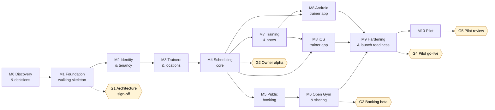
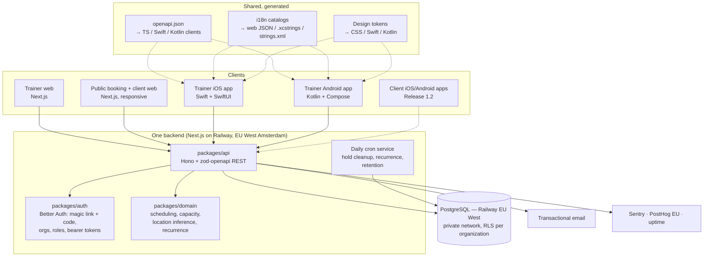

# Trainer Hub — Product & Delivery Roadmap

| | |
|---|---|
| **Version** | 1.3 |
| **Date** | 22 September 2026 |
| **Owner** | Keyvan Mahmoudi (product owner, reviewer, final decision-maker) |
| **Builders** | AI coding agents: Claude Code + Codex, working in parallel worktrees |
| **Status** | Approved (22 September 2026); ADR-011 (hosting) revised to Railway in v1.3 |
| **Requirements source** | [`PRODUCT.md`](PRODUCT.md) (what we build and why) |
| **Feature registry** | [`FEATURES.md`](FEATURES.md) (status of every feature) |
| **Engineering workflow** | [`../engineering/WORKFLOW.md`](../engineering/WORKFLOW.md) (branches, worktrees, reviews, cleanup, Definition of Done) |

> **Precedence:** `PRODUCT.md` owns requirements. This roadmap owns sequencing, milestones, gates and technical decisions. `FEATURES.md` owns per-feature status. If they disagree, fix the doc that is wrong in the same PR that finds the mismatch. Where this roadmap deliberately deviates from `PRODUCT.md` (e.g. native apps instead of React Native), the ADR in §4.3 records why.

---

## Table of contents

1. [Executive summary](#1-executive-summary)
2. [Delivery principles](#2-delivery-principles)
3. [Roadmap at a glance](#3-roadmap-at-a-glance)
4. [Phase 0: Discovery and decisions](#4-phase-0--discovery-and-decisions-m0)
5. [MVP delivery plan (M1–M9)](#5-mvp-delivery-plan-m1m9)
6. [Parallel tracks and dependencies](#6-parallel-tracks-and-dependencies)
7. [Pilot plan (M10)](#7-pilot-plan-m10)
8. [MVP success metrics](#8-mvp-success-metrics)
9. [Post-MVP roadmap (1.1 → 7.0)](#9-post-mvp-roadmap-11--70)
10. [Cross-cutting tracks](#10-cross-cutting-tracks)
11. [Target architecture](#11-target-architecture)
12. [Cost plan: free-tier first](#12-cost-plan--free-tier-first)
13. [Risk register](#13-risk-register)
14. [Decisions](#14-decisions)
15. [Roadmap governance](#15-roadmap-governance)
16. [Changelog](#16-changelog)

---

## 1. Executive summary

**What:** A Dutch-first, fully bilingual (nl-NL + en) operating platform for personal trainers and small fitness businesses. It covers scheduling, public booking, Open Gym, client management, workouts and notes, on **web, native iOS and native Android**.

**First customer:** A pilot gym owner who is also a PT and works with other trainers. Today they run on Excel, a separate calendar, notes and manual booking.

**How it is built:** AI coding agents (Claude Code and Codex) implement the work in parallel, one branch and worktree per change. They review each other's PRs. The product owner approves each milestone gate. The plan is therefore **sequence- and gate-based, not date-based**: a milestone is done when its exit criteria pass, not when a calendar date arrives.

**Strategy in horizons:**

| Horizon | Goal | Releases | When |
|---|---|---|---|
| **H1: Prove it** | Replace the pilot gym's Excel + calendar + manual booking | MVP, 1.1 | Now |
| **H2: Deepen it** | Native client apps and AI assistance for trainers | 1.2, 1.3, 1.4 | After the pilot proves value |
| **H3: Open it** | Self-serve SaaS for independent trainers, freelancers and multi-location gyms | 2.0 – 2.3 | After the pilot says "would not go back" |
| **H4+: Scale it** | Smart scheduling, analytics, payments, integrations, enterprise | 3.0 – 7.0 | Themes only; scoped when their gate opens |

**MVP at a glance:** 50 user-facing features (F001–F050) plus 18 engineering enablers (E001–E018), delivered in **10 milestones**, followed by a **6-week real-world pilot**. Everything runs on **free tiers** until real clients are on the platform (§12).

---

## 2. Delivery principles

These principles govern *how* we deliver. The product principles in `PRODUCT.md §2` govern *what* we deliver.

1. **Bilingual is part of done, not a phase.** Every milestone ships in Dutch and English on every platform. CI fails on a missing translation key or a hard-coded user-facing string. There is no "translate later".
2. **Build the architecture once; build features only when needed.** The multi-workspace model, tenant isolation, timezone-correct time handling and localization go in on day one (`PRODUCT.md §4, §77, §3`). Features that are explicitly excluded (`PRODUCT.md §53`) stay out.
3. **One contract, many clients.** The API is defined once as an OpenAPI contract. Web, iOS and Android all consume generated clients from it, so the three apps can't drift apart.
4. **Vertical slices.** Each milestone ends with something a real user can do end-to-end (DB → API → UI → email, in NL and EN), not with a finished layer.
5. **Walking skeleton first.** Web, iOS, Android, API, database, email and CI are all connected in M1, before any feature work.
6. **Pilot evidence beats opinion.** After MVP, a release is scoped only from observed pilot usage, and each post-MVP release has an entry gate.
7. **Security and privacy by default.** Notes can contain health information. Least-privilege access, trainer-only by default, EU data residency and a processor agreement with every workspace.
8. **Agents build, the owner decides.** Agents work in small, reviewable PRs, one per worktree. They cross-review each other's work, and every gate needs the owner's approval. Rules for agents live in `AGENTS.md`, which both Claude and Codex read.
9. **Free-tier first.** Every service starts on a free plan. Moving to a paid plan is triggered by real clients (Gate G4) or a hard limit, never by convenience (§12).
10. **Documentation is part of the change.** The feature doc and the `FEATURES.md` status are updated in the same PR as the code.
11. **One change, one branch, one worktree. Clean up afterwards.** See `WORKFLOW.md`.

---

## 3. Roadmap at a glance

### 3.1 Milestone sequence and parallel tracks



After M4 the plan runs as **three parallel tracks**, each in its own worktrees:

| Track | Milestones | Typical agent split |
|---|---|---|
| **Backend + web** | M5 → M6, and M7 | One agent on booking/Open Gym, one on training/notes |
| **iOS** | M8 (iOS) | One agent: Swift + SwiftUI |
| **Android** | M8 (Android) | One agent: Kotlin + Jetpack Compose |

The native tracks start as soon as the M4 API contract is stable (Today, calendar, sessions, attendance). They add workout logging and notes screens once the M7 contract lands.

### 3.2 Milestones summary

Size is relative complexity (S / M / L / XL), not a duration.

| # | Milestone | Outcome (what someone can do at the end) | Features | Size |
|---|---|---|---|---|
| **M0** | Discovery & decisions | Validated flows, accepted ADRs, pilot baseline measured | — | S |
| **M1** | Engineering foundation | A "hello" runs web + iOS + Android → API → DB → email, in NL and EN, with CI | E001–E010, E018 | L |
| **M2** | Identity & tenancy | Owner signs in, creates a workspace, sees Dutch-default UI, switches to English | F001–F010, E011 | L |
| **M3** | Trainers & locations | Owner invites trainers; a trainer belongs to several workspaces; locations are inferred | F011, F012, F015–F019 | M |
| **M4** | Scheduling core | Owner runs the real weekly schedule: private sessions, recurring classes, substitution, attendance | F013, F014, F020–F026, E012 | XL |
| **M5** | Public booking | A client scans a link, books a class with name + email, verifies, gets a localized confirmation | F027–F033, F049, F050, E013 | L |
| **M6** | Open Gym & sharing | Owner publishes Open Gym; clients book it; booking links and QR posters are printable | F034–F038 | M |
| **M7** | Training & notes | Trainer builds templates, assigns workouts, logs live sets with previous values, keeps notes | F039–F048 | L |
| **M8** | Native trainer apps (iOS + Android) | A trainer's day runs from the phone: Today, calendar, clients, logging, notes, attendance | Mobile surfaces of F013, F020, F025, F043–F048; E017 | XL (×2 platforms) |
| **M9** | Hardening & launch readiness | Security, privacy, accessibility, NL/EN QA, import tooling, backups, runbooks are all done | E014–E016 | M |
| **M10** | Pilot | The pilot gym runs on the platform for 6 weeks; evidence collected; Release 1.1 defined | — | 6 weeks |

### 3.3 Release roadmap

| Release | Objective | Horizon | Entry gate (must be true to start) |
|---|---|---|---|
| **MVP** | Dutch-first pilot gym platform | H1 | Roadmap approved |
| **1.1** | Pilot-driven refinement | H1 | ≥ 4 weeks of pilot usage data; findings triaged |
| **1.2** | Native client iOS + Android apps | H2 | Public booking web is healthy (funnel ≥ target); clients ask for an app |
| **1.3** | NL/EN AI note capture | H2 | AI processor DPA signed; per-workspace opt-in designed |
| **1.4** | AI client briefing | H2 | 1.3 in use; enough history per client to summarize |
| **2.0** | Public SaaS onboarding | H3 | Pilot says "would not go back"; pricing model decided (see §9, 2.0) |
| **2.1** | Freelance trainer improvements | H3 | ≥ 3 independent trainers onboarded via 2.0 |
| **2.2** | Multi-workspace improvements | H3 | Trainers actually active in ≥ 2 workspaces |
| **2.3** | Multi-location organizations | H3 | A committed multi-location customer |
| **3.0** | Smart scheduling | H4 | Enough scheduling data to justify it |
| **3.1** | Open Gym automation | H4 | Manual Open Gym publishing is a proven, repeated chore |
| **3.2** | Business analytics | H4 | Customers ask for reports they currently build by hand |
| **4.0** | Payments and billing | H4 | Customers ask to take payments in-platform |
| **5.0** | Advanced AI | H4+ | 1.3/1.4 adoption proves AI value |
| **6.0** | Integrations | H4+ | Integration demand ranked from customer requests |
| **7.0** | Larger-business features | H4+ | Pipeline of larger gyms |

---

## 4. Phase 0: Discovery and decisions (M0)

**Goal:** Remove the expensive unknowns before writing product code.

### 4.1 Pilot discovery

Run it with the printable kit in [`docs/discovery/`](../discovery/README.md) (shadow day, baseline, phone inventory, import checklist, metric targets, prototype validation).

- [ ] **Shadow day** with the pilot owner: observe a real day of scheduling, booking, logging and notes.
- [ ] Understand the **real artefacts**: current Excel sheets, calendar, note formats, the weekly class timetable. The gym owner describes them; files are only shared if they choose to.
- [ ] Inventory: number of trainers, clients, recurring classes, Open Gym demand, and private sessions per week.
- [ ] Inventory **which phones the trainers use** (iOS vs Android split, OS versions). This sets the minimum OS versions (ADR-003).
- [ ] **Measure the baseline:** hours per week spent on admin, number of tools used, booking method, no-show rate. This is what M10 success is compared against.
- [ ] Agree on the **data to import** at go-live (clients, class schedule, future sessions, optionally workout history).
- [ ] Agree on MVP metric targets with the owner (see §8).

### 4.2 UX design

- [ ] Information architecture for trainer web, iOS/Android trainer apps, public booking and client web.
- [ ] Wireframes for the **6 critical flows**, **written in Dutch first**:
  1. Public booking on a phone (QR → class → name/email → verify → confirmed → optional account)
  2. Trainer "Today" on mobile
  3. Workspace calendar on web (owner view)
  4. Create / reschedule a private session (with location inference)
  5. Live workout logging with previous values
  6. Manage a class occurrence (substitution, cancellation, attendance)
- [ ] The mobile flows follow **platform conventions**: iOS Human Interface Guidelines and Android Material 3. Same flow and content, native look on each.
- [ ] Clickable prototype validated with the pilot owner and at least 1 other trainer.
- [ ] Visual direction and **design tokens** (colour, type, spacing) as a single source that exports to web CSS, Swift and Kotlin (ADR-015).
- [x] Start the **Dutch terminology glossary** (`packages/i18n/GLOSSARY.md`), e.g. Klanten, Lessen, Boekingslinks, Aanwezig, Niet verschenen. It keeps LLM translations consistent.

### 4.3 Architecture Decision Records (ADRs)

Each decision has a short ADR in [`docs/decisions/`](../decisions/README.md) with its context, consequences and alternatives. All ADRs were accepted by the owner on 22 September 2026. **ADR-011 (hosting) was re-evaluated** during the write-up, because the owner already pays for Railway Hobby and Vercel Hobby is non-commercial only; the owner accepted the Railway option the same day.

| ADR | Decision | Choice | Status | Why |
|---|---|---|---|---|
| [001](../decisions/ADR-001-monorepo-tooling.md) | Monorepo tooling | **pnpm workspaces + Turborepo** for TS; native projects live in the same repo (`apps/ios`, `apps/android`) with their own build tools (Xcode, Gradle) | Accepted | One repo, one PR per change across all platforms |
| [002](../decisions/ADR-002-web-framework.md) | Web framework | **Next.js (App Router) + TypeScript strict** | Accepted | Per spec §71; server rendering is good for public booking speed |
| [003](../decisions/ADR-003-native-mobile-apps.md) | Mobile | **Native: iOS in Swift + SwiftUI; Android in Kotlin + Jetpack Compose** (min OS versions set in M0 from the trainers' phones) | **Accepted, deviates from spec §72** | Owner decision: best platform fit, performance and native feel. The cost is two UI codebases, offset by the shared API contract, i18n and design tokens |
| [004](../decisions/ADR-004-api-layer.md) | API layer | **REST + OpenAPI 3.1**, built with Hono + `@hono/zod-openapi` in `packages/api` and served from Next.js route handlers. The OpenAPI spec is generated and committed; **typed clients are generated** for TS (web), Swift (swift-openapi-generator) and Kotlin (openapi-generator) | Accepted (replaces tRPC) | Native clients need a language-neutral contract. One backend still serves all clients (§75) |
| [005](../decisions/ADR-005-database-and-orm.md) | Database & ORM | **PostgreSQL (EU region) + Drizzle ORM + versioned SQL migrations** | Accepted | Per spec §76; SQL-first, works cleanly with Row-Level Security |
| [006](../decisions/ADR-006-tenant-isolation.md) | Tenant isolation | **Org-scoped data-access layer + Postgres RLS as defence in depth + automated cross-tenant tests** | Accepted | Per spec §77; two independent barriers against data leaks |
| [007](../decisions/ADR-007-authentication.md) | Authentication | **Better Auth** (organization/member/invitation plugins + email magic link **and** 6-digit email code; bearer tokens for native apps) | Accepted | Our own tables and our own localized emails. The 6-digit code lets native apps sign in without needing Universal/App Links on day one, and it survives email link scanners. *Spike in M1: native bearer-token flow* |
| [008](../decisions/ADR-008-localization.md) | Localization | **One source of truth:** ICU MessageFormat catalogs in `packages/i18n` (`nl-NL.json`, `en.json`). Web uses next-intl. A generator **exports the catalogs to iOS String Catalogs (`.xcstrings`) and Android `strings.xml`/plurals**. Emails use the same catalogs | Accepted | One set of keys and translations for three platforms; CI checks parity on the source and on the generated files |
| [009](../decisions/ADR-009-transactional-email.md) | Transactional email | **React Email templates + a free-tier provider** (Resend or Brevo; Brevo is EU-based) | Accepted | One template structure with localized strings (§74); free tier covers pilot volume |
| [010](../decisions/ADR-010-background-jobs.md) | Background jobs | **Avoid needing a job runner:** holds expire *lazily* (`expires_at` is checked when capacity is read) and a daily cron cleans up; emails are sent inline with retry; recurrence is materialized by a daily cron plus on-demand at edit time | Accepted | Works within free-tier cron limits; add a queue (e.g. Inngest free tier) only if needed |
| [011](../decisions/ADR-011-hosting-and-environments.md) | Hosting & environments | All on **Railway, EU West (Amsterdam)**: Next.js web + API, Postgres and a cron service in one project; a PR environment per PR. Hobby (already paid) during the build → **Pro ($20/month) at G4**. *Replaces v1.2: Vercel Hobby + Neon free* | Accepted (revised in v1.3) | Vercel Hobby is non-commercial only, so G4 needs a paid plan anyway. Railway keeps app and DB in one EU location with one DPA, no DB cold starts, and costs a flat $20/month at pilot volume vs ≈ $20–40 for Vercel Pro + Neon |
| [012](../decisions/ADR-012-time-and-recurrence.md) | Time & recurrence model | **UTC `timestamptz` + IANA timezone on workspace/location; recurrence as RRULE in local wall-clock time; occurrences materialized as rows for a rolling horizon (e.g. 12 weeks)** | Accepted | "Every Tuesday 18:00" must stay 18:00 across daylight-saving changes; each occurrence needs its own trainer, capacity and bookings (§20) |
| [013](../decisions/ADR-013-observability.md) | Observability | **Free tiers:** Sentry (EU region; web, iOS, Android, API), UptimeRobot / Better Stack uptime checks, PostHog EU (cookieless mode) for product events | Accepted | Pilot observation (§85 J) needs data; cookieless means no consent banner |
| [014](../decisions/ADR-014-testing.md) | Testing | **Vitest** (unit + integration against real Postgres), **Playwright** (web e2e in NL and EN), **XCTest/XCUITest** (iOS), **JUnit + Compose UI tests** (Android), **Maestro** for shared cross-platform mobile flows | Accepted | Booking and tenancy bugs are the most expensive; Maestro runs the same flow on both native apps |
| [015](../decisions/ADR-015-ui-foundation.md) | UI foundation | **Shared design tokens** (Style Dictionary) → web (Tailwind + shadcn/ui), iOS (SwiftUI), Android (Compose + Material 3) | Accepted | Share tokens, contract and strings, not components |

### 4.4 Legal and privacy preparation

*This is not legal advice. Before go-live, have the result checked (at least an LLM-assisted review against AVG/GDPR guidance; ideally a privacy professional once there is revenue).*

**Drafts (v0.1):** [`docs/legal/`](../legal/README.md). The boxes below get ticked once the owner has answered the [open questions](../legal/open-questions.md) and the review is done.

- [ ] **Role mapping:** each workspace (gym/trainer) is the *controller* of its client data; the platform is the *processor*.
- [ ] **Processor agreement (verwerkersovereenkomst)** template, signed with the pilot gym before real data is imported.
- [ ] Sub-processor list (hosting, DB, email, error tracking, analytics), each with its region and DPA.
- [ ] Assess whether a **DPIA** is needed, because free-form notes may contain health data (special-category data).
- [ ] Privacy policy and terms in **NL and EN**.
- [ ] Data retention policy (guest bookings, expired holds, deleted clients).

### 4.5 Accounts and setup (free-first)

- [ ] **Name:** Trainer Hub (working name). **Domain:** decided later. Buy one before M5 (see §12), because email deliverability and deep links need it.
- [ ] GitHub repository (private) + branch protection on `main`.
- [ ] Accounts: Railway (Hobby, already paid; EU West Amsterdam, ADR-011), plus free tiers for the email provider, Sentry, PostHog and the uptime monitor (EU regions).
- [ ] **Apple Developer Program and Google Play Console: deferred to M8.** During development, use Xcode's free on-device provisioning and Android debug builds. Enroll as an *individual* for the pilot to avoid the D-U-N-S wait (§12).

### 4.6 M0 exit criteria (Gate G0)

- Critical flows validated by the pilot owner.
- ADRs 001–015 written up in `docs/decisions/` (the decisions themselves are accepted).
- Baseline metrics recorded; trainer phone inventory known.
- Free-tier accounts created.

---

## 5. MVP delivery plan (M1–M9)

Each milestone lists its **goal**, **scope** (features from `FEATURES.md`), **key technical notes**, **pilot touchpoint** and **exit criteria**. Every milestone must also meet the Definition of Done (`WORKFLOW.md §6`), including Dutch and English on every platform it touches.

### M1: Engineering foundation (walking skeleton)

**Goal:** Every layer on every platform is connected before feature work starts.

**Scope:** E001 Monorepo, E002 CI, E003 Environments, E004 Database, E005 i18n + native export, E006 Email infra, E007 Design tokens + UI foundation, E008 Native app shells, E009 Observability, E010 Test infra, E018 API contract + client generation.

**Key notes**
- Repo layout (this deviates from `PRODUCT.md §70` for native, per ADR-003/004):

  ```text
  /apps
    /web          Next.js: trainer web, public booking, client web, hosts the API
    /ios          Xcode project, Swift + SwiftUI
    /android      Gradle project, Kotlin + Jetpack Compose
  /packages
    /api          Hono + zod-openapi routes → generates openapi.json
    /contract     Committed openapi.json + generated TS / Swift / Kotlin clients
    /domain       Pure business logic (location inference, capacity, recurrence)
    /database     Drizzle schema, migrations, seed
    /auth         Better Auth configuration
    /i18n         nl-NL.json, en.json, GLOSSARY.md, exporters → .xcstrings / strings.xml
    /validation   zod schemas (shared by API and web)
    /design-tokens  Style Dictionary source → CSS / Swift / Kotlin
    /ui           Web component kit
  ```
- CI on every PR: lint, typecheck, tests, build, **i18n key parity**, **ICU syntax**, **no hard-coded strings** (web lint; SwiftLint/ktlint custom rules for native), and an **OpenAPI drift check** (the committed spec must match the code; generated clients must be up to date).
- **CI minutes on the free plan:** Linux jobs (web, API, Android) run on every PR. iOS builds run only when `apps/ios` or the contract changes, and agents also build locally with Xcode. macOS minutes count 10× against the free quota (§12).
- Environments (ADR-011): `local` (Docker Postgres), `preview` (a Railway PR environment per PR with its own migrated and seeded Postgres, removed on merge/close), `production` (Railway, EU West Amsterdam). A separate `staging` is only added if it's needed. The M1 spike checks the ADR-011 conditions (per-PR databases, backup/restore, cron, cost).
- Native shells: an iOS app and an Android app that call a generated API client and show a translated screen, running on a simulator/emulator and on a real device.

**Exit criteria (Gate G1: architecture sign-off)**
- A translated "hello" screen on web, iOS and Android reads from the DB through the generated API client.
- A localized test email is delivered and lands in the inbox, not spam.
- A PR opens a preview deploy; merging to `main` deploys production (not yet public).
- Adding a string to only one locale fails CI, and so does changing an API route without regenerating the contract.

---

### M2: Identity and tenancy

**Goal:** Users, workspaces and roles, with strict tenant isolation and locale handling.

**Scope:** F001 Authentication, F002 Workspaces, F003 Workspace Membership, F004 Roles, F005 Trainer Profile, F006 Client Profile, F007 Localization Infrastructure, F008 Dutch UI, F009 English UI, F010 Locale Preference, E011 Tenant isolation suite.

**Key notes**
- `preferredLocale: "nl-NL" | "en"` on the user; a `defaultLocale` on the workspace; guests are detected from browser/device locale, falling back to Dutch (§3).
- Locale resolution order, documented once in `packages/i18n` and used by every platform: **explicit user choice → stored preference → workspace default → device/browser → nl-NL**. The native apps follow the in-app choice, not only the OS language.
- Roles: Owner, Admin, Trainer (§50). No custom permissions. Owner + Trainer on the same person is a normal case.
- Every business table carries `organization_id`; RLS policies are active; the cross-tenant test suite runs in CI.
- **Sign-in email contains a magic link and a 6-digit code.** Web uses either one; native apps use the code, and deep links come later. Tokens are hashed, single-use, short-lived and rate-limited, with no account enumeration. The link opens a **confirm-click page**, so email scanners (e.g. Outlook Safe Links) can't consume it.

**Exit criteria**
- Owner signs in on web, iOS and Android, creates "John's Gym", sees the UI in Dutch by default, switches to English, and the choice persists across devices.
- Automated tests prove workspace A cannot read or write workspace B's data through any API route.

---

### M3: Trainers and locations

**Goal:** A multi-trainer gym, and trainers who work across workspaces.

**Scope:** F011 Trainer Invitations, F012 Multi-Workspace Trainer, F015 Locations, F016 Organization Default Location, F017 Trainer Locations, F018 Client Preferred Location, F019 Automatic Location Selection.

**Key notes**
- Invitation emails are localized: **recipient language if known → workspace default** (§49).
- Location types: `organization_location`, `external_gym`, `client_home`, `outdoor`, `online`, `other` (§12). No floors, rooms or resources.
- Location inference is a **pure domain function** in `packages/domain`: (workspace, trainer, client, history) → a location or "ambiguous, ask". The server computes it and returns it through the API, so native apps never re-implement it.

**Exit criteria**
- Owner invites 2 trainers (one NL, one EN); each receives the invite in their language and joins.
- Sarah is a trainer at John's Gym and owner of "Sarah Personal Training" at the same time.
- Inference picks the right location in all spec scenarios (§13) and asks only when the answer is ambiguous.

---

### M4: Scheduling core

**Goal:** The owner can run the gym's real weekly schedule in the platform.

**Scope:** F013 Personal Trainer Calendar, F014 Workspace Calendar, F020 Private Sessions, F021 Group Class Templates, F022 Recurring Classes, F023 Trainer Assignment, F024 Trainer Substitution, F025 Attendance, F026 Cancellations, E012 Scheduled jobs.

**Key notes**
- **One scheduling engine** for Private, Group and Open Gym (§16). A `session` has a type, workspace, trainer(s), location, start/end and capacity.
- Recurrence follows ADR-012. Editing one occurrence vs. "this and following" is explicit in the UI. DST transitions (last Sunday of March/October) are covered by tests.
- **Two calendars, one data model:** the workspace calendar filters by `organization_id`; the trainer calendar filters by `trainer_id` across all the trainer's workspaces (§78). Both are permission-checked.
- Substitution changes the occurrence's trainer only; bookings stay untouched (§19).
- Cancelling a session or class notifies participants in *their* language.
- Attendance statuses: Booked / Attended / Cancelled / No-show (§43).
- **Freeze the mobile-facing API** (Today, calendars, sessions, attendance) at the end of M4. That unblocks the iOS and Android tracks.

**Pilot touchpoint (Gate G2: owner alpha):** The owner enters the real weekly timetable on web and runs it **in parallel** with Excel. First real feedback loop.

**Exit criteria**
- A full real week of the pilot gym is represented correctly, including a substitution and a cancellation.
- Owner sees the workspace-wide "Today" (§45); a trainer sees "My day" across workspaces (§46–47).

---

### M5: Public booking

**Goal:** A client books without an app, without a password and without a phone number.

**Scope:** F027 Public Booking Page, F028 Booking Capacity, F029 Booking Hold, F030 Magic-Link Verification, F031 Guest Booking, F032 Optional Account Creation, F033 Client Booking Dashboard, F049 Localized Transactional Emails, F050 Trainer Booking Notifications, E013 Public surface security.

**Key notes**
- Flow per §23: choose → name + email → **hold (`pending_verification`, 10–15 min)** → magic link → verified → `confirmed` → optional account. Expired holds become `expired` and free the spot. Expiry is checked lazily, per ADR-010.
- **Capacity is enforced transactionally**: row lock or constraint on the occurrence, with holds counted against capacity, and concurrent booking tests (two people, one spot).
- **Abuse protection:** holds could be spammed to block a class. Mitigate with rate limits per IP/email, a cap on active holds per email, and Cloudflare Turnstile (free, privacy-friendly) on the form.
- A prominent **NL | EN** switch; the chosen language is carried through the hold, the email, the confirmation and all future emails (§3, "Client language").
- Email set (NL + EN each): magic link, booking confirmation, cancellation, schedule change, class cancellation; trainer: new booking, cancellation (§51).
- Client web (F033): upcoming/past bookings, cancellation, profile, reachable via magic link, with or without an account.
- **Buy the domain before this milestone.** Real clients need emails from an authenticated domain (SPF, DKIM, DMARC).
- Performance budget for the public page: fast on a mid-range phone over 4G (LCP < 2.5 s).

**Exit criteria**
- Playwright e2e passes the whole flow **in Dutch and in English** on a mobile viewport.
- A concurrency test proves no overbooking.
- Deliverability tested against Gmail, Outlook/Hotmail and a Dutch ISP mailbox.

---

### M6: Open Gym and sharing

**Goal:** Open Gym is bookable, and every booking surface is shareable by link and QR.

**Scope:** F034 Open Gym Slots, F035 Open Gym Public Booking, F036 Open Gym Suggestions *(Should-have; the first candidate to slip to 1.1)*, F037 Booking Links, F038 QR Codes.

**Key notes**
- Open Gym is just a session type with start, end, location and capacity (§2.7, §28). It reuses the M4 engine and the M5 booking flow.
- Booking-link scopes: all bookings, group classes, Open Gym, a specific class, a specific occurrence (§32). Links carry a language behaviour (workspace default / detect / manual).
- QR codes: copy link, download (PNG + SVG), a print-ready poster (A4, bilingual), share (§33). Generated server-side, so native apps just show and share them.
- Suggestions (F036): "You're already at the gym 10:00–11:00. Offer Open Gym?", derived from the trainer's calendar.

**Pilot touchpoint (Gate G3: booking beta):** A QR poster goes up in the gym; a small group of real clients book through it.

**Exit criteria**
- Real clients have completed bookings through a printed QR code, in both languages.

---

### M7: Training and notes

**Goal:** Workouts and notes replace Excel and scattered notes.

**Scope:** F039 Exercise Library, F040 Custom Exercises, F041 Workout Templates, F042 Client Workouts, F043 Live Workout Logging, F044 Previous Workout Display, F045 Workout History, F046 Client Notes, F047 Session Notes, F048 Note Visibility.

**Key notes**
- **Exercise library baseline:** curate about 150 core exercises with Dutch and English names and aliases. Check the license of any open dataset before using it. Custom exercises are stored as entered (§38).
- Data model per §42: exercise, sets, reps, weight, difficulty (Easy/Normal/Hard), date, session, trainer, notes.
- "Previous" values come from the client's last logged performance of that exercise (§41). Indexed for instant display.
- **Design the logging API for offline from day one:** client-generated IDs (UUIDv7), idempotent writes and a batch sync endpoint. The native apps queue writes locally (SwiftData / Room). Full offline resilience is scoped for 1.1, but it must not need a rewrite.
- Notes are free-form, stored as entered, **trainer-only by default**, with an optional client-visible flag (§35–37). Access to notes is permission-checked and audit-logged.

**Exit criteria**
- A trainer completes a real private session on web: assigns a template, logs sets against previous values, adds a session note and a trainer-only client note.
- The logging API contract is frozen for the native tracks.

---

### M8: Native trainer apps (iOS + Android)

**Goal:** A trainer's day runs from the phone, on either platform.

**Scope:** Native screens for Today, personal calendar, clients, session screen, workout logger, notes, attendance, and the NL/EN switch (§85 I), built **in parallel**: one iOS track and one Android track. E017 App distribution.

**Key notes**
- Both apps consume the **generated API clients** and **generated string catalogs**. No hand-written API models and no hand-written strings.
- **Platform parity checklist** per screen: every screen and state (loading, empty, error, offline) exists on both platforms in both languages before the milestone closes.
- The workout logger is designed for one hand, big targets and use between sets, and keeps working on weak gym Wi-Fi (local queue from M7).
- The same Maestro flows run on iOS and Android as the shared acceptance test.
- **Distribution for the pilot:** TestFlight (iOS) and Play internal testing (Android). This needs the Apple Developer Program ($99/year) and Google Play ($25 once), the first unavoidable costs, paid only now (§12). Native apps have no over-the-air updates, so pilot fixes ship as new TestFlight/internal builds.
- App Store requirements: in-app account deletion, a privacy nutrition label, and a demo account for review.

**Exit criteria**
- A trainer runs a full day on the phone (check Today, take attendance, log 3 sessions, add notes) in NL and in EN, **on iOS and on Android**.
- Maestro smoke flows pass on both platforms.

---

### M9: Hardening and launch readiness

**Goal:** Nothing about going live is left to chance.

**Scope:** E014 Privacy tooling (export, deletion, retention), E015 Data import tooling, E016 Backups, restore drill and runbooks, plus the checklist below.

**Launch checklist**
- [ ] Security review (cross-agent + owner sign-off): authn/authz on every route, tenant isolation suite green, rate limits, security headers, secrets rotation, dependency audit, native secure storage for tokens (Keychain / EncryptedSharedPreferences or DataStore).
- [ ] Privacy: data export and deletion work per client and per workspace (§79); retention jobs run; processor agreement signed.
- [ ] **Full bilingual QA pass:** an LLM review of every string against the glossary and tone guide, on web, iOS, Android and email. Dates/times checked (`22 september 2026`, 24h, Europe/Amsterdam). The pilot owner flags anything that reads oddly.
- [ ] Accessibility: public booking and client web meet WCAG 2.2 AA. Native apps support Dynamic Type / font scaling, VoiceOver / TalkBack labels, and have sufficient contrast.
- [ ] Performance: public page budget met; calendar loads a busy week quickly.
- [ ] Backups verified by an **actual restore** to a scratch Postgres service on Railway.
- [ ] Runbooks: incident response, rollback, "a client says they didn't get the email", "wrong booking".
- [ ] Import scripts dry-run against a copy of the pilot's real data.
- [ ] **Free-tier limits reviewed** and the paid upgrades triggered by G4 are ready to switch on (§12).
- [ ] Support channel with the pilot agreed (response times, how to report issues).

**Exit criteria (Gate G4: pilot go-live)**
- Every checklist item is done or explicitly waived by the owner, with a reason.

---

## 6. Parallel tracks and dependencies

- **Hard sequence:** M1 → M2 → M3 → M4. Everything depends on the foundation, identity/tenancy, and the scheduling engine.
- **After M4, three tracks run in parallel:** backend/web (M5 → M6 and M7), iOS (M8), Android (M8). Each agent works in its own worktree and branch.
- **Contract freezes are the sync points:** the mobile-facing contract freezes at the end of M4 (scheduling) and at the end of M7 (logging/notes). Any later contract change comes as a versioned, additive change with regenerated clients, never a silent break.
- **The real bottleneck is review and integration, not typing.** To keep it moving:
  - Keep PRs small (one feature or sub-feature each).
  - Each PR is cross-reviewed by the other agent (Claude ↔ Codex) before the owner sees it.
  - At most **3–4 open worktrees at once**, to limit merge conflicts and review load.
- **Scope levers, in order, if a gate is at risk:** F036 (Open Gym suggestions) → a minimal version of F033 client web → the size of the exercise library baseline. **Never cut:** bilingual, tenant isolation, booking capacity correctness, iOS/Android parity, privacy basics.

---

## 7. Pilot plan (M10)

| Week | Activity |
|---|---|
| **0: Setup** | Import data (clients, timetable, future sessions); 1:1 onboarding with the owner; short onboarding per trainer (Dutch quick guide); install the apps via TestFlight / Play internal testing; create classes and Open Gym; print QR posters |
| **1: Soft launch** | Booking page shared with a subset of clients; the owner keeps Excel as a safety net |
| **2–3: Switch-over** | All scheduling and booking move to the platform; Excel retired for scheduling; workouts logged in-app |
| **4–6: Observe** | Weekly 30-min check-in with the owner; trainers asked every two weeks; workaround log maintained |
| **End of 6** | **Pilot review (Gate G5):** metrics vs. baseline and targets; ranked findings; Release 1.1 scope defined from evidence |

**What we observe (§85 J 74–76):**
- Where people still use Excel, a separate calendar or notes, and why.
- Workarounds (things people do *around* the product).
- Support requests and developer interventions (goal: zero for normal use).
- Funnel drop-offs in public booking.
- iOS vs Android issue split.

**Feedback channels:** in-app "feedback" link (NL/EN) on web and both apps, the weekly check-in, and the workaround log in `docs/pilot/`.

---

## 8. MVP success metrics

These turn `PRODUCT.md §87` into measurable targets. **Targets marked ⚑ are confirmed with the pilot owner in M0.**

| Success criterion (§87) | Metric | Target |
|---|---|---|
| Owner runs gym scheduling through the platform | Share of the real weekly schedule that exists in the platform | ≥ 95 % from pilot week 3 |
| Trainers use their assigned sessions | Active trainers per week ÷ trainers with sessions | 100 % |
| Customers book through public pages | Share of group + Open Gym bookings made via public pages | ≥ 80 % ⚑ |
| Booking is easy | Started → confirmed conversion; median time to verify | ≥ 70 %; < 5 min |
| Dutch-only and English-only users complete everything | Missing keys; e2e suites per locale on web, iOS, Android | 0 missing; all suites green |
| Open Gym receives bookings | Open Gym bookings per week | ⚑ agreed in M0 |
| Workout logging replaces Excel | Private sessions with a logged workout | ≥ 80 % |
| Notes replace scattered tools | Owner/trainers confirm no other notes tool is in use | Yes, at pilot review |
| Previous performance is easy to access | Trainer rating "easy to see what they did last time" | ≥ 4/5 |
| Normal usage needs no developer | Developer interventions for routine operations | 0 in the final 2 weeks |
| Reliability and safety | Uptime; cross-tenant incidents; app crash-free sessions | ≥ 99.5 %; 0; ≥ 99 % |
| Admin time reduced | Hours per week on admin vs. M0 baseline | ⚑ e.g. −50 % |
| **Strongest signal** | "Would you go back to Excel + calendar + manual booking?" | **No** |

---

## 9. Post-MVP roadmap (1.1 → 7.0)

Near-term releases have concrete scope. Later releases are **themes**, and their scope is re-planned when their entry gate opens (§3.3). Every release keeps the rule: **both languages, on every platform, or it isn't done.**

### Horizon 1: Prove it

#### Release 1.1: Pilot refinement
- **Goal:** Close the gaps the pilot exposes.
- **Candidate scope (from `PRODUCT.md §54`, re-ranked by evidence):** waitlists, cancellation cutoff, recurring private appointments, schedule exceptions, holidays, blocked time, workout duplication, previous-session duplication, warm-up sets, supersets, workout reordering, pinned notes, note search, offline resilience, bulk attendance.
- **Suggested additions (not in spec, validate in pilot):**
  - **Session reminder emails** (e.g. 24 h before): a cheap way to reduce no-shows.
  - **Read-only calendar feed (ICS)** per trainer: covers much of the Google/Apple/Outlook need well before 6.0.
  - **Deep links** (Universal Links / App Links) so email links open the trainer apps directly.
- **Exit:** the top 5 pilot pain points are resolved; still zero dev interventions.

### Horizon 2: Deepen it

#### Release 1.2: Native client apps (iOS + Android)
- **Scope:** Home / Book / Training / Profile (Dutch: Home / Boeken / Training / Profiel); upcoming bookings, group and Open Gym booking, cancellations, workout history, notifications, language switch.
- **Build:** Swift/SwiftUI and Kotlin/Compose, same as the trainer apps. Either separate client apps or a role-based mode inside one app per platform; decide at the 1.2 entry gate, based on App Store listing and branding needs.
- **Enablers:** push notifications via APNs + FCM directly (both free) with localized payloads; deep links from emails; public App Store / Play listings (NL + EN); in-app account deletion.
- **Reuse:** the same API contract, booking engine, string catalogs and design tokens.

#### Release 1.3: AI note capture (NL/EN)
- **Scope:** the trainer speaks or types; AI proposes structured notes; **the trainer confirms before saving** (§56).
- **Prerequisites:** a DPA with the AI/speech processor (EU processing, no training on customer data); per-workspace opt-in; Dutch-capable speech-to-text (on-device speech APIs on iOS/Android are a free first option); an evaluation set of real Dutch and English trainer notes to measure quality before release.

#### Release 1.4: AI client briefing
- **Scope:** a short pre-session summary from history (last sessions, trends, notes), in the trainer's language (§57).
- **Guardrails:** trainer-only; always cites which notes/sessions it used; never shows client-invisible notes to clients.

### Horizon 3: Open it

#### Release 2.0: Public SaaS onboarding
- **Scope:** self-serve signup; "What describes you?" (Independent trainer / Trainer at a gym / Studio or gym owner, in Dutch by default); a workspace setup wizard per persona; marketing site (NL/EN); help center; support process; public App Store / Play listings for the trainer apps.
- ⚠️ **Decision needed before 2.0:** `PRODUCT.md` puts payments at 4.0, but a public SaaS needs a way to charge *our* customers. **Platform subscription billing** (charging trainers and gyms for the product) is different from **client payments** (gyms charging their clients, 4.0). Choose: free beta / manual invoicing / pull platform billing forward into 2.0.

#### Release 2.1: Freelance trainers
- **Scope:** independent workspace polish, multiple external gyms, client default location, navigation links (open Apple Maps / Google Maps), combined schedule of org + independent clients, gym access info (§60, no billing).

#### Release 2.2: Multi-workspace improvements
- **Scope:** easy workspace switching, combined calendar improvements, **cross-workspace conflict detection**, workspace-specific permissions, personal workspace next to organization work.
- *Note:* the combined calendar already exists from MVP (F013); 2.2 improves it. Conflict detection is here, and 3.0 builds on it rather than duplicating it.

#### Release 2.3: Multi-location organizations
- **Scope:** several locations per organization (e.g. FitLab Amsterdam Zuid / Oost / Utrecht); default location per trainer/class so nobody selects the same location repeatedly.

### Horizon 4+: Scale it (themes; scope set when the gate opens)

| Release | Theme | Notes |
|---|---|---|
| **3.0** Smart scheduling | Travel warnings, client clustering, location optimization, buffer suggestions | Builds on 2.2 conflict detection and location data |
| **3.1** Open Gym automation | Rules for capacity, days, time ranges, advance publication, trainer on-site | Automates the F036 suggestion from MVP |
| **3.2** Business analytics | Sessions, occupancy, Open Gym usage, cancellations, no-shows, busy periods, trainer workload, retention | Bilingual UI; the event data must already be captured from MVP (see §10) |
| **4.0** Payments & billing | Packages, credits, subscriptions, memberships, payments, invoices, recurring payments, reminders, accounting | **NL priorities:** iDEAL via a Dutch-friendly PSP (e.g. Mollie or Stripe); accounting links such as Moneybird, e-Boekhouden, Exact Online; validate with customers first. Check App Store rules on in-app purchases before adding payments to native apps |
| **5.0** Advanced AI | Note summaries, progression insights, training suggestions, schedule assistance | Trainer keeps final control; NL + EN |
| **6.0** Integrations | Two-way Google/Apple/Outlook calendar sync, accounting, payments, **Apple HealthKit, Android Health Connect**, wearables, exercise media | Native apps make HealthKit and Health Connect straightforward; rank by customer requests |
| **7.0** Larger business | Advanced permissions, reception role, branding, custom domain, staff analytics, commissions, enterprise controls, white-label | The role model from M2 must allow new roles without migration pain |

---

## 10. Cross-cutting tracks

These run continuously from M1 onward. They are not phases.

| Track | Standard | Enforced by |
|---|---|---|
| **Localization** | Every string is a key in `packages/i18n`; nl-NL and en always in parity; ICU plurals; generated `.xcstrings` / `strings.xml` never edited by hand; dates/times via the platform's locale APIs with the workspace/user timezone; user content never auto-translated | CI checks (E005); per-locale e2e on all platforms; **LLM translation review** on every PR that touches strings, against `GLOSSARY.md` and the tone guide (informal "je", friendly and short) |
| **Platform parity** | Every mobile feature exists on iOS and Android, in both languages, before it counts as done | Parity checklist in PRs; shared Maestro flows |
| **API contract** | All clients use generated clients; changes are additive and versioned after a freeze | OpenAPI drift check in CI |
| **Security** | Least privilege; tenant isolation; hashed single-use tokens; rate limits; secure token storage on devices; dependency updates | E011 suite in CI; cross-agent security review at M9 and before each major release |
| **Privacy (AVG/GDPR)** | Minimal data (name + email for booking); trainer-only notes by default; EU residency; export and deletion; retention; processor agreements | Definition of Done checklist for any feature touching personal data |
| **Accessibility** | WCAG 2.2 AA on public and client web; Dynamic Type, VoiceOver/TalkBack and contrast on native | axe checks in web e2e; native accessibility audits at M9 |
| **Observability** | Errors, logs, uptime, crash-free rate; **product events captured from MVP** (bookings, attendance, logging) so 3.2 analytics has history | E009; event list maintained in `docs/engineering/` |
| **Quality** | Test pyramid; e2e for booking, tenancy, scheduling; tests ship with every change (`docs/engineering/TESTING.md`) | CI required checks on `main`; feature Test plans; cross-agent review |
| **Documentation** | Feature docs + registry updated in the same PR | PR checklist (WORKFLOW.md) |

---

## 11. Target architecture



**Environments** (per [ADR-011](../decisions/ADR-011-hosting-and-environments.md)): `local` (Docker Postgres) → `preview` (per PR: a Railway PR environment with its own Postgres, migrated and seeded with demo data, removed on merge/close) → `production` (Railway, EU West Amsterdam). Migrations run forward-only; production deploys come only from `main`. All decisions behind this architecture are in [`docs/decisions/`](../decisions/README.md).

---

## 12. Cost plan: free-tier first

**Rule:** no new spend until real clients use the platform. Paid upgrades are switched on at **Gate G4 (pilot go-live)** or when a free-tier limit is actually hit. *Free-tier limits change often; re-check them at M0 and at M9.* Hosting follows [ADR-011](../decisions/ADR-011-hosting-and-environments.md) (terms checked 22 September 2026).

| Need | Free choice now | Limit to watch | Upgrade trigger → option |
|---|---|---|---|
| Web + API hosting, cron, previews | Railway Hobby, EU West (Amsterdam): **already paid by the owner** ($5/month incl. $5 usage) | Usage above the $5 credit is billed (watch PR environments); community support only; 7-day logs | **G4 → Railway Pro**, $20/month incl. $20 usage (≈ $5–10 expected usage at pilot volume) |
| Database | Railway Postgres in the same project (EU West, Amsterdam) | Hobby: 5 GB volume; backup/PITR availability per plan to verify in M1 | Covered by Railway Pro at G4; storage $0.15/GB-month |
| Email | Resend free or Brevo free | Daily/monthly send caps; one domain | Send volume near the cap → paid tier |
| Domain | Not needed until M5 (use the provider's test sending and `*.up.railway.app` before then) | — | **Before M5:** buy the domain (~€10–15/year), the first small cost |
| Errors / crashes | Sentry free (EU) | Event quota, 1 user | Quota hit → paid |
| Product analytics | PostHog free (EU, cookieless) | Event quota | Quota hit → paid |
| Uptime | UptimeRobot / Better Stack free | Check interval | — |
| Bot protection | Cloudflare Turnstile | Free | — |
| Source + CI | GitHub private repo + Actions free minutes | **macOS minutes count 10×** | Path-filtered iOS CI + local Xcode builds; if still short → make the repo public (unlimited free minutes) or pay for minutes |
| iOS distribution | Free Xcode provisioning to own devices during build | Apps expire after 7 days; no TestFlight | **M8 (pilot):** Apple Developer Program, $99/year (individual enrollment: no D-U-N-S wait) |
| Android distribution | Debug builds / APK to own devices | — | **M8 (pilot):** Google Play Console, $25 one-time |
| Push notifications (1.2) | APNs + FCM | Free | — |

**Expected spend until pilot go-live:** a domain (~€10–15/year) plus Apple ($99/year) and Google ($25 once) at M8. Hosting runs on the Railway Hobby plan the owner already pays ($5/month); everything else is €0. **From G4:** Railway Pro, $20/month.

---

## 13. Risk register

| ID | Risk | L | I | Mitigation | Watch in |
|---|---|---|---|---|---|
| R1 | **Magic-link emails land in spam or links get pre-clicked by scanners** → bookings fail | M | H | Authenticated domain (SPF/DKIM/DMARC) before M5; confirm-click page; 6-digit code fallback; deliverability tests | M1, M5 |
| R2 | **Daylight-saving/timezone bugs** in recurring classes | M | H | ADR-012; UTC + IANA TZ; DST test fixtures (March/October) | M4 |
| R3 | **Overbooking via race conditions** | M | H | Transactional capacity checks; concurrency tests | M5 |
| R4 | **Cross-tenant data leak** | L | Critical | Org-scoped data layer + RLS + CI isolation suite | M2 onward |
| R5 | **Hold spam blocks classes** | L | M | Rate limits; hold caps per email; Turnstile | M5 |
| R6 | **Single pilot = single point of failure and bias** | M | H | Recruit 1–2 "friendly" extra trainers/gyms during the pilot to sanity-check findings before 2.0 | M10 |
| R7 | **Scope creep** from pilot requests during the build | H | M | Requests go to a 1.1 backlog unless they block a success criterion; roadmap changelog | All |
| R8 | **AI-agent drift:** inconsistent patterns, duplicated logic, or plausible-but-wrong code across Claude and Codex | M | H | `AGENTS.md` rules + ADRs; strict CI; small PRs; mandatory cross-agent review; owner approval at every gate; business logic only in `packages/domain` | All |
| R9 | **Native doubles the UI work; iOS and Android drift apart** | H | M | Generated API clients, strings and tokens; parity checklist; shared Maestro flows; parallel tracks | M8, 1.2 |
| R10 | **LLM Dutch reads unnatural or inconsistent** and hurts trust | M | M | Glossary + tone guide; LLM review on every string PR; the pilot owner flags oddities; fix quickly | All |
| R11 | **Health data in notes (GDPR special category)** | M | H | Trainer-only default; access audit log; DPIA assessment; EU residency; processor agreement | M0, M7, M9 |
| R12 | **Weak gym connectivity** breaks live logging | M | M | Offline-tolerant logging API + local queue from M7; full offline in 1.1 | M7, M8 |
| R13 | **Pilot data import is messier than expected** | H | M | M0: the gym owner describes the Excel structure (no files); go-live data entered by hand or imported from a template the gym owner fills in; import dry-runs in M9 | M0, M9 |
| R14 | **A free-tier limit bites at the worst moment** (email cap blocks magic links; DB cold starts slow booking; CI minutes run out) | M | H | Know the limits (§12); usage alerts; upgrade path ready before G4 | M1, M9, M10 |
| R15 | **No over-the-air updates for native apps**, so pilot fixes are slower | M | M | Keep business rules server-side; TestFlight/internal builds are fast to ship; feature flags from the API for risky features | M8, M10 |

*L = likelihood, I = impact (L/M/H).*

---

## 14. Decisions

### Resolved (22 September 2026)

| # | Decision | Outcome |
|---|---|---|
| 1 | Product name and domain | **Trainer Hub** (working name); domain chosen and bought before M5 |
| 2 | Team and capacity | **Built by AI agents (Claude Code + Codex)**; no human-capacity timeline; sequence- and gate-based plan |
| 3 | Stack (ADRs) | **Native iOS (Swift/SwiftUI) + native Android (Kotlin/Compose)**; the rest as recommended; API switched to REST + OpenAPI because of native |
| 4 | Hosting and budget | **Free tiers until real clients**; upgrades at G4 (§12) |
| 5 | Dutch copy review | **LLM review** with a glossary and tone guide |
| 6 | Owner alpha on web at M4 | **Yes:** the owner runs the real timetable in parallel with Excel from Gate G2 |
| 7 | Repository visibility | **Private**, with path-filtered iOS CI and local Xcode builds to stay within free CI minutes |

### Decided iteratively (at their entry gate, from evidence)

These are intentionally left open. Each one is decided when its release's entry gate opens (§3.3), based on what the pilot and early customers show. It is recorded here and in an ADR when decided.

| # | Decision | Decided at |
|---|---|---|
| 8 | Platform billing model (free beta / manual invoicing / billing in 2.0) | 2.0 entry gate |
| 9 | AI provider(s) and data terms | 1.3 entry gate |
| 10 | Client apps: separate apps or a role mode inside the trainer apps | 1.2 entry gate |

---

## 15. Roadmap governance

- **Review cadence:** at the end of every milestone, a short review with the owner: exit criteria met?, risks, what changed, next milestone scope. The next milestone starts only after owner approval.
- **Scope changes:** every change to milestone scope or release order goes in the [changelog](#16-changelog) with a reason.
- **Feature lifecycle** (`PRODUCT.md §81`): `IDEA → PLANNED → DESIGNED → IN PROGRESS → IN REVIEW → IMPLEMENTED → RELEASED`. Status lives in `FEATURES.md`, and new features get the next free `F0xx` ID when they move to `PLANNED`.
- **Feature specs:** each feature gets `docs/features/F0xx-<slug>.md` from [`_TEMPLATE.md`](../features/_TEMPLATE.md) before it moves to `DESIGNED`. Agents implement against the spec's acceptance criteria.

---

## 16. Changelog

| Date | Version | Change |
|---|---|---|
| 2026-09-22 | 1.0 | Initial roadmap derived from `PRODUCT.md`. Added Phase 0, walking-skeleton foundation, hardening milestone, gates, metrics, risks, ADR proposals and post-MVP entry gates. |
| 2026-09-22 | 1.1 | Owner decisions applied: built by AI agents (no human-capacity timeline; sequence/gate-based with parallel tracks); **native iOS + Android** instead of React Native/Expo; API → REST + OpenAPI with generated clients; i18n exported to native catalogs; **free-tier-first cost plan**; Dutch review by LLM with glossary; Apple/Google accounts deferred to M8; name "Trainer Hub". Added E018, R14, R15. |
| 2026-09-22 | 1.2 | **Approved.** Owner alpha at M4: yes. Repository: private. Billing model, AI provider and client-app shape are decided iteratively at their entry gates. |
| 2026-09-22 | 1.3 | ADRs 001–015 written up in [`docs/decisions/`](../decisions/README.md) and linked from §4.3. **ADR-011 (hosting) revised and accepted:** the owner already pays for Railway Hobby, and Vercel Hobby is non-commercial only. Everything runs on Railway EU West (Amsterdam): Hobby during the build → Pro at G4. Vercel and Neon are dropped. §4.5, M1, M9, §11 and §12, E003 in `FEATURES.md`, `WORKFLOW.md §5` and `TESTING.md §5.3` updated to match. |
